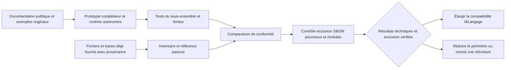
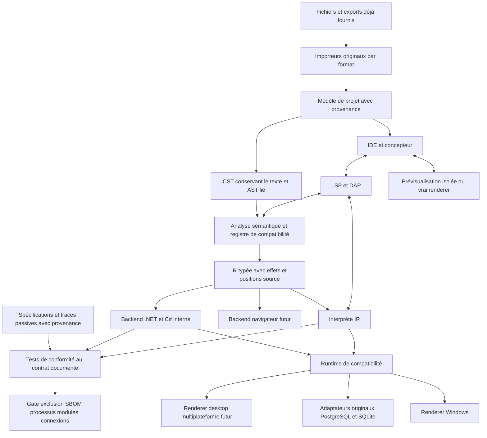
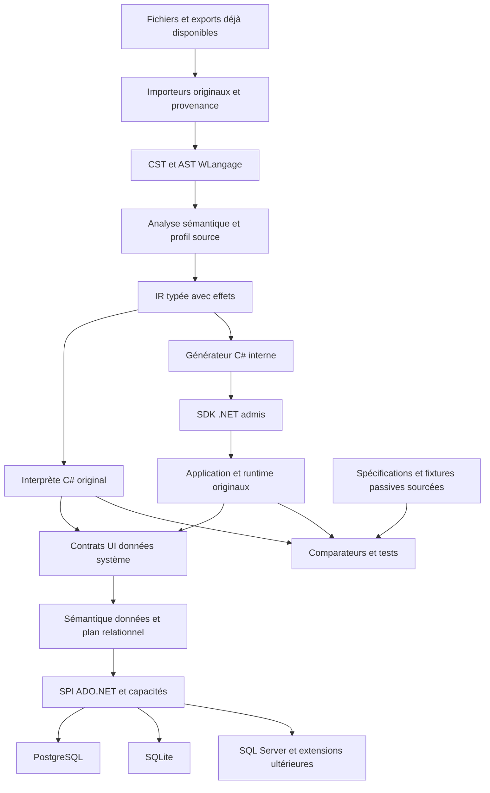

# Recherche : plateforme compatible WLangage et migration WINDEV

Date : 26 octobre 2026. Rapport assemblé à partir des chapitres de `docs/`. Modifier les chapitres puis relancer `python3 tools/assemble_report.py`.

Cette étude décrit un produit à développer. Elle ne certifie aucune compatibilité exécutée. Le périmètre, les limites et la méthode d'exhaustivité figurent dans les chapitres 00 et 06.

[Sommaire du dépôt](README.md) · [Matrice fonctionnelle](data/fonctionnalites.csv)


---

## Synthèse et décisions proposées

Date de recherche : **26 octobre 2026**. Nature du livrable : étude de conception, spécification et plan de validation. Aucun compilateur, importeur ou moteur compatible n'est présenté ici comme déjà réalisé.

### 1. Réponse à l'objectif

La question immédiate est la **faisabilité technique d'une reprise du code WLangage d'origine**, avec un compilateur et un runtime développés indépendamment. C'est l'objectif prioritaire de l'étude et du prototype proposé. Le modèle commercial ou une décision de publication ne sont pas des préalables à cette preuve de concept autonome.

**Contrainte ferme du projet : aucune utilisation de DLL, outil ou autre composant PC SOFT dans la chaîne de développement, d'import, de construction, de test, de données ou d'exécution.** Sont exclus IDE, convertisseur/exporteur, compilateur, framework, SDK, pilote, serveur HFSQL, pont et exécutable d'origine servant d'oracle, même exécutés chez un client pour notre workflow. Les sources, exports, spécifications publiques, jeux et traces **déjà disponibles** peuvent être fournis comme entrées passives avec leur provenance. Aucun export supplémentaire ne sera demandé par l'intermédiaire d'un outil PC SOFT.

Les deux dimensions deviennent des exigences simultanées : **conserver le code comme source maintenue** et **supprimer toute dépendance logicielle PC SOFT de notre chaîne**. Une implémentation indépendante doit réunir les deux sur le périmètre annoncé. L'incompatibilité d'un élément devient un blocage explicite ; elle n'autorise pas l'ajout d'un pont propriétaire.

| Trajectoire | Résultat recherché | Conséquence et condition |
| --- | --- | --- |
| A — compatibilité du code, priorité de l'étude | Continuer à écrire et déboguer les traitements d'origine en WLangage | Compilateur/runtime originaux et outils tiers non PC SOFT ; indépendance dès le prototype, import et tests compris |
| B — conversion ou réécriture explicite | Reprendre les fonctionnalités si la conservation du code échoue pour un élément | Même exclusion PC SOFT ; changement de langage maintenu annoncé, sans le compter comme code inchangé |

Dans A, le C# éventuellement généré serait un artefact interne. Dans B, le langage cible deviendrait la source maintenue : l'engagement porterait sur les fonctionnalités et les données, avec les changements tracés. Les stratégies historiques de conservation de HFSQL ou de pont vers WINDEV sont **exclues du projet**, même à titre transitoire.

Une implémentation indépendante du langage est une **hypothèse technique à éprouver sur un périmètre fini**. Le prototype emploie code original, spécifications et exemples synthétiques sans logiciels ni composants PC SOFT. L'applicabilité à ce travail autonome des clauses encadrant l'utilisation de WINDEV ou de son framework n'est pas démontrée dans le dossier. Aucun avis juridique individualisé n'a été obtenu ; aucun avis préalable n'est posé ici comme condition au codage autonome. Les questions de commercialisation ou diffusion restent distinctes de la preuve de faisabilité.

Le principal investissement ne sera probablement pas la reconnaissance des mots `SI`, `POUR` ou `PROCÉDURE`. Il sera dans les bibliothèques WLangage, le modèle d'événements, les comportements implicites des champs, la sémantique HFSQL, les états et l'import de métadonnées. C'est une conclusion d'architecture de cette étude, à confirmer par le pilote.

### 2. Les cinq compatibilités à contractualiser pour la trajectoire A

| Niveau | Promesse distincte | Preuve requise |
| --- | --- | --- |
| Sources | Les traitements WLangage restent maintenus en WLangage, avec leur texte conservé | Empreintes des originaux, correspondance traitement/événement, journal de toute modification |
| Projet | Fenêtres, champs, états, analyse, requêtes et ressources sont repris | Inventaire avant/après et statut pour chaque propriété et chaque ressource |
| Exécution | Résultats conformes au contrat public et aux observations déjà fournies du profil | Cas attendus sourcés, fixtures/traces passives avec provenance ; aucun moteur PC SOFT exécuté, aucune parité totale déduite |
| Usage développeur | Le travail quotidien conserve les repères de l'AGL | Parcours chronométrés par des développeurs WINDEV, débogage dans le WLangage |
| Usage final | La nouvelle application permet les mêmes opérations | Recette métier, clavier, données, impressions, accessibilité et performances |

Une application qui compile n'a démontré que sa compilabilité. Une capture visuellement proche ne démontre ni la gestion du focus, ni les filtres HFSQL, ni les traitements de sortie de champ.

### 3. Ce que les sources changent dans le plan

Le format texte prévu pour Git est une porte d'entrée **lorsqu'un export existe déjà et est fourni**. Le support technique PC SOFT documente cette possibilité ; cela ne constitue pas un schéma public complet. Notre chaîne ne lance pas WINDEV pour produire ou convertir cet export. Elle lit les fichiers reçus avec ses propres importeurs, conserve les portions opaques et bloque l'élément si les informations indispensables ne sont pas récupérables sans outil PC SOFT. [PC SOFT, enregistrement des projets en texte](https://blogs.pcsoft.fr/fr/obtenir-access-token-operations-pull-commit-push-projet-partage-git-heberge-chez-github/281474976710987/read.awp).

La version du produit ne suffit pas à définir le langage d'un projet. Des options de compilation influencent notamment l'évaluation des conditions et d'autres comportements. L'import doit donc produire un profil de compatibilité **version + build + options + cible + encodage**, conserver les réglages non résolus comme inconnus dans le bilan, puis bloquer la génération du périmètre concerné jusqu'à leur résolution. [PC SOFT, onglet Compilation du projet](https://doc.pcsoft.fr/?9500218=).

La base d’implémentation demandée est **C#**, avec une couche **multi-moteurs dès la conception : PostgreSQL et SQLite au premier gate réel**, puis SQL Server et extensions qualifiées séparément. Les pilotes doivent être indépendants de PC SOFT et admis pour version/usage. Le [plan détaillé](docs/16-plan-detaille-de-realisation.md) et l’[architecture C#](docs/18-architecture-csharp-multi-bdd-et-reemploi.md) précisent cette évolution. Les fonctions `H*` nécessitent une couche sémantique originale pour curseurs, filtres, verrous et erreurs : un accès SQL seul ne prouve pas leur équivalence. Les entrées sont des schémas et exports de données déjà fournis, ou des jeux synthétiques. Aucun pilote, serveur HFSQL ou accès distant indirect à ce moteur n'est prévu. Un fichier de données opaque sans lecteur indépendant éprouvé reste bloquant ; voir le [chapitre données](docs/04-donnees-integrations-et-cibles.md).

Le [contrat WINDEV publié, article 4](https://doc.pcsoft.fr/fr-FR/?4510001=&name=License_WINDEV), et la [licence du framework, article 3](https://doc.windev.com/fr-FR/?1000019581=&name=licence_framework_windev), concernent l'utilisation des produits couverts. Notre architecture exclut cette utilisation ; elle conserve la provenance des sources et informations reçues. Le dossier ne conclut ni à la nullité générale des clauses ni à l'interdiction du code autonome. Voir le [chapitre juridique](docs/09-propriete-intellectuelle-et-licences.md) pour l'analyse séparée des droits et de la diffusion future.

Les améliorations proposées doivent partir de la réalité du produit de référence. PC SOFT annonce déjà, dans sa version 2026, de l'assistance IA, du hot reload et des évolutions de sécurité et d'intégration. L'avantage à construire porte donc sur la transparence, l'interopérabilité, les preuves de compatibilité et l'ouverture des formats, plutôt que sur la seule présence de ces fonctions. [Annonce officielle 2026](https://forum.pcsoft.fr/fr-FR/pcsoft.fr.windev/278021-pcsoft-version-2026-windev-webdev-windev-mobile-est/read.awp).

### 4. Stratégie de preuve technique et architecture proposée

**Étage 1 — prototype autonome et inventaire.** Développer frontend, types du runtime et cas synthétiques à partir des informations publiques. Inventorier les fichiers/exports déjà fournis et leur provenance, sans en commander la génération par PC SOFT. Ces tests prouvent le fonctionnement du prototype et les règles documentées couvertes, pas l'équivalence générale à WINDEV.

**Étage 2 — confronter aux preuves disponibles et élargir.** Importer les fichiers reçus et comparer aux fixtures, traces et documents de référence déjà fournis ; relever leur couverture et leurs inconnues. Ne pas exécuter l'application PC SOFT d'origine, même chez un tiers pour produire de nouvelles preuves. Une information manquante reste à spécifier ou bloque l'élément ; elle n'est pas inventée. Poursuite A, réduction du périmètre ou B reposent sur les résultats, sans annoncer une parité totale faute d'oracle exécuté.



Pour éprouver A, le premier périmètre proposé est **Windows desktop**, un profil source précis, quelques familles de champs et des applications de gestion représentatives. .NET et WinForms sont les premiers candidats techniques à tester, sans utilisation du framework PC SOFT dans le prototype. Le runtime proposé serait développé indépendamment. Le premier harnais peut interpréter l'IR ; le backend compilé passe ensuite la même suite. Le [chapitre architecture](docs/05-architecture-cible.md) détaille cette hypothèse, sans prétendre sa conformité déjà démontrée.

Pour B, la pile cible se choisit après inventaire des usages, contraintes d'hébergement, licences, compétences et degré de sortie recherché. Les adaptations des API `H*`, les migrations de données et les remplacements de champs font alors partie du produit. Une réécriture ne peut être comptée comme conservation inchangée du code.

WEBDEV, Android, iOS, Linux et macOS doivent avoir des lignes de couverture propres. Un appel bloquant d'interface desktop ne se transporte pas automatiquement dans le modèle navigateur ; un ActiveX Windows ne devient pas un composant iOS. Le même noyau métier pourra être réutilisé lorsque ses dépendances le permettent. Les adaptations nécessaires seront identifiées avant génération.

### 5. Expérience de développement proposée

Les parcours ci-dessous décrivent la branche d'atelier compatible A. En B, conserver vocabulaire métier, données, navigation et repères utiles reste souhaitable, mais le nouvel outil et son langage peuvent demander une formation ; cette différence doit être annoncée.

Le point d'entrée est « Ouvrir un projet existant ». L'assistant préserve les fichiers originaux, explique les éléments reconnus et présente les blocages par écran, état et dépendance. Le développeur retrouve son arborescence, ses fenêtres, l'analyse, les événements des champs, un éditeur WLangage, l'action GO et le débogueur.

Les fichiers de projet de la nouvelle plateforme sont textuels, documentés et versionnés. Le code compilé généré n'est pas la source de vérité du développeur. Une modification dans le concepteur produit une différence lisible et un identifiant stable, sans réécrire tout le projet. Un panneau de compatibilité relie chaque écart à la source, à sa conséquence et à un test.

La familiarité ne doit pas devenir un obstacle à l'amélioration : mode de transition activé à l'import, raccourcis configurables, vocabulaire connu, puis fonctionnalités modernes accessibles progressivement. La priorité reste la capacité à travailler sans réapprentissage massif. Voir les [parcours UX](docs/03-experience-developpement-et-interface.md) et les [améliorations proposées](docs/08-ameliorations-produit.md).

### 6. Exhaustivité : une exigence mesurable

L'inventaire du dépôt est une **base large d'exigences fonctionnelles**. Ce n'est pas une certification que toutes les fonctions, surcharges, constantes, événements et variantes historiques sont identifiés. Aucun projet client ni SDK installé n'a été fourni pour fermer ce périmètre.

L'exhaustivité se mesure sur un ensemble fini et publié : versions/builds, cibles, catalogue daté, options, formats et corpus. Chaque élément reçoit un statut : conforme au contrat testé, partiel, bloquant, non pris en charge, non applicable justifié, ou inconnu. **Inconnu ne compte jamais comme conforme et n'est jamais éliminé du dénominateur.** Un pont PC SOFT ne peut pas résoudre un blocage dans le périmètre choisi. La preuve contre documentation/fixtures est distincte d'une parité générale avec un moteur d'origine non exécuté.

Deux tableaux de bord sont nécessaires : couverture de la plateforme de référence, et couverture des fonctions effectivement utilisées par un projet. Une fréquence d'usage élevée ne permet pas de retirer les fonctions rares du premier tableau. Pour un pilote, on exige la fermeture de tous les éléments utilisés dans son périmètre, même si la plateforme globale reste incomplète. La procédure détaillée figure dans l'[inventaire de couverture](docs/06-inventaire-fonctionnel-et-couverture.md).

### 7. Ordre de décision

| Décision | Proposition | Condition avant engagement plus large |
| --- | --- | --- |
| Faisabilité immédiate | Prototyper la reprise WLangage avec compilateur et runtime originaux | Cas synthétiques, limites connues et résultats reproductibles ; aucun avis juridique préalable imposé au code autonome |
| Réutilisation des sources | Maintenir le WLangage dans A ; accepter un langage cible dans B si nécessaire | Débogage et exécution inchangée dans A ; recette métier et changements tracés dans B |
| Import | Fichiers et exports déjà disponibles, lus par du code indépendant | Aucune conversion/export par outil PC SOFT ; toute portion opaque et information absente détectée |
| Cible et backend | Base C# choisie ; Windows desktop et .NET LTS/WinForms à qualifier | Mesures sur le sous-ensemble, conformité sémantique et parcours UI ; réexaminer les candidats si échec |
| Moteurs de données | PostgreSQL + SQLite d’abord, adaptateur sémantique `H*` original | Aucun serveur/pilote HFSQL ; données importables depuis des exports fournis ou synthétiques |
| Élargissement SQL | SQL Server ensuite ; chaque moteur a son adaptateur et son gate | Tests des contrats `H*`, reprise des données et retour arrière répétés |
| Plateformes suivantes | Services/web puis autres cibles selon demande | Profil de compatibilité et budget séparés pour chaque renderer |
| Exclusion PC SOFT | Appliquer la contrainte à import/build/CI/test/exécution et dépendances transitives | SBOM, processus, modules et connexions contrôlés ; échec si un composant ou service PC SOFT est requis |
| Différenciation | Formats ouverts, reproductibilité et traçabilité | Reconstruction sur poste vierge sans composant ni outil PC SOFT |
| Références de comparaison | Spécifications publiques et preuves passives déjà fournies | Provenance et couverture déclarées ; aucun oracle PC SOFT exécuté ni résultat manquant fabriqué |
| Commercialisation ou diffusion ultérieure | Définir modèle d'exploitation, composants et destinataires | Consultation ciblée sur le produit réel, contrats et droits concernés avant cette étape |
| Publication | Visibilité actuelle publique ; choix de licence de publication différé par le propriétaire | Aucun choix d'ouverture n'est un préalable à la faisabilité ; aucune modification de visibilité proposée ici |

### 8. Premières semaines de travail produit

Commencer par parseur réduit, modèle de valeurs, interprète et cas synthétiques originaux ; ajouter le backend .NET sur le même sous-ensemble. Rechercher en parallèle des dossiers déjà disponibles de projets représentatifs : gestion CRUD et états, interop non PC SOFT, concurrence. Accepter les fichiers, options, jeux et traces déjà fournis avec provenance. Construire le registre de leurs lacunes sans lancer d'IDE, serveur ou application PC SOFT. L'exclusion se contrôle dès la première CI.

On élargit A si la tranche conserve les traitements originaux, les écarts sont explicables, les preuves suffisantes pour le contrat annoncé et l'exclusion vérifiée. Sinon, corriger, resserrer le profil ou retenir B explicitement. Toute dépendance PC SOFT découverte est retirée ou bloque le module ; elle ne devient pas une exception autorisée. Le [plan de réalisation](docs/07-plan-realisation-et-risques.md) distingue ces décisions et les limites de preuve.

### 9. Inconnues à lever

- Versions/builds et options réellement utilisés, dont projets antérieurs au format texte.
- Disponibilité et couverture de fixtures/traces de référence déjà fournies ; aucune exécution PC SOFT prévue pour les compléter.
- Taux de propriétés visuelles et d'états récupérables sans inférence.
- Composants distribués seulement compilés, droits sur les sources et actifs tiers.
- Dépendances exactes HFSQL, matériels, polices, Office, COM, DLL et bibliothèques.
- Cible prioritaire, taille du parc et budgets/contraintes de performances réels.
- Objectif commercial ou interne, dépendances acceptées en transition et exigence d'indépendance à l'état final.
- Portée des clauses relatives aux outils de même nature pour les actes et contrats du projet ; aucune analyse juridique individualisée obtenue.
- Possibilité de lire indépendamment les portions binaires des fichiers reçus ; aucune conversion par outil PC SOFT admise.

Ces inconnues fixent les limites de ce qui peut être démontré aujourd'hui. Le prochain résultat attendu est une preuve de concept autonome de reprise WLangage ; la conformité au patrimoine réel et les questions d'exploitation commerciale viennent avec les actes et résultats correspondants.


---

## Options et solutions existantes

Recherche arrêtée au 26 octobre 2026. Cette comparaison sépare les déclarations des auteurs et les conclusions de conception. Aucun des produits ou dépôts mentionnés n'a subi ici une campagne d'essais sur une application client. L'absence de preuve publique de compatibilité n'est pas une preuve d'impossibilité.

**Périmètre retenu après instruction du propriétaire : aucun logiciel, DLL, pilote, serveur ou oracle PC SOFT exécuté dans notre chaîne, même par un tiers. Les solutions utilisant ces éléments sont comparées historiquement, mais exclues de la cible ; les promesses des fournisseurs ne prouvent pas leur conformité à cette contrainte.** [Règle de périmètre](docs/15-perimetre-independant-et-preuve-de-faisabilite.md).

### 1. Choisir la bonne catégorie de solution

| Approche | Le développeur maintient le même WLangage | Reprise de l'IHM | Indépendance envers l'environnement PC SOFT | Usage approprié |
| --- | --- | --- | --- | --- |
| Continuer dans PC SOFT, extraire progressivement des services | Oui pour l'existant | Conservée dans le produit d'origine | Partielle | Réduire immédiatement le risque et isoler les dépendances |
| Nouveau compilateur et runtime compatibles | Objectif central | Importeur et renderer à construire | Forte si implémentation indépendante et dépendances maîtrisées | Construire le produit demandé |
| Transpileur de migration vers C# ou autre langage | Généralement non après bascule de maintenance | Variable et souvent chantier séparé | Possible | Sortie du langage d'origine acceptée |
| Réécriture assistée par IA | Non, sauf usage d'un compilateur compatible en aval | Recréée à partir des preuves | Possible | Refondre aussi l'architecture et les usages |
| Nouvel AGL avec un autre langage | Non sans couche additionnelle | Recréée ou import partiel démontré | Dépend du nouvel éditeur | Priorité à un RAD existant plutôt qu'au même code |
| Exécuter l'ancien runtime derrière un nouveau shell | Oui mais toujours exécuté par PC SOFT | Peut rester ancienne | Faible | Pont transitoire déclaré, selon licences et interfaces |
| Émuler l'exécutable compilé | Ne réutilise pas les sources au sens demandé | Ancienne application exécutée | Ne démontre pas l'indépendance | Compatibilité d'exploitation spécifique, hors architecture centrale |

**Recommandation :** retenir une implémentation compatible indépendante pour la plateforme, en gardant un pont transitoire explicite lorsqu'une capacité ne peut pas être reprise immédiatement. Pour un client qui accepte de changer de langage, proposer une autre offre de migration, avec ses propres critères. Mélanger ces promesses rendrait la couverture impossible à interpréter.

### 2. Ce qui existe publiquement et ce que cela démontre

#### 2.1 Le format texte et les outils PC SOFT

PC SOFT documente le partage via Git et la sauvegarde textuelle des éléments. Cela fournit une voie d'acquisition préférable à une hypothèse de décompilation universelle. Le guide détaillé d'import doit cependant considérer le binaire résiduel et les éléments non convertibles. [Blog officiel PC SOFT sur les projets Git](https://blogs.pcsoft.fr/fr/obtenir-access-token-operations-pull-commit-push-projet-partage-git-heberge-chez-github/281474976710987/read.awp).

Cette voie peut servir aussi à constituer un patrimoine documentaire et des tests sans attendre le nouveau moteur. Elle ne transforme pas l'environnement PC SOFT en compilateur ouvert et ne donne pas automatiquement le droit de redistribuer ses composants.

#### 2.2 `wl2net`

Le dépôt public de son auteur présente un transpileur WLangage vers C# et annonce des conversions de structures de contrôle et d'appels courants. Le README décrit explicitement des limites sur l'interface, HFSQL et l'analyse sémantique. Il est donc une piste pour étudier des transformations ou des contre-exemples, pas une preuve de compatibilité complète. [Dépôt de l'auteur et limites](https://github.com/lukimperinetti/wl2net).

Vérification complémentaire par l'API GitHub le 26 octobre 2026 : aucune licence reconnue détectée par GitHub (`license: null`), branche `main`, dépôt non archivé. Au commit `7fd8a11402e71ce38b713b06e556669c45f33942`, aucun fichier de licence ni déclaration dans le README n'a été identifié dans les éléments examinés. Une publication lisible ne suffit pas à autoriser une exploitation et redistribution générales du code. [GitHub, licences des dépôts](https://docs.github.com/en/repositories/managing-your-repositorys-settings-and-features/customizing-your-repository/licensing-a-repository). Les pourcentages de gain annoncés dans une présentation ne sont pas repris comme mesures de cette étude. Avant réemploi : licence explicite, audit du parseur, essais des conversions numériques et contrôle des appels non reconnus. En particulier, traduire directement `ET` en court-circuit peut changer le résultat d'un projet dont l'option de compilation est différente. Le comportement doit suivre le réglage importé, car le court-circuit existe aussi dans WLangage. [PC SOFT, opérateurs logiques](https://doc.pcsoft.fr/?1512003=).

#### 2.3 WXCode

L'éditeur décrit une chaîne d'import, graphe de dépendances, extraction de règles et conversion vers une nouvelle pile. Sa procédure publique mentionne les sources, le DDL et des compléments permettant de documenter les propriétés des contrôles. Cela éclaire l'intérêt d'un inventaire structuré avant conversion. Ce n'est pas, dans les pages examinées, une démonstration d'un runtime maintenant le WLangage inchangé. [Procédure de l'éditeur](https://wxcode.ai/windev-migration-guide/kb-import).

La présence d'un outil commercial d'import ou d'une démonstration ne suffit pas à conclure à une équivalence d'exécution. Une évaluation devra demander un échantillon anonymisé, les limitations par version/cible, le contrat sur les sources, le fonctionnement hors service et les résultats des tests d'origine. Aucune affirmation de réduction des coûts ou de couverture provenant du fournisseur n'est considérée ici comme vérifiée indépendamment.

#### 2.4 Xojo et autres AGL

Xojo a organisé un webinaire spécifiquement destiné aux utilisateurs de WINDEV. Cette initiative est une preuve d'une offre d'accompagnement et d'une expérience RAD présentée à ce public ; elle ne démontre pas l'exécution du WLangage original. [Annonce officielle Xojo](https://forum.xojo.com/t/new-webinar-intro-to-xojo-for-windev-users/88740).

Delphi/RAD Studio et d'autres AGL peuvent constituer une cible de réécriture. Les mécanismes de modernisation décrits par Embarcadero concernent notamment les sources Delphi/C++Builder ; on ne doit pas extrapoler cette conservation des sources au WLangage. [Centre de migration Embarcadero](https://upgrade-center.embarcadero.com/).

Pour chaque AGL envisagé, demander la démonstration d'un import WLangage sur le corpus et distinguer la familiarité visuelle de la compatibilité source. Une interface de concepteur similaire peut aider la formation sans préserver un seul traitement métier.

#### 2.5 Dépôts de mots-clés et documentation communautaire

Des dépôts publics recensent des mots-clés ou des pages de référence. Le fichier d'autocomplétion WLangage de la collection Notepad++ indique lui-même que ses métadonnées sont générées et demandent un travail expert. Cela peut aider à repérer des noms ; cela ne fournit ni grammaire normative, ni signatures garanties, ni disponibilité par cible. [Fichier source Notepad++](https://github.com/notepad-plus-plus/userDefinedLanguages/blob/master/autoCompletion/Wlangage.xml).

Des projets appelés `WLang` ou `WLanguage Compiler` peuvent concerner un langage totalement différent. Le nom ne permet pas de les compter comme implémentations compatibles PC SOFT. Toute veille devra vérifier l'origine, les exemples et la licence avant de retenir une solution.

#### 2.6 Cartographie élargie des offres et méthodes visibles en 2026

**Vérification documentaire complémentaire au 26 octobre 2026.** Le tableau rassemble des outils, des prestations et une méthode publique. Une page publiée par un fournisseur est une source primaire pour **ce qu'il propose ou déclare**, sans constituer une validation indépendante de sa qualité. « Reprise du métier », « iso-fonctionnel », « conversion » et « sans repartir de zéro » n'impliquent pas que le développeur continuera à maintenir exactement son WLangage. Aucun achat, échange commercial ni essai de ces offres n'a été réalisé dans cette étude.

Pour les prestations, les pages examinées ne publient généralement pas de version d'outil, de grammaire ou de matrice de conformité versionnée. La date de consultation est donc le repère de cette comparaison ; les déclarations sont à confirmer sur un POC et dans le contrat. Les trois premières lignes récapitulent les pistes déjà examinées ci-dessus ; les suivantes élargissent la veille.

| Solution / auteur | Origine et repère de version | Offre ou mécanisme déclaré | Même WLangage maintenu après migration ? / preuve manquante |
|---|---|---|---|
| **wl2net** | [Dépôt de l'auteur](https://github.com/lukimperinetti/wl2net), commit examiné `7fd8a11402e71ce38b713b06e556669c45f33942` | Transpilation vers C# avec périmètre et limites annoncés ; licence à clarifier comme indiqué en §2.2 | La cible est C# ; pas de démonstration ici d'un IDE/runtime maintenant le projet WLangage intégralement inchangé. Ne pas confondre existence de transformations et conformité complète. |
| **WXCode** | [Guide propre à l'éditeur](https://wxcode.ai/windev-migration-guide/kb-import), page consultée le 26/10/2026 ; version produit non précisée dans la preuve retenue | Import et analyse du patrimoine avant transformation vers une nouvelle pile | Réemploi comme matière de migration ; continuité de maintenance WLangage non établie. POC à demander sur propriétés, événements et données. |
| **Xojo** | [Webinaire de l'éditeur pour utilisateurs WINDEV](https://forum.xojo.com/t/new-webinar-intro-to-xojo-for-windev-users/88740), annonce de l'événement | Présentation d'un autre environnement RAD et accompagnement de transition | Le webinaire n'atteste pas d'un compilateur WLangage compatible ; qualifier la réécriture, l'import et les composants nécessaires. |
| **Synelia** | [Page propre de l'offre](https://www.synelia.fr/migration-windev), consultée le 26/10/2026 ; version d'outil non publiée | Migration WINDEV/WEBDEV vers .NET, rétro-documentation puis réimplémentation assistée par IA et pilotée par développeurs ; objectif d'interface iso-fonctionnelle ; export texte à partir d'un projet ouvrable en version 25 ou ultérieure demandé | Réimplémentation dans le langage cible, explicitement décrite par le fournisseur. La fidélité annoncée et la reprise des données restent à mesurer sur le corpus client. |
| **Winfall** | [Site de l'offre](https://winfall.fr/), consulté le 26/10/2026 ; pas de version publique de l'analyseur dans la page | WINDEV/WEBDEV vers C#/.NET/Blazor ; HFSQL vers SQL Server ou PostgreSQL ; cartographie, correspondances, IA et revue humaine ; comparaison déclarée avec l'application d'origine | Maintenance en C# après bascule. Les illustrations de rapports et les gains annoncés sont des éléments de présentation du fournisseur, pas des résultats reproduits par cette étude. |
| **WinExit** | [Annonce du compte de l'entreprise](https://fr.linkedin.com/posts/winexit_windev-migration-react-activity-7518264443785416704-ogyR), complétée par [sa description de méthode](https://fr.linkedin.com/posts/winexit_architecturelogicielle-windev-refactoring-activity-7519284386350043137--4sw), consultées le 26/10/2026 ; version non précisée | Service annoncé de migration accélérée par IA, analyse de l'export, séparation du métier et de l'interface, restructuration vers une architecture web ou .NET, revue humaine et POC sur des vues critiques | Déclaration primaire de l'auteur sur réseau social. Le site `winexit.fr` indiqué par l'annonce n'a pas pu être consulté avec l'outil web ; aucun compilateur ni résultat de migration n'a été vérifié ici. |
| **Smartshift** | [Dossier propre de l'offre](https://smartshift.fr/migration-pcsoft), daté par le site du **24/07/2026** | Audit, scénarios de maintien/gel/migration de base/refonte, migration progressive, maintien de l'existant et assistance IA à la cartographie/transposition | Prestation de trajectoire et de réimplémentation, pas preuve d'un moteur compatible. Ses recommandations générales restent à confronter au besoin ; ses cas anonymisés ne constituent pas un benchmark indépendant. |
| **Dev-Booster** | [Page propre migration WINDEV](https://dev-booster.com/prestations/migration-windev), consultée le 26/10/2026 ; version des outils non précisée | Reconstruction .NET/C# ou web Symfony/React ; export automatisé HFSQL vers MySQL/MariaDB/PostgreSQL ; retour d'expérience publié sur son propre logiciel NomadBiz | Le code cible change. L'automatisation revendiquée de l'export des données ne prouve pas une conversion complète des traitements, écrans et états. Chantier propre déclaré, non audité ici. |
| **EloNeva** | [Page de prestation](https://eloneva.com/services/migration-windev-webdev/) et [méthode détaillée](https://eloneva.com/migration-windev/), consultées le 26/10/2026 ; version non précisée | C#/.NET ou React/Vue, audit, spécifications assistées par IA, lots et recette parallèle ; le site décrit aussi une transition web avec backend WINDEV conservé temporairement | La voie C# est une réécriture technique ; une interface web peut coexister avec PC SOFT. Faire préciser la trajectoire, les dépendances restantes et le langage de maintenance dans l'offre. |
| **Lexode** | [Site propre de l'offre](https://lexode.ch/), consulté le 26/10/2026 ; version produit non précisée | Portage des traitements vers un backend standard, interfaces React/Vue, mobile React Native, HFSQL vers PostgreSQL, POC puis déploiement et transfert | Réexpression du métier dans de nouveaux langages. L'exemple avant/après et les promesses de reprise intégrale ne constituent pas une preuve de compatibilité de toutes les API. |
| **Playbook migration-windev/windev-vers-dotnet** | [README à version figée](https://github.com/migration-windev/windev-vers-dotnet/blob/2f3e04c808070bb5631299a10f287d47dffd2874/README.md), commit **`2f3e04c808070bb5631299a10f287d47dffd2874` du 09/06/2026** ; [licence MIT](https://github.com/migration-windev/windev-vers-dotnet/blob/2f3e04c808070bb5631299a10f287d47dffd2874/LICENSE) | Méthode et modèles pour une migration .NET avec Cowork/Claude Code, sources texte, schéma SQL, données et captures, décisions et boucle de revue humaine | C'est un cadre documentaire réutilisable, pas un compilateur. L'inspection du dépôt ne prouve ni sa réussite sur un projet donné ni la justesse de chaque conseil technique. |

**Ce que cette veille change dans la décision.** Il existe des prestations et des outils de transformation à examiner avant de financer une plateforme complète. Une réécriture assistée peut être le meilleur choix pour une application dont l'équipe accepte un changement de langage. Elle ne satisfait cependant pas automatiquement l'objectif plus strict de ce dépôt : continuer à modifier et compiler le WLangage d'origine dans une expérience familière. Pour comparer honnêtement, faire deux évaluations séparées : coût/risque d'une migration vers une nouvelle pile et faisabilité/coût d'un runtime compatible. Les promesses de gain de coût ou de délai, l'expérience déclarée et les simulateurs tarifaires n'ont pas été utilisés ici comme mesures acquises.

#### 2.7 Le playbook et la commande `/init_projet` : niveau de preuve

Le README du playbook affirme qu'un Companion IA de WINDEV 2026 propose `/init_projet` pour produire un contexte décrivant le projet. Cette affirmation est bien présente dans la source tierce consultée ; **elle n'est pas confirmée ici par une documentation PC SOFT décrivant précisément cette commande, son build, son format de sortie et ses limites**. La recherche officielle n'en a pas apporté la preuve ; cela ne démontre pas son inexistence. La mention reste une piste à vérifier sur une installation autorisée. [README figé, étape de préparation](https://github.com/migration-windev/windev-vers-dotnet/blob/2f3e04c808070bb5631299a10f287d47dffd2874/README.md).

Si l'export existe dans la version du client, l'intégrer comme **indice documentaire supplémentaire**, conserver sa provenance et le confronter au code, aux propriétés UI, au schéma et aux scénarios. Un contexte produit par IA peut omettre une règle, résumer incorrectement un événement ou ignorer une configuration. Il n'est donc ni une spécification normative du langage, ni un inventaire exhaustif, ni un substitut aux tests différentiels. La présence d'une IA intégrée en 2026, déjà documentée ailleurs dans cette étude, ne suffit pas à confirmer cette commande particulière.

**Conclusion limitée aux preuves collectées :** aucune des sources examinées dans ce chapitre n'établit une compatibilité intégrale, reproductible et indépendante avec tous les projets PC SOFT. Cette formulation ne signifie ni qu'aucun convertisseur n'existe, ni qu'aucun acteur ne peut atteindre une bonne fidélité sur un périmètre donné. Un nouvel outil, une version ou un résultat de POC peut modifier cette conclusion ; sa preuve doit être ajoutée avec date, version, corpus et limites.

### 3. Grille d'évaluation à appliquer à un fournisseur ou un prototype

La même procédure s'applique à la plateforme proposée dans ce dépôt.

| Test | Éléments à fournir | Refus ou restriction de la promesse si… |
| --- | --- | --- |
| Sources inchangées | Original, empreintes, différences, correspondance des événements | Du code généré remplace discrètement les traitements maintenus |
| Propriétés visuelles | Fenêtre dense, masques, ancrages, plans, tabulation, styles, valeurs | Des propriétés sont ignorées sans diagnostic |
| Options de compilation | Projet avec variantes de court-circuit, portées et conversions | La version du langage est la seule information capturée |
| Données | Parcours indexés, filtres, NULL, doublons, verrous et transactions | Le fournisseur montre seulement une requête SQL simple |
| État | Pagination stable, ruptures, polices, imprimante et export | La preuve est une capture d'écran d'aperçu |
| Interop | DLL/COM/Office/matériel réellement utilisé | La cible est annoncée sans architecture et pilotes compatibles |
| Débogage | Pas à pas dans le traitement d'origine, pile et variables WLangage | Le développeur doit comprendre le code généré pour corriger un incident |
| Sortie de la plateforme | Projet et dépendances exportés, build sur poste vierge | Un service distant secret reste nécessaire sans l'avoir annoncé |
| Maintenance | Mise à jour du compilateur et retour à une version antérieure | Un changement d'outil modifie silencieusement le comportement |
| Licence | Code réutilisé, composants redistribués, coûts et droits par cible | La publication du code est confondue avec une autorisation de réemploi |

### 4. Fabriquer, assembler ou acheter

**À fabriquer comme cœur du produit :** modèle de compatibilité, import versionné, analyse sémantique WLangage, IR, runtime des conventions spécifiques, moteur d'événements, adaptateur `H*`, correspondance source/débogueur et registre de preuves. Ce sont les éléments qui déterminent directement la promesse faite à l'utilisateur.

**À assembler si leur comportement et licence conviennent :** moteur de rendu natif, éditeur de texte, protocoles LSP/DAP, gestion Git, pilote SQL, bibliothèques réseau et chiffrement, outils de packaging et de tests. Chaque dépendance reste derrière une interface remplaçable et des contrats testés.

**À acheter éventuellement :** composants complexes tels que tableur, traitement de texte, reporting ou connecteurs métier, après preuve de leurs exigences. Leur présence au catalogue ne dispense pas du travail pour préserver les propriétés, événements et sorties attendus par le code existant.

Un plugin tiers ne doit pas faire disparaître une exigence du backlog. Il change sa stratégie de réalisation en « composant externe », ajoute les versions et licences au manifeste et conserve les critères d'acceptation.

### 5. Recherche restante avant une sélection irréversible

La veille de cette étude n'est pas un recensement contractuel de tous les fournisseurs du marché. Pour lancer une réalisation : ouvrir un dossier d'évaluation par solution, relever une version ou un commit précis, obtenir une licence, importer le même corpus et publier les résultats bruts reproductibles. Un outil peut être utile sans satisfaire l'ensemble de l'objectif ; sa portée doit rester visible.

La solution recommandée est donc une architecture et une méthode de preuve, pas une affirmation qu'aucune alternative ne pourra jamais exister. L'évaluation devra être réactualisée avant tout achat ou choix technique majeur.


---

## Reprendre les sources et exécuter le WLangage

Date de recherche : 26 octobre 2026. Ce chapitre décrit une architecture à développer, pas un compilateur déjà opérationnel. Aucun projet client, fichier natif, export Git ou exécutable de référence n'a été fourni. Les compatibilités et taux de reprise doivent donc être mesurés pendant les prototypes.

**Contrainte active : aucune utilisation d'outil ou de composant PC SOFT dans la chaîne proposée.** L'import, la génération, le débogage, les tests, la migration des données et l'exploitation doivent fonctionner sans IDE, GDS, utilitaire, compilateur, DLL, SDK, pilote, runtime ni serveur HFSQL de PC SOFT. Un pont distant ou une exécution demandée au client ne contourne pas cette règle : aucun oracle WINDEV ne sera lancé dans ce workflow. Les documents publics, fichiers source, exports, profils, fixtures et traces **déjà disponibles**, avec leur provenance, restent des matériaux d'étude statiques. Les dépendances tierces et leurs dépendances transitives doivent également être contrôlées.

Le maintien du WLangage par une implémentation entièrement indépendante reste une hypothèse technique et juridique à qualifier. Les limites de lecture des formats et l'absence d'observations d'exécution réduisent la portée des affirmations possibles ; elles n'empêchent pas de développer un prototype indépendant sur les règles documentées.

### 1. Le contrat de migration à viser

Le produit doit accepter le WLangage d'origine comme langage de développement permanent. Un développeur doit retrouver ses procédures, noms de champs, traitements et points d'arrêt, même si le moteur génère ensuite du C#, du JavaScript ou du code machine. Les fichiers générés sont des artefacts reconstruisibles. Ils ne deviennent pas les sources que l'équipe doit maintenir.

Il faut contractualiser séparément cinq propriétés :

| Propriété | Signification mesurable | Preuve attendue |
|---|---|---|
| Conservation textuelle | Les blocs WLangage importés gardent leurs octets ou une transformation d'encodage explicitement déclarée | Empreintes avant/après, diff consultable |
| Acceptation syntaxique | Toutes les constructions rencontrées sont reconnues dans le profil choisi | Rapport par fichier, traitement et construction |
| Compatibilité sémantique | Calculs, mutations, conversions et erreurs satisfont les contrats établis pour le périmètre retenu | Tests indépendants sur règles documentées et comparaison avec fixtures/traces déjà disponibles ; règles non établies laissées inconnues |
| Compatibilité de plateforme | Les services UI, données, système et intégrations existent pour la cible | Matrice API × signature × cible × version |
| Compatibilité observable | Le parcours utilisateur et ses effets métier restent équivalents | Scénarios, événements, données, documents et captures comparés |

La compilation sans erreur établit seulement la deuxième propriété. Une fonction remplacée par une coquille vide ne constitue jamais une compatibilité. Un résultat partiel doit rester explicite : « importé », « analysé », « exécutable avec adaptateur », « vérifié », « bloquant ».

PC SOFT distingue lui-même l'exécution du langage et les fonctionnalités du framework dans une explication historique du fonctionnement de son moteur. Cela confirme la nécessité de traiter ces deux chantiers séparément ; cette description de 2010 ne constitue pas une spécification du runtime actuel. [Source : PC SOFT, compilation, framework et JITc](https://blogs.pcsoft.fr/fr/compilation-wlangage-framework-jitc/7/read.awp).

### 2. Les sources disponibles et leurs limites

Les brochures officielles des versions 25 et 2024 indiquent que les projets peuvent être enregistrés pour Git avec du code texte et des éléments structurés dans un format hybride présenté comme du YAML. Elles mentionnent notamment projets, fenêtres, pages, états, classes et collections de procédures. Cette possibilité est un point d'entrée crédible pour un importeur ; elle ne démontre ni que tout le contenu est transparent, ni que le schéma est ouvert et stable. [Sources : brochure WINDEV 25](https://www.pcsoft-windev-webdev.com/brochureWD25.pdf), [brochure WINDEV 2024](https://www.pcsoft-windev-webdev.com/brochureWD2024.pdf).

La documentation technique du partage Git indique une version minimale **25** et exige que le projet ne soit pas dans le **GDS/SCM** pour suivre ce parcours. Elle précise que le changement de format ne change pas les extensions : le code et les principales caractéristiques des fenêtres/champs sont textuels, tandis que des propriétés avancées restent binaires. Le format de sauvegarde peut aussi être vérifié par élément. Cette précondition concerne le partage Git documenté ; elle ne prouve pas que tout usage d'un format texte serait impossible dans le GDS. [Source : PC SOFT, Share your projects via Git, prérequis et préparation](https://doc.windev.com/en-US/?9500230=).

Ces indications expliquent la provenance possible de fichiers déjà fournis. Elles ne définissent aucune étape de conversion, d'export ou de vérification dans un outil PC SOFT pour notre solution. Si les éléments nécessaires ne sont pas déjà disponibles dans un format lisible indépendamment, l'import signale ce manque ; il ne déclenche pas l'ancien IDE et ne délègue pas cette opération au client.

Conséquence de conception : l'import doit relever, pour chaque élément, son mode de sauvegarde effectif, la part lisible et les segments binaires résiduels. Un fichier exporté en mode texte n'est pas déclaré entièrement interprété sur ce seul critère. Les originaux et segments opaques restent conservés ; leur impact est rapporté, puis la génération du périmètre affecté est bloquée tant que l'équivalence nécessaire n'est pas établie.

| Élément à récupérer | Contenu nécessaire | Traitement de migration proposé |
|---|---|---|
| Projet et configurations | Éléments inclus, cibles, options de compilation, initialisation, langues | Import du manifeste, résolution des références, profil de compatibilité |
| Procédures globales et locales | Signatures, attributs, code, commentaires, ordre de déclaration | Analyse WLangage avec contexte de déclaration |
| Classes et structures | Membres, méthodes, propriétés, héritage, constantes | Graphe de types et règles d'affectation |
| Fenêtres et fenêtres internes | Arbre de champs, noms, dimensions, styles, événements | Modèle UI indépendant du moteur de rendu |
| Pages et modèles WEBDEV | Contrôles, zones, code serveur/navigateur, AJAX, ressources | Deux contextes d'exécution distincts et liaisons contrôlées |
| États et modèles d'états | Blocs, ruptures, ancrages, calculs, événements, polices | Modèle documentaire dédié ; aucune assimilation à une simple page HTML |
| Analyse de données | Tables, rubriques, clés, contraintes, liaisons, paramètres HFSQL documentés | Lecture indépendante des fichiers/descriptions déjà fournis ; conversion vers modèle PostgreSQL ; inconnu conservé et bloquant |
| Requêtes | SQL, paramètres, métadonnées, relations avec les champs | AST SQL et description de résultat ; conserver le dialecte d'origine |
| Composants internes | Sources et métadonnées, dépendances et visibilité | Import récursif, espace de noms explicite |
| Composants externes binaires | Contrat fourni, provenance et dépendances | Sources déjà disponibles ou remplacement indépendant ; aucun binaire compilé nécessitant un composant PC SOFT n'est chargé |
| Ressources | Images, icônes, traductions, modèles, sons, styles, fichiers embarqués | Copie déterministe avec empreinte, provenance et licence |
| Interopérations natives | DLL tierces, COM, .NET, Java/Kotlin, Objective-C/Swift, scripts | Inventaire ABI et architecture ; adaptateur indépendant après exclusion de toute dépendance PC SOFT directe ou transitive |
| Tests et scénarios | Jeux de données, assertions et parcours utilisateur | Import lorsque le format le permet ; sinon reconstruction validée |
| Paramètres de génération | Manifestes, permissions, signature, installation, services | Traduction vers la chaîne de fabrication choisie |

Cette liste est un contrat d'inventaire. Elle ne prétend pas que chaque catégorie possède un export textuel intégral.

#### Sources anciennes ou natives

Commencer par une copie immuable des fichiers déjà fournis et de leurs métadonnées de provenance. Aucune installation, ouverture, conversion ou recompilation avec un outil PC SOFT n'entre dans le parcours. Les fichiers originaux restent inchangés, même lorsqu'une lecture indépendante du contenu ne peut pas encore être réalisée.

Il faut distinguer le **millésime commercial**, l'**update** et le **build observé**. Le changelog officiel 2026 donne un cas concret historique : des fenêtres ouvertes avec « 2026 Update 2 » ne peuvent plus être ouvertes avec une version 2026 antérieure. Le même millésime ne garantit donc pas une identité de format. Cette source situe l'update dans la famille `312xxx` ; elle ne fournit pas le build exact d'un patrimoine non examiné. Relever celui-ci uniquement dans les métadonnées ou preuves déjà disponibles ; sinon conserver la valeur inconnue. [Source : mise à jour WINDEV 2026, rubrique Update 2](https://doc.pcsoft.fr/fr-FR/?9000050=&name=windev_2026_update).

Le chemin retenu est un lecteur indépendant des fichiers source ou exports existants, sélectionné par leur contenu et leur provenance. Sa faisabilité est à démontrer sur des échantillons autorisés déjà disponibles. Un ancien format non compris reste un cas de diagnostic bloquant ; une reconstruction indépendante peut être spécifiée à partir de données lisibles et d'exigences vérifiées, mais elle ne devient pas du code équivalent par hypothèse. Aucun outil ou composant PC SOFT ne sert de solution de secours.

Un export de code seul ne suffit pas à reconstruire les fenêtres, l'analyse et les états. L'importeur doit refuser une migration déclarée complète si ces éléments restent absents. Il ne faut pas déduire un format de fichier uniquement de son extension : le contenu, la version et le mode de sauvegarde déterminent le parseur. La lecture de formats binaires propriétaires, si elle est envisagée, nécessite une étude technique et juridique distincte ; ce chapitre n'en suppose pas la faisabilité.

#### Parcours d'import recommandé

1. **Inventorier sans exécuter** : fichiers, tailles, empreintes, type détecté, encodage, liens et références. Contrôler les chemins sortant du projet et les archives anormalement volumineuses.
2. **Identifier le contexte** : produit, version/build, options effectives du projet et surcharges locales, cible, architecture 32/64 bits, langues, alphabet, fuseau et dépendances.
3. **Constituer un paquet d'évidence existante** : fichiers source et exports déjà fournis, descriptions de données, ressources, dépendances, profils, fixtures et traces disponibles avec leur date, auteur, contexte et intégrité. Les secrets sont des références externes, jamais des valeurs publiées. Aucun nouvel export ni relevé d'exécution dans PC SOFT n'est requis.
4. **Analyser les conteneurs** : lire chaque élément via un adaptateur de format versionné. Préserver les propriétés inconnues et les portions opaques ; ne pas les supprimer au prochain enregistrement.
5. **Extraire les blocs WLangage** : pour chacun, conserver fichier, objet, événement, position dans le conteneur, encodage et empreinte.
6. **Résoudre le graphe** : dépendances entre classes, procédures, champs, requêtes, tables, composants et ressources. Toute référence manquante reçoit un diagnostic localisé.
7. **Produire un bilan** : couverture par catégories, API utilisées, constructions dynamiques, incompatibilités de cible, interventions estimées et blocages.
8. **Créer un espace de travail séparé** : sources originales en lecture seule, représentation normalisée, paramètres de migration et artefacts générés dans des répertoires distincts.
9. **Contrôler les dépendances, compiler puis vérifier** : la génération du périmètre de production est interdite si un blocage sémantique subsiste ou si la chaîne requiert un outil/composant PC SOFT, même distant ou transitif. Les prototypes indépendants peuvent avancer sans oracle, en affichant le périmètre effectivement testé et ses inconnues.

L'interface d'import doit proposer une explication actionnable par problème : « le composant X nécessite un runtime PC SOFT interdit ; seules des sources déjà disponibles et une réimplémentation indépendante ou un remplacement peuvent lever ce blocage ». Elle conserve la décision dans un fichier versionné, avec son auteur et les éléments concernés ; elle ne propose aucun pont PC SOFT.

### 3. Un profil de compatibilité réellement reproductible

Deux projets de même version peuvent ne pas interpréter le même texte de la même façon. La documentation de l'onglet Compilation décrit des réglages portant notamment sur la portée des variables, la copie des tableaux, les types nullables, les sources de données et l'évaluation des booléens. Elle mentionne des surcharges sur certains éléments pour les options de norme de programmation ; cela ne permet pas de généraliser une surcharge à toutes les options sémantiques. Chaque possibilité de surcharge doit être vérifiée pour le réglage et le build concernés. [Source : description du projet, onglet Compilation](https://doc.pcsoft.fr/?9500218=).

Le profil doit aussi relever le **mode de passage des paramètres**. La brochure 2026 décrit un choix de mode au niveau du projet et la possibilité d'utiliser ponctuellement l'autre mode ; le mode historique par référence reste annoncé comme défaut en création de projet. Cela ne donne pas la valeur effective d'un projet importé. La disponibilité de surcharges par élément et la règle qui départage contexte appelant, élément appelé et syntaxe explicite doivent être recherchées dans les preuves existantes et la documentation, puis caractérisées dans le moteur indépendant. Elles restent inconnues si ces éléments ne suffisent pas ; aucun build PC SOFT n'est exécuté pour les lever. [Source : brochure 2026, nouveautés 133–135, page PDF 15, pages imprimées 28–29](https://fr.pcsoft-windev-webdev.com/brochure-WX2026.pdf#page=15).

Le manifeste suivant est **une proposition de format**, avec des valeurs d'exemple à résoudre à l'import ; ce n'est pas un fichier PC SOFT ni une configuration déjà testée :

```yaml
compatibility:
  product: WINDEV
  version: "a-renseigner"
  update_name: "a-renseigner"
  build: "a-renseigner"
  source_target: windows-x64
  generation_target: windows-x64
  language_vocabulary: [fr, en]
  boolean_evaluation: preserve-imported-setting
  local_scope: preserve-imported-setting
  array_assignment: preserve-imported-setting
  nullable_types: preserve-imported-setting
  datasource_naming: preserve-imported-setting
  parameter_passing:
    project_default: null
    element_overrides: []
    effective_by_context: []
    resolution_precedence: to-characterize
    provenance_status: not-observed
  string_encoding: preserve-imported-setting
  locale: fr-FR
  time_zone: Europe/Paris
  unresolved_settings_are_errors: true
```

Conserver la provenance de chaque réglage : « lu », « déduit d'un export identifié », « confirmé par le développeur » ou « encore inconnu ». Une valeur moderne par défaut ne remplace jamais silencieusement une valeur historique inconnue. Les écarts entre cible source et cible demandée deviennent des modifications de comportement à accepter dans le dossier de migration.

Pour le passage de paramètres, chaque relevé doit identifier configuration, élément, procédure, éventuel site d'appel, valeur déclarée, mode effectif, origine du réglage et preuve liée au build lorsqu'elle existe déjà. Enregistrer les surcharges présentes dans les pièces fournies, sans en inventer ni ouvrir l'IDE pour les chercher. Si leur support ou leur priorité reste inconnu, le bilan le conserve et bloque la génération concernée. L'[exemple JSON de profil](examples/profil-migration.exemple.json) propose des emplacements distincts pour réglage projet, surcharges, contextes effectifs et provenance ; ses valeurs nulles ne constituent pas des observations.

Il faut séparer le **mode compatibilité**, qui reproduit les résultats convenus, et les options de modernisation sélectionnables. L'IDE peut recommander une nouvelle pratique, mais son activation produit un diff, un plan de tests et une modification versionnée du profil.

### 4. Frontend WLangage : couverture à implémenter

Il faut une grammaire construite à partir de la documentation, des exemples autorisés et de corpus de projets. Une table de remplacement de mots-clés ou de noms de fonctions est insuffisante. Le parseur doit accepter les syntaxes historiques rencontrées, diagnostiquer les ambiguïtés et tolérer un fichier temporairement incomplet dans l'éditeur.

| Groupe | Couverture attendue du frontend |
|---|---|
| Lexique | Vocabulaires français et anglais, accents des mots-clés, identificateurs, constantes et commentaires |
| Mise en forme | Retours à la ligne significatifs, continuations, indentation, chaînes multilignes et délimiteurs |
| Expressions | Priorités, associativité, appels, accès membres/propriétés, opérateurs unaires et binaires |
| Affectations | Affectation de valeur, référence, opérations composées, incrémentations et affectations multiples si rencontrées |
| Déclarations | Typage explicite, inférence, constantes, types composés et déclarations externes |
| Contrôle | SI, SELON, boucles, POUR TOUT, sorties, retours et instructions conditionnelles |
| Procédures | Locales/globales/internes, paramètres optionnels, par référence/par valeur, résultat, surcharge et attributs |
| POO | Classes, structures, héritage, constructeurs, destructeurs, visibilité, méthodes et propriétés |
| Collections | Tableaux simples/multidimensionnels/associatifs, listes, piles, files, parcours et mutation |
| Dynamique | Variant, indirection, introspection, appels par nom et code construit à l'exécution |
| Erreurs | Gestion automatique configurée, blocs d'exception, propagation et informations d'erreur |
| Compilation | Conditions de compilation, configurations, directives et attributs dépendant de la cible |
| Données | Références à l'analyse, fichiers/rubriques, sources de données et paramètres de requêtes |
| UI | Noms de fenêtres/champs, propriétés, traitements implicites et variables de contexte |
| Concurrence | Threads, tâches, temporisations, callbacks et procédures asynchrones/réactives rencontrées |
| Langages embarqués | Blocs natifs et code SQL, XML/JSON/HTML ; parsers distincts selon le contexte |

Les équivalents français/anglais convergent vers le même identifiant sémantique interne, tout en conservant le lexème d'origine. Traduire automatiquement les identificateurs ou le texte d'un code construit dynamiquement altérerait les appels par nom. Pour la syntaxe classique et préfixée, la résolution doit partager la même définition de fonction lorsque les contrats sont effectivement équivalents ; elle doit aussi reconnaître les divergences de signatures et de disponibilité.

#### Arbre concret conservant le texte, AST et IR

Construire trois représentations complémentaires :

- Un **arbre concret conservant le texte** garde commentaires, espaces, encodage, lexèmes et zones inconnues. Sans modification, sa réémission doit rendre le même contenu.
- Un **AST sémantique** relie symboles, types, traitements, signatures, effets et profils. Les références aux éléments visuels y sont explicites.
- Une **représentation intermédiaire (IR)** décrit les opérations exécutables indépendamment du backend : conversion WLangage, référence vers une cellule, chargement de propriété UI, appel de fonction de compatibilité et branchement.

Le runtime reçoit des opérations WLangage précises, pas des comportements implicites du langage hôte. Une conversion, une égalité de chaînes ou un accès de tableau est un contrat à implémenter. Un backend peut ensuite optimiser une opération si une preuve et les tests établissent l'équivalence.

Ne pas imposer la normalisation du fichier d'origine dès son import. Une première version peut traiter les exports existants comme une source externe en lecture, avec fichiers de décisions adjacents. Une modification visuelle ultérieure peut écrire un format interne ouvert. Le réexport vers WINDEV et sa vérification par réouverture sont hors du parcours retenu, puisqu'ils introduiraient un outil PC SOFT. La sortie de la nouvelle plateforme doit être indépendante et documentée.

### 5. Les règles sémantiques qui déterminent la fidélité

Les points ci-dessous sont des **exigences de conception et de caractérisation**. Chaque résultat attendu doit découler d'une règle documentaire identifiée, d'une fixture ou d'une trace déjà disponible et contextualisée. Lorsque le contrat n'est pas établi, on conserve l'inconnu et on peut tester une hypothèse de conception séparément, sans la présenter comme le comportement PC SOFT.

#### 5.1 Nombres, conversions et valeurs absentes

Définir des types WLangage pour les entiers avec taille et signe, les réels, les monétaires et les numériques décimaux. Documenter dépassement, troncature, arrondi, division, modulo et conversion en chaîne. L'exigence est l'absence de perte supplémentaire par rapport au type, aux arrondis et au profil de référence ; préserver aussi les limites et troncatures du programme d'origine. Choisir automatiquement le `double` du backend serait une erreur d'architecture.

Tester les conversions implicites à l'affectation, à l'appel et au retour. Une expression évaluée en variant peut suivre un autre chemin qu'une variable statiquement typée. Distinguer valeur par défaut, chaîne vide, date vide, objet non affecté, variable non initialisée et NULL. Tester leur comportement dans les comparaisons, les conditions, les paramètres optionnels et les champs liés à une base.

#### 5.2 Chaînes, encodages et comparaisons

La documentation distingue plusieurs formes de chaînes et des fonctions de conversion ANSI/OEM/Unicode. Elle indique aussi qu'un type de chaîne Unicode à taille fixée peut être remplacé par une chaîne ordinaire sur certaines cibles. La compatibilité doit donc porter sur une cible précise. [Sources : manipulation des chaînes](https://doc.pcsoft.fr/?3024020=), [Chaîne Unicode sur](https://doc.pcsoft.fr/?1000024447=).

Le runtime doit conserver les informations d'encodage nécessaires, distinguer texte et buffer et caractériser taille en octets/caractères, caractères composés, caractères hors du plan de base, zéros embarqués, espaces de remplissage et fins de ligne. Les tris et comparaisons dépendent aussi des options linguistiques. Une normalisation Unicode automatique peut modifier des clés ou empreintes ; elle doit être explicite.

#### 5.3 Dates, heures et durées

Séparer date civile, heure civile, date-heure, durée et instant UTC. Caractériser formats compacts, dates vides, validation, changement de mois, années bissextiles, précision et conversions. Une fonction comme PremierJourDuMois accepte des chaînes compactes et des types Date/DateHeure : ce contrat exige des surcharges de compatibilité. [Source : PremierJourDuMois](https://doc.pcsoft.fr/fr-FR/?1000019417=&product=WB).

Les tests doivent fixer l'horloge, la langue et le fuseau. Pour les applications distribuées, conserver les comportements historiques nécessaires puis proposer une modernisation explicite des fuseaux et de la sérialisation.

#### 5.4 Booléens et ordre d'évaluation

Les opérateurs logiques possèdent des variantes optimisées, et une option peut rendre ce mode actif pour les formes usuelles depuis la version 2024. La documentation précise également une priorité identique de ET et OU dans le langage, différente du contexte SQL. Reprendre la grammaire et la configuration exactes évite d'importer involontairement les règles du backend. [Source : opérateurs logiques](https://doc.pcsoft.fr/?1512003=).

```text
// Cas conceptuel pour le moteur indépendant ; attendu lié au profil documenté.
SI ConditionA() ET ConditionB() ALORS
    Traiter()
FIN
```

Le test enregistre les appels et effets de `ConditionA` et `ConditionB`, y compris si la première condition est fausse. La valeur finale seule ne détecte pas une différence d'évaluation.

#### 5.5 Tableaux, collections et références

Les exemples officiels d'ajout et de suppression utilisent des indices commençant à 1 et décrivent des effets sur la taille et les erreurs d'indice. Ne pas propager les indices 0 du langage cible. [Sources : TableauAjouteTrié](https://doc.pcsoft.fr/fr-FR/?1000017013=), [Tableau.Supprime](https://doc.pcsoft.fr/fr-FR/?1000024314=).

Caractériser copies et références, tableaux fixes/dynamiques, dimensions, indices invalides, ordre de parcours, suppression de l'élément courant, doublons des tableaux associatifs et invalidation d'un élément passé par référence. Pour chaque collection, définir son interaction avec les threads, la sérialisation et les membres de classes.

#### 5.6 Paramètres, portée et durée de vie

La page technique décrit le comportement historique par référence et les moyens de demander un passage par valeur, dont LOCAL dans la déclaration et les doubles parenthèses à l'appel. Cette présentation ne doit pas devenir un défaut universel du nouvel outil. La brochure 2026 documente également un mode par valeur choisi dans le projet, avec les mots-clés « par valeur » et « par référence » pour une sélection ponctuelle. Les pages HTML consultées n'explicitent pas toute la résolution de ce mode 2026 : sa combinaison avec les syntaxes historiques et les réglages d'élément reste à établir à partir de documents et preuves déjà disponibles. L'absence de preuve sur un build ne sera pas comblée par son exécution. [Sources : passage de paramètres](https://doc.pcsoft.fr/fr-FR/?1514077=), [brochure 2026, nouveautés 133–135](https://fr.pcsoft-windev-webdev.com/brochure-WX2026.pdf#page=15).

Caractériser séparément variables affectables, éléments de tableaux, propriétés, constantes, expressions et références d'objets : création éventuelle d'un temporaire, conversions, copie de l'objet ou de sa référence, réaffectation et propagation des mutations. Ne pas confondre le mode général de passage des paramètres avec l'option distincte relative aux instances de classe passées par référence. Les choix de l'implémentation hôte ne remplacent aucun de ces contrats.

Le harnais indépendant conserve le même fragment WLangage et change un seul réglage à la fois. Il vérifie les règles établies et peut comparer les sorties aux traces préexistantes lorsque leur contexte correspond exactement. Les écarts entre variantes de notre moteur servent aussi à isoler une règle ; ils ne prouvent pas à eux seuls une équivalence avec PC SOFT. Aucun résultat des cas ci-dessous n'a été mesuré dans cette étude :

| Cas à exécuter uniquement dans le moteur indépendant | Contrat documentaire ou preuve préexistante à rattacher ; inconnues à conserver |
|---|---|
| Même procédure et même variable, mode projet référence puis valeur lorsque disponible | Valeur avant/après appel, mutation à l'intérieur et mode effectif relevé |
| Appel dans le même élément puis entre deux éléments, dont une surcharge attestée par une pièce existante | Disponibilité de la surcharge, origine du réglage retenu, contexte appelant/appelé et règle de priorité |
| Paramètre sans indication, LOCAL, doubles parenthèses, puis syntaxes explicites 2026 suffisamment documentées | Acceptation syntaxique et mutations du moteur indépendant ; priorité laissée inconnue si aucune preuve ne l'établit |
| Scalaire, tableau, objet et référence d'objet ; paramètres typés et non typés | Copie de valeur, partage d'objet, changement de référence et éventuels effets différents selon type |
| Procédure interne, callback et événement après retour de l'appelant | Règle appliquée au contexte indirect, captures et durée de vie |
| Réglage ou contexte de résolution non relevé | Diagnostic localisé ; aucune génération prétendue équivalente tant que le mode effectif reste inconnu |

Le moteur doit représenter une référence par une cellule ou un accès lecture/écriture, avec durée de vie contrôlée. Distinguer variables de projet, de collection, de fenêtre/page/état, locales, de classe et contexte de champ. Les captures de procédures internes et le moment de destruction des objets demandent des tests séparés. La documentation confirme que la visibilité dépend du lieu de déclaration. [Source : portée des variables](https://doc.pcsoft.fr/fr-FR/?1514088=).

#### 5.7 Classes, objets, propriétés et champs

Établir les règles d'héritage, résolution de surcharge, construction/destruction, affectation, identité, conversion, méthode virtuelle et visibilité. Les objets exposés par un composant externe peuvent demander un adaptateur plutôt qu'une instanciation directe.

Un champ n'est pas une variable ordinaire. La documentation distingue l'opérateur de référence `<-` et l'affectation `=`, cette dernière transférant une valeur. Le runtime doit préserver cette différence et les effets sur les événements. [Source : type Champ](https://doc.pcsoft.fr/fr-FR/?1000020967=).

Une propriété doit avoir un contrat : type, cibles, lecture/écriture, valeur par défaut, effet immédiat/différé, invalidation du rendu et événements induits. Une table générique de propriétés sans ces règles ne suffit pas à reproduire l'application.

#### 5.8 Événements et contexte implicite

Le compilateur associe un bloc de code à un type de traitement et un contexte : projet, fenêtre, champ, page ou état. Le runtime doit établir les variables de contexte, l'ordre d'initialisation, les événements imbriqués, les retours annulant une action et la durée de vie des fenêtres.

Créer un ordonnanceur d'événements journalisable. Une affectation programmée peut avoir un effet différent d'une saisie utilisateur ; un callback réseau peut revenir après la fermeture d'une fenêtre. Les scénarios doivent tester ces cas. Pour WEBDEV, séparer serveur et navigateur : aucun accès direct au disque serveur ni secret ne doit être déplacé dans le navigateur par simple traduction.

#### 5.9 Sémantique des accès aux données sans moteur PC SOFT

Les symboles provenant de l'analyse constituent une partie du contexte de compilation. Une expression `Client.Nom` peut désigner une rubrique, avec un buffer courant et un état de lecture associés. Les fonctions H* modifient potentiellement curseur, filtre, erreur et transaction ; les convertir en requêtes SQL isolées détruirait ces relations.

Le compilateur doit typer les fichiers, rubriques, clés, requêtes et sources de données. Le runtime délègue à un **adaptateur PostgreSQL entièrement indépendant**, qui devra implémenter les contrats retenus des fonctions H* ; aucun pilote, provider, runtime ni serveur HFSQL de PC SOFT n'est utilisé. Les descriptions et données sont lues dans les exports déjà disponibles ou via un lecteur indépendant dont le support du format est démontré. Un format natif opaque conserve son blocage ; le nom d'une API ne suffit pas à rendre sa sémantique portable. Les limitations documentées des requêtes contenant du WLangage font partie des règles à étudier, sans réutiliser leur implémentation PC SOFT. [Source documentaire : Source.ExécuteRequêteSQL](https://doc.pcsoft.fr/fr-fr/?1000024948=).

#### 5.10 Erreurs et exceptions

La documentation présente des mécanismes d'exception automatiques, généraux et spécifiques. Le comportement peut donc provenir du code et des paramètres de l'élément. [Source : gestion des erreurs de programmation](https://doc.pcsoft.fr/?3034004=).

Maintenir l'état d'erreur compatible au niveau correct : procédure, thread, connexion ou opération suivant le contrat. Préserver codes, message utile, emplacement source, reprise et effets transactionnels. Une exception du langage hôte doit être traduite à la frontière ; elle ne doit pas traverser arbitrairement le code WLangage. La nouvelle plateforme peut ajouter un identifiant de diagnostic stable, sans changer les valeurs sur lesquelles le programme existant branche.

#### 5.11 Indirection, introspection et compilation dynamique

Les appels par nom et la construction de code à l'exécution imposent de conserver une table de symboles runtime et des métadonnées. L'analyse statique ne peut pas prouver qu'aucun autre nom sera construit. Elle doit signaler les zones dynamiques et enrichir l'inventaire avec des traces de scénarios, en précisant que ces traces ne prouvent pas une couverture complète.

La documentation du champ Éditeur de code PC SOFT décrit des paramètres de fonctions autorisées/interdites. C'est une référence documentaire de comportement, pas un composant à intégrer. Notre frontend, compilateur dynamique et runtime sont développés indépendamment, sans appeler les implémentations PC SOFT de Compile ou d'ExécuteCode ni aucune bibliothèque PC SOFT ; ils partagent un budget de temps/mémoire et des capacités configurables. Une API de mêmes noms devra être une implémentation indépendante dont le contrat et les limites sont documentés. [Source documentaire : manipulation du champ Éditeur de code](https://doc.pcsoft.fr/?1410087305=).

Ne pas annoncer la compilation dynamique sur une cible qui l'interdit ou ne la permet pas avec les mêmes propriétés. Sur les cibles AOT, prévoir une liste de modules précompilés lorsque le besoin s'y prête ou déclarer le blocage. Un interpréteur embarqué est une option technique à étudier avec les contraintes du système et de distribution.

#### 5.12 Threads, tâches et interopération

Spécifier les partages de variables, contextes de données, sections critiques, annulation, temporisations et retour sur le thread UI. Pour les opérations asynchrones, conserver ordre observable, propagation d'erreur et durée de vie des captures. Les threads ou processus du backend sont des moyens d'implémentation : ils ne définissent pas automatiquement le contrat WLangage.

L'interopération exige des contrats séparés pour tailles numériques, encodage, propriété de mémoire, callbacks, exceptions et architecture. Les docs d'intégration Java et .NET montrent des conversions et limites propres à ces passerelles ; elles ne permettent pas de promettre qu'un code natif sera portable sans adaptation. [Sources : saisir du code Java](https://doc.pcsoft.fr/fr-FR/?9000011=), [utiliser des assemblages .NET](https://doc.pcsoft.fr/fr-FR/?2012002=).

Toute interopération retenue doit exclure les passerelles et bibliothèques PC SOFT, y compris celles cachées dans un assemblage, un package, un service ou un composant tiers. Une API indépendante peut être construite à partir d'un contrat établi ; un contrat inconnu ou une dépendance interdite est un blocage, jamais une permission d'utiliser l'ancien runtime à distance.

### 6. Exécution, diagnostics et expérience de débogage

La recommandation est un frontend commun et une couche de compatibilité explicitement versionnée. Un interpréteur d'AST ou une petite VM facilite d'abord les tests de sémantique et le débogage. Un backend compilé peut être développé ensuite pour les cibles et chemins validés. Le backend retenu par l'architecture générale devra passer exactement la même suite de conformité.

Chaque instruction générée garde un identifiant stable relié au fichier source, objet et traitement. La table de correspondance doit couvrir une génération un-vers-plusieurs et une macro/directive, avec positions en octets et conversion vers les unités du protocole d'éditeur. L'utilisateur pose un point d'arrêt dans « Clic de BTN_Valider », inspecte les variables WLangage et voit une pile WLangage, même si le moteur exécute du code généré.

Utiliser un serveur de langage commun via LSP et un adaptateur de débogage via DAP permet de mutualiser navigation, complétion, diagnostics et débogage entre l'IDE principal et d'autres éditeurs. Ces protocoles standardisent les échanges ; ils ne fournissent ni analyseur WLangage ni runtime. [Sources : Language Server Protocol](https://microsoft.github.io/language-server-protocol/), [Debug Adapter Protocol](https://microsoft.github.io/debug-adapter-protocol/).

Diagnostics proposés :

| Code de conception | Situation | Résolution attendue |
|---|---|---|
| IMP001 | Format/segment inconnu | Préserver et rapporter ; chercher une pièce déjà disponible ou spécifier une lecture indépendante ; bloquer le périmètre affecté |
| IMP002 | Ressource ou composant absent | Afficher les références et chemins recherchés |
| SEM001 | Réglage sémantique indéterminé | Résoudre via sources/exports/profils déjà disponibles et preuves documentaires ; sinon conserver l'inconnu |
| API001 | Signature absente sur la cible | Proposer adaptateur, cible compatible ou remplacement |
| DYN001 | Nom construit dynamiquement | Afficher l'incertitude et les scénarios d'instrumentation |
| UI001 | Propriété visuelle sans équivalent | Afficher une différence localisée, jamais la supprimer |
| DB001 | Sémantique de curseur non assurée | Exiger un fournisseur ou un scénario de validation |
| GEN001 | Backend incapable d'une opération | Bloquer l'artefact concerné et proposer une autre stratégie |
| DEP001 | Outil/composant PC SOFT direct, transitif ou distant | Refuser la chaîne et l'artefact ; remplacement indépendant obligatoire avant génération de production |

### 7. Protocole de conformité et critères de sortie

Construire un harnais qui n'exécute que le nouveau moteur et ses dépendances indépendantes. Les programmes de test sont écrits pour l'étude. Leurs résultats attendus proviennent soit de règles publiques identifiées, soit de fixtures ou traces déjà disponibles avec provenance, version/build lorsqu'ils sont connus, profil, contexte et empreinte. Une trace sans contexte suffisant reste indicative ; elle ne tranche pas un comportement ambigu. Les cas non déterministes utilisent une horloge et des données fixées, ou des assertions d'ordre/intervalle dont la justification est enregistrée.

Distinguer dans le registre **règle documentée testée**, **trace préexistante comparée**, **contrat de conception propre testé** et **inconnu**. Il est interdit de fabriquer un attendu puis de présenter le test comme preuve du comportement PC SOFT. Sans oracle exécutable, on peut prototyper, tester la cohérence interne et démontrer les règles documentées du périmètre ; on ne peut pas revendiquer une conformité globale ni avoir observé les comportements manquants. Aucun oracle PC SOFT n'est requis ou exécuté, même chez le client.

| Famille de tests | Cas minimaux nécessaires |
|---|---|
| Lexique | FR/EN, accents, commentaires, littéraux, fichier tronqué, erreurs localisées |
| Opérateurs | Priorité, associativité, courts-circuits, effets secondaires, null |
| Nombres | Limites, débordements, arrondis, divisions, conversions chaîne/nombre |
| Chaînes | ANSI/Unicode, taille, découpe, accents, zéros, caractères composés |
| Dates | Vide, invalide, bissextile, fins de mois, durée, changement d'heure |
| Paramètres | Modes projet, surcharges observées, contexte appelant/appelé, référence/LOCAL, doubles parenthèses, syntaxes 2026 acceptées, expression, constante, tableau, alias partagé |
| Collections | Indices, dimensions, doublons, copies, mutation pendant parcours |
| POO | Constructeurs, héritage, propriétés, identité, affectation, destruction |
| Portées | Projet/fenêtre/champ, masquage, capture, réentrée, fermeture |
| Dynamique | Nom construit, symbole absent, introspection, code valide/invalide |
| Erreurs | Retour faux, exception, gestion automatique, reprise, état d'erreur |
| Concurrence | Donnée partagée, thread UI, annulation, callback après destruction |
| Données | Buffer courant, filtre, recherche, transaction, clés, null, verrou |
| Événements | Initialisation, focus, saisie, validation, fermeture, événements imbriqués |
| Interopération | Conversion, encodage, callback, architecture, mémoire, exception |
| Génération | Profil/cible/version, build reproductible, artefacts et symboles |

Ajouter des tests génératifs pour les expressions et des tests de mutation pour vérifier que la suite détecte un changement de priorité, d'indice ou de règle de copie. Les programmes générés doivent rester dans un sous-ensemble dont les règles et attendus sont justifiés. Ces tests vérifient notre implémentation et la sensibilité de notre suite ; ils ne découvrent pas par eux-mêmes un comportement PC SOFT absent des preuves.

Mesurer séparément : blocs de code importés, constructions syntaxiques rencontrées, signatures appelées, propriétés utilisées, scénarios passés et profils vérifiés. Ne pas publier un pourcentage global mêlant ces unités. Publier les dénominateurs : « 173 signatures vérifiées sur les 221 rencontrées dans trois applications », plutôt que « compatible à 78 % avec WINDEV ».

Trois portes de sortie sont recommandées :

1. **Import fidèle** : aucun élément perdu, inconnus conservés et signalés, provenance et empreintes disponibles, projet source inchangé.
2. **Noyau exécutable indépendant** : frontend, types, références, erreurs, événements et API du pilote passent les tests dont les attendus sont justifiés ; règles propres, preuves de compatibilité et inconnues restent distinctes. Le prototype ne dépend d'aucun oracle.
3. **Application migrée** : parcours métier, données PostgreSQL, documents, périphériques et performances du périmètre accepté passent leur recette sur chaque cible ; un contrôle des dépendances et commandes exclut tout maillon PC SOFT de l'import à l'exploitation. Une nouvelle version du runtime indépendant rejoue ces preuves.

### 8. Sources et réserves de recherche

Les liens de ce chapitre sont des sources primaires PC SOFT ou Microsoft. Plusieurs ouvertures directes du domaine de documentation ont renvoyé HTTP 403 pendant la recherche ; les passages utilisés ont alors été consultés via leur indexation web. Une URL disponible et un extrait indexé ne prouvent pas que la page décrit le build exact d'un futur projet client. Le pilote devra figer les documents publics pertinents ou les copies de documentation déjà fournies, sans lancer d'outil PC SOFT pour les consulter.

Lors de la révision sur les formats Git et le passage de paramètres, les pages `9500230`, `9000050` et `1514077`, ainsi que la brochure 2026, ont pu être lues intégralement par HTTP direct malgré les erreurs de l'outil de navigation. Les variantes française historique/générique et anglaise de `1514077`, dont la variante `verdisp=310`, n'exposaient pas le réglage de projet 2026 ni sa surcharge par élément dans leur texte lu. Le choix du mode projet est attesté par la brochure ; la disponibilité de surcharges par élément, leur priorité et le build exact du projet demeurent non vérifiés. Les commentaires d'utilisateurs présents sous une page d'aide ne sont pas traités comme spécification normative.

Les sources documentaires établissent l'existence des comportements cités. Les structures de manifeste, algorithmes d'import, AST/IR, diagnostics, profils, stratégies runtime et critères de conformité sont des recommandations originales de cette étude. Aucune affirmation de compatibilité avec des fichiers binaires, de réexport natif intégral ou de couverture de tout le WLangage ne peut être déduite de ce document seul.


---

## Expérience de développement et fidélité des interfaces

Recherche arrêtée au 26 octobre 2026. Ce document décrit l'expérience **à construire**, les éléments officiels vérifiés servant de référence et les conditions pour déclarer une reprise satisfaisante. Les tableaux de périmètre constituent des exigences du futur produit ; ils ne signifient pas que toutes les fonctions existent déjà dans un prototype.

**Contrainte de réalisation : tous les éditeurs, renderers, automatismes et outils de cet atelier sont indépendants. Aucune DLL, IDE, serveur ou outil PC SOFT n’est utilisé ; les noms et parcours du produit d’origine sont des références de conception. Les comparaisons partent de documents et traces déjà fournis, sans exécuter WINDEV.** Voir le [périmètre retenu](docs/15-perimetre-independant-et-preuve-de-faisabilite.md).

### 1. Principe directeur : préserver les gestes, expliciter les écarts

Une solution compatible doit permettre au développeur de retrouver son projet, son analyse de données, ses fenêtres, ses champs et leurs événements. Lui demander de comprendre d'abord une arborescence React, un ORM et trois outils de compilation déplacerait le coût de migration vers la formation. Le futur atelier doit donc présenter ces concepts familiers directement, tout en utilisant un stockage ouvert et une architecture moderne en dessous.

Il faut distinguer trois engagements :

- **Continuité du travail** : mêmes noms d'objets, recherche, passage conception/code, procédures, test d'une fenêtre et test du projet.
- **Continuité fonctionnelle** : mêmes calculs, données, contrôles, impressions, droits et séquences d'événements observables.
- **Continuité visuelle** : géométrie, police, densité, couleurs, menus et interactions suffisamment proches pour les tâches métier retenues.

Ces engagements se mesurent séparément. Une capture identique ne valide pas un ordre d'événements, et un calcul juste ne valide pas une saisie clavier. L'importeur doit préserver les originaux et produire un rapport des informations reconnues, opaques, perdues ou converties. Toute modernisation susceptible de changer le comportement doit faire l'objet d'une modification visible dans le dépôt du client.

**Référence vérifiée.** PC SOFT organise déjà son environnement autour d'éditeurs de code, fenêtres/pages, états et données. La description du projet regroupe notamment langues, styles/ambiance, GDS/Git, compilation et télémétrie. Le projet doit donc être repris comme un ensemble de métadonnées, pas seulement comme du texte WLangage. [Documentation générale](https://help.windev.com/fr-FR/), [Description du projet : compilation et autres onglets](https://doc.pcsoft.fr/?9500218=).

### 2. Deux espaces de travail, un seul projet

**Proposition.** Fournir au premier lancement un profil « Repères WINDEV » puis un profil « Atelier moderne ». Les deux manipulent le même modèle de projet. Le choix ne doit modifier ni le code ni la sémantique. Le premier place l'explorateur à gauche, les éditeurs au centre, le modifieur de propriétés à droite et les erreurs/traces en bas. Il emploie les mots fenêtre, champ, analyse, rubrique, requête, état, procédure, composant et configuration. Le second peut privilégier une palette de commandes, une vue fichiers et une disposition adaptée aux autres IDE.

Le ruban du profil de transition regroupe Projet, Création, Description, Alignement, Code, Tests et Génération. Les panneaux peuvent se détacher, se réancrer et être restaurés par un profil versionné localement. La densité d'affichage, les tailles de police, le contraste, le thème et la langue de l'IDE restent indépendants du thème de l'application. Le produit doit être utilisable entièrement au clavier ; chaque commande du ruban doit avoir un nom accessible et être disponible dans la palette.

L'écran d'accueil présente les projets récents, l'ouverture d'un projet importé, la création d'un projet et les opérations en cours. Un projet importé arrive directement sur ses objets et sur la liste des écarts ; le développeur n'est pas forcé de lire un assistant complet pour accéder à son code. Le résultat technique d'import reste accessible à tout moment depuis un onglet « Compatibilité ».

#### Correspondances à conserver

| Repère connu | Comportement attendu dans le futur atelier | Vérification utile |
|---|---|---|
| Explorateur de projet | Fenêtres, pages, états, analyse, requêtes, classes, procédures, ressources, tests, configurations | Retrouver un objet par son nom d'origine en quelques secondes |
| Description du projet | Métadonnées lisibles et formulaire organisé par thèmes familiers | Aller d'une option au fichier qui la porte |
| Description d'un champ | Dialogue par catégories et panneau de propriétés synchronisés | Modifier le libellé sans modifier une autre langue |
| Conception → code | Ouvrir directement l'événement de la sélection | Le curseur arrive sur le bon traitement |
| Test d'un élément | Exécuter l'objet avec son contexte et ses paramètres | Les dépendances sont préparées ou signalées |
| Test du projet | Démarrer la configuration choisie et sa première fenêtre | Même ordre de démarrage que le profil de référence |
| Modèles et styles | Héritage, variantes locales et propagation explicites | Une surcharge locale survit à la mise à jour du modèle |
| Analyse | Schéma visuel, rubriques, clés, liaisons et contraintes | Les noms métier restent stables dans le code |
| États et requêtes | Éditeurs intégrés reliés aux mêmes objets de données | Une modification de schéma localise ses impacts |
| GDS/Git | Historique, comparaison, branches et conflits depuis l'atelier | Une fusion ne perd pas un événement de champ |

**Références vérifiées.** La première fenêtre peut être définie depuis l'explorateur, la configuration ou le test ; les outils d'alignement regroupent position, taille et répartition. Ces parcours justifient des correspondances directes. [Première fenêtre du projet](https://doc.pcsoft.fr/?9000177=), [Options d'alignement](https://doc.pcsoft.fr/?2022004=).

#### Raccourcis et contexte

Les raccourcis suivants sont publiés par PC SOFT ; l'atelier peut proposer un profil de correspondance configurable. Il faut conserver leur **contexte**, car une même touche peut servir à des actions différentes selon l'éditeur. [Référence officielle WINDEV/WINDEV Mobile](https://www.pcsoft-windev-webdev.com/Raccourcis_WD_WM.pdf), [Référence officielle WEBDEV](https://www.pcsoft-windev-webdev.com/Raccourcis_WB.pdf).

| Geste | Action de transition proposée |
|---|---|
| F9 | Tester l'élément actif |
| Ctrl + F9 | Tester le projet |
| Alt + F9 | Tracer le projet |
| Ctrl + Maj + F9 | Paramétrer le mode test |
| Maj + F5 | Arrêter le test |
| F2 | Accéder au code de la sélection |
| Maj + F2 | Code de la fenêtre ou références, selon contexte |
| Ctrl + F2 | Revenir au traitement précédent |
| Alt + F2 | Revenir à l'objet visuel associé |
| Ctrl + B | Ajouter/enlever un point d'arrêt dans le code |
| F4 / Maj + F4 | Nouvelle procédure locale/globale dans le code |
| Ctrl + R | Réindenter le code dans l'éditeur de code |
| Ctrl + D | Dupliquer la sélection selon l'éditeur |
| F12 | Erreur suivante dans le code |

Le moteur de commandes doit résoudre les conflits, gérer claviers AZERTY/QWERTY et permettre un export du profil. Les raccourcis spécifiques macOS/Linux sont une décision à valider si ces hôtes IDE sont retenus ; ne pas remplacer silencieusement les touches familières.

### 3. Périmètre fonctionnel de l'atelier

Les éléments ci-dessous forment un cahier des charges de parité à décliner en tickets et tests. La disponibilité historique dépend de WINDEV, WEBDEV, WINDEV Mobile, de l'édition et de la cible. Le [catalogue officiel historique des fonctionnalités](https://fr.pcsoft-windev-webdev.com/liste-exhaustive-des-fonctionnalites-de-windev.pdf) fournit un point de départ, mais son intitulé correspond à la version 26 : il ne suffit pas pour certifier un périmètre 2026.

#### Projet, code, équipe et productivité

| Famille | Fonctions à prévoir et à qualifier |
|---|---|
| Cycle de vie du projet | Création, ouverture, copie, import, sauvegarde, archivage, réparation, version d'origine, mises à niveau réversibles, dépendances, dossiers virtuels et physiques |
| Configurations | Exécutables, bibliothèques, services, webservices, sites, applications mobiles, architectures CPU, variantes client, ressources et code conditionnels, profils de compilation |
| Navigation | Recherche de symbole, références croisées, usages, appels entrants/sortants, historique de navigation, favoris, marques, tâches, navigation entre objet/propriété/événement |
| Édition | Français/anglais du langage, commentaires, indentation, complétion, signatures, aide contextuelle, snippets, glossaire, blocs, multicurseur, pliage, différences, Unicode, encodages historiques |
| Refactorisation | Renommage sémantique projet/champ/rubrique, extraction de procédure, déplacement, conversion explicite de syntaxe, prévisualisation de tous les changements |
| Qualité | Erreurs syntaxiques et sémantiques, avertissements de cible, erreurs UI, audit statique, dépendances obsolètes, analyse des secrets, règles de projet, suppressions motivées |
| Documentation | Dossier technique, diagrammes, documentation des procédures, aide intégrée, guides utilisateur, liens des exigences vers tests et éléments |
| Travail en équipe | Git, historique par ligne, comparaison texte et visuelle, revue, branches, fusion structurelle, verrouillage optionnel des ressources non fusionnables, résolution des partages |
| Réutilisation | Classes, collections de procédures, composants internes, composants externes avec sources, contrats de composants sans sources, modèles de fenêtres/pages/champs/états |
| Ressources | Images/icônes, polices, SVG, traductions, modèles de document, médias, licences des ressources, références stables et résolution de chemins |
| Industrialisation | Compilation CLI, génération reproductible, dépendances verrouillées, cache, CI, rapports machine, signatures, installateurs, publication, mises à jour et retour arrière |
| Pilotage | Tâches, exigences, incidents et liens Git ; intégration aux outils déjà utilisés ; métriques explicites sans surveillance individuelle imposée |

Chaque fonction de refactorisation doit respecter les références indirectes. Quand un nom d'objet est construit par concaténation ou par données externes, le moteur indique l'incertitude et demande une revue du changement proposé. Une recherche textuelle ne doit pas être présentée comme un renommage sûr.

#### Éditeurs visuels et données

L'éditeur de fenêtres doit gérer sélection multiple, groupe, alignement, grille, guides, aimantation, règles, zoom, ordre de superposition, verrouillage, duplication et annulation/restauration. Les propriétés comprennent géométrie, ancrages, plans, visibilité, activation, focus, navigation, contenu, masque, liaison de données, styles, langues, bulles et événements. Les modèles doivent conserver l'identité des objets, les liens d'héritage et les surcharges ; un simple copier/coller du rendu ne suffit pas.

L'analyse et les requêtes nécessitent schéma visuel, tables/fichiers, rubriques, clés simples/composées, liaisons, contraintes, types, nullabilité, valeurs initiales, paramètres et génération SQL. Le développeur doit pouvoir suivre une liaison d'un champ jusqu'à la rubrique et revenir. Les données de démonstration sont isolées des connexions de production ; l'aperçu est désactivable et les valeurs sensibles masquées. Les changements de schéma présentent les effets sur requêtes, fenêtres, états et migrations de données.

Le concepteur d'états doit prévoir blocs, ruptures, regroupements, tris, calculs, sous-états, états imbriqués, étiquettes, codes-barres, images, graphes, marges, recto-verso, orientation, papier, pagination, polices, textes extensibles, aperçu, PDF et impressions physiques. Le moteur doit comparer aussi les numéros de page, les sauts, les totaux et les zones répétées. Un rendu HTML approximatif ne remplace pas une compatibilité d'impression certifiée.

#### Débogage, tests et exploitation

Prévoir points d'arrêt simples/conditionnels, compteurs de passages, activation/désactivation, arrêt sur exception, exécution pas à pas, entrée/sortie, pause, pile des appels, inspection et modification de variables, expressions surveillées, objets, collections, données images/HTML, threads, tâches asynchrones et contexte de données. Le débogueur travaille sur les lignes WLangage d'origine grâce aux correspondances de sources ; une pile exclusivement dans le langage généré ferait perdre le bénéfice de migration.

La référence PC SOFT propose déjà test du projet, attachement à un exécutable et lancement du débogueur pendant l'exécution. Il faut reprendre ces parcours et décider explicitement, cible par cible, ce qui reste disponible. [Tester et déboguer un projet](https://doc.pcsoft.fr/fr-fr/?2019017=).

La future suite doit couvrir tests unitaires de procédures/classes, tests de fenêtres, scénarios enregistrés, assertions métier, données de test, exécution CLI, rapports et reprise des scénarios existants quand leur format est compris. PC SOFT dispose déjà d'un outil de tests sur exécutable et de scénarios enregistrables ; un nouveau produit doit proposer une continuité ou déclarer les scénarios à réenregistrer. [Tests automatiques sur exécutable](https://doc.windev.com/en-US/?2019029=).

Pour l'exploitation : traces structurées, journal d'erreurs, dump de débogage, profilage CPU/mémoire, requêtes lentes, métriques, télémétrie optionnelle, anonymisation, diagnostic à distance et export du contexte autorisé. Les audits et le profiler sont des fonctions historiques ; leur seule présence ne différencie pas un concurrent. [Livre officiel historique des fonctionnalités, chapitres performances et audits](https://fr.pcsoft-windev-webdev.com/Fonctionnalites_WinDev.pdf).

### 4. Périmètre des interfaces produites

#### Familles de champs

Ce tableau indique les familles à inventorier pour chaque cible. Pour chacune, le contrat inclut **propriétés + événements + méthodes/fonctions + liaisons + FAA + rendu + clavier/accessibilité**. Une case « champ pris en charge » sans ces dimensions est insuffisante.

| Groupe | Familles à prévoir dans la matrice de compatibilité |
|---|---|
| Texte et saisie | Libellé, saisie simple/multiligne, mot de passe, numérique/monétaire, date/heure/durée, masque, texte riche, jetons, validation et saisie assistée |
| Actions et choix | Bouton, interrupteur, sélecteur, combo, liste, liste image, lien, menu, menu contextuel, ruban, barre d'outils, boutons segmentés |
| Données tabulaires | Table mémoire/fichier/requête, table hiérarchique, colonnes typées, ruptures, zone répétée, TCD, sélection et édition multiples, virtualisation |
| Conteneurs et navigation | Onglet, fenêtre/page interne, plans, dispositions, groupe, panneau, séparateur, volet, tiroir, fenêtre fille/sœur/modale, MDI et panneaux ancrables |
| Visualisation métier | Arbre, graphe, jauge, potentiomètre, tableau de bord, agenda, planning, diagramme de Gantt, Kanban, organigramme, diagramme |
| Documents | Lecteur PDF, traitement de texte, tableur, éditeur d'images, éditeur HTML, éditeur de code et visualiseur de documents |
| Médias et web | Image, dessin, vidéo, son, caméra, navigateur HTML, carte, contenu externe, WebView, notifications et dialogues système |
| Mobile et appareils | Gestes, orientation, zone de sécurité, clavier virtuel, caméra/scan, GPS, notifications, permissions, capteurs, authentification biométrique selon cible |
| Extensions récentes | Champs liés à l'IA et autres nouveautés : inventaire par version, dépendances externes et mode dégradé explicites |

**Faits vérifiés ciblés.** Le type `Champ` permet de référencer des champs existants ou créés dynamiquement, avec des limitations propres aux cibles. Le champ Arbre possède des options visuelles et des fonctions automatiques. Les propriétés d'un champ Disposition incluent notamment ancrage, géométrie et accessibilité. Ces cas montrent pourquoi il faut tester un objet dans sa cible réelle. [Type Champ](https://doc.pcsoft.fr/fr-FR/?1000020967=), [Champ Arbre](https://doc.pcsoft.fr/fr-FR/?1013037=), [Propriétés du champ Disposition](https://doc.pcsoft.fr/?1410087048=).

#### Fonctions automatiques attendues par les utilisateurs

Les FAA font partie du comportement métier perçu : les utilisateurs peuvent s'appuyer sur un filtre, une exportation ou une personnalisation sans que ce besoin soit visible dans le code de l'application. Le catalogue officiel comprend des commandes de filtrage/recherche, zoom, export, manipulation de planning, personnalisation et contrôle de disponibilité. Le futur moteur doit implémenter les commandes nécessaires ou signaler leur absence lors de l'audit. [Constantes officielles des FAA](https://doc.windev.com/en-US/?3013073=&lf=fr&name=AAF_constants).

**Exigences proposées :** conserver tri simple/multiple, filtres et mémorisation, recherche/loupe, choix/ordre/largeur des colonnes, calculs/totaux, copie, export autorisé, impression, zoom, sélection, cocher tout, menus contextuels, saisie/calendrier/calculatrice, annuler/refaire dans les éditeurs concernés et personnalisation des fenêtres. Chaque action doit déclencher les événements attendus et respecter les droits. Il faut inventorier également les commandes programmatiques activant, désactivant ou renommant ces fonctions. Les préférences utilisateur doivent être exportables et liées à des identifiants stables de champs.

Les exports et impressions doivent appliquer les autorisations côté données/service, pas uniquement masquer une option du menu. Quand une ancienne application autorisait une action dangereuse, le mode migration conserve le comportement seulement si la politique du client le permet ; la différence devient une décision documentée, pas une surprise après livraison.

#### Droits, langues, accessibilité et fidélité

La reprise du groupware doit couvrir utilisateurs, groupes, configuration de droits, premier écran, authentification, propagation des restrictions et personnalisation des fenêtres d'identification. Le groupware PC SOFT peut être classique ou utiliser un serveur d'authentification ; il ne faut pas réduire son import à un simple formulaire de login. [Options du groupware](https://doc.windev.com/en-US/?1000021153=&lf=fr&name=GPU_Options), [Personnalisation](https://doc.windev.com/en-US/?1000021170=).

**Proposition de recette :** matrice rôle × action × objet × périmètre de données ; contrôle des refus et des accès indirects ; migration des identités par processus explicite, sans présumer que les mots de passe existants sont portables. Les droits UI et les autorisations serveur doivent rester cohérents, même si un appel est fait sans interface.

Pour les langues, importer messages, libellés, bulles, masques et ressources ; conserver la langue de secours, formats nombres/dates, devises, tri/casse, pluriels et sens d'écriture. Pour l'accessibilité, prévoir navigation clavier, ordre de tabulation, focus visible, lecteur d'écran, nom/rôle/état accessibles, contraste et zoom texte. La tabulation et l'action Entrée font déjà partie du paramétrage des champs de saisie PC SOFT. [Champ de saisie](https://help.windev.com/en-US/?1013145=). La conformité au niveau WCAG 2.2 AA sur le web est une cible proposée qui exige une recette, pas une propriété acquise par choix d'un framework. [WCAG 2.2, W3C](https://www.w3.org/TR/WCAG22/).

Le web et le mobile ont des contraintes différentes du bureau : navigation HTTP, session, historique, permissions, reprise après suspension, latence et absence de réseau. Conserver le même code métier n'implique pas automatiquement les mêmes fenêtres. La conversion d'un écran dense peut demander une disposition dédiée ; l'atelier doit indiquer quels éléments sont partagés et quelles variantes sont spécifiques.

### 5. Quatre parcours prioritaires

#### A. Ouvrir un projet historique et retrouver sa fenêtre

Le développeur choisit une copie exportée du projet et indique version, cible et profil. L'atelier analyse les fichiers, conserve les originaux et affiche les objets reconnus. La première fenêtre s'ouvre sur son plan initial ; un panneau montre les écarts bloquants. F2 sur un bouton ouvre le code d'origine et non une traduction. F9 exécute la fenêtre avec des paramètres contrôlés. Le critère de recette est la réalisation d'une modification de libellé puis d'un test sans modifier manuellement les fichiers générés.

#### B. Corriger une régression métier après import

Depuis un scénario qui échoue, le développeur ouvre le résultat original et le résultat du nouveau moteur. Le rapport montre le premier événement divergent, les entrées et la valeur attendue. Il place un point d'arrêt dans le WLangage, inspecte la rubrique et le champ, puis corrige soit une règle de compatibilité du moteur, soit une adaptation explicitement acceptée du projet. La distinction est essentielle pour ne pas accumuler des corrections inutiles dans le code client.

#### C. Faire évoluer analyse, formulaire et impression ensemble

Le développeur ajoute une rubrique dans l'analyse, demande les impacts, met à jour le formulaire et l'état associé, puis génère une migration de données révisable. L'atelier propose de prolonger la liaison de données plutôt que d'insérer un SQL ad hoc invisible. La recette compare stockage, affichage, validation, export et impression avec des données témoins incluant vide, NULL et valeurs limites.

#### D. Moderniser progressivement sans perdre la référence

Le développeur duplique une disposition visuelle et active un nouveau thème sur un lot d'écrans ; le modèle métier et les procédures restent partagés. La comparaison montre la variante classique et la variante modernisée à plusieurs DPI/langues. Les nouvelles interactions sont testées avec des utilisateurs. Un déploiement pilote active la variante par population, puis permet le retour au thème classique sans restauration de la base de données.

### 6. Maquette textuelle du profil de transition

```text
Projet : Gestion commerciale             Profil : Référence WD / Windows
[Projet] [Création] [Description] [Alignement] [Code] [Tests] [Génération]
[Ouvrir] [Sauver] [GO Élément F9] [GO Projet Ctrl+F9] [Configuration ▾]
┌ Explorateur ─────────┬ FEN_Client : Conception | Code | Comparaison ┬ Propriétés ┐
│ Analyse             │ [Nom             ] [Code client         ] │ Général    │
│ Fenêtres            │ [Adresse                                 ] │ UI         │
│  FEN_Client         │ [Table contacts                          ] │ Liaison    │
│ Requêtes            │                                            │ Événements │
│ États               │ [Valider] [Annuler]                        │ Style      │
│ Classes / Procédures│ Plan 1 | Plan 2       Zoom 100 % DPI 125 %  │ Langues    │
├─────────────────────┴────────────────────────────────────────────┴────────────┤
│ Erreurs | Compatibilité | Tests | Traces | Données | Références                │
│ 1 blocage : fonction externe indisponible — localisation — options documentées│
└───────────────────────────────────────────────────────────────────────────────┘
```

Cette maquette représente une organisation proposée, sans reprendre les graphismes ni les ressources de PC SOFT. Un clic sur un écart doit ouvrir l'objet, sa localisation et les solutions possibles ; aucun écran ne doit afficher un taux global rassurant tout en cachant un blocage.

### 7. Validation et critères d'acceptation

La recette doit employer des projets représentatifs autorisés et plusieurs développeurs habitués à WINDEV, pas uniquement l'équipe qui construit l'atelier. Mesurer ouverture d'un projet, localisation d'un événement, ajout d'un champ lié, débogage d'une erreur, évolution d'un état et préparation d'une génération. Enregistrer réussite, durée, erreur, aide requise et satisfaction ; fixer les seuils après un pilote plutôt que publier une promesse arbitraire.

Pour les applications : scénarios métier comparés, capture à tailles/DPI fixés, arbre d'accessibilité, ordre d'événements, focus, clavier, données modifiées, états PDF et impression physique sur les périphériques concernés. Tester séparément langues, thème sombre, très longs textes, écran réduit, multiécran, réseau lent, permissions refusées et reprise d'une session.

Un rapport de parité doit identifier la version d'origine, l'OS, le moteur, les polices, la configuration, les jeux de données, le scénario et les tolérances. Les écarts acceptés restent listés. Les champs sans exemple représentatif, les composants sans sources et les paramètres opaques reçoivent un statut « non qualifié », jamais « compatible » par défaut.

### 8. Sources et limites

Les liens intégrés sont des sources primaires PC SOFT ou W3C, consultées via la recherche publique le 26 octobre 2026. Certaines pages de documentation indexées concernent 2024/2025 et le catalogue exhaustif historique concerne la version 26 ; leurs dates ne constituent pas une preuve du dernier état commercial disponible. L'annonce officielle 2026 confirme notamment IA conversationnelle, positionnement Grille, audit de sécurité et Hot Reload, sans permettre d'inférer leur disponibilité sur toutes les éditions et toutes les cibles. [Annonce officielle PC SOFT du 3 octobre 2025](https://forum.pcsoft.fr/fr-FR/pcsoft.fr.windev/278021-pcsoft-version-2026-windev-webdev-windev-mobile-est/read.awp).

Restent à qualifier sur des projets réels : l'intégralité des propriétés de chaque champ, les formats de personnalisation utilisateur, les comportements implicites des modèles, les différences d'événements par cible, l'import des scénarios, les versions de groupware, les limites des éditeurs documentaires et les contraintes d'impression. L'exhaustivité doit être produite et maintenue par inventaire versionné et tests ; ce document définit le périmètre UX de cette démarche.


---

## Données, intégrations, impressions et plateformes

Date de recherche : **26 octobre 2026**. Ce chapitre distingue les comportements documentés de PC SOFT, les décisions proposées pour le nouveau produit et les points à vérifier sur de véritables projets. Aucun accès à une installation WINDEV, à un serveur HFSQL, à un projet client ou à une imprimante n'a été fourni : les architectures et critères ci-dessous sont des spécifications, pas des compatibilités déjà démontrées.

### 1. Contrainte ferme : aucune DLL ni aucun outil PC SOFT

**La chaîne entière doit être indépendante de PC SOFT : import, construction, exécution, tests, exploitation et support.** Sont exclus les DLL/frameworks PC SOFT, HFSQL comme moteur ou serveur, les pilotes HFSQL ODBC/OLE DB, les connecteurs PC SOFT, les ponts compilés WINDEV/WEBDEV, WDSQL, les convertisseurs et les exécutables de référence PC SOFT. Les faire exécuter chez le client ou derrière une API dans notre protocole ne respecte pas cette contrainte.

**La cible demandée est multi-moteurs sur base C# : PostgreSQL et SQLite au premier gate réel**, puis SQL Server ; MariaDB, MySQL, Oracle et les autres besoins sont qualifiés séparément. Pilotes et runtime sont indépendants, soumis à admission par version/acte. Les développements PostgreSQL ci-dessous restent un cas principal, et ne suffisent pas à prouver SQLite ou un autre fournisseur. Le [plan détaillé](docs/16-plan-detaille-de-realisation.md) et l’[architecture multi-BDD](docs/18-architecture-csharp-multi-bdd-et-reemploi.md) définissent les extensions. Les appels `H*` des sources métier sont interprétés ou compilés par notre implémentation originale et exécutés par notre adaptateur. Ce ne sont pas des appels à HFSQL cachés derrière une façade SQL.

Le code métier peut rester du WLangage. Cette continuité du langage ne prouve pas la fidélité de tous ses comportements. Les sources lisibles, métadonnées, données et schémas déjà fournis constituent les entrées ; les formats opaques sans lecteur indépendant qualifié constituent des blocages. Le protocole ne demande pas une extraction ou une conversion avec un outil PC SOFT, même par un tiers. Le [protocole de recette](docs/10-protocole-pilote-et-recette.md) précise les preuves acceptables.

#### 1.1. Chemins retenus et alternatives exclues

| Chemin | Statut | Conditions et limites |
|---|---|---|
| WLangage métier conservé, compilateur/runtime originaux, PostgreSQL | Prioritaire à développer | Import lisible, contrat `H*` caractérisé, bibliothèque indépendante et résultats qualifiés |
| Autre stockage SQL indépendant | Possible selon le projet | Adaptateur distinct, mêmes contrôles et aucune dépendance PC SOFT transitive |
| Modernisation explicite des accès métier | Possible avec adaptations déclarées | Réécriture identifiée et acceptée ; la mesurer séparément de la conservation des sources |
| HFSQL, pilote PC SOFT, pont WINDEV ou API exigeant un moteur PC SOFT | Exclu | Comparatif historique uniquement, jamais étape temporaire de notre plan |
| Exécution d'un oracle WINDEV, même côté client | Exclu | Comparaison limitée aux résultats déjà fournis et licites ou à une spécification indépendante |

Les documentations décrivent des accès tiers à HFSQL et des connecteurs PostgreSQL PC SOFT ; ces faits historiques ne sont pas des solutions retenues. Leurs possibilités et licences ne créent aucune exception à la contrainte. [HOuvreConnexion](https://help.windev.com/en-US/?3044107=), [pilote ODBC HFSQL](https://doc.pcsoft.fr/fr-FR/?3044179=).

La page officielle des sessions associe notamment application, machine, compte système et type de base, avec activation renouvelée ; PostgreSQL accompagné du runtime PC SOFT ne suffirait donc pas à démontrer une sortie de dépendance. Cette configuration est ici exclue et aucun prix n'est déduit de cette page. [Définition des sessions](https://windev.com/fr/sessions).

#### 1.2. Matrice de fermeture des dépendances

| Dimension | Exigence de la cible | Preuve attendue |
|---|---|---|
| Code métier et actifs | Sources et ressources déjà fournies, provenance établie | Inventaire, droits, empreintes ; composants opaques bloquants |
| Langage et compilation | Compilateur indépendant et format ouvert ; aucun compilateur PC SOFT | Build sur poste vierge et nomenclature des outils |
| Runtime distribué | Aucun framework/DLL PC SOFT direct ou transitif | Inventaire des binaires, bibliothèques chargées et appels externes |
| Serveur de données | PostgreSQL et SQLite initiaux, autres moteurs indépendants par qualification | Services et connexions recensés ; absence de serveur HFSQL |
| Pilote et connexion | Pilote non PC SOFT qualifié | Provenance, licence et dépendances transitives |
| Sessions applicatives | État géré par le runtime cible | Scénarios sans serveur WEBDEV ni pont PC SOFT |
| Import et qualification | Lecteurs indépendants et références déjà fournies | Journal des outils utilisés ; aucune exécution d'oracle propriétaire |
| Contrats et facturation | Obligations des composants réellement choisis recensées | Revue des licences et actifs ; pas de promesse générale d'absence de risque |

Les SDK tiers non PC SOFT restent possibles : bibliothèque PostgreSQL, SDK système, moteur PDF ou pilote matériel, sous réserve de provenance, licence et qualification. L'indépendance technique ne décide pas à elle seule des droits attachés aux sources, ressources et contrats antérieurs ; voir le [dossier juridique](docs/09-propriete-intellectuelle-et-licences.md).

#### 1.3. Jalons de décision

1. Vérifier que le paquet déjà fourni permet l'import indépendant ; bloquer les éléments manquants ou opaques.
2. Décrire le profil sémantique par documentation et preuves disponibles, en conservant les inconnues.
3. Qualifier l'adaptateur PostgreSQL et le runtime sur fixtures licites et spécifications indépendantes.
4. Construire, installer, tester et mettre à jour sur une machine dépourvue de composants PC SOFT.
5. Répéter l'import des données et la reprise de la cible indépendante ; ne pas promettre un retour à l'ancien produit.

### 2. Contrat d'entrée : sources, données et schéma déjà disponibles

#### 2.1. Paquet accepté par l'importeur indépendant

Une reprise rapproche les descriptions lisibles déjà fournies, le code métier et les données disponibles. Le modèle interne conserve noms logiques et physiques, alias, types et tailles, précision/échelle, encodage, valeurs par défaut, nullabilité, clés simples/composées, règles de tri, unicité, intégrité et index spécialisés. La provenance de chaque propriété doit rester visible.

| Entrée déjà fournie | Traitement indépendant | Limite |
|---|---|---|
| Sources WLangage textuelles et fichiers de projet lisibles | Parseur original, inventaire et préservation des sections inconnues | Le texte hybride ne garantit pas que toutes les propriétés sont exposées |
| Schéma SQL, JSON ou description textuelle documentée | Normalisation, validation et correspondance vers PostgreSQL | Identifier les types et contraintes manquants sans les inventer |
| Données CSV/JSON/SQL ou autre format ouvert décrit | Lecteur indépendant, conversion contrôlée et chargement idempotent | Conserver types, `NULL`, encodage, précision et intégrité des mémos |
| Documents, captures, traces et résultats préexistants licites | Références datées et immuables pour cas comparables | Preuve partielle, sans exécution nouvelle du produit d'origine |
| Fichiers natifs opaques | Inventaire statique, taille, empreinte et dépendances | Aucune ouverture par DLL/outillage PC SOFT ; lecture bloquée sans lecteur indépendant qualifié |

Les fichiers usuels HFSQL comprennent `.fic`, `.ndx` et `.mmo` ; le schéma peut dépendre d'autres métadonnées. La présence de ces fichiers ne constitue donc pas un export logique exploitable. **Si seuls ces fichiers opaques sont disponibles, la migration des données est bloquée** jusqu'à disponibilité d'une entrée déjà fournie exploitable ou qualification d'un lecteur entièrement indépendant. Aucun lecteur de ce type n'est livré ni démontré par cette étude. [Extensions présentées dans le déploiement Android](https://doc.pcsoft.fr/en-us/?1410087576=&name=deploying_android_application).

#### 2.2. Procédure indépendante proposée

1. Conserver les originaux reçus et leurs empreintes ; ne charger aucun exécutable, DLL ou pilote accompagnant le paquet.
2. Recenser les versions et options à partir des métadonnées déjà fournies ; maintenir tout réglage inconnu comme bloquant pour le comportement concerné.
3. Importer le schéma lisible et vérifier sa cohérence avec les données et les accès du code ; aucune génération via l'éditeur d'analyse n'est prévue.
4. Chercher dans le texte les créations dynamiques, alias, changements de connexion, de nom et de répertoire ; construire le graphe des accès.
5. Définir la correspondance de chaque rubrique et clé avec la cible indépendante, y compris les règles de conversion et les valeurs non représentables.
6. Comparer échantillons puis ensemble reçu : clés, effectifs, contraintes, agrégats et empreintes des mémos. L'intégrité du paquet reçu ne démontre pas qu'il couvre la totalité d'une base historique inaccessible.

L'analyse reste visible dans le nouvel IDE avec fichiers/tables, rubriques, clés, liaisons et connexions, selon ce qui a effectivement été importé. Les propriétés non récupérées restent affichées comme inconnues. La documentation indique qu'un ancien éditeur peut produire du SQL ; c'est une information historique, pas une étape autorisée de ce workflow. [Génération de scripts SQL, contexte historique](https://doc.windev.com/en-US/?2011027=&name=Generer_Scripts_SQL).

#### 2.3. Classic et Client/Serveur : deux patrimoines à comprendre, aucun à exécuter

Les anciens projets Classic peuvent dépendre de chemins, fichiers partagés, verrous et accès concurrents. Les projets Client/Serveur peuvent dépendre de droits, traitements stockés, tâches et connexions. Ces informations sont relevées dans le code et les descriptions déjà reçus ; le protocole ne se connecte pas à HFSQL et ne lance pas son Centre de Contrôle. [Fonctions historiques d'administration](https://doc.pcsoft.fr/?35400016=).

Le manifeste décrit ces dépendances comme comportements à réimplémenter ou blocages, jamais comme des adaptateurs HFSQL à activer. Le runtime cible sépare l'accès métier de son administration PostgreSQL et fonctionne sans droits de réparation ou de suppression de bases.

### 3. Pourquoi traduire `H*` en SQL demande un moteur de compatibilité

Les fonctions `H*` manipulent à la fois des données et un état d'exécution. Une fonction qui renvoie le bon enregistrement peut encore être incompatible si elle change le tampon courant, le parcours, une erreur ou un verrou différemment.

Deux exemples documentés illustrent ce risque. `HAjoute` distingue l'effet de l'ajout sur le parcours avec `hAffecteParcours` et `hEcritureDéfaut`. `HNbEnr` peut compter différentes catégories d'enregistrements, ignore le filtre courant et comporte des particularités selon le connecteur. Les ramener à un `INSERT` et à un `COUNT(*)` génériques perd des comportements observables. [HAjoute](https://doc.pcsoft.fr/?3044147=), [HNbEnr](https://doc.pcsoft.fr/fr-FR/?3044006=).

#### 3.1. Contrat d'état proposé

Chaque contexte de données doit porter au minimum :

```text
DataContext
  identity: projet, thread/tâche, connexion, transaction
  descriptors: analyse et déclarations dynamiques
  sourceStates[sourceId]:
    currentRecordBuffer, previousValues, changedItems
    browseKey, browseDirection, bookmark, searchCriterion
    filterDefinition, found, outOfBounds, deletedOrCrossedState
    lastError, duplicateError, integrityError, lockError
    heldLocks, pendingWrites, queryResources
```

Il s'agit d'un modèle conceptuel, pas d'une déclaration de l'implémentation interne PC SOFT. Sa portée exacte doit être mesurée : un contexte global, partagé entre tous les threads et toutes les sessions web, provoquerait des contaminations entre traitements.

L'interface d'adaptation proposée expose des opérations sémantiques : `seek`, `readFirst`, `readNext`, `readAtBookmark`, `insert`, `updateCurrent`, `deleteCurrent`, `lock`, `unlock`, `begin`, `commit`, `rollback`, `executeQuery`, `describeSource`. Elle doit accepter les options WLangage déjà normalisées par le compilateur et retourner un résultat structuré. Le rendu des erreurs WLangage reste dans le runtime ; les codes natifs sont conservés pour le diagnostic.

#### 3.2. Matrice de conformité de données

| Domaine | Points à reproduire ou à déclarer incompatibles | Preuve nécessaire |
|---|---|---|
| Positionnement | Première/dernière ligne, suivant/précédent, absence de résultat, reprise après ajout/modification | Traces de parcours avec identités de lignes |
| Recherche | Exacte/générique, bornes, doublons, clé composée, direction, arrêt du parcours | Corpus de clés limites et résultats dans le même ordre |
| Tampon courant | Valeurs conservées après recherche infructueuse, remise à zéro, copie d'enregistrement, alias | Valeurs avant/après chaque opération |
| Indicateurs | `HTrouve`, `HEnDehors`, erreurs et remise à zéro | Table de transitions des indicateurs |
| Filtres | Empilement éventuel, activation, compatibilité clé/filtre, effet sur recherches et comptages | Parcours filtrés et non filtrés identiques au référentiel |
| Identité | Identifiants automatiques, identifiants forcés, séquences après import, doublons | Insertion concurrente et reprise après rollback |
| Suppression | Actif/rayé/supprimé, possibilité de réutilisation, renumérotation physique | Scénarios utilisant ces états explicitement |
| Types | Numérique exact, réel, monnaie, date vide/invalide, heure, durée, chaîne et binaire | Valeurs extrêmes et comparaison sans conversions implicites |
| Nullabilité | `NULL`, chaîne vide, valeur par défaut et affectation partielle | Table vérité en lecture/écriture/recherche/SQL |
| Tri | Casse, accents, ponctuation, espaces, Unicode et ordre des doublons | Jeux multilingues et clés composées |
| Verrous | Lecture, écriture, lecture-écriture, attente, timeout, libération et déconnexion | Deux processus concurrents instrumentés |
| Transactions | Connexion concernée, isolation, erreurs intermédiaires, annulation, redémarrage | Pannes injectées avec contrôle après reprise |
| SQL | Paramètres, préparation, résultats modifiables, fonctions embarquées, requêtes sur requêtes | Plans fonctionnels et valeurs de résultat |
| Schéma | Création, contrôle de structure, mise à jour, liaisons, génération | Reconstruction en base vide et mise à niveau depuis N−1 |
| Ressources | Fermeture de requête, destruction de contexte, reconnexion, mémoire | Exécution longue avec mesures de ressources |

La documentation `HLitRecherche` indique que certaines options et gestions de blocage diffèrent entre HFSQL, ODBC, connecteurs et JDBC. Le nouveau produit doit conserver ces distinctions dans une table de capacités plutôt que les masquer. [HLitRecherche](https://doc.pcsoft.fr/fr-FR/?3044050=).

#### 3.3. Verrous et transactions : un blocage majeur possible

**Fait utile :** le modèle de verrous PostgreSQL ne transforme pas automatiquement un verrou d'écriture de ligne en interdiction de toute lecture ordinaire. Sa documentation distingue les verrous de table et de ligne, leurs conflits et les lectures MVCC. Un comportement historique bloquant les lectures peut donc demander une couche coopérative supplémentaire ; sans équivalence qualifiée, le comportement reste bloquant ou fait l'objet d'une adaptation explicitement acceptée. [Verrouillage explicite PostgreSQL](https://www.postgresql.org/docs/18/explicit-locking.html).

**Recommandation :** sélectionner un profil parmi `native-compatible`, `emulated-compatible` et `unsupported`. Un verrou coopératif n'est valide que si tous les clients passent par le même protocole ; un outil SQL externe peut contourner cette convention. Le rapport doit le signaler. Pour les conflits, définir l'ordre d'acquisition, les délais, la politique d'annulation et le nombre maximal de reprises. Ne jamais réessayer automatiquement un bloc métier ayant déjà envoyé un email ou appelé un paiement.

Chaque transaction doit avoir un propriétaire, une connexion et un identifiant de corrélation. L'IDE doit montrer les écritures incluses, les effets externes exclus et les risques de transaction longue pendant une interaction utilisateur. Les sauvegardes de transactions interrompues et la restitution des messages métier doivent être testées en arrêtant volontairement client, serveur et réseau dans un environnement jetable.

#### 3.4. Schéma, SQL, triggers et exploitation

`HModifieStructure` fournit une modification automatique de la structure HFSQL, avec certaines possibilités à chaud en C/S ; sa documentation précise que les liaisons ne sont pas mises à jour par cette fonction. La nouvelle solution doit donc modéliser séparément colonnes, index et liaisons. [HModifieStructure](https://doc.windev.com/en-US/?1000019439=).

**Proposition :** générer une migration de schéma lisible, annoncer son verrouillage prévu et sa réversibilité, puis l'exécuter avec sauvegarde et journal. Une suppression de colonne ne doit pas être automatiquement présentée comme réversible ; conserver temporairement les anciennes données ou créer une migration de compensation. Comparer le schéma attendu au schéma observé avant chaque déploiement.

Il faut inventorier les requêtes textuelles déjà fournies et celles construites dynamiquement par le code reçu. Les requêtes HFSQL peuvent inclure des fonctions WLangage : une réécriture SQL vers PostgreSQL doit soit évaluer une fonction déterministe dans une stratégie explicitement définie, soit la traduire avec preuve, soit refuser la construction. Aspirer toute la table dans le client pour appliquer une fonction est une dégradation à diagnostiquer. [ExécuteRequêteSQL](https://doc.pcsoft.fr/fr-fr/?1000024948=).

Pour chaque trigger et procédure stockée, relever : moteur d'exécution, événement, ordre, paramètres, droits effectifs, dépendances, erreurs et transaction. Les triggers applicatifs exécutés par le client ne doivent pas être confondus avec des triggers serveur. Les vues SQL constituent encore un autre objet : dans HFSQL, la documentation décrit notamment des droits liés au créateur de la vue. Une reprise doit empêcher qu'une vue change silencieusement de niveau de privilège. [Vues SQL HFSQL](https://doc.pcsoft.fr/fr-FR/?9000157=).

L'exploitation couvre réindexation, contrôle des mémos, statistiques, surveillance des connexions, tâches planifiées, sauvegarde complète/incrémentale selon le moteur, restauration, réplication, bascule et réparation. Le type `hPlanification` documente des planifications pour optimisation, sauvegarde et réplication ; leur existence doit être recherchée dans les descriptions de projets et de configuration déjà fournies, sans connexion ni outil HFSQL. [hPlanification](https://doc.pcsoft.fr/fr-FR/?1000018853=).

#### 3.5. PostgreSQL simplifie le stockage, pas automatiquement le contrat `H*`

Utiliser un moteur SQL existant évite de construire son stockage, son indexation et sa récupération transactionnelle. Cela peut réduire une partie de l'effort, mais préserver les sources `H*` exige encore tampon courant, parcours ordonné, positions sauvegardées, indicateurs, filtres, règles de verrouillage et erreurs. Même sans moteur ISAM physique dédié, l'adaptateur émule les comportements ISAM observables utilisés par le projet. Le coût doit être mesuré, pas considéré comme supprimé.

Une pagination par clé stable peut servir certains parcours ; elle ne prouve pas l'équivalence d'un numéro physique d'enregistrement ou d'un verrou empêchant toute lecture. Pour chaque primitive sans correspondance, choisir une émulation qualifiée, une adaptation du code acceptée ou un blocage explicite. Une nouvelle API orientée SQL peut simplifier les modules nouveaux ; elle constitue une modernisation du contrat applicatif et doit être distinguée de l'exécution inchangée des sources anciennes.

### 4. Alternatives historiques exclues et stratégie indépendante retenue

Les licences WINDEV et du framework comportent des clauses pertinentes pour des outils de développement ; leur analyse reste dans le [chapitre juridique](docs/09-propriete-intellectuelle-et-licences.md). La présente décision est plus stricte : aucune utilisation de ces composants dans la chaîne, même si un usage particulier pouvait être autorisé. [Licence WINDEV](https://doc.pcsoft.fr/?4510001), [licence du framework](https://doc.pcsoft.fr/?1000019581).

| Alternative étudiée historiquement | Décision ferme |
|---|---|
| Pilote HFSQL ODBC ou fournisseur OLE DB PC SOFT | Exclu de l'import, des tests et de l'exécution |
| Serveur ou moteur HFSQL conservé derrière SQL | Exclu ; PostgreSQL doit réellement stocker et traiter les données cibles |
| Pont compilé WINDEV/WEBDEV ou service exposant ces moteurs | Exclu, y compris distant ou exécuté chez le client pour notre workflow |
| WDSQL, convertisseur ou exporteur PC SOFT lancé pour la migration | Exclu ; aucune demande d'exécution à un tiers |
| Oracle WINDEV instrumenté ou application d'origine relancée pour comparaison | Exclu ; seules références préexistantes licites acceptées |
| Lecteur indépendant d'un format natif | Recherche envisageable ; aucune capacité démontrée aujourd'hui, qualification et droits nécessaires |

Le fait qu'ODBC ou OLE DB soient des interfaces documentées ne les rend pas admissibles lorsqu'ils chargent un composant PC SOFT. Une bibliothèque tierce peut être utilisée uniquement si sa chaîne de dépendances respecte aussi l'exclusion. [ODBC HFSQL, comparaison historique](https://doc.pcsoft.fr/fr-FR/?3044179=), [OLE DB HFSQL, comparaison historique](https://doc.pcsoft.fr/?9000059=&name=provider_ole_pour_hfsql&verdisp=180).

**Prototype retenu :** importer un paquet textuel et des données ouvertes déjà fournis, analyser les appels `H*`, exécuter leur implémentation originale sur PostgreSQL et comparer les sorties aux fixtures disponibles. Une capacité sans contrat ou sans référence suffisante reste inconnue ; elle ne déclenche aucun repli vers un moteur PC SOFT. Les erreurs statiquement détectables bloquent la génération concernée et les appels dynamiques inconnus produisent un diagnostic explicite.

### 5. Charger les données reçues dans PostgreSQL sans perte silencieuse

#### 5.1. Conversion et preuve

**Protocole proposé :**

La cible est l'absence de **perte supplémentaire par rapport au type et au profil source**, pas l'exactitude mathématique illimitée. Préserver aussi les arrondis, troncatures, débordements et conversions observables du programme d'origine. Un `numeric(p,s)` ou le `decimal` d'un backend ne peut être choisi qu'après qualification de sa capacité et de ses opérations ; la valeur stockée et le résultat d'un calcul sont deux contrats distincts.

1. Décrire les règles de correspondance : `numeric(p,s)` pour les valeurs exactes ; texte avec longueur validée si elle est significative ; `bytea` ou stockage externe contrôlé pour les mémos ; politique explicite pour les dates sans valeur et les dates invalides.
2. Créer le schéma et les contraintes cibles. Conserver une clé source durable ; ne pas utiliser un numéro physique d'enregistrement comme clé métier sans vérifier sa stabilité.
3. Charger une photographie cohérente. Pour chaque lot, journaliser identifiant, bornes, nombre attendu, nombre chargé, somme de contrôle et état. Rendre la reprise idempotente.
4. Comparer l'ensemble des données : nombre de lignes par table et état, clés distinctes, doublons, orphelins, valeurs `NULL`, extrêmes, sommes monétaires exactes, longueurs et empreintes binaires des mémos.
5. Comparer les résultats métier : encours client, stocks, taxes, arrondis par ligne et total, ancienneté des créances, factures et clôtures.
6. Exécuter les parcours WLangage et requêtes importées sur le moteur indépendant et comparer aux résultats déjà fournis, si le profil et les entrées correspondent. Les cas sans référence ne constituent pas une preuve de parité ; une différence de tri peut changer la sélection d'un premier résultat.
7. Approuver les écarts documentés, puis réaliser une répétition complète de la bascule avec les mêmes volumes et contraintes que la production.

Les collations PostgreSQL peuvent dépendre d'un fournisseur et de paramètres de langue ; il ne suffit pas de choisir « français » pour garantir les règles de comparaison HFSQL. Enregistrer les versions de collation et conserver un corpus d'accents, espaces, ligatures et normalisations Unicode. [Collations PostgreSQL](https://www.postgresql.org/docs/18/collation.html).

Une preuve chiffrée doit exprimer des résultats, par exemple « 2 400 000 lignes attendues, 2 400 000 chargées, 0 clé absente, 0 mémo d'empreinte différente ». Ces nombres sont un **exemple de format**, pas des mesures réalisées. Les données de validation peuvent être anonymisées, mais leurs distributions, contraintes et cas extrêmes doivent rester représentatifs.

#### 5.2. Fraîcheur du paquet, autorité des écritures et reprise indépendante

Le paquet déjà fourni doit définir une photographie cohérente, sa date, son périmètre et ses éventuels changements incrémentaux dans un format exploitable indépendamment. La présence de fichiers seuls ne prouve ni cohérence transactionnelle ni exhaustivité. Si une migration à chaud exige un journal HFSQL ou une extraction PC SOFT, ce mode est exclu et le passage en production reste bloqué faute de voie indépendante qualifiée. Il n'est pas remplacé par une demande d'exécution côté client.

La cible conserve un seul propriétaire d'écriture par domaine. Une comparaison en lecture ou un import technique ne crée pas de second écrivain métier. Les lots ouverts et mises à jour indépendantes utilisent ordre, identifiant d'idempotence, point de reprise et file d'erreurs. Deux écritures sur deux systèmes indépendants ne deviennent pas atomiques du fait de leur proximité dans le code.

La réplication logique PostgreSQL sert entre systèmes compatibles et ne transforme pas les fichiers HFSQL opaques en source accessible. Sa documentation mentionne aussi des limites, notamment pour schémas et séquences ; les traiter séparément. [Réplication logique PostgreSQL](https://www.postgresql.org/docs/18/logical-replication.html), [restrictions](https://www.postgresql.org/docs/18/logical-replication-restrictions.html).

**Reprise prévue :** restaurer un état ou une version de la cible indépendante, ou réimporter un paquet neutre vérifié. Avant toute écriture métier autoritative et tout effet externe, un chargement peut être annulé sans réconciliation métier. Après des écritures, conserver et rejouer les changements, réaliser une compensation qualifiée ou accepter une perte explicitement décidée ; restaurer une ancienne sauvegarde seule ferait perdre ces opérations. Le chargement initial n'est pas une écriture métier autoritative.

Aucun retour vers WINDEV, HFSQL ou un outil PC SOFT n'est prévu par cette procédure. Un export neutre de sauvegarde n'est pas une preuve qu'une ancienne application saurait le reprendre. Fixer les objectifs de perte maximale et délai de reprise pour la cible indépendante puis les mesurer par restauration et rejeu.

### 6. Plateformes : compatibilité déclarée par profil

Le tableau suivant présente une **politique de produit recommandée**, et non une promesse que PC SOFT ou le futur runtime possède toutes les capacités de chaque ligne. Chaque capacité doit être identifiée par `version-source × runtime × OS × architecture × type-d'exécution`.

| Cible | Fait documenté utile | Politique proposée et qualification |
|---|---|---|
| Windows bureau | L'écosystème expose des applications Windows et des intégrations Windows | Première cible de fidélité des applications de gestion ; DPI, clavier, dialogues, COM et impression |
| Linux bureau/service | Des cibles Linux apparaissent dans la documentation et certaines capacités évoluent par version | Profil séparé ; distributions, bibliothèques, affichage, polices, impression et démon |
| JVM/Java | WINDEV peut générer des fenêtres et fonctions WLangage en Java, avec restrictions | Ne pas choisir Java comme preuve automatique de fidélité complète |
| macOS | Le catalogue distingue notamment Java et Mac Catalyst selon les fonctions | Inventorier l'origine réelle ; ne pas assimiler Catalyst à toute application Windows |
| Web serveur | WEBDEV documente modes Session et AWP, et déploiement de sites/services | Runtime serveur propre, isolation des sessions, identité, stockage et montée en charge |
| Web navigateur | Code navigateur distinct du code serveur | Backend JavaScript ciblé ; messages asynchrones, sécurité DOM, limites du navigateur |
| PHP | Cible explicitement distinguée dans le catalogue WEBDEV | Maintien seulement si requis par un patrimoine réel et après audit de ses limites |
| Android | Génération et déploiement WINDEV Mobile documentés | Backend mobile qualifié, versions SDK, cycle de vie, permissions et packaging |
| iOS/iPadOS | Déploiement Apple avec certificats/profils et compilation Xcode documenté | Chaîne Mac/Xcode nécessaire à qualifier, signature, sandbox et publication |
| Widgets/montres/Catalyst | Entrées de cible visibles sur certaines fonctions | Lots spécifiques selon demande et corpus ; aucun support implicite |
| Batch/service/conteneur | Des traitements sans interface existent, notamment WDScript | Runtime headless et CLI ; pas de dépendance à une session graphique |

Les différences ne sont pas théoriques : la documentation Java mentionne des fonctionnalités non disponibles, dont les états, certaines formes d'indirection et la compilation dynamique. Les impressions directes WLangage disponibles ne remplacent pas l'éditeur et le moteur d'états. [Fonctionnalités et limites Java](https://doc.windev.com/en-US/?9000056=). La documentation distingue aussi des comportements de génération et d'exécution par cible ; l'ancien mécanisme de code conditionnel a été remplacé à partir de la version 25 par d'autres constructions. L'importeur doit donc respecter les variantes réelles du code source. [Code conditionnel par cible](https://doc.windev.com/en-US/?9000033=).

#### 6.1. Web : reprendre le cycle d'exécution

Un code serveur qui remplit une table avant rendu et un clic navigateur ne partagent pas nécessairement le même état ni la même transaction. Pour chaque événement importé, conserver sa localisation serveur/navigateur, ses paramètres, l'usage d'AJAX, les règles de validation et l'ordre d'initialisation. Définir les comportements du bouton retour, des URL, du rafraîchissement, des onglets multiples et de la session expirée.

Le mode AWP possède sa propre gestion du contexte. `DéclareContexteAWP` décrit une persistance des variables entre affichages avec des modes configurables. Une conversion systématique en session serveur changerait les propriétés de montée en charge, de confidentialité et de partage entre onglets. [DéclareContexteAWP](https://doc.pcsoft.fr/?3058028=).

Le déploiement WEBDEV documenté repose sur un serveur web, un serveur d'application et un compte de déploiement, avec des étapes de synchronisation des données. Le nouveau moteur doit utiliser son propre hébergement indépendant et fournir l'équivalent opérationnel : configuration des secrets, uploads, fichiers persistants, tâches, logs, sauvegarde, cluster et reprise. [Déploiement WEBDEV](https://doc.pcsoft.fr/?2028019=). WDDeploy décrit des fonctions historiques de packaging ; son utilisation est exclue du nouveau workflow. [WDDeploy](https://doc.pcsoft.fr/?3533002=).

#### 6.2. Mobile : l'équivalence inclut le système et le hors ligne

Un plugin mobile doit fournir : capteurs, permission, état autorisé/refusé/révoqué, arrivée en arrière-plan, suspension, reprise et indisponibilité matérielle. Il doit permettre aux tests de simuler ces états. Sur Android, les permissions sensibles se demandent à l'exécution et peuvent être refusées ; un ancien code qui supposait l'accès permanent nécessite un traitement explicite. [Permissions Android](https://developer.android.com/training/permissions/requesting).

Pour le hors ligne, fixer le schéma local, chiffrement, quotas, synchronisation des suppressions, identité des opérations, résolution des conflits, reprise des pièces jointes et protection des identifiants. Le stockage local proposé doit être indépendant, par exemple SQLite qualifié ; il ne résout pas à lui seul les conflits métier et HFSQL reste exclu. Prévoir des cas de double modification, changement d'heure, plusieurs jours sans réseau, réinstallation, restauration d'une sauvegarde et appareil perdu.

Les versions de SDK et règles de publication changent ; elles doivent être épinglées et contrôlées dans la chaîne de build. L'historique PC SOFT montre des adaptations du niveau API Android selon les versions de WINDEV Mobile. [Spécificités Android](https://doc.pcsoft.fr/en-US/?9000108=). Pour iOS, la génération doit prévoir les étapes de certificats, profils et Xcode, sans confondre simulateur et distribution. [Déploiement In-House PC SOFT](https://doc.windev.com/en-US/?1000019926=).

### 7. Inventaire des intégrations à intégrer au plan de compatibilité

Les lignes suivantes sont un **périmètre d'audit et de conception** ; les SDK, DLL, services et pilotes tiers ne sont admissibles que sans composant PC SOFT direct ou transitif. Elles ne déclarent pas chaque API existante disponible sur chaque cible. Pour chaque appel réellement rencontré : nom et surcharges, constantes, type retourné, erreurs, cible, version, dépendance, licence, mode synchrone/asynchrone et test de référence doivent être consignés.

| Famille | Couverture à rechercher | Stratégie et point de vigilance |
|---|---|---|
| Bases SQL | PostgreSQL, SQL Server/Azure SQL, Oracle, MySQL/MariaDB, DB2, Informix, AS/400, Progress, Sybase, SQLite | Adaptateurs distincts, dialecte et types ; pas de connecteur unique miraculeux |
| Bases et formats historiques | xBase, Access, Excel source de données, XML, fichiers délimités, sources ODBC/OLE DB/JDBC | Encodages, verrous, types inférés et identifiants |
| Données non relationnelles | Documents JSON/XML, MongoDB ou autres moteurs réellement utilisés | Inventorier les extensions ; pas de traduction implicite vers SQL |
| HTTP et API | HTTP/HTTPS, REST, verbes, en-têtes, cookies, streaming, multipart, upload/download, proxy | Timeout, annulation, certificats, redirection et taille maximale |
| SOAP | WSDL, types XML, tableaux, erreurs SOAP, authentification, pièces jointes | Générateur de clients et services, compatibilité sérialisation |
| GraphQL | Schéma, requêtes, variables, mutations, pagination et erreurs | Qualifier la version source et le contrat ; préserver réponses partielles |
| Temps réel | Sockets TCP/UDP, WebSocket, serveur et client, TLS | Encadrement des messages, reconnexion et concurrence |
| Réseau métier | MQTT, messageries ou middleware effectivement présents | QoS, ordre, réémission et déduplication |
| Fichiers et transfert | FTP/FTPS/SFTP, SSH/SCP, partages réseau, disque, archives ZIP | Permissions, chemins Windows/Linux, flux binaires et reprise |
| Email | SMTP, POP, IMAP, MIME, pièces jointes, OAuth, calendriers | Encodage, jetons, limites du fournisseur et déduplication |
| Identité | OAuth 2, OpenID Connect, annuaires/LDAP, SSO, certificats client | Règles de session et renouvellement ; séparer authentification et autorisation |
| Cloud et drives | Stockage objet, Dropbox, Google Drive, OneDrive, API d'entreprise utilisées | Adaptateurs versionnés et scopes minimaux, coûts et quotas visibles |
| Cryptographie | Hash, signature, chiffrement, certificats, coffre-fort, carte à puce | Choix explicite d'algorithme et format, compatibilité des octets et rotation |
| Windows natif | DLL, API Win32, COM/OLE, ActiveX, WPF/.NET, registre, services, planificateur | Plugin Windows isolé ; passage 32/64 bits et ABI |
| .NET et Java | Assemblies, composants externes, JVM, bibliothèques natives, callbacks | Cycle de vie, exceptions, types, threading et packaging |
| Langages embarqués | JavaScript, Python, Java/C selon les appels présents | Exécution isolée et dépendances déclarées ; ne pas assimiler code texte à support automatique |
| Office | Automatisation Word/Excel/Outlook, lecture/écriture de documents et tableurs | Distinguer formats ouverts et automatisation nécessitant Office installé |
| PDF/documents | Création, lecture, fusion, extraction, formulaires, pièces jointes, signatures, PDF/A | Polices, précision de rendu, validation et dépendances sous licence |
| Données métier documentaires | Factur-X/UBL, XML/EDI, codes fiscaux ou santé réellement utilisés | Valider schémas, signatures et versions normatives ; pas de conformité implicite |
| Impression | Pilotes système, PDF, étiquettes, tickets, PCL/ESC/POS, recto-verso, bacs | Périphériques réels et paramètres persistants |
| Capture | Scanner/TWAIN/WIA, caméra, OCR, lecture code-barres et QR | Qualité, permissions, SDK fabricants, matériels de test |
| Image/audio/vidéo | Chargement, dessin, EXIF, formats, codecs, capture, lecture et enregistrement | Licences de codecs, orientation, accélération et mémoire |
| Cartes/localisation | GPS, géocodage, itinéraires, cartes et tuiles, zones | Clés fournisseur, réseau, cache hors ligne et conditions d'utilisation |
| Mobile téléphonie | Appels, SMS, contacts, agenda, partage, liens profonds | Capacités fortement conditionnées par OS et permissions |
| Mobile notification | Notifications locales/push, APNs/FCM, badges, actions | Gestion des jetons, consentement et réinstallation |
| Bluetooth/NFC | Bluetooth classique, BLE/GATT, beacons, tags NFC | Matériel et OS précis ; services, MTU, reconnexion et arrière-plan |
| Industrie et périphériques | Ports série, USB/HID, balances, lecteurs, imprimantes, terminaux spécifiques | ABI, pilotes fabricant, chronologie et indisponibilité |
| IoT et capteurs | Accéléromètre, gyroscope, orientation, capteurs embarqués, appareils connectés | Fréquence, unité, batterie et simulation |
| Paiement et signature | Terminal, passerelle, tokenisation, signature électronique | Ne pas rejouer automatiquement ; journal métier et conformité du prestataire |
| IA | Appels de modèles, streaming, embeddings, outils, traitement local éventuel | Choix du fournisseur, confidentialité, coûts et tests reproductibles |
| Administration | Exécution de processus, shell, SSH, logs, supervision, tâches | Droits, isolation, annulation et audit |

L'existence de capacités BLE dans l'écosystème est documentée, avec différences par plateforme ; cela illustre le besoin d'une matrice par cible au lieu d'une simple case « Bluetooth ». [Gestion Bluetooth LE](https://doc.windev.com/en-US/?1000022226=).

### 8. États, impressions et personnalisation utilisateur

#### 8.1. Traiter le reporting comme un moteur distinct

**Proposition :** construire un modèle d'état indépendant du moteur d'interface, comprenant source de données, tri, ruptures, en-têtes/pieds, corps, blocs conditionnels, itérations, sous-états, calculs, champs, images et événements. L'état doit produire une représentation intermédiaire de pages avant export et impression. Les retours des procédures appelées pendant la génération doivent être observables dans les tests.

Le périmètre de fidélité inclut : marges, unités, mesure du texte, polices embarquées ou substituées, sauts de page, rupture en fin de page, répétition d'en-têtes, veuves/orphelines, numérotation, total en pied, impression en plusieurs passes, recto-verso, étiquettes, codes-barres et documents multilingues. Les blocs d'itération sont une construction documentée de l'éditeur d'états et doivent apparaître dans l'importeur. [Bloc Itération](https://doc.pcsoft.fr/?1011039=).

**Tests proposés :** comparer d'abord texte, montants, ordre, nombre de pages et positions des zones métier ; comparer ensuite les images avec seuils maîtrisés pour l'anticrénelage. Une comparaison d'image seule ne démontre ni le bon contenu caché, ni la validité d'une signature, ni la conformité PDF/A. Qualifier des impressions réelles sur plusieurs pilotes et formats, notamment ticket et étiquette. Les bacs, l'agrafage et le recto-verso ne sont pas reproduits par un simple export HTML.

L'aperçu doit conserver recherche, zoom, navigation, export, impression partielle et actions autorisées. Les états et requêtes créés par les utilisateurs finaux constituent des données applicatives : ils doivent être inventoriés, migrés et protégés avec leurs droits, pas remplacés silencieusement par les seuls états du projet.

#### 8.2. États & Requêtes, FAA et documents produits par les utilisateurs

Historiquement, PC SOFT permet d'intégrer le logiciel États & Requêtes à une installation et distingue des répertoires personnels et partagés ; ce logiciel ne sera ni installé ni exécuté dans notre solution. Cela établit que la personnalisation continue après le déploiement et qu'un inventaire uniquement Git peut être incomplet. [Modules complémentaires d'installation](https://doc.pcsoft.fr/?2028045=).

**Recommandation :** importer les variantes déjà fournies dans un format lisible indépendamment, ou signaler leur format opaque comme bloquant, dans un espace utilisateur versionné, avec aperçu des changements, validation et retour à une version précédente. Pour les FAA liées à l'impression ou aux tables, reprendre les actions utilisées : export de table, copie, recherche, tri, filtres, choix des colonnes et mémorisation. Tester leurs restrictions : une colonne masquée par commodité ne doit pas devenir une colonne accessible malgré une interdiction métier.

Séparer l'export fidèle d'un état et l'export structuré des données : le premier privilégie la mise en page ; le second des types et cellules exploitables. Conserver les droits sur les fichiers générés, la purge des temporaires, le téléchargement authentifié et les noms de fichiers sûrs. Les fichiers de production ne doivent pas aboutir dans un répertoire public pour simplifier l'aperçu web.

### 9. Conditions de sortie et inconnues à lever

| Lot | Condition de sortie proposée |
|---|---|
| Absence de composants PC SOFT | Import, build, tests, installation et exploitation réussis sans DLL, outil, service, pilote, pont ou oracle PC SOFT |
| PostgreSQL | Contrôles du paquet reçu approuvés ; limites des références publiées ; reprise de la cible indépendante exercée, sans prétendre une parité globale |
| Web | Tests de sessions, onglets, AJAX, expirations, droits et isolation réussis ; restauration de déploiement démontrée |
| Mobile | Appareils et versions OS représentatifs ; permissions refusées/révoquées et hors ligne testés ; package signé installable |
| Reporting | Documents métier approuvés, totaux exacts, pagination acceptée et imprimantes critiques testées |
| Intégrations | Propriétaire, contrat, version, secret, dépendance et scénario de panne pour chaque intégration du projet |

Les inconnues bloquantes sont : disponibilité exacte des sources et analyses, version PC SOFT et options, fichiers réellement ouverts, fonctions dynamiques, formats d'états exportables, composants externes sans source, pilotes et droits de distribution, fraîcheur et cohérence des données déjà fournies, exigences de verrouillage, plateformes souhaitées et parc d'imprimantes. Il faut rechercher ces réponses dans un échantillon déjà disponible et exploitable indépendamment ; les absences restent bloquantes, sans recours à un outil PC SOFT. Cette recherche établit les voies possibles et les protocoles de décision ; elle ne peut garantir une migration sans modification pour tous les patrimoines.

### Sources primaires consultées

Les liens proches du texte constituent les références précises. Plusieurs pages sont indexées sur des éditions antérieures ; leur présence ne prouve pas une disponibilité uniforme en 2026. Les faits utilisés sont limités aux éléments décrits, et toute recommandation d'architecture reste une proposition de cette étude. Les références aux outils PC SOFT documentent le patrimoine ou les alternatives exclues ; elles ne prévoient aucune exécution de ces outils.

1. [Pilote ODBC HFSQL Windows](https://doc.pcsoft.fr/fr-FR/?3044179=).
2. [Provider OLE DB HFSQL, page historique](https://doc.pcsoft.fr/?9000059=&name=provider_ole_pour_hfsql&verdisp=180).
3. [HOuvreConnexion et connecteurs](https://help.windev.com/en-US/?3044107=).
4. [Déploiement d'application Android, fichiers HFSQL](https://doc.pcsoft.fr/en-us/?1410087576=&name=deploying_android_application).
5. [Génération des scripts SQL depuis une analyse](https://doc.windev.com/en-US/?2011027=&name=Generer_Scripts_SQL).
6. [Gestion des fichiers HFSQL C/S](https://doc.pcsoft.fr/?35400016=).
7. [HAjoute](https://doc.pcsoft.fr/?3044147=).
8. [HNbEnr](https://doc.pcsoft.fr/fr-FR/?3044006=).
9. [HLitRecherche](https://doc.pcsoft.fr/fr-FR/?3044050=).
10. [HModifieStructure](https://doc.windev.com/en-US/?1000019439=).
11. [ExécuteRequêteSQL](https://doc.pcsoft.fr/fr-fr/?1000024948=).
12. [Vues SQL HFSQL](https://doc.pcsoft.fr/fr-FR/?9000157=).
13. [hPlanification](https://doc.pcsoft.fr/fr-FR/?1000018853=).
14. [Fonctionnalités et limites Java](https://doc.windev.com/en-US/?9000056=).
15. [Code conditionnel par cible](https://doc.windev.com/en-US/?9000033=).
16. [DéclareContexteAWP](https://doc.pcsoft.fr/?3058028=).
17. [Déploiement WEBDEV](https://doc.pcsoft.fr/?2028019=).
18. [WDDeploy et packages de déploiement](https://doc.pcsoft.fr/?3533002=).
19. [Spécificités Android](https://doc.pcsoft.fr/en-US/?9000108=).
20. [Déploiement In-House iOS](https://doc.windev.com/en-US/?1000019926=).
21. [Bluetooth LE](https://doc.windev.com/en-US/?1000022226=).
22. [Bloc d'itération d'un état](https://doc.pcsoft.fr/?1011039=).
23. [Modules complémentaires et États & Requêtes](https://doc.pcsoft.fr/?2028045=).
24. [Verrous PostgreSQL 18](https://www.postgresql.org/docs/18/explicit-locking.html).
25. [Collations PostgreSQL 18](https://www.postgresql.org/docs/18/collation.html).
26. [Réplication logique PostgreSQL 18](https://www.postgresql.org/docs/18/logical-replication.html).
27. [Restrictions de réplication logique](https://www.postgresql.org/docs/18/logical-replication-restrictions.html).
28. [Permissions à l'exécution Android](https://developer.android.com/training/permissions/requesting).
29. [Licence WINDEV, clauses à rapprocher du contrat applicable](https://doc.pcsoft.fr/?4510001).
30. [Licence du framework, clauses à rapprocher du contrat applicable](https://doc.pcsoft.fr/?1000019581).


---

## Architecture autonome : reprise du WLangage sans composant PC SOFT

Date de recherche : **26 octobre 2026**. Statut : **hypothèses d’architecture à prototyper**, sans compilateur, importeur ni compatibilité exécutée dans cette étude. La priorité est la preuve technique de reprise WLangage par du code original autonome. Aucun avis juridique préalable au développement sans WINDEV ni framework PC SOFT n'est posé comme condition par ce chapitre. Les documents [Langage et import](docs/02-langage-et-import.md), [Données et cibles](docs/04-donnees-integrations-et-cibles.md), [Expérience développeur](docs/03-experience-developpement-et-interface.md) et [Contrats et licences](docs/09-propriete-intellectuelle-et-licences.md) détaillent leurs domaines respectifs.

### 1. Hypothèse technique à éprouver en premier

La priorité est **A — compatibilité du code** : conserver le WLangage comme source maintenue par une implémentation indépendante. **L'exclusion de tout outil ou composant PC SOFT est ferme dès l'import, le développement, la construction et les tests, puis en production.** Le code de la plateforme est original ; les outils tiers et leurs dépendances sont non PC SOFT. Cela exclut DLL, framework, SDK, IDE, exporteur/convertisseur, pilote, serveur HFSQL et pont, ainsi que l'exécution d'un original PC SOFT comme oracle, même chez un tiers pour notre workflow. B, conversion/réécriture explicite si A échoue, respecte la même exclusion.

Choisir les premières expériences d'après les contraintes techniques : conservation du WLangage, desktop Windows, types et événements à reproduire, interop effectivement utilisée et ressources de l'équipe. .NET et WinForms peuvent être essayés après admission exacte des outils nécessaires sur ce sous-ensemble original. Le modèle commercial, les pays et la distribution future éclaireront une phase ultérieure ; ils ne conditionnent pas le démarrage du prototype.

Le [contrat WINDEV publié, article 4](https://doc.pcsoft.fr/fr-FR/?4510001=&name=License_WINDEV), et la [licence du framework, article 3](https://doc.windev.com/fr-FR/?1000019581=&name=licence_framework_windev), visent l'utilisation des produits couverts. Cette utilisation est exclue de notre architecture. Leur applicabilité au code autonome original n'est pas démontrée ; elles ne constituent pas ici un veto au prototype. Les sources, exports, traces et fixtures déjà fournis restent des entrées passives avec provenance ; aucune nouvelle observation par exécution PC SOFT n'est demandée. La diffusion future relève d'une analyse distincte, sans avis préalable imposé au codage autonome.

#### 1.1 Ce que signifie « indépendant »

| Dimension | Objectif à vérifier | Ce qui ne suffit pas à le prouver |
| --- | --- | --- |
| Langage | Analyseur, compilateur et sémantique implémentés indépendamment | Conserver la syntaxe WLangage ne supprime pas le coût de suivi de ses versions ni les questions sur les actes de développement |
| Import et construction | Aucun IDE, générateur, exporteur, convertisseur, SDK ou compilateur PC SOFT, local ou délégué | Générer du C# après avoir demandé un export WINDEV pour notre workflow |
| Exécution et tests | Runtime original, aucun framework PC SOFT ni oracle de ce fournisseur | Appeler une DLL PC SOFT via adaptateur, sous-processus ou pont réseau chez un tiers |
| Données | PostgreSQL + SQLite d’abord, pilotes non PC SOFT ; schémas/exports déjà fournis ou jeux synthétiques | Accéder à HFSQL par SQL, ODBC, API ou service distant |
| Exploitation et maintenance | Installation, support, mises à jour et restauration réalisables avec les composants retenus | Une exécution réussie sur une machine qui possède encore toutes les dépendances d'origine |

Dans ce chapitre, **runtime de compatibilité** désigne une implémentation originale à développer. Tout module PC SOFT, même isolé ou transitoire, est exclu. Un composant externe contenant transitivement un tel module est également exclu ; un nom renommé ou un accès réseau ne change pas cette décision.

#### 1.2 Deux étages de preuve

**Étage 1 : code autonome, inventaire et cas originaux.** Construire frontend, types et premiers moteurs sur des exemples synthétiques et les règles publiques. Lire uniquement les fichiers/exports déjà fournis avec des importeurs originaux. Une portion opaque non résolue est conservée et bloque la fonctionnalité qui en dépend. Aucun IDE n'est appelé pour exporter ou convertir le projet.

**Étage 2 : conformité aux preuves disponibles.** Comparer traitements, imports, événements, données et documents aux spécifications publiques et fixtures/traces déjà fournies, avec provenance. L'absence d'observation laisse un contrat non vérifié, sans exécution de l'application d'origine pour combler le manque. Les deux moteurs originaux peuvent être comparés entre eux, mais leur accord peut partager le même défaut : il ne prouve pas une parité totale avec PC SOFT. Le [plan de réalisation](docs/07-plan-realisation-et-risques.md) publie ces limites.

#### 1.3 Branche A : architecture du prototype

**Les sections 2 à 18 détaillent A sous l'exclusion ferme ; la conformité reste à démontrer.** Le prototype étudie un compilateur WLangage indépendant, un runtime explicite et un modèle UI partagé entre concepteur et application. Commencer par constructions originales puis projets de gestion dont les fichiers sont déjà disponibles. La couche données est désormais multi-moteurs : PostgreSQL et SQLite initiaux, SQL Server ensuite ; la couche de contrats `H*` est originale et ne charge aucun composant HFSQL. Les scénarios historiques de conservation de HFSQL ou de pont PC SOFT sont exclus.

La base d’implémentation demandée est **C#**, avec génération interne de C# puis compilation en IL par une toolchain **.NET LTS** admise, et Windows Forms comme renderer candidat pour la première cible desktop. Le [plan de réalisation](docs/16-plan-detaille-de-realisation.md) et l’[architecture multi-BDD](docs/18-architecture-csharp-multi-bdd-et-reemploi.md) détaillent les modules et gates. Le développeur continuerait d’écrire et de déboguer son WLangage. Le C# généré serait un artefact de construction, sans devenir la source durable du projet. Un interprète de la même représentation intermédiaire servirait aux évaluations du débogueur, aux constructions dynamiques prises en charge et à la comparaison des exécutions.

Cette hypothèse privilégie la réalisation d’une compatibilité Windows, l’interopérabilité .NET et le diagnostic ; aucune vitesse de réalisation n'a été mesurée. Elle ne signifie pas que la sémantique WLangage serait celle de C#. La génération doit traduire chaque différence par une opération du runtime. Une simple substitution de noms de fonctions et d’opérateurs serait insuffisante.

Le deuxième renderer desktop peut utiliser **Avalonia**, après qualification. L’IDE peut lui-même utiliser Avalonia dès le départ, ou rester Windows Forms pendant le premier pilote si l’équipe n’a pas cette compétence. Le renderer navigateur doit être distinct, fondé sur le DOM et sur une séparation explicite client/serveur. La présence de cibles multiples dans un framework ne prouve aucune compatibilité avec WINDEV, WEBDEV ou WINDEV Mobile.

### 2. Contrat à préserver

Un projet doit déclarer son **profil de compatibilité** : version PC SOFT d’origine, configuration, dialecte, cible, architecture processeur, encodages, options de compilation et dépendances. Ce profil est figé par défaut. Une mise à jour du nouvel outil ne peut pas moderniser implicitement les conversions, l’ordre des événements ou les règles de tri.

L’engagement mesurable comporte cinq dimensions : acceptation des sources, résultat des calculs, effets externes, comportement d’interface et exploitation. Les taux doivent être publiés séparément. « 99 % des fonctions reconnues » ne prouve ni l’exactitude d’un arrondi financier ni la reprise d’une fenêtre utilisée quotidiennement.

Chaque fonctionnalité reçoit un état parmi : `inconnue`, `spécifiée`, `implémentée`, `testée isolément`, `conforme au profil`, `limitée`, `indisponible sur cette cible`. La compilation d’une fonctionnalité inconnue ayant un effet observable doit échouer avec un diagnostic localisé. Un stub qui renvoie silencieusement zéro ou une chaîne vide détruit la confiance dans la migration.

### 3. Vue d’ensemble



Le modèle de projet, le compilateur et la ligne de commande ne dépendent pas du processus de notre IDE. Les mêmes commandes fonctionnent sur un agent sans écran et sans installation PC SOFT. Le concepteur dialogue avec une prévisualisation de notre renderer, sans exécuter un élément importé sous un runtime propriétaire.

### 4. Compilation, transpilation et interprétation

| Approche | Avantage pour cette migration | Difficulté principale | Usage proposé |
| --- | --- | --- | --- |
| Réécriture du code en TypeScript, C# ou Java | Écosystème disponible ; voie de sortie B si les dépendances sont remplacées | Le code d’origine cesse d’être la source maintenue ; aller-retour fragile | Trajectoire B à choisir explicitement, sans la compter comme code inchangé |
| Transpilation textuelle directe | Première démonstration rapide | Portées, conversions, alias, événements, fonctions implicites et erreurs divergent | À exclure comme architecture du produit |
| Compilateur WLangage vers C# via IR | Backend mature ; interop .NET ; outils Windows | Runtime sémantique et débogage source indispensables | Premier backend candidat de la branche A |
| Compilateur WLangage vers LLVM | Contrôle des types, ABI et optimisations ; sorties natives | GC, exceptions, débogage, bibliothèques et outillage restent à construire | Réévaluer si un profil de charge le justifie |
| Interprète AST/IR | Introspection, dynamique, instrumentabilité | Débit et consommation à mesurer ; ne règle pas l’UI | Référence interne, dynamique et certains scénarios de test |
| Bytecode et machine virtuelle dédiés | Contrôle homogène des sémantiques | Coût d’une VM, d’un débogueur et d’un écosystème complet | Alternative si .NET impose des écarts bloquants |
| Génération JS/TypeScript | Distribution navigateur naturelle | Nombres, dates, threads, blocage et APIs natives différents | Backend spécialisé après stabilisation de l’IR |

Le mot « transpilation » n’est donc pas un problème en soi. La différence essentielle est l’existence d’une analyse sémantique complète et d’un contrat de runtime. Le compilateur peut produire du C# tout en conservant une sémantique WLangage, comme il peut produire du code natif erroné si cette sémantique est mal spécifiée.

LLVM possède un régime de licence Apache-2.0 avec exception LLVM ; l’inclusion de composants et de bibliothèques doit être examinée sur les versions réellement livrées. Cette licence est un avantage d’intégration, pas un argument suffisant pour développer un backend natif au premier jalon. [Politique officielle LLVM](https://www.llvm.org/docs/DeveloperPolicy.html).

### 5. Frontend et représentation des sources

#### 5.1 Deux représentations complémentaires

Le **CST** conserve tokens, commentaires, espaces, accents, fins de ligne, orthographe et positions. L’**AST** représente procédures, déclarations, expressions, classes, événements et références résolues. Chaque nœud AST pointe vers le CST et vers l’élément importé : fichier, objet, traitement, intervalle d’octets et version.

Les mots français et anglais correspondant à la même construction sont normalisés dans l’AST. Le CST garde leur écriture originale. Le formateur n’est pas appliqué lors d’un import. Une transformation ne réécrit que les fragments qu’elle modifie. Les noms de champs et les procédures générées implicitement doivent recevoir des symboles stables, distincts de leur libellé affiché.

Une grammaire ANTLR est un choix initial raisonnable pour le compilateur C# ; ANTLR produit des parseurs et des arbres à partir d’une grammaire. Le générateur ne fournit pas une grammaire WLangage validée : celle-ci devra être construite et vérifiée sur le corpus autorisé. [Présentation ANTLR](https://www.antlr.org/about.html), [licence ANTLR](https://www.antlr.org/api/maven-plugin/latest/license.html).

Tree-sitter est utile pour la coloration et l’analyse incrémentale tolérant du code incomplet. Une seconde grammaire crée toutefois un risque de divergence : ses sorties ne doivent pas devenir une deuxième définition du langage. Un corpus commun et des tests de reconnaissance doivent relier les deux grammaires ; commencer avec un seul parseur est préférable si les temps de réponse conviennent. [Présentation Tree-sitter](https://tree-sitter.github.io/tree-sitter/), [licence MIT](https://github.com/tree-sitter/tree-sitter/blob/master/LICENSE).

#### 5.2 Analyse sémantique

L’analyse construit une table des symboles par projet, configuration et contexte d’exécution. Elle distingue variables, propriétés de champs, rubriques de fichiers, paramètres, procédures, classes et constantes. Elle résout les surcharges en utilisant les règles du profil, sans déléguer cette décision au compilateur C#.

Elle annote explicitement : type attendu, conversion choisie, passage par référence, stockage partagé, disponibilité par cible, droits requis et effets possibles. Les expressions d’indirection et les noms calculés sont conservés comme opérations dynamiques. Leur analyse statique produit une liste prudente de dépendances, complétée par les traces de test ; elle ne peut prouver seule toutes les dépendances d’un nom construit à l’exécution.

#### 5.3 IR avec effets observables

L’IR doit rester suffisamment proche du langage pour expliquer un diagnostic, et suffisamment explicite pour générer plusieurs backends. Exemples d’opérations proposées : `LoadFieldValue`, `SetFieldProperty`, `ConvertNumber`, `ReadRecord`, `OpenModal`, `RaiseCompatibilityError`, `InvokeDynamic` et `PrintBand`. Ce sont des noms internes proposés, pas des fonctions existantes de PC SOFT.

Chaque opération porte : identifiant source, type, profil, domaine d’exécution et effets (`UI`, `DataRead`, `DataWrite`, `File`, `Network`, `Native`, `Suspend`, `Dynamic`). L’ordre d’évaluation est matérialisé. Une optimisation ne peut déplacer une opération à travers un effet incompatible. Une lecture de champ dépendant d’un événement ne devient pas une constante parce que son type C# semble stable.

### 6. Runtime de compatibilité

Le runtime constitue le cœur du produit. Il doit rester utilisable par le backend compilé et l’interprète, sans branche de sémantique indépendante.

| Domaine | Représentation proposée | Contrat public et traces disponibles à vérifier pour le profil |
| --- | --- | --- |
| Numérique | Types dédiés ou wrappers sélectionnés par type source | Précision, échelle, saturation/dépassement, division, arrondis, conversions |
| Monétaire/décimal | Mantisse et échelle explicites ; capacité fixée par profil | Ne pas supposer que `decimal` .NET suffit pour tous les types et versions |
| Chaînes | Chaîne avec information d’encodage quand nécessaire | Comparaison, indices, découpage, NUL, Unicode/ANSI, normalisation |
| Dates et durées | Types métiers indépendants des dates locales de l’hôte | Valeur vide, invalide, calculs, format, fuseau et précision |
| Tableaux et collections | Conteneurs avec règles d’indexation propres | Bornes, dimensions, copie, référence, tri, itération après mutation |
| Variant et Null | Union étiquetée ; état Null distinct des valeurs vides | Propagation, comparaisons, affectations et sérialisation |
| Objet et référence | Identité stable et cellules de stockage explicites | Alias, durée de vie, destruction, héritage, accès aux membres |
| Champ et fenêtre | Références vers modèle UI et instance de session | Résolution du nom, instance active, propriété par défaut, état |
| Données | Contexte de curseur et tampon d’enregistrement | Position courante, fin de parcours, erreurs, verrouillage, transactions |
| Erreur | Objet structuré et état attaché au contexte approprié | Code, message, pile, récupération et visibilité entre traitements |

Ne pas généraliser « tout est un `WlValue` » sans mesure. Les valeurs primitives statiquement prouvées peuvent utiliser des représentations efficaces, tandis que les frontières dynamiques emploient l’union étiquetée. Une optimisation doit garder la même observation dans le débogueur et les mêmes conversions.

Les fonctions système utilisent des interfaces injectables : horloge, hasard, système de fichiers, accès réseau, imprimante et fournisseur de données. Les tests peuvent les remplacer par des implémentations déterministes. En production, ces interfaces appellent les services réels. Leur contrat doit préserver les codes de retour et les erreurs attendus ; la neutralité du nom d’interface n’implique pas neutralité du comportement.

### 7. Exécution, événements et blocage

Un **contexte d’exécution** regroupe session, utilisateur, profil, variables globales pertinentes, connexions, transactions et état d’erreur. Les tâches ne partagent pas implicitement tout cet état. La qualification doit déterminer ce qui est global au processus, au thread, à une fenêtre ou à une requête selon la fonctionnalité d’origine.

Un répartiteur traite les événements UI dans leur domaine. Il distingue entrée utilisateur, initialisation, modification programmée, validation, fermeture et événements de liaison de données. Les comportements de réentrance, annulation et propagation sont des contrats testés. Convertir automatiquement chaque traitement en tâche .NET changerait l’ordre d’exécution et les accès aux champs ; cette transformation est interdite en mode compatibilité.

Le desktop peut utiliser une boucle modale lorsque le profil l’exige. Le navigateur ne peut reproduire une pile native bloquée en attendant librement un aller-retour réseau. Le backend web doit transformer les opérations suspendables en continuations, préserver les variables et références nécessaires, et qualifier les effets de réentrance. Certaines constructions ou dépendances natives resteront indisponibles. Le compilateur doit identifier ces cas avant génération.

Le lancement d’un thread, une minuterie et une procédure asynchrone doivent donc être trois opérations distinctes dans l’IR. Les tests doivent vérifier l’annulation, la fermeture de fenêtre pendant un traitement, la fin de transaction et la livraison tardive d’un événement. Les captures d’interface ne suffisent pas à détecter ces erreurs.

### 8. Modèle UI et fidélité du concepteur

Le modèle UI décrit arbre des champs, identifiants, coordonnées et unités, ancres, plans, styles, données, événements, navigation clavier, accessibilité et variantes. Les propriétés importées inconnues restent dans une section opaque avec provenance. Si une propriété peut changer le résultat, le rapport bloque la certification de l’élément jusqu’à son traitement ; la conserver en fichier sans l’exécuter ne constitue pas une compatibilité.

Le concepteur et le runtime consomment le même modèle. Une modification graphique est une commande versionnée (`MoveControl`, `SetProperty`, `BindEvent`) avec annulation. Le moteur de persistance transforme cette commande en patch minimal. Il ne sérialise pas tout un écran à chaque déplacement.

Le mode de fidélité conserve les coordonnées et le comportement importés. Un mode modernisation peut ensuite introduire responsive, thèmes ou nouveaux composants, après choix explicite. Les FAA et autres comportements automatiques doivent être des services du renderer : tri, filtre, export, redimensionnement, recherche, mémoire des choix et droits. Une grille de framework fournissant quelques opérations ne remplace pas ce contrat.

Le renderer Windows initial peut s’appuyer sur Windows Forms pour les champs standards, les dialogues et les hôtes spécifiques. Microsoft documente un ensemble de contrôles extensibles, y compris des contrôles personnalisés et ActiveX. Cela facilite un socle Windows, mais ne prouve pas l’équivalence d’une table, d’un état ou d’un champ métier WINDEV. [Contrôles Windows Forms](https://learn.microsoft.com/en-us/dotnet/desktop/winforms/controls/controls-to-use-on-windows-forms), [vue d’ensemble Windows Forms](https://learn.microsoft.com/en-us/dotnet/desktop/winforms/overview/).

Les contrôles complexes — table hiérarchique, zone répétée, planning, graphe, éditeur bureautique — passent chacun une sélection entre développement propre, composant tiers et maintien temporaire dans l’application d’origine. Le coût et la licence du composant font partie du choix. Une capture raster ne préserve ni saisie ni lecteurs d’écran.

### 9. Choix du toolkit

| Technologie | Intérêt | Limites pour le projet | Décision proposée |
| --- | --- | --- | --- |
| .NET + Windows Forms | Contrôles Windows, interop, impression, déploiement desktop | Windows seulement ; composants avancés et thèmes à réaliser | Premier renderer d’application ; banc d’essai natif |
| .NET + Avalonia | Cohérence avec runtime .NET ; IDE et desktop multiplateformes | Rendu différent ; qualification des contrôles, accessibilité et plateformes | IDE possible ; deuxième renderer après preuve |
| Qt Widgets/Quick + C++ | Desktop mature, outils graphiques, accès natif | Deuxième stack si backend .NET ; obligations variables selon modules | Alternative sérieuse si expertise C++ ou dépendances Qt existantes |
| Electron + HTML/TypeScript | Écosystème éditeur et UI web ; cohérence avec DOM | Empreinte et surface de mise à jour ; ponts natifs ; événements différents | Alternative pour la coque IDE, pas moteur sémantique universel |
| Flutter/Dart | UI mobile et desktop partagée, accès aux services natifs | Runtime supplémentaire ; interop et modèle UI à adapter | Candidat renderer mobile après comparaison, pas choix initial |
| DOM + TypeScript | Accessibilité et usages navigateur ; déploiement web | APIs locales et blocage limités ; séparation serveur obligatoire | Renderer web spécialisé |

Avalonia annonce plusieurs cibles et distingue des niveaux de support qui peuvent évoluer. Sa matrice doit être figée avec la version choisie ; la disponibilité générale d’une cible ne garantit pas que chaque contrôle et intégration possède le niveau requis. Son cœur est sous licence MIT ; les offres et composants additionnels s’examinent séparément. [Plateformes Avalonia](https://docs.avaloniaui.net/docs/supported-platforms), [licence du dépôt](https://github.com/AvaloniaUI/Avalonia/blob/main/licence.md).

Qt propose des licences commerciales et des voies LGPL/GPL selon les composants. Certains modules ne sont pas disponibles sous LGPL. Le choix ne peut donc pas se résumer à « Qt est gratuit » ; un inventaire exact des modules et de leur distribution est nécessaire. [Licences Qt](https://doc.qt.io/qt-6/licensing.html).

Flutter possède son propre moteur de rendu et des mécanismes d’intégration natifs, dont canaux de plateforme et FFI. Cela en fait un candidat crédible pour un renderer, mais ne fournit ni compilateur WLangage ni équivalence des widgets importés. [Architecture Flutter](https://docs.flutter.dev/resources/architectural-overview).

Si Electron est retenu pour la coque, isoler le contenu, désactiver l’accès Node des pages non fiables, exposer un pont étroit et appliquer une politique de contenu. Ces mesures suivent les recommandations officielles ; l’exécution d’une extension native exige encore une isolation supplémentaire. [Sécurité Electron](https://www.electronjs.org/docs/latest/tutorial/security).

### 10. Web et mobile : deux programmes de compatibilité distincts

Pour le web, séparer trois situations : reprendre un projet WEBDEV qui distingue déjà navigateur et serveur ; exposer un métier desktop en service ; transformer une interface desktop en interface navigateur. Les coûts diffèrent fortement. Une exécution WLangage côté serveur avec rendu DOM distant peut accélérer certains pilotes, mais ajoute latence, dépendance réseau et état de session. Elle doit être présentée comme un mode connecté avec limites, pas comme conversion universelle.

Le backend navigateur consomme l’IR autorisée côté client et ne reçoit aucun secret de connexion serveur. Les modèles partagés déclarent sérialisation, validation et droits. Le serveur revalide toute requête. Les propriétés calculées côté client restent des données non fiables. Les appels de fichiers, imprimantes et matériel nécessitent une capacité web disponible ou un agent local explicitement installé et authentifié.

Pour Android et iOS, le renderer doit ajouter cycle de vie, reprise après suspension, permissions, navigation et synchronisation hors connexion. Le code métier portable peut être réutilisé ; un composant COM ou une DLL Windows ne le devient pas. L’AOT et l’interprétation doivent être qualifiées selon la plateforme et les règles de distribution retenues. Le projet ne doit pas faire dépendre son MVP Windows de cette qualification.

### 11. Interopérabilité et adaptateurs

Les interfaces de plateforme proposées sont `IDataProvider`, `IUiHost`, `IPrintService`, `IFileService`, `INativeBridge` et `IIdentityProvider`. Leur interface réelle devra être spécifiée avec erreurs, transactions, annulation, ownership et durée de vie. Les adaptateurs ne peuvent aplatir tous les comportements dans un simple CRUD générique.

`INativeBridge` désigne uniquement l'intégration de composants **non PC SOFT** inventoriés, par exemple une bibliothèque matérielle tierce. Ce n'est pas une ouverture vers un runtime, une DLL, un serveur ou un oracle PC SOFT. Une dépendance transitive interdite bloque l'intégration.

Un pont natif choisit explicitement architecture x86/x64/ARM64, convention d’appel, encodage, alignement des structures, allocation et libération. Un processus x64 ne charge pas directement une bibliothèque x86 : un auxiliaire x86 peut exposer des opérations définies via IPC, mais aucun pointeur brut ne traverse cette frontière. Les callbacks sont convertis en identifiants de session avec règles de thread et de fin de vie.

La prise en charge COM de .NET est spécifique à Windows ; elle ne rend pas l’automatisation Office ou ActiveX portable. Le profil Windows peut préserver ces dépendances tant que versions, architecture et autorisations conviennent. [Interop COM .NET](https://learn.microsoft.com/en-us/dotnet/standard/native-interop/cominterop).

Les premiers fournisseurs de données ciblent PostgreSQL et SQLite avec pilotes indépendants de PC SOFT ; les contrats ne référencent aucun fournisseur concret. SQL Server puis les moteurs optionnels repassent chacun les mêmes tests et leur admission propre. La couche originale `H*` doit spécifier tampon courant, recherche, parcours, filtres, erreurs, verrous et transactions à partir des contrats publics et preuves reçues. Elle ne se réduit pas à renommer des fonctions SQL. Schémas et données proviennent de formats déjà fournis et lisibles indépendamment ; un fichier natif opaque sans lecteur original éprouvé bloque sa reprise. **HFSQL, ses pilotes et tout pont vers l'exécutable d'origine sont exclus**, même en transition. Voir le [chapitre données](docs/04-donnees-integrations-et-cibles.md).

### 12. Débogueur et langage dans l’IDE

Le serveur de langage expose diagnostics, complétion, navigation, références, renommage prudent, aide aux paramètres et actions de correction. LSP standardise l’interface entre éditeur et service de langage. Il permet de réutiliser le moteur dans l’IDE dédié et dans d’autres éditeurs, sans empêcher un espace de travail familier. [Spécification LSP 3.17](https://microsoft.github.io/language-server-protocol/specifications/lsp/3.17/specification/).

Un adaptateur DAP présente points d’arrêt, pas à pas, pile, variables, exceptions et évaluation en WLangage. Les détails CLR sont une vue avancée. Les références de variables du débogueur doivent respecter leur durée de validité, notamment après reprise d’exécution. DAP définit des capacités négociées ; une fonction non implémentée n’est pas annoncée comme disponible. [Vue d’ensemble DAP](https://microsoft.github.io/debug-adapter-protocol/overview.html).

La chaîne de correspondance est : fichier d’origine → élément/traitement → AST → IR → méthode et position backend. Pour le C# interne, les directives `#line` peuvent contribuer au remappage, mais il faut aussi traduire noms, champs implicites, closures et machines d’état. Des documents virtuels matérialisés permettent d’ouvrir le traitement d’un champ comme source WLangage. [Directives C#](https://learn.microsoft.com/en-us/dotnet/csharp/language-reference/preprocessor-directives).

Pour une sortie JavaScript, produire une source map standard, en protégeant la distribution des sources métier. La carte ne remplace pas la traduction des valeurs ou des exceptions par le débogueur. [Format de source map, ECMA-426](https://tc39.es/ecma426/).

### 13. Format de projet et mises à jour

Le format proposé associe un manifeste JSON versionné, les sources WLangage, des descriptions UI structurées, une description de données, les ressources et un verrou de dépendances. Les identifiants restent stables lors d’un renommage. Les fichiers ont ordre de sérialisation déterministe et schémas publics. Les chemins sont relatifs au dépôt ; secrets et préférences individuelles sont externes.

Deux modes sont nécessaires. En **import conservateur**, les sources texte importées sont la source de vérité et les changements sont des patches contrôlés ; le modèle normalisé est une vue dérivée. En **projet converti**, une conversion explicite et versionnée adopte le format ouvert comme source de vérité. Les deux modes ne doivent jamais éditer indépendamment deux copies autoritaires du même traitement. La conservation d’une archive d’origine n’est pas une promesse de réexport vers tous les formats binaires PC SOFT.

Le manifeste déclare notamment : version de schéma, profil source, configuration, cibles, versions runtime/compilateur, dépendances, adaptateurs, politiques de capacités, liste des divergences acceptées et empreinte de l’import initial. Une migration de schéma produit un diff et conserve la possibilité de restaurer l’ancienne branche.

### 14. Compilation incrémentale et reproductibilité

Le graphe de dépendances doit distinguer signature, corps, ressource, modèle UI, analyse de données et options de profil. Modifier un texte de bouton ne recompile pas tout le moteur. Modifier une signature publique invalide les consommateurs. Une indirection non résolue nécessite une invalidation conservatrice ; un cache trop agressif peut produire un exécutable incohérent.

La clé de cache inclut contenu, profil, version du compilateur, runtime, adaptateurs, options et dépendances. Les chemins et horodatages doivent être normalisés. Deux constructions propres de la même révision visent des artefacts identiques hors signature et métadonnées explicitement non déterministes ; cette propriété sera vérifiée, pas déduite de l’utilisation d’un gestionnaire de paquets.

Chaque livraison produit exécutable ou paquet, symboles, rapport de compatibilité, inventaire des composants, licences, configuration et procédure de retour arrière. CycloneDX est une option standardisée pour représenter composants et dépendances ; SLSA permet de structurer la provenance de construction. Une nomenclature ne prouve pas à elle seule l’absence de vulnérabilités, et la présence d’une attestation ne permet pas d’annoncer un niveau SLSA non vérifié. [CycloneDX](https://cyclonedx.org/specification/overview/), [provenance SLSA](https://slsa.dev/spec/v1.2/provenance).

#### 14.1 Gate technique d'exclusion PC SOFT

Ce contrôle est une **exigence à implémenter**, pas une capacité déjà livrée par ce dossier. Chaque chemin d'import/build/test/package/exécution doit fonctionner sur une machine propre sans produit PC SOFT. Produire : inventaire transitif/SBOM et provenance avec empreintes ; liste des outils et processus enfants ; modules natifs et assemblages chargés ; services et connexions nécessaires ; contenu exact du paquet. Utiliser une liste positive de dépendances non PC SOFT et identifier origine/éditeur/empreinte, plutôt que seulement chercher des noms de fichiers `wd*.dll`.

La CI doit refuser toute DLL, assembly, SDK, outil, pilote, serveur, service ou pont PC SOFT détecté ou requis, même fourni par un plugin tiers. Tester aussi la prévisualisation, l'import, le débogage et les chemins d'erreur. Aucun appel délégué au poste client ne contourne la règle. Un composant inconnu est à instruire avant livraison ; il n'est pas implicitement autorisé. Les fichiers métier reçus demeurent des données passives et ne sont jamais lancés comme programme de référence.

La livraison .NET initiale peut être autonome pour ne pas dépendre d’un runtime installé. Le Native AOT reste optionnel : Microsoft documente notamment des limites de génération dynamique, chargement dynamique et COM intégré. La chaîne ne doit pas supprimer une fonctionnalité dynamique du projet pour obtenir seulement un binaire plus petit. [Déploiement Native AOT](https://learn.microsoft.com/en-us/dotnet/core/deploying/native-aot/).

### 15. Extensions, isolation et observabilité

Une extension déclare identifiant, version de protocole, fonctionnalités, cibles, dépendances, licence et capacités demandées. Le protocole prévoit négociation, annulation, délai maximum, diagnostics et reprise après arrêt. L’interface n’expose pas les objets internes du compilateur sans version : elle échange des DTO documentés et des identifiants opaques.

Les extensions d’édition s’exécutent dans un processus séparé. Les adaptateurs natifs et plugins autorisés pour l’application s’exécutent selon le profil choisi. Le code .NET chargé dans un même processus n’est pas une frontière de sécurité. L’ouverture d’un projet ne doit lancer ni scripts d’installation ni code d’initialisation importé. Le mode prévisualisation a des capacités limitées et des données fictives par défaut.

Le code dynamique doit passer le même parseur, le même profil et les mêmes contrôles de capacité que le code statique. Une limite de temps et de mémoire doit pouvoir interrompre l’hôte isolé. WebAssembly peut fournir une isolation utile pour certains modules, mais les accès passent par les API de l’hôte : une API de fichiers ou de réseau trop permissive annulerait l’intérêt du cloisonnement. [Modèle de sécurité WebAssembly](https://webassembly.org/docs/security/).

Tracer les événements UI, appels de données, transactions et franchissements de pont avec identifiants de corrélation. Mesurer démarrage, mémoire, latence d’événement et durée de requête. OpenTelemetry fournit une base interopérable pour traces, métriques et journaux ; l’usage proposé est local par défaut, export configurable, avec masquage des paramètres sensibles. Aucune collecte du code ou des données métier n’est nécessaire au fonctionnement normal. [Signaux OpenTelemetry](https://opentelemetry.io/docs/concepts/signals/).

### 16. Organisation du futur dépôt d’implémentation

Cette arborescence est une **proposition pour développer et éprouver la branche A**, pas un état des fichiers présents dans ce dépôt de recherche. Une réécriture B emploierait une architecture adaptée à la stack choisie, sans exiger un atelier WLangage complet.

```text
src/
  project-model/          # provenance, formats, schémas et patches
  importers/              # modules par version/format
  language/               # lexique, grammaire, AST, liaison et analyse
  ir/                     # opérations typées et effets
  compiler-dotnet/        # émission C# interne, compilation et symboles
  interpreter/            # exécution de l'IR et instrumentation
  runtime-core/           # types, conversions, collections et erreurs
  runtime-platform/       # fichiers, réseau, processus et identité
  data-providers/         # contrats H* originaux, PostgreSQL, SQLite puis extensions
  ui-model/               # description des champs et événements
  ui-winforms/            # premier renderer Windows
  reports/                # bandes, pagination et impression
  language-server/        # LSP
  debug-adapter/          # DAP et traduction des valeurs
  designer/               # commandes et prévisualisation
  ide/                    # coque et parcours familiers
  cli/                    # import, audit, build, test et package
contracts/                # schémas publics et protocoles
conformance/              # cas autorisés, attendus et profils
integration/              # projets pilotes anonymisés sous droits adéquats
benchmarks/               # charges documentées et budgets
docs/adr/                 # décisions, alternatives et preuves
```

Les corpus clients restent privés et séparés de la distribution du produit. Les exemples publics sont originaux ou redistribués sous droits compatibles. La documentation explique les contrats de modules ; elle ne vend pas un nombre de packages comme preuve de maturité.

### 17. Décisions d’architecture à valider

| ADR | Décision proposée | Alternative considérée | Condition de validation et de réexamen |
| --- | --- | --- | --- |
| A00 | Exclusion de tout logiciel PC SOFT dans toute la chaîne | Outils/framework/HFSQL/pont/oracle PC SOFT : exclus | Provenance, SBOM, outils/processus/modules/services inspectés et tests sur machine propre ; aucune délégation chez un tiers |
| A01 | WLangage demeure la source maintenue dans A | Conversion ou réécriture B avec code cible maintenu | Import/modification d’un pilote sans réécriture pour le sous-ensemble certifié ; sinon ne pas revendiquer le même code |
| A02 | IR explicite, indépendante de la cible | Générateur direct WLangage → C# | Tests montrant ordre d’évaluation, références, conversions et événements identiques |
| A03 | Backend .NET en premier | C++/LLVM, JVM, VM dédiée | Interop, diagnostic et charge pilote satisfaisants ; réexamen si un écart runtime est impossible à corriger proprement |
| A04 | Interprète partageant runtime et IR | Deux moteurs sans code sémantique commun | Même suite de conformité exécutée en compilé et interprété ; aucun résultat métier divergent accepté |
| A05 | Windows Forms premier renderer, multiplateforme ensuite | Avalonia ou Qt unique dès le départ | Matrice de champs, impression, modalité et interop validée sur les pilotes Windows |
| A06 | Modèle UI partagé et vraie prévisualisation isolée | Renderer de designer distinct | Propriétés, navigation et captures concordantes entre conception et exécution |
| A07 | Import indépendant des fichiers/exports déjà fournis puis format ouvert | Appel d'IDE/exporteur/convertisseur PC SOFT : exclu | Cycle import–édition–build déterministe ; portions opaques conservées et bloquantes si indispensables |
| A08 | LSP/DAP et diagnostics en WLangage | IDE et débogueur propriétaires couplés | Points d’arrêt, pile et valeurs justes dans les traitements de champs et procédures |
| A09 | Adaptateurs de capacités par cible | API universelle qui émule tout | Erreur à la compilation pour une dépendance indisponible ; limitation compréhensible avant déploiement |
| A10 | Runtime dynamique isolé et AOT optionnel | AOT obligatoire ou plugins illimités | Cas dynamiques qualifiés ; tests d’isolation et de révocation ; décision distincte par plateforme mobile |

### 18. Expériences techniques à engager pour la faisabilité

Les essais emploient exclusivement code original et outils non PC SOFT. Les attendus viennent de règles publiques ou de fixtures/traces déjà fournies avec provenance. Les contrats sans preuve restent non vérifiés ; aucun oracle PC SOFT n'est exécuté pour les compléter. Aucun avis juridique préalable n'est imposé au prototype autonome. Les vérifications de diffusion future restent distinctes.

1. **Frontend** : importer des fichiers déjà fournis comprenant procédure, classe, fenêtre, état, requête et ressource ; produire provenance et rapport de pertes sans exporteur PC SOFT. Vérifier une modification locale sans réécriture globale.
2. **Sémantique** : exécuter les cas dans l'interprète et le backend .NET originaux, comparer aux contrats publics et fixtures passives disponibles. Couvrir chaînes, décimaux, dates, références, erreurs, indirection et collections ; distinguer cohérence des deux moteurs et preuve externe disponible.
3. **UI** : reprendre un parcours de saisie avec table liée, modalité, validation, FAA, raccourcis, impression et fermeture pendant traitement. Comparer événements et données, puis apparence, DPI, clavier et accessibilité.
4. **Interop** : tester les dépendances tierces non PC SOFT permises par le contrat d'exclusion : bibliothèque matérielle, COM/ActiveX tiers, imprimante. Vérifier également leur fermeture transitive ; bloquer un composant qui embarque du PC SOFT.
5. **Données** : tester PostgreSQL, SQLite et l’adaptateur `H*` original sur schéma/export déjà fourni ou jeu synthétique. Définir transactions, curseurs, verrous et reprise ; aucun serveur HFSQL, pilote ou pont dans les tests.
6. **Outillage** : poser un point d’arrêt dans le code d’un champ, modifier une variable, suivre une exception et retrouver la source exacte. Aucun passage obligé par le C# généré.
7. **Industrialisation** : reconstruire sur agent propre, installer sur machine vierge, vérifier exclusion A00, signature, symboles et retour arrière ; répéter avec les mêmes entrées. L'absence de PC SOFT est requise dans l'agent, les processus, services nécessaires et paquets, pas seulement dans le fichier principal.

Les seuils de temps, mémoire et productivité sont à fixer après mesure du parc. Une cible initiale raisonnable à négocier est l’absence de régression métier critique et l’absence de modification manuelle du code dans le sous-ensemble annoncé ; les budgets de performance doivent ensuite être chiffrés sur des jeux de données représentatifs. Un prototype qui montre seulement un bouton et un calcul ne valide ni un compilateur compatible ni la migration d’une application de gestion.

### Sources primaires consultées

Les liens ci-dessus étayent les caractéristiques des technologies, pas la faisabilité déjà démontrée du produit proposé. Consultation au 26 octobre 2026. Les versions et licences effectivement sélectionnées devront être verrouillées au démarrage de l’implémentation.

- [ANTLR : présentation](https://www.antlr.org/about.html) et [licence](https://www.antlr.org/api/maven-plugin/latest/license.html).
- [Tree-sitter : documentation](https://tree-sitter.github.io/tree-sitter/) et [licence](https://github.com/tree-sitter/tree-sitter/blob/master/LICENSE).
- [LLVM : politique et licence](https://www.llvm.org/docs/DeveloperPolicy.html).
- [Microsoft : Windows Forms](https://learn.microsoft.com/en-us/dotnet/desktop/winforms/overview/), [contrôles](https://learn.microsoft.com/en-us/dotnet/desktop/winforms/controls/controls-to-use-on-windows-forms), [interop COM](https://learn.microsoft.com/en-us/dotnet/standard/native-interop/cominterop), [Native AOT](https://learn.microsoft.com/en-us/dotnet/core/deploying/native-aot/) et [directives C#](https://learn.microsoft.com/en-us/dotnet/csharp/language-reference/preprocessor-directives).
- [Avalonia : plateformes](https://docs.avaloniaui.net/docs/supported-platforms) et [licence du cœur](https://github.com/AvaloniaUI/Avalonia/blob/main/licence.md).
- [Qt : licences](https://doc.qt.io/qt-6/licensing.html).
- [Flutter : architecture](https://docs.flutter.dev/resources/architectural-overview).
- [Electron : sécurité](https://www.electronjs.org/docs/latest/tutorial/security).
- [LSP : spécification](https://microsoft.github.io/language-server-protocol/specifications/lsp/3.17/specification/) et [DAP : vue d’ensemble](https://microsoft.github.io/debug-adapter-protocol/overview.html).
- [ECMA-426 : source maps](https://tc39.es/ecma426/).
- [WebAssembly : sécurité](https://webassembly.org/docs/security/).
- [OpenTelemetry : signaux](https://opentelemetry.io/docs/concepts/signals/).
- [CycloneDX : spécification](https://cyclonedx.org/specification/overview/).
- [SLSA : provenance](https://slsa.dev/spec/v1.2/provenance).
- [PC SOFT : contrat WINDEV, notamment articles 4 et 5](https://doc.pcsoft.fr/fr-FR/?4510001=&name=License_WINDEV), et [licence du framework, notamment article 3](https://doc.windev.com/fr-FR/?1000019581=&name=licence_framework_windev) : restrictions contractuelles à examiner pour le projet réel, sans conclusion d'autorisation dans ce chapitre.


---

## Inventaire fonctionnel et qualification du profil indépendant

Date de recherche : 26 octobre 2026. Nature du livrable : cahier des exigences de la future solution, avec références documentaires et méthode de certification. Aucun compilateur, importeur ou adaptateur de compatibilité n'est implémenté dans ce dossier.

### Contrainte normative : aucun logiciel PC SOFT dans la chaîne

L’instruction explicite de l’utilisateur est : **« Aucune utilisation de dll ou d’outil pc soft »**. Elle s’applique à tous les maillons : acquisition/import des sources, construction, CI, tests, installation, exécution et services distants. Aucune DLL, aucun SDK, outil, runtime, pilote ODBC/OLE DB, connecteur natif, moteur ou serveur PC SOFT ne peut être utilisé, même temporairement, chez un tiers ou pour produire une référence de test. Il n’existe pas de variante hybride autorisée dans ce profil.

La documentation publique de PC SOFT demeure une source passive sur les comportements à étudier. Les fichiers sources, exports, résultats, captures et traces **déjà fournis** peuvent être analysés par des lecteurs indépendants. Le plan ne demande ni ouverture/conversion sous WINDEV ni nouvelle extraction par un outil PC SOFT. Un format opaque reste inventorié et bloquant tant qu’un lecteur indépendant n’est pas établi ; l’absence de fichier exploitable ne justifie pas un détour par l’outillage exclu.

Les noms WLangage et les familles `H*`, `Table*`, `UI*`, états et FAA sont conservés comme contrats de référence. Ils peuvent être réimplémentés indépendamment en gardant le code source lorsque leurs règles sont établies. Les API H retenues ciblent un runtime propre et PostgreSQL, sans serveur ni pilote HFSQL. Les DLL et outils .NET ou tiers **non-PC SOFT** restent des choix techniques possibles, sous contrôle de provenance et de dépendances transitives. Cela ne prouve aucune équivalence de la nouvelle implémentation avec les comportements historiques.

F-0519 est une exigence **P0 bloquante du profil** : contrôler paquets, SBOM, modules, processus, pilotes et services utilisés, y compris les dépendances transitives et les services distants. Toute présence active de PC SOFT bloque la chaîne et la release. Ce contrôle est spécifié, non implémenté dans ce dossier.

### 1. Ce que contient l'inventaire

Le fichier [fonctionnalites.csv](data/fonctionnalites.csv) décrit **519 exigences**, réparties en **17 domaines**. Chaque ligne possède un identifiant stable, un périmètre, une priorité, une stratégie et un critère d'acceptation. Il organise les exigences selon la chaîne de migration : reprise du projet, compréhension du code, génération, conservation du comportement, qualification, installation et exploitation. Ce classement ne démontre pas la couverture de chaque API de ces étapes. Seize exigences P0 disposent désormais de références ciblées avec limites explicites ; leur précision documentaire ne prouve aucune conformité d’exécution. Le registre [sources-inventaire.json](data/sources-inventaire.json) distingue les références thématiques des observations ponctuelles et précise le mode d'accès réellement obtenu.

Cette matrice est un cahier d’exigences destiné à devenir le backlog de référence ; son nombre de lignes ne mesure pas la couverture du langage. **Elle ne constitue pas une liste certifiée de toutes les fonctions WLangage, surcharges, constantes, propriétés et cibles de toutes les versions PC SOFT.** Les signatures API ne se déduisent pas d'une liste de familles. L'exhaustivité demandée devient une obligation de fermeture du périmètre et de traçabilité, décrite ci-dessous, avant toute promesse de compatibilité complète.

Cette distinction change le produit à construire : le futur IDE doit pouvoir expliquer, pour chaque objet d'un projet, s'il est importé depuis un fichier fourni, compilé, émulé indépendamment ou bloquant. Un pourcentage global sans dénominateur explicite masquerait les incompatibilités les plus coûteuses.

#### Répartition

| Domaine | Exigences | Exemple de frontière à qualifier |
|---|---:|---|
| Import et projet | 31 | Version, format hybride, sections opaques, .MCU, constantes et événements |
| Langage | 41 | Options de compilation, conversions, portées, POO, indirection |
| Bibliothèque standard | 38 | Encodage, fichiers, sérialisation, cryptographie, scripts, dates |
| IDE | 30 | Complétion, navigation, débogage du source original, extensions |
| Designer | 23 | Ancrages, héritage, styles, traduction, accessibilité |
| Champs | 73 | Champs simples, tables, TCD, documents, hôtes natifs, chat IA |
| Événements et FAA | 20 | Ordre de traitement, focus, modalité, menus et préférences |
| Données | 72 | Analyse, API H, moteurs SQL, administration SaaS, TCD |
| États et documents | 22 | Blocs, pagination, imprimantes, exports et signatures |
| Intégrations | 40 | Protocoles, .NET, DLL, COM, matériel, services cloud, legacy |
| Web | 23 | Séparation client/serveur, sessions, AWP, AJAX, droits, déploiement |
| Mobile | 23 | Cycle de vie, permissions, hors ligne, matériel, stores |
| Construction et déploiement | 18 | Build reproductible, installation, mise à jour, signature |
| Qualité | 24 | Références fournies, indépendance, erreurs, performances, périphériques |
| Sécurité et gouvernance | 16 | Groupware, secrets, isolation, données sensibles, licences |
| Collaboration | 10 | Git/GDS, fusion visuelle, exigences, documentation, CI |
| Exploitation et support | 15 | Watchdog, reprise, support, modes hors ligne et réversibilité |
| **Total** | **519** | **Aucun de ces points n'est marqué compatible par anticipation** |

Les ajouts de revue couvrent notamment UML, MCD Merise, full-text, HBase/HDFS, aide contextuelle, anciennes API SQL, vues matérialisées et intégrité inaltérable. Les hôtes ActiveX, OLE, XAML, Java et Flash sont distingués ; les cibles sont restreintes ou signalées comme nécessitant un remplacement. COM/TAPI/TWAIN ne deviennent pas disponibles sur Linux ou mobile par une simple recompilation. Réplication universelle et serveur spare ont deux contrats séparés.

Les domaines se recoupent volontairement aux frontières : « champ TCD » concerne l'objet visuel ; ses caches et recalculs concernent le moteur de données ; son export concerne la restitution. Il ne faut pas additionner ces lignes pour annoncer un nombre de fonctions PC SOFT reproduites.

#### Lecture des colonnes du CSV

| Colonne | Sens et règle de lecture |
|---|---|
| `id` | Identifiant d'exigence `F-0001` à `F-0519` ; ne pas renuméroter après publication |
| `domaine`, `sous_domaine` | Classement de navigation, sans déduire les dépendances techniques |
| `fonctionnalite` | Capacité à traiter ; certaines familles exigent ensuite plusieurs contrats API |
| `produits_reference` | Famille produit dans laquelle rechercher les usages ; ne signifie pas que chaque fonction existe dans chaque édition citée |
| `cibles_proposees` | Ambition de la future solution ; ce champ ne décrit pas les disponibilités officielles PC SOFT |
| `priorite` | Ordre proposé du programme, à recalibrer par les applications pilotes |
| `strategie` | Voie de réalisation envisagée, sans garantie de faisabilité acquise |
| `statut_preuve` | Exigence proposée ; référence thématique ou ciblée sur un contrat partiel |
| `critere_acceptation` | Résultat observable à vérifier, puis à transformer en scénarios versionnés |
| `source_url` | Contexte documentaire historique uniquement ; ne constitue ni une autorisation de dépendance logicielle ni une preuve de compatibilité |
| `statut_implementation` | Toutes les lignes : `non implémenté` |
| `portee_source` | Rappelle la contrainte utilisateur et les limites de la source ; aucune URL documentaire ne remplace la décision de périmètre |
| `nb_fonctions_couvertes` | `INCONNU` sur toutes les lignes : aucun rattachement complet exigence→fonctions/surcharges n’est établi ; ce champ n’est ni zéro ni un compteur de fonctions implémentées |
| `statut_rattachement_api` | `non établi` sur toutes les lignes : le registre des contrats API n’est pas constitué |
| `decision_perimetre` | Décision opérationnelle par exigence : réimplémenter indépendamment, importer les fichiers fournis, intégrer un tiers non-PC SOFT, ou détecter une capacité PC SOFT exclue et bloquer/remplacer |

Les familles de référence ne sont pas supprimées parce que leur réalisation d’origine est PC SOFT. La matrice distingue leur contrat applicatif de leur outil ou moteur historique : H* et les champs peuvent être émulés ; le moteur HFSQL, ses pilotes, la Fabrique logicielle, GDS, WDMSG/WDTRAD, Robot et États & Requêtes PC SOFT sont exclus. Les anciens services RPC WINDEV ou SQLConnecteWS ne peuvent être appelés par un adaptateur distant ; un service de remplacement doit être indépendant et son contrat qualifié. Les fonctions d’import exploitent seulement les fichiers préexistants fournis. Une exclusion d’outil ne vaut donc ni exclusion automatique de sa famille fonctionnelle ni compatibilité automatique de son remplacement.

Les références thématiques sont marquées ainsi pour empêcher qu'une URL générale soit prise pour une validation ligne par ligne. Les noms d'API historiques dans les exigences sont des sujets d'investigation et de qualification, pas une déclaration universelle de disponibilité ou de droit de redistribution.

#### Priorités proposées

- **P0 : 269 exigences** liées au diagnostic fiable, au noyau de compatibilité, aux premières applications Windows, aux données, aux états et à la démonstration de non-régression. P0 signifie « nécessaire avant de déclarer réussi le périmètre qui l'utilise », pas « à livrer entièrement dans le premier prototype ».
- **P1 : 230 exigences** de parité produit, intégrations et extension aux cibles Web/mobile, dont l'ordre dépendra de la fréquence réelle dans les pilotes.
- **P2 : 20 exigences** de spécialisations ou de legacy à isoler derrière un contrat précis. P2 ne signifie jamais ignorable lorsqu'une application en dépend.

Une application industrielle utilisant DDE, un automate ou une imprimante particulière peut rendre sa dépendance P2 prioritaire pour son pilote. L'ordre global du backlog n'autorise pas une perte fonctionnelle silencieuse.

### 2. Pourquoi l'exhaustivité API exige un autre registre

#### Une exigence n’est pas une fonction WLangage

Les **519 exigences** désignent des objectifs de produit à des niveaux différents : une règle de sémantique, un import d’objet, un champ, une famille de protocoles, un déploiement ou une mesure de qualité. Une exigence peut concerner plusieurs dizaines de fonctions et de surcharges ; plusieurs exigences peuvent aussi concerner la même fonction. Les compter ne donne donc ni le nombre de fonctions WLangage inventoriées ni le nombre de fonctions prises en charge.

Le chiffre **3 480** mentionné dans la critique ne peut pas servir de dénominateur normatif. Le 26 octobre 2026, l’ancienne URL `https://windev.com/wlanguage.htm` et l’ancien chemin de liste ont redirigé en HTTP vers l’accueil anglais, sans ce compteur. Une page régionale [liste des commandes WLanguage](https://www.windev.la/wlanguage/list-of-wlanguage-programming-commands.htm) conserve un extrait indexé annonçant 3 480 fonctions, mais sa version n’est pas qualifiée et son accès HTTP direct a répondu 503 pendant cette vérification. La [page WLangage actuelle de PC SOFT](https://pcsoft.fr/wlangage.htm), liée par l’accueil officiel et lue en HTTP 200, annonce **plus de 4 500 fonctions**. Ces nombres éditoriaux ne définissent ni les surcharges comptées, ni les versions, cibles, propriétés ou constantes applicables à un projet.

Aucun ratio entre 519 exigences et l’un de ces compteurs n’est calculé : les unités et les périmètres sont différents. Les colonnes `nb_fonctions_couvertes=INCONNU` et `statut_rattachement_api=non établi` rendent cette absence de correspondance explicite dans le CSV. **La couverture API qualifiée mesurée est `N/A`**, car il n’existe ici ni registre API fermé ni campagne de tests de conformité exécutée. Tous les statuts d’implémentation restent « non implémenté ». La présence de critères d’acceptation documentés et de contrôles de structure des fichiers ne constitue pas une exécution de ces critères.


L'index officiel des fonctions WLangage ouvre cinq branches : champs/pages/fenêtres, communication, fonctions Web, fonctions Mobile et fonctions standard. Les catégories sont paginées. Les rubriques de syntaxe, les propriétés et HFSQL possèdent aussi leurs points d'entrée. Lire cette seule première page ne donne donc pas un dénominateur complet. [Index officiel des fonctions WLangage](https://doc.pcsoft.fr/fr-FR/search2.awp?cat=fonctions-wlangage%2C489&origin=browse), [accueil de la documentation](https://doc.pcsoft.fr/fr-FR/).

Un appel peut également avoir une syntaxe classique et une syntaxe préfixée ; l'existence des deux formes n'implique pas deux comportements métier différents. Les regrouper demande une correspondance explicite, tout en conservant chaque signature dans le registre. [Présentation du WLangage](https://doc.pcsoft.fr/fr-FR/?1410087578=).

Les icônes et remarques de disponibilité doivent être lues au niveau de chaque fonction et de ses paramètres. Par exemple, la documentation de `HNumEnr` expose une dépendance au moteur HFSQL ; la documentation de `ExécuteRequêteSQL` décrit des différences selon connexion et cible. Un accès SQL réussi n'établit pas l'équivalence des fonctions H. [HNumEnr](https://doc.pcsoft.fr/?3044063=), [ExécuteRequêteSQL](https://doc.pcsoft.fr/fr-fr/?1000024948=).

Le périmètre de certification est un tuple, et non un simple numéro d'année :

```text
profil = produit + version complète/build + édition/mode + cible/architecture
       + langue/vocabulaire + options de compilation + connecteur/moteur
       + OS/locale + dépendances natives utilisées
```

L'édition et le mode SaaS doivent être enregistrés. Les mises à jour officielles distinguent des fonctionnalités accessibles selon ce mode et décrivent aussi des changements de vocabulaire et de types. La version affichée en tête d'une page Web peut différer du profil effectivement choisi par le projet. [Mises à jour WINDEV 2025](https://doc.pcsoft.fr/fr-GEN/?9000050=&verdisp=300).

Il faut aussi conserver les options du projet : une option de court-circuit ET/OU ou de copie des tableaux peut changer le résultat sans modifier une seule ligne de code. L'importeur doit relever et conserver cette configuration depuis les fichiers ou preuves déjà fournis, sans ouvrir un IDE PC SOFT. [Description du projet, compilation](https://doc.pcsoft.fr/?9500218=).

La configuration du passage des paramètres est elle aussi sémantique. La brochure officielle 2026 décrit le maintien du mode historique par référence, un choix projet par valeur et des mots-clés explicites de passage ; elle ne suffit pas à établir la disponibilité de toutes les surcharges par élément ni la priorité appelant/appelé. F-0046 couvre les variantes de comportement, F-0518 impose la résolution et la provenance du mode effectif pour chaque appel. Toute règle inconnue reste à caractériser avant génération. [Brochure officielle 2026, page PDF15, nouveautés133–135](https://fr.pcsoft-windev-webdev.com/brochure-WX2026.pdf).

### 3. Procédure de fermeture du catalogue

#### 3.1 Fixer la baseline

Choisir les versions et builds de référence depuis les métadonnées et preuves déjà fournies, documenter l’accès à leur documentation et sélectionner les cibles indépendantes réellement promises. La première baseline recommandée est étroite : une famille de projets Windows et quelques applications métier représentatives. Les éditions 2025 et les annonces 2026 alimentent la recherche ; aucune disponibilité 2026, encore moins une version ultérieure, ne doit être inférée sans sa fiche et son build.

Enregistrer ce qui reste hors périmètre, avec justification, dépendances et condition d'entrée. Un objet hors périmètre présent dans un projet produit un blocage ou une décision de migration explicite ; il n'est pas ignoré par le générateur.

#### 3.2 Récolter les métadonnées autorisées

Parcourir les index officiels et leurs paginations, puis leurs entrées pertinentes : syntaxe, fonctions, variantes préfixées, types, propriétés, constantes, événements, erreurs, connecteurs, objets projet et formats d'échange. Respecter les conditions d'accès, limiter la charge, conserver la provenance et les échecs. La documentation reste la propriété de son éditeur ; le registre contient principalement des identifiants, noms, liens et qualifications originales.

Pour chaque collecte, consigner : URL initiale, URL normalisée, langue, version sélectionnée, date/heure, mécanisme d'accès, statut HTTP, hash du contenu d'observation conservé dans l'environnement autorisé, nombre d'entrées et pagination attendue/observée. Une erreur 403 ou une pagination manquante devient un manque de preuve. L'index de cette étude a été accessible en HTTP public, tandis que certaines ouvertures du moteur Web ont échoué ; aucun contournement d'accès privé n'est nécessaire à ce livrable.

Les dépôts tiers de documentation ou de pseudo-transpilateurs peuvent révéler des pistes. Leur compteur n'est ni un oracle sémantique ni une autorisation de recopier leur corpus. Leur version et leur licence doivent être qualifiées séparément.

#### 3.3 Normaliser sans fusion abusive

Utiliser un identifiant canonique interne indépendant du nom traduit, conserver l'identifiant documentaire officiel lorsqu'il existe. Enregistrer les alias FR historique, FR générique et anglais ; ne pas fusionner les surcharges sur la seule base du nom. Les constantes identiques en apparence peuvent avoir des disponibilités différentes selon le type d'objet.

Le niveau de détail proposé pour un futur registre `api-contracts` est le suivant :

```text
symbol_id, official_doc_id, kind, canonical_name, aliases[]
receiver_type, overload_id, parameters[], defaults, return_type
side_effects, implicit_context, errors[], constants_used[]
product, source_build, edition_mode, compiler_options, target, connector
availability, documentation_observation, implementation_status
test_ids[], evidence_runs[], known_divergences[], owner
```

`kind` distingue au minimum instruction, fonction, surcharge, type, propriété, constante, événement et code d'erreur. `availability` distingue documenté disponible, documenté absent, ambigu et non investigué. `implementation_status` distingue non commencé, partiel, réalisé non qualifié et qualifié pour un profil précis.

#### 3.4 Découvrir les usages effectifs

Analyser chaque application pilote : appels directs et préfixés, propriétés, événements, liaisons de données, requêtes, états, ressources et composants. Résoudre les références statiques ; journaliser les noms calculés, l'indirection, la compilation dynamique, les procédures injectées et les .MCU comme surfaces à observer.

Prévoir une revue humaine pour les appels dynamiques non résolus. Exploiter les traces et captures préexistantes fournies sans lancer ni instrumenter une application utilisant PC SOFT. Une trace sans appel observé ne prouve pas qu’un chemin est inutile. Les plugins, DLL, ActiveX et composants externes sans sources restent inventoriés séparément : un composant PC SOFT est exclu ; un composant tiers doit prouver sa provenance et l’absence de dépendance transitive PC SOFT.

#### 3.5 Croiser documentation, import et exécution

Établir trois ensembles distincts : éléments documentés du profil historique, éléments présents dans les fichiers fournis et éléments exercés dans le runtime indépendant ou attestés par des résultats préexistants. Consigner séparément le type et la force de chaque preuve ; ne pas assimiler une fixture documentaire à une mesure différentielle contre l’ancien moteur. Produire les différences : symbole non reconnu, objet opaque, API documentée absente du runtime, comportement exercé sans preuve, objet déclaré mais non exercé.

La fermeture du catalogue documentaire exige une vérification de toutes les pages de pagination et des branches du profil. La fermeture d'un pilote exige que chacun de ses usages dispose d'une stratégie et d'un état de preuve. Ce sont deux obligations différentes ; une migration peut être complètement qualifiée sur un périmètre limité sans avoir réimplémenté toute la plateforme.

### 4. Ce qu'une preuve doit contenir

Une exigence du CSV devient un ou plusieurs scénarios avec entrées, préconditions, profil exact, données isolées et résultat attendu. La preuve lie l'identifiant d'exigence à la signature utilisée, au test, à l'exécution et aux artefacts observés.

Pour chaque surcharge réellement utilisée, prévoir les cas nominal, limites et erreur ; ajouter NULL, paramètres omis, conversions, locale et interaction de contexte lorsque pertinents. Les erreurs demandent code, catégorie et état des données ; comparer seulement une chaîne de message traduite serait fragile. La documentation distingue erreurs d'exécution et erreurs de programmation : les tests doivent donc couvrir leurs circuits respectifs. [Gestion des erreurs en exécution](https://doc.pcsoft.fr/fr-FR/?3034016=).

Les références admissibles sont les résultats, captures, fichiers et traces déjà fournis, avec leur provenance lorsqu’elle est connue, ainsi que les fixtures construites à partir de contrats documentés ou d’exigences métier explicites. F-0403 exclut toute nouvelle exécution PC SOFT, même sur le poste d’un client. Les tests s’exécutent uniquement dans l’implémentation indépendante. Horloge, hasard, réseau et ordre des threads y sont contrôlés ou assortis d’un contrat de tolérance explicite ; les effets externes sont simulés ou confinés. Une référence absente n’empêche pas de prototyper, mais interdit de présenter le comportement correspondant comme une équivalence historique démontrée. Une trace historique isolée ne prouve pas tous les cas limites.

| Surface | Observation nécessaire | Exemple de divergence bloquante |
|---|---|---|
| Langage | Valeur, type, effets de bord, erreur | Second opérande ET exécuté dans le mauvais profil |
| Événements | Séquence, paramètres, focus, modalité | Validation contournée lors d'une fermeture |
| API H* indépendantes sur PostgreSQL | Buffer et curseur émulés, état, verrou, transaction | H implicite vise la mauvaise source ; aucune référence disponible pour conclure |
| SQL | Multiensemble de lignes, types, ordre contractuel | NULL transformé en chaîne vide |
| UI | État sémantique, accessibilité, capture sous conditions fixes | Ligne masquée exportée malgré une restriction |
| États | Texte, pages, positions, polices, réglage imprimante | Facture repartie sur une page de plus |
| Mobile | Cycle de vie, permissions, reprise hors ligne | Écriture locale perdue après arrêt du processus |
| Déploiement | Paquet, installation, signature, mise à jour, rollback | Version installée incapable de lire le schéma migré |

Les fichiers de scénarios WLangage déjà fournis peuvent être inventoriés et interprétés par un moteur de tests indépendant lorsque leur syntaxe et leurs API sont prises en charge ; l’éditeur de tests et les runtimes PC SOFT ne sont jamais lancés. La documentation décrit les scénarios historiques pour fenêtres, procédures et classes : elle aide à définir le lecteur indépendant, sans prouver l’existence d’un format public complet ni une couverture métier complète. [Tests unitaires, contexte documentaire](https://doc.pcsoft.fr/?1410086932=).

### 5. Calculs de couverture sans fausse précision

Toutes les mesures ci-dessous sont **à calculer dans la future solution**. Pour ce dépôt de recherche : aucune compatibilité exécutée n'est mesurée, et les 519 exigences sont non implémentées. Le rattachement des exigences aux contrats API n’est pas établi : nombre de fonctions couvertes `INCONNU`, couverture qualifiée mesurée `N/A`, aucune campagne de conformité exécutée. Ne pas remplacer ces valeurs par un pourcentage nul ou un quotient exigences/fonctions.

Définir `D_p` comme l'ensemble des contrats API applicables au profil `p` ; `U_a,p` comme les contrats utilisés par l'application `a` ; `Q_p` comme ceux qualifiés par un test indépendant assorti d’un résultat attendu admissible et d’une provenance explicite. Un contrat inclut sa surcharge et son profil.

```text
Couverture catalogue(p) = |Q_p ∩ D_p| / |D_p|
Couverture usages(a,p)  = |Q_p ∩ U_a,p| / |U_a,p|
Couverture import(a)   = objets compris sans perte / objets inventoriés
Couverture scénarios  = scénarios métier acceptés / scénarios métier requis
```

Un dénominateur incomplet rend la mesure non calculable ; afficher « inconnu » et le manque à résoudre. Un symbole opaque ou un appel dynamique non résolu interdit d'annoncer la couverture complète des usages. Les exclusions restent visibles et ne sont pas retirées après coup pour améliorer un score.

Une mesure pondérée par fréquence d'appel peut guider la priorité, mais ne remplace pas la couverture brute : une seule fonction peu fréquente peut valider une clôture comptable ou signer une facture. Publier aussi les blocages, divergences connues, chemins dynamiques et scénarios non exercés.

La ligne d'exigence elle-même n'est pas une unité suffisante de certification. Une ligne « REST » peut engendrer des dizaines de contrats ; une ligne « champ Table » ne devient pas validée parce qu'une table vide s'affiche. La granularité de preuve doit suivre le comportement réel.

### 6. Conditions d'acceptation d'une migration

Un pilote est prêt à basculer lorsque le contrôle F-0519 confirme l’absence de dépendance PC SOFT, que tous ses éléments inventoriés ont une décision de périmètre et une stratégie indépendantes explicites, que les usages statiques et dynamiques pertinents sont résolus, que les scénarios métier obligatoires passent, que les différences de données et documents sont expliquées, et que l’installation ainsi que le retour arrière ont été exercés. Aucun composant natif manquant, champ supprimé, événement ignoré ou conversion avec perte ne peut être masqué par une génération réussie.

La liste du CSV n'accorde pas le droit d'omettre une capacité découverte après l'audit. Ajouter l'exigence avec un nouvel identifiant, son propriétaire, son origine et ses dépendances ; conserver l'historique. Pour chaque release, publier le profil indépendant qualifié, le rapport F-0519, le périmètre des pilotes, les limites et les preuves correspondantes. La qualification des tests indépendants ne devient une affirmation d’équivalence historique que dans les limites des références préexistantes réellement disponibles.

Les surfaces à surveiller particulièrement sont les .MCU et autres codes post-déploiement, dictionnaires .DIC abonnés, états personnalisables, chaînes traduites réintégrées, composants sans source, options du projet, intégrations DDE/RPC/X10/UPnP, TCD et caches, administration SaaS, robots de surveillance, et règles implicites des fonctions H. Elles doivent être cherchées activement dans l'audit, même lorsqu'elles ne sont pas visibles dans les principaux écrans du projet.

Cette procédure permet une affirmation vérifiable : « cette application, dans ces profils et ces scénarios, garde son code et ses comportements qualifiés ». La promesse « tout projet de toute version fonctionne sans changement » resterait dépourvue de preuve tant que le catalogue documentaire, les composants externes et les comportements dynamiques ne sont pas fermés.


---

## Plan de réalisation, validation et maîtrise des risques

Date de l'étude : **26 octobre 2026**. **Le plan opérationnel actualisé est le [chapitre 16](docs/16-plan-detaille-de-realisation.md) : base C#, multi-BDD, tickets d’agents et gates.** Le scénario budgétaire long ci-dessous est conservé comme hypothèse de plateforme étendue, sans devenir une estimation calendaire du nouveau backlog. Ce chapitre est une **proposition de conduite du programme**, pas le compte rendu d'une implémentation existante. Aucun projet client, installation WINDEV, périphérique ou serveur HFSQL n'a été testé pour cette étude. Les seuils ci-dessous sont des critères de départ à contractualiser avec les pilotes.

**Contrainte ferme : aucun outil, DLL, framework, SDK, pilote, serveur ou pont PC SOFT dans toute la chaîne, y compris import, build, CI, tests et référence de comparaison.** Aucune exécution d'un original PC SOFT n'est déléguée à un client pour notre workflow. On utilise code original, outils tiers non PC SOFT, spécifications publiques et fichiers/exports/fixtures/traces déjà fournis avec provenance. Aucun export ou conversion par outil PC SOFT n'est demandé.

Les seuils illustratifs sont rapprochés par stade dans le [registre de décision](data/seuils-decision.csv). Ils restent non validés jusqu’à leur choix avant un essai sur un profil précis ; voir les [améliorations immédiates](docs/12-ameliorations-immediates.md).

### 1. Résultat à financer et première décision

Le premier résultat attendu est une **preuve de faisabilité de reprise du WLangage**, réalisée avec du code original autonome. A conserve les traitements dans un compilateur/runtime indépendants avec exclusion PC SOFT dès le départ. Conversion ou réécriture B reste une alternative si la reprise du code échoue, sous la même exclusion. Le modèle commercial, la publication et la redistribution ne sont pas des préalables au codage autonome.

Le programme comporte deux étages : **prototype autonome, inventaire et cas synthétiques originaux**, puis **comparaison aux preuves passives disponibles et élargissement de la couverture**. Aucun oracle PC SOFT n'est exécuté. Documentation publique et fixtures/traces déjà fournies fondent les attendus ; leurs lacunes sont publiées. Sans preuve sur un comportement, on maintient l'inconnu plutôt que promettre une parité totale.

Le scénario des phases P1–P6 ci-dessous concerne la plateforme A si les preuves techniques justifient son élargissement. Il suit l'[architecture à prototyper](docs/05-architecture-cible.md) : IR WLangage, runtime original, backend .NET candidat et Windows/WinForms en premier. Ces essais peuvent commencer sans WINDEV ni framework PC SOFT. Le scénario long n'est pas une décision d'investissement et ne chiffre pas une réécriture B.

La couche données cible plusieurs moteurs : PostgreSQL et SQLite au premier gate réel, SQL Server ensuite, chacun avec pilote non PC SOFT et admission propre. La couche `H*` doit être développée et testée indépendamment. La conservation de HFSQL, d'un driver PC SOFT ou d'un pont vers l'original appartient aux stratégies comparées **exclues**, même en transition ; elle ne constitue jamais une réponse à un blocage dans ce plan.

#### Périmètre admis, exclusions et provenance

Le [contrat WINDEV, article 4](https://doc.pcsoft.fr/fr-FR/?4510001=&name=License_WINDEV), et la [licence du framework, article 3](https://doc.windev.com/fr-FR/?1000019581=&name=licence_framework_windev), encadrent des usages de produits qui sont exclus de notre chaîne. Leur applicabilité au code original autonome n'est pas démontrée ; aucun avis préalable au prototype n'est exigé par ce plan. Provenance des informations, droits sur les entrées et éventuelle diffusion future restent des sujets distincts, détaillés au [chapitre juridique](docs/09-propriete-intellectuelle-et-licences.md).

| Entrée ou opération | Traitement dans le plan | Information à conserver |
| --- | --- | --- |
| Code original, outils tiers non PC SOFT, cas synthétiques et documentation publique | Démarrer le prototype et ses tests | Provenance, versions, dépendances transitives, résultats et limites |
| Fichiers/exports et fixtures/traces déjà disponibles | Lire comme données passives avec nos importeurs ; ne pas lancer les logiciels qui les ont produits | Empreintes, provenance, profil connu, couverture et informations manquantes |
| Format natif opaque ou composant compilé PC SOFT | Préserver l'inventaire ; bloquer la fonctionnalité si lecture/réimplémentation indépendante non disponible | Portion inconnue, impact, raison de blocage ; aucun exporteur/pont propriétaire en recours |
| IDE, compilateur, runtime, SDK, DLL, pilote, serveur HFSQL ou oracle PC SOFT, local ou délégué | **Exclu de toute étape**, même transitoirement | Détection dans le contrôle d'exclusion, suppression ou blocage du module |
| Commercialisation/diffusion ultérieure de notre produit autonome | Analyse ciblée du produit réel à cette étape | Sources, composants non PC SOFT, droits sur les entrées et destinataires |

La réponse à un blocage reste une correction originale, une réduction documentée du périmètre ou une réécriture explicite ; l'exclusion n'admet pas d'exception par licence ou autorisation de pont. Aucun avis juridique individualisé n'a été obtenu. La recherche et le prototype autonome continuent, sans reprendre une stratégie propriétaire exclue.

### 2. Corpus pilote à constituer

Commencer par les microprogrammes synthétiques originaux, puis rechercher des dossiers déjà disponibles de cinq applications, avec sources et preuves passives reçues légalement. Les nombres suivants décrivent **les dossiers à rechercher**, sans demander au détenteur de lancer PC SOFT pour les produire. Les modèles de données d'origine décrivent le patrimoine, pas les serveurs admis dans notre chaîne.

| Pilote | Profil recherché | Difficultés qu'il doit révéler | Mesures de sortie |
| --- | --- | --- | --- |
| A — gestion Windows | Fichiers déjà fournis : 30–100 fenêtres, 20–80 tables, code FR et export logique des données | Tables fichier, FAA, modalité, états ; reprise sur PostgreSQL | Parcours commande-facture-stock conforme au contrat et aux traces disponibles |
| B — application ancienne | Export texte ancien déjà fourni, ANSI, composants internes en source | Options historiques, fichiers externes, copies de tableaux, valeurs implicites | Conservation des sources et règles documentées ; binaire opaque bloquant sans lecteur indépendant |
| C — application concurrente | Sources et traces déjà fournies sur droits, transactions et traitements longs | Sémantique des verrous, reprise, timeouts à réimplémenter sur PostgreSQL | Invariants définis et contrats observables couverts, sans lancer le moteur d'origine |
| D — WEBDEV | Pages navigateur/serveur, AJAX, sessions, REST, authentification | Frontière client/serveur, réentrance, expiration, erreurs réseau | Parcours E2E, isolation des sessions, absence de fuite de secrets |
| E — WINDEV Mobile | Android puis iOS, collecte hors ligne, code-barres, photos | Permissions, tâches de fond, synchronisation et conflits | Reprise après déconnexion, périphériques réels et publication test |

Un pilote simple qui évite toutes les difficultés ne prouve pas la migration du parc. Stratifier les projets selon version, édition, options de compilation, cible, base, volume, langue, interop native et fonctions dynamiques. Faire apparaître les zones non représentées. Obtenir pour chaque application un propriétaire métier, un référent WINDEV et un référent données.

Entrées passives : fichiers sources et empreintes, métadonnées, analyse, ressources, états, requêtes, traductions et paramètres déjà disponibles ; inventaire documentaire des composants bloquants ; jeux synthétiques ou exports logiques anonymisés déjà fournis. Les installateurs ou exécutables PC SOFT ne sont pas lancés ni chargés pour validation. Le dossier signale les éléments absents, sans demander un export ou une observation supplémentaire par PC SOFT.

### 3. Jalons et portes de sortie

Le calendrier ci-dessous est **une hypothèse budgétaire séquentielle de 36 mois pour une plateforme A complète sur les pilotes**. Il suppose une équipe expérimentée et un corpus utilisable pour les phases de conformité. Il ne conditionne pas le démarrage du prototype à un avis juridique, à un modèle commercial ou à une décision de diffusion. Les étapes sont séquentielles pour rendre les efforts lisibles ; une parallélisation ne supprime pas le travail. La preuve de faisabilité initiale doit précéder tout engagement de cette ampleur. Si B est choisie, produire un plan propre au patrimoine.

| Phase | Fenêtre indicative | Équipe moyenne | Effort indicatif | Livrables et condition de passage |
| --- | --- | --- | --- | --- |
| P0 — cadrage technique et patrimoine | M0–M2 | 5–7 ETP | 10–14 personnes-mois | Prototype autonome, corpus synthétique, fichiers déjà fournis, provenance ; inconnues classées ; premier contrôle d'exclusion PC SOFT |
| P1 — preuve sémantique bornée | M2–M5 | 7–10 ETP | 21–30 personnes-mois | Parseur sans perte, profils, types et fonctions ; conformité aux règles publiques/fixtures reçues, comparaison des deux moteurs originaux et limites de preuve publiées |
| P2 — tranche Windows | M5–M11 | 10–14 ETP | 60–84 personnes-mois | Import fenêtre/données/état, IDE familiarisé, débogage WLangage, build CI; parcours complet A sur données de test |
| P3 — Windows pilote | M11–M18 | 12–18 ETP | 84–126 personnes-mois | API/champs, PostgreSQL et couche H* originale, concurrence, packaging/rollback ; pilotes acceptés dans le contrat annoncé, exclusion vérifiée |
| P4 — service et web | M18–M26 | 16–22 ETP | 128–176 personnes-mois | Services, séparation navigateur/serveur et première famille de pages; pilote D avec session/sécurité/performance validées |
| P5 — mobile et extension | M26–M36 | 20–30 ETP | 200–300 personnes-mois | Android/iOS sur périmètre annoncé, hors ligne, interop; pilote E et certification des profils publiés |
| P6 — couverture durable | Après M36 | À dimensionner sur le parc | Non chiffrable sans inventaire | Longue traîne API, états complexes, matériels, autres OS et nouvelles versions PC SOFT |

Total de l'hypothèse P0–P5 de plateforme A : **503–730 personnes-mois**. Ce total concerne les pilotes et l'industrialisation progressive, sans constituer une décision d'engagement, un devis exhaustif ou le prix d'une réécriture B. La preuve de concept initiale porte sur un sous-ensemble bien plus réduit ; son résultat permet de réestimer la suite avec débit observé, divergences et coût de maintenance.

Chaque passage de phase technique exige démonstration reproductible, rapport des écarts, limites des preuves et décision de périmètre. Le gate d'exclusion ci-dessous doit passer. Une dépendance PC SOFT découverte bloque le module jusqu'à retrait ; la faire exécuter par un tiers ne la rend pas acceptable. Un échec de conformité ne disparaît pas par reclassement en avertissement.

#### Premier lot de 90 jours

1. J1–J15 : définir le sous-ensemble WLangage, écrire les cas synthétiques et les premiers types/parseur autonomes ; inventorier les métadonnées disponibles, préparer la collecte de provenance et les scénarios de comparaison.
2. J16–J30 : scanner les éléments, produire le manifeste et la carte des dépendances; conserver tous les fragments inconnus; choisir 50 microcas sémantiques à fort risque.
3. J31–J60 : compléter lexer/parseur, CST, profils, types et diagnostics ; faire fonctionner interprète et backend .NET originaux sur le même sous-ensemble ; comparer aux attendus publics et fixtures reçues, sans oracle PC SOFT.
4. J61–J75 : importer une fenêtre, une table, un événement et une requête, puis générer un état minimal; tester les événements et l'arrondi.
5. J76–J90 : démonstration reproductible et mesure du coût d'ajout d'une API/champ; décision poursuivre, concentrer la cible ou abandonner un chemin technique.

Ce lot ne se confond pas avec P1 terminé. Une entrée absente limite la mesure de conformité concernée ; elle ne bloque pas les expériences autonomes. Le lot doit permettre de mesurer ce qui fonctionne, ce qui diverge et ce qui demande encore une référence, avant de décider l'élargissement de l'atelier compatible.

### 4. Équipe et modèle de coût

Prévoir les compétences suivantes, avec cumul possible dans le noyau initial : direction technique des langages, ingénieurs compilateur/runtime, spécialiste WINDEV senior, développeurs concepteur/IDE, spécialiste UI Windows et impression, ingénieurs données/HFSQL, backend/web, mobile, QA automatisation, UX/accessibilité, sécurité/DevSecOps et documentation/support. Un expert fonctionnel client doit participer aux recettes; il n'est pas remplacé par un test de compilation.

Une allocation en régime établi peut consacrer 25 % au langage/runtime, 20 % à l'IDE/designer, 15 % aux données/intégrations, 15 % aux cibles, 15 % à QA/conformité et 10 % à sécurité, exploitation et documentation. Réviser cette répartition selon les goulets observés. Les personnes qui connaissent à la fois WLangage et les compilateurs constituent une capacité rare à sécuriser tôt.

Formule de cadrage :

```text
Budget = Σ(personnes-mois par rôle × coût mensuel complet du rôle)
       + licences/outils + machines et périphériques + infrastructure CI
       + conseil juridique + audits spécialisés + assistance pilotes
       + provision de risque explicitement affectée.
```

Pour le scénario de plateforme A seulement, une **hypothèse illustrative** de 9 000 à 16 000 € par personne-mois complet donne 4,53 à 11,68 M€ de travail pour 503–730 personnes-mois, avant postes additionnels et provision. Ces valeurs ne sont ni des tarifs PC SOFT ni des prix de marché vérifiés ni une offre commerciale. Remplacer chaque hypothèse par les coûts réels. Une provision de 20–35 % est un point de départ de planification, pas une preuve statistique. Ne pas additionner une seconde fois les mêmes charges déjà intégrées au coût complet. Aucun budget B n'est déduit de ces nombres.

Le coût récurrent inclut maintien des profils historiques, certification des nouvelles versions d'OS, mises à jour de dépendances, support, sécurité, tests de périphériques et enrichissement du catalogue. La couverture complète n'est pas un état acquis définitivement.

### 5. Système de preuves et contrôle d'exclusion

#### 5.0 Gate technique : aucune dépendance PC SOFT

Exigence **à implémenter**, pas contrôle produit déjà livré : produire SBOM/inventaire transitif, liste positive d'outils tiers et empreintes, journal des processus enfants, modules/assemblages chargés, services/connexions requis et contenu du paquet. Exécuter import, build, UI, DAP, tests de données et packaging sur agent propre sans produit PC SOFT. Vérifier origine et dépendances, pas seulement le nom des DLL. Refuser tout outil, SDK, driver, serveur HFSQL, service ou pont PC SOFT local/distant, même indirect ou délégué. Un composant inconnu reste non approuvé jusqu'à identification.

La preuve de fonctionnement doit être reproductible avec outils non PC SOFT uniquement. Un chemin d'erreur, un plugin ou un test qui requiert PC SOFT fait échouer ce gate ; aucun avis ou licence supplémentaire ne lève la contrainte choisie.

#### 5.1 Quatre dénominateurs à publier

Un score unique masque les lacunes. Publier séparément :

| Mesure | Dénominateur | Preuve nécessaire |
| --- | --- | --- |
| Import sans perte | Éléments effectivement présents dans le corpus | Inventaire avant/après, empreintes, comptage code et ressources, inconnus conservés |
| Source inchangée | Unités WLangage originales sélectionnées | Empreintes des octets ou diff explicite; conversions d'encodage rapportées séparément |
| Compatibilité API utilisée | Signatures, propriétés, événements et modes rencontrés | Tests par profil/version/cible et cas d'erreur; appel dynamique signalé |
| Compatibilité fonctionnelle | Scénarios et invariants métier acceptés | Recette différentielle données/UI/PDF et traces signées |

Le catalogue global du produit donne un cinquième indicateur : entrées certifiées / entrées inventoriées **dans une édition et un périmètre datés**. Un très bon score sur trois pilotes ne devient pas une couverture mondiale de WLangage.

#### 5.2 Spécifications, preuves passives et cohérence des moteurs originaux

Pour chaque cas, qualifier l'attendu : règle publique citée, trace/fixture déjà fournie avec provenance, ou hypothèse encore à préciser. Exécuter uniquement notre moteur, puis comparer valeur typée, précision, erreurs, état et effets aux attendus disponibles. Enregistrer profil déclaré, contexte connu et lacunes. Les effets externes sont simulés ou capturés par des outils originaux/tiers non PC SOFT.

Exécuter aussi le cas dans notre interprète et notre backend compilé : leur accord vérifie la cohérence interne, sans exclure un défaut partagé du runtime. **Aucun WINDEV ou framework PC SOFT n'est exécuté comme oracle**, et aucune trace manquante n'est produite chez un client pour notre workflow. La conformité revendiquée se limite aux contrats et observations réellement couverts ; absence de référence ou option inconnue demeure visible.

Cas prioritaires : valeurs limites et nulles, décimaux, débordements, chaînes ANSI/Unicode, caractères combinés, indices, dates invalides, portée, référence/copie, ET/OU, procédures, exceptions, propriétés, ordre des événements, réentrance, curseurs, doublons et verrous. Un test d'erreur est aussi important qu'un résultat nominal. Employer tests génératifs et réduction automatique des cas défaillants; un millier de variantes d'une addition ne remplace pas un test du changement de portée.

#### 5.3 Recette des interfaces et documents

Sur notre renderer autonome, capturer clavier, focus, validation, clic/double-clic, raccourcis, glisser-déposer, menus, FAA, tri/filtre et préférences. Comparer au contrat documenté et aux images/traces déjà fournies lorsque leur contexte est connu ; ne pas lancer l'original pour en produire. Tester DPI 100/150/200 %, écrans multiples et lecteur d'écran sur le périmètre annoncé.

Pour les états : comparer le contenu extrait, montants et pagination; comparer ensuite géométrie, polices, sauts et superpositions. Une tolérance initiale de 0,2 mm sur les éléments imprimés peut être choisie puis ajustée au cas métier; les chiffres, identifiants, signatures et codes-barres n'admettent pas une altération cachée dans une tolérance visuelle. Tester de vraies imprimantes, étiquettes et lecteurs lorsque le pilote en dépend. Le hash d'un PDF ne suffit pas, car les métadonnées ou identifiants internes peuvent varier.

#### 5.4 Données, concurrence et résilience

Comparer comptages par table, clés et relations, totaux monétaires exacts, valeurs nulles/vides, types, blobs, dates et encodages. Produire des empreintes de lignes après une canonicalisation documentée, avec traitement explicite des champs non déterministes. Contrôler également ordre des parcours et équivalences de recherche selon les collations.

Injecter crash avant/après commit, coupure réseau, expiration de session, disque plein, restauration, conflit offline et reprise de tâche. Vérifier qu'une opération acquittée n'est pas perdue, qu'une opération rejouée n'est pas facturée deux fois et que les verrous sont libérés. Définir RPO/RTO par pilote, puis les mesurer lors d'un exercice; une sauvegarde jamais restaurée n'est pas une preuve de reprise.

#### 5.5 Performance et sécurité

Mesurer démarrage, compilation froide/chaude, import, mémoire, tables, impression et p50/p95/p99 sur matériel et jeu fixés. La référence est un budget absolu métier ou une mesure passive déjà fournie avec méthode connue ; ne pas lancer PC SOFT pour la créer. Le ratio illustratif p95 < 1,2× n'a de sens que si cette référence préexistante est comparable ; sinon publier un budget absolu. Aucun score de parité de performance n'est déduit d'un historique insuffisamment décrit.

Tester séparation des privilèges, contrôle d'accès serveur, injection, sérialisation, secrets, dépendances, accès disque/réseau des extensions et confinement des compilations dynamiques. Structurer les pratiques de développement sécurisé à partir du [NIST SSDF, SP 800-218](https://csrc.nist.gov/pubs/sp/800/218/final), sans confondre conformité à un processus et absence de vulnérabilité.

### 6. Déploiement progressif et retour arrière

Pour chaque pilote : sauvegarde restaurable, version applicative et runtime verrouillées, empreintes des artefacts, plan de changement du schéma, utilisateurs pilotes, surveillance et procédures d'escalade. Livrer d'abord en environnement de recette, puis à un groupe limité avec un responsable métier joignable.

Le retour arrière décrit ici vise une **version précédente de notre plateforme autonome**, sans runtime PC SOFT. Il reste simple seulement si les données sont compatibles ; préférer des changements de schéma additifs. Tout changement destructif exige sauvegarde PostgreSQL, reprise et réconciliation éprouvées avec outils non PC SOFT. Un retour qui nécessiterait de relancer l'application PC SOFT d'origine est hors périmètre.

Dans le protocole prévu, seules des instances de moteurs indépendants admis (PostgreSQL et SQLite initiaux) et des données de recette autorisées sont utilisées ; aucun service PC SOFT n'est sollicité pour une comparaison ou une réplication. La bascule métier ultérieure doit disposer de données d'entrée déjà disponibles et d'une procédure de reprise compatible avec l'exclusion. Si le retour exige de lancer PC SOFT dans notre workflow, ce plan de retour est exclu et la bascule reste bloquée jusqu'à définition d'une autre réponse.

Déclencheurs de repli proposés : perte/intégrité de données, erreur de montant, accès indu, incident critique, hausse de latence dépassant le seuil convenu ou taux d'échec d'un parcours essentiel. Le repli comprend arrêt des écritures, sauvegarde de l'état atteint, réconciliation et contrôle métier avant réouverture. Ne pas restaurer aveuglément une ancienne base en effaçant les opérations valides déjà réalisées.

### 7. Registre de risques initial

Probabilités et impacts sont des **appréciations initiales qualitatives**, à recalibrer après les pilotes. « Élevé » n'est pas un pourcentage observé.

| Risque | Probabilité / impact | Signal précoce | Réduction et réponse | Responsable |
| --- | --- | --- | --- | --- |
| Formats natifs insuffisamment lisibles | Élevée / critique | Métadonnées absentes des fichiers/exports déjà fournis | Importeurs originaux, portions opaques préservées et blocages explicites ; aucun exporteur/convertisseur PC SOFT en recours | Import |
| Options de compilation historiques perdues | Élevée / critique | Même source, résultat divergent | Profils explicites, tests ET/OU/portée/copie; bloquer profil inconnu | Langage |
| Sémantique dynamique non détectée | Élevée / élevée | Appels résolus uniquement en production | Traces autorisées, analyse conservatrice, runtime contrôlé, diagnostic actionnable | Runtime |
| SQL confondu avec les contrats H* | Élevée / critique | Différences de recherche, tampon ou verrouillage | Couche originale sur PostgreSQL, règles publiques/fixtures passives et limites visibles ; pas de pilote, serveur HFSQL ou pont de secours | Données |
| Ordre des événements différent | Élevée / critique | Double validation, fenêtres bloquées | Traces événements, tests réentrance et modalité | UI |
| Pagination ou précision financière altérée | Élevée / critique | État visuellement proche mais totaux faux | Comparaison structurée + géométrie + recette imprimée | Reporting |
| Composant externe sans source | Élevée / élevée | Uniquement DLL ou composant compilé | Réutilisation autorisée via contrat documenté ou remplacement annoncé; pas de promesse de recompilation | Interop |
| Dépendance COM/ActiveX Windows | Élevée / élevée | Blocage web/mobile/Linux | Isoler adaptateur Windows, diagnostic cible, alternative explicite | Plateforme |
| Applicabilité d'une clause aux travaux autonomes originaux | Non démontrée ; pas de classement critique automatique | Une condition serait invoquée alors que le prototype n'utilise ni WINDEV ni framework PC SOFT | Conserver provenance et inventaire des dépendances ; poursuivre le prototype autonome ; vérifier l'acte précis si un doute concret apparaît | Architecture |
| Provenance/couverture insuffisante des traces reçues | À constater sur chaque dossier / élevée | Profil ou méthode inconnus ; observation manquante | Déclarer la limite, retrouver les métadonnées déjà disponibles, compléter par spécification ou laisser bloquant ; aucune nouvelle exécution PC SOFT demandée | QA |
| Dépendance PC SOFT directe ou transitive | À contrôler / blocage ferme | Outil, DLL, SDK, pilote, serveur, service ou pont dans un chemin import/build/test/exécution | Gate SBOM/processus/modules/services ; retirer ou remplacer par du code original ; aucune exception transitoire ou délégation client | Architecture / CI |
| Budget de longue traîne sous-estimé | Élevée / critique | Coût par API/champ croissant | Mesurer débit, trier par usage, budget maintenance, réviser périmètre annoncé | Produit |
| Corps de tests trop simple | Élevée / élevée | Pilote passe, nouveau client échoue | Stratification du corpus, programme de pilotes, critères par profil | QA |
| Sources modifiées silencieusement | Moyenne / critique | Diff sans explication | Copie immuable, import sans perte, patchs séparés et revue | Import |
| Dual write incohérent | Moyenne / critique | Soldes et événements divergents | Autorité d'écriture unique, idempotence, réconciliation | Données |
| Perte au retour arrière autonome | Moyenne / critique | Schéma incompatible avec notre release autonome précédente | Migrations additives PostgreSQL, repli répété et journal ; aucun repli vers un binaire PC SOFT | Exploitation |
| Régression sécurité de compatibilité | Moyenne / critique | Ancienne permission devient accès global | Profil sécurité séparé, pas d'affaiblissement implicite, tests négatifs | Sécurité |
| Extension ou package compromis | Moyenne / élevée | Artefact non signé ou origine inconnue | Versions verrouillées, SBOM, vérification d'origine et politique d'extensions | DevSecOps |
| Performance non acceptable | Moyenne / élevée | p95 dégradé sur gros jeux | Mesures précoces, profiler, backend adapté; annoncer les limites | Runtime |
| Stores et permissions mobiles changent | Élevée / élevée | Rejet de publication ou permission retirée | Veille éditeurs, tests appareil, releases de maintenance | Mobile |
| Développeurs désorientés | Moyenne / élevée | Temps de tâche ou erreurs augmentent | Tests avec développeurs WINDEV, terminologie et raccourcis configurables | UX |
| Compétence clé concentrée | Moyenne / élevée | Un seul mainteneur pour un sous-système | Binômage, spécifications exécutables, revue croisée et formation | Direction technique |
| Catalogue périmé | Élevée / élevée | Nouvelle API non classée | Inventaire daté, delta par version, statut inconnu visible | Compatibilité |
| Preuve confondue avec parité générale | Élevée / élevée | Accord interprète/compilé ou quelques fixtures présenté comme compatibilité totale | Publier origine/portée des attendus, inconnues et défauts partagés possibles ; aucun oracle PC SOFT ni parité totale revendiquée | QA / compatibilité |

Un registre vivant ajoute pour chaque risque une date de revue, un propriétaire nommé, une action, une échéance et une preuve de réduction. Une probabilité basse ne dispense pas de traiter une perte de données potentielle.

### 8. Documentation, support et maintenance

Livrer un guide « je viens de WINDEV », un dictionnaire concepts/raccourcis, les limites par version/cible, un tutoriel d'import réel, un guide débogage et un diagnostic consultable depuis l'IDE. Chaque message d'incompatibilité indique l'élément source, la signature concernée, la cible, le comportement manquant, la voie de contournement et le test de certification attendu.

Publier notes de version, schéma du projet ouvert, politique de compatibilité, durée de support, procédure de rapport de bug et procédure de minimisation des reproductions. Les projets clients envoyés au support nécessitent consentement et filtrage des secrets; proposer un diagnostic local et des reproductions synthétiques.

La déclaration d'une version stable doit nommer les profils certifiés, les cibles, l'ensemble de tests et les exclusions. Conserver une branche corrective pour les pilotes en production. Une nouvelle optimisation du compilateur doit rejouer les tests historiques qu'elle peut affecter. Une nouvelle version majeure PC SOFT n'est compatible qu'après son propre inventaire et ses preuves.

### Sources et nature des informations

- [Architecture proposée](docs/05-architecture-cible.md) et [compatibilité langage](docs/02-langage-et-import.md) : recommandations internes de cette étude.
- [NIST, Secure Software Development Framework SP 800-218](https://csrc.nist.gov/pubs/sp/800/218/final) : référence primaire de processus de développement sécurisé.
- [Directive 2009/24/CE](https://eur-lex.europa.eu/legal-content/FR/TXT/?uri=CELEX:32009L0024) : cadre du travail d'interopérabilité; détaillé au chapitre 09.
- [PC SOFT, contrat WINDEV, articles 4 et 5](https://doc.pcsoft.fr/fr-FR/?4510001=&name=License_WINDEV) et [licence du framework, article 3](https://doc.windev.com/fr-FR/?1000019581=&name=licence_framework_windev) : clauses dont la portée doit être analysée sur le projet réel ; aucun avis obtenu ici.

Les charges, calendriers, scénarios, répartitions et seuils sont des propositions originales de planification. Ils devront être remplacés par des mesures du corpus et les engagements des pilotes.


---

## Améliorations proposées et différenciation vérifiable

Recherche arrêtée au 26 octobre 2026. Ce chapitre est une proposition de produit, pas une évaluation par essai comparatif de WINDEV. Chaque idée doit être validée avec des projets et des équipes représentatifs. Une fonction existante chez PC SOFT peut être améliorée par un contrat plus ouvert, une mesure précise ou une meilleure continuité de migration ; il serait trompeur de la présenter comme absente.

**Contrainte active : aucun outil, DLL, framework, pilote ou serveur PC SOFT dans la chaîne, y compris chez un tiers pour les tests. Les quinze propositions ci-dessous sont des implémentations originales ; les références à l’ancien produit restent documentaires.** [Périmètre indépendant](docs/15-perimetre-independant-et-preuve-de-faisabilite.md).

### 1. Positionnement recommandé

La promesse centrale doit être : **« Vos sources WLangage restent votre point de travail ; chaque compatibilité annoncée est démontrée et chaque écart est localisé. »** Le produit doit d'abord réduire les modifications nécessaires et la durée de retour à une application fiable. Une liste de nouvelles technologies ne constitue pas à elle seule un avantage pour les développeurs qui maintiennent une application de gestion depuis quinze ans.

Ne pas revendiquer « nous apportons Git, les tests, l'IA, l'audit ou le rechargement à chaud » comme si ces concepts étaient absents. La documentation PC SOFT traite déjà Git, tests automatisés, audits, profilage et télémétrie ; l'annonce 2026 cite IA conversationnelle, audit de sécurité et Hot Reload. Les variantes historiques/SaaS et les cibles doivent être distinguées. [Tests sur exécutable](https://doc.windev.com/en-US/?2019029=), [Mises à jour WINDEV 2025](https://doc.pcsoft.fr/fr-GEN/?9000050=&verdisp=300), [Annonce officielle 2026](https://forum.pcsoft.fr/fr-FR/pcsoft.fr.windev/278021-pcsoft-version-2026-windev-webdev-windev-mobile-est/read.awp).

**Décision proposée :** privilégier trois avantages fondateurs : une migration mesurable, des projets entièrement exploitables avec les outils standards et une liberté durable de compilation/exploitation. Les autres innovations se greffent sur ces bases. Le tableau ci-dessous décrit les preuves nécessaires, sans affirmer que PC SOFT ne pourrait pas fournir certaines capacités comparables.

### 2. Quinze améliorations concrètes

#### A01 — Rapport de compatibilité expliqué jusqu'à la ligne

À l'import, construire le graphe des objets, API, propriétés, événements, dépendances et accès aux données. Chaque élément reçoit un statut : reconnu, implémenté mais non qualifié sur cette cible, testé sur corpus, écart connu, dépendance externe, conversion manuelle requise. Un lien ouvre la source et la preuve associée.

Le rapport distingue code repris sans modification, écrans fidèles, données converties et scénarios métier validés. Un blocage unique doit rester visible même si 99 % des références sont reconnues. L'estimation de migration affiche ses hypothèses et son intervalle, avec l'impact des composants sans sources et des usages dynamiques non résolus.

**Preuve d'acceptation :** sur un jeu de projets de référence, aucun appel connu comme non implémenté ne passe en statut compatible ; chaque diagnostic peut être relié à un test ou à une raison d'incertitude. **Dépendance :** inventaire d'API et analyse sémantique. **Risque :** faux sentiment de sécurité si le dénominateur compte seulement des lignes de code.

#### A02 — Comparaison automatique aux références statiques fournies

Le comparateur lit des entrées, résultats, états, documents ou traces déjà disponibles, avec leur provenance et le contexte connu. Il exécute uniquement le nouveau moteur indépendant et présente le premier écart pertinent : calcul, focus, ordre d’événements, requête, donnée modifiée ou pagination. Il n’enregistre pas une nouvelle exécution de WINDEV et ne demande pas au client d’en produire une dans notre protocole.

Les horloges, aléas, fichiers et services du nouveau moteur sont contrôlables. Les opérations de paiement et d’envoi restent simulées. Les références manquantes ou insuffisamment contextualisées sont marquées inconnues ; des cas synthétiques originaux peuvent tester le comparateur, sans devenir de faux résultats du produit d’origine.

**Preuve :** détecter une différence volontaire de total, de NULL ou d’ordre d’événements avec une localisation utile. **Dépendance :** spécification et références déjà fournies exploitables. **Limite :** la conformité porte sur ces cas, sans équivalence universelle déduite de l’absence d’écart.

#### A03 — Projet texte complet, stable et réversible

Publier un schéma de projet pour le code, les fenêtres, les états, les données, les événements, les ressources et les configurations. Utiliser des identifiants stables, un ordre de sérialisation déterministe et des fichiers limités à des responsabilités cohérentes. Les parties non reconnues d'un import sont conservées dans un compartiment opaque avec provenance et empreinte.

La différence recherchée n'est pas « avoir Git », puisque l'écosystème le permet déjà : c'est garantir qu'une édition indépendante du projet ne dépend pas d'un blob impossible à interpréter pour les éléments pris en charge. Le format ouvert doit être versionné, accompagné d'exemples et d'un validateur utilisable sans IDE.

**Preuve :** ouvrir/sauver sans modification produit un diff nul ; un changement de libellé ne réécrit pas toute la fenêtre ; une migration de format peut revenir à sa représentation précédente lorsqu'elle est déclarée réversible. **Risque :** promettre la réversibilité vers un format propriétaire opaque serait injustifié. Le retour garanti porte d'abord sur le format propre du produit et sur les originaux conservés.

#### A04 — Fusion sémantique et visuelle des interfaces

Lors de changements concurrents, comparer propriétés et événements par identifiant, indépendamment de leur position dans un fichier. Présenter « libellé modifié par A », « validation modifiée par B », « champ supprimé et encore référencé » et afficher l'aperçu de la fusion. Résoudre explicitement les collisions de noms, les déplacements et les suppressions.

**Preuve :** deux développeurs modifient des champs distincts sans conflit artificiel ; une suppression opposée à une modification déclenche un conflit réel ; les tests de compilation et de scénario s'exécutent après résolution. **Dépendance :** schéma stable et AST conservant commentaires/formatage. **Risque :** une fusion automatique ne peut pas déduire toutes les intentions métier.

#### A05 — Compilateur autonome et compilation reproductible

Fournir CLI, version épinglée du compilateur/runtime, verrouillage des dépendances, manifeste d'entrées et génération automatisable sans interaction graphique. Le client peut reconstruire la version livrée à partir du dépôt, avec les droits de redistribution des dépendances explicités. La continuité de reconstruction est un objectif technique. Le choix des licences de publication et du futur produit est différé pendant la faisabilité.

**Preuve :** deux environnements de construction propres produisent des artefacts identiques quand les outils et formats le permettent ; les variations de signature/horodatage sont isolées et expliquées. **Bénéfice :** audit, reprise d'activité et indépendance de l'IDE. **Risque :** la signature et les chaînes propriétaires mobiles imposent leurs propres contraintes.

#### A06 — WLangage utilisable dans plusieurs éditeurs

Exposer complétion, références, diagnostics et refactorisations via LSP ; proposer le débogage par DAP quand le moteur le permet. Le protocole LSP vise précisément à séparer services de langage et éditeurs : il fournit une base d'intégration plutôt qu'une obligation de réécrire un IDE pour chaque hôte. [Spécification officielle LSP](https://microsoft.github.io/language-server-protocol/).

**Proposition :** atelier visuel complet pour la transition, extension d'éditeur pour le travail principalement en code et outils CLI pour la CI. La parité des services doit être testée ; le concepteur de fenêtres peut rester une fonction spécifique de l'atelier. **Preuve :** une même erreur renvoie le même code et la même localisation dans l'IDE, la CLI et l'extension. **Limite :** une interface protocolaire ne rend pas les éditeurs visuels portables automatiquement.

#### A07 — Modernisation progressive avec variantes comparables

Conserver un rendu de référence puis permettre thèmes, densités, conteneurs flexibles, dispositions web/mobile et composants accessibles par écran. Prévisualiser la variante à côté d’une référence statique déjà fournie, avec noms et procédures partagés. Produire une liste de différences fonctionnelles attendues, pas seulement un changement de couleur.

**Preuve :** une équipe modernise une fenêtre pilote, annule la variante et retrouve le comportement de référence ; les procédures métier ne divergent pas entre versions. **Risque :** les règles de focus, validation et événement peuvent changer avec la disposition. Le thème moderne doit donc rester une évolution révisable jusqu'à sa recette.

#### A08 — Accessibilité contrôlée dans l'éditeur

Ajouter diagnostics de nom accessible manquant, contraste, ordre de tabulation incohérent, cible trop petite et information transmise uniquement par la couleur. Relier chaque diagnostic à l'objet et proposer un correctif. Les critères WCAG sont formulés de manière testable et indépendante des technologies ; ils peuvent guider les exigences web. [WCAG 2.2, W3C](https://www.w3.org/TR/WCAG22/).

**Proposition :** bibliothèque de composants accessible, tests clavier et lecteurs d'écran, recettes avec utilisateurs et rapport exportable. **Preuve :** les problèmes connus du corpus sont repérés et les parcours prioritaires restent réalisables sans souris. **Limite :** aucun scanner automatique ne suffit à certifier toutes les obligations d'accessibilité ; les règles natives et web doivent être distinguées.

#### A09 — Observabilité ouverte, corrélée au WLangage

Chaque action UI peut être reliée à une procédure, un appel service et une requête au moyen d'un identifiant de corrélation. Fournir traces, métriques et journaux exportables vers le système du client. OpenTelemetry fournit des composants et conventions pour collecter/exporter plusieurs signaux ; il ne constitue pas à lui seul un stockage ou une interface complète d'observabilité. [Présentation officielle OpenTelemetry](https://opentelemetry.io/docs/what-is-opentelemetry/).

**Proposition :** affichage des procédures WLangage dans les traces, échantillonnage, masquage des paramètres, collecte locale possible et activation explicite. **Preuve :** remonter d'une lenteur utilisateur à une requête et à sa ligne d'origine sur un scénario contrôlé. **Risque :** fuite de données dans les traces ; les valeurs sensibles doivent être exclues avant export.

#### A10 — Transactions, migrations de données et droits explicables

Afficher ce que fait un accès implicite : contexte de compatibilité H* utilisé sur le moteur indépendant, transaction active, paramètres, origine de la liaison et contraintes. Générer une migration de schéma relisible, avec analyse de perte, sauvegarde et retour arrière lorsque c'est techniquement possible. Pour les droits, présenter les règles applicables et la raison d'un refus.

**Preuve :** un développeur peut expliquer pourquoi une écriture a lieu et pourquoi un utilisateur n'accède pas à un écran ; une migration destructrice ne s'applique pas sans étape explicite. **Différenciation recherchée :** visibilité et contrôle de la sémantique sur un moteur indépendant ; le serveur et les pilotes HFSQL PC SOFT sont exclus. **Risque :** un changement de moteur modifie tri, verrouillage ou NULL ; la preuve exige des tests différentiels.

#### A11 — Assistant IA gouverné et facultatif

Proposer recherche dans le projet, explication d'un traitement, génération de tests et préparation de correctifs. Choisir un fournisseur autorisé, un modèle local ou aucun assistant. L'IA ne participe pas de manière obligatoire à la compilation ni à l'exécution de l'application.

L'assistant fournit les fichiers qu'il a consultés, produit un diff révisable et exécute les tests appropriés. Il ne doit pas annoncer une compatibilité parce qu'une traduction générée semble plausible. Les prompts externes excluent secrets et données de production selon une politique configurable ; coût et volume sont visibles.

**Preuve :** l'IDE et les builds fonctionnent sans réseau IA ; les changements générés sont attribuables et annulables ; un cas non pris en charge reste signalé même si l'assistant sait proposer une adaptation. **Risque :** divulgation de propriété intellectuelle et corrections silencieusement sémantiques.

#### A12 — Composants et extensions avec contrats stables

Définir API d'extension, versionnement sémantique, compatibilité du moteur, licences, signatures, dépendances, permissions et tests de contrat. Séparer extensions d'éditeur, composants d'application, connecteurs et moteurs de rendu. Une galerie peut être auto-hébergée et filtrée par politique d'organisation.

**Preuve :** une extension désactivée ne corrompt pas un projet ; un connecteur annonce précisément ses capacités ; une mise à jour incompatible est bloquée avant déploiement. **Risque :** confondre composants WLangage avec sources et composants binaires propriétaires. Ces derniers nécessitent une stratégie spécifique, et parfois leur remplacement.

#### A13 — Contrats de compatibilité et support à long terme

Publier les versions du langage, options sémantiques, bibliothèques et cibles couvertes. Chaque correction peut être activée sous un profil de compatibilité ; toute rupture a un cas de test, une note de migration et une période d'adaptation. Des versions LTS du compilateur et du runtime sont proposées avec une durée de maintenance annoncée.

**Preuve :** le corpus d'une version stable reste valide sur sa branche de maintenance ; une mise à jour ne modifie pas silencieusement l'évaluation d'une expression. **Risque :** conserver indéfiniment des défauts crée une dette ; distinguer le comportement de référence des correctifs de sécurité obligatoires, avec procédure d'impact.

#### A14 — Migration par modules et retour arrière opérationnel

Permettre de déplacer un lot métier ou un service avant de réécrire tout l'atelier. Définir des frontières explicites de données et de transactions entre ancien et nouveau modules. Prévoir coexistence, observation des écarts, activation par population et retour vers le module d'origine.

**Preuve :** un pilote peut être retiré sans désynchroniser les données. **Dépendance :** contrats d'API et stratégie d'écriture uniques. **Risque :** la double écriture n'est pas une stratégie suffisante : elle introduit des divergences difficiles à réparer ; chaque cas exige journalisation, idempotence et réconciliation définies.

#### A15 — Documentation et assistance reliées aux preuves

Chaque API prise en charge doit avoir signature, contraintes de cible, comportement d'erreur, différences connues, exemples originaux et tests de contrat. L'aide contextuelle doit afficher le profil courant et prévenir lorsqu'un exemple vise une autre version. Un incident peut exporter un petit cas reproductible avec secrets retirés.

**Preuve :** un diagnostic mène à une page décrivant exactement le statut rencontré ; l'exemple s'exécute en CI ; une fonction non qualifiée ne possède pas une page promettant la parité totale. **Bénéfice :** la documentation participe à la réduction du risque de migration, au lieu d'être séparée du moteur.

### 3. Priorisation proposée

| Vague | Améliorations | Pourquoi cet ordre |
|---|---|---|
| Fondations | A01, A03, A05, A13, A15 | Sans format, diagnostic et contrat de version, aucune promesse n'est vérifiable |
| Pilote métier | A02, A07, A10, A14 | Prouver reprise fonctionnelle et capacité à livrer/retirer un premier lot |
| Travail en équipe | A04, A06, A09, A12 | Réduire les coûts récurrents de maintenance et d'intégration |
| Qualité continue | A08 dès les composants initiaux, puis élargissement ; A11 optionnel | Éviter la dette d'accessibilité ; maintenir l'IA comme service indépendant |

Le classement ne constitue pas un chiffrage. Un pilote très orienté impressions peut placer le moteur d'états avant la fusion visuelle ; une application mobile hors ligne peut placer la synchronisation avant les extensions. La priorité se décide par blocages réels, fréquence et coût de correction, pas par nombre de fonctions dans une brochure.

### 4. Mesures permettant de juger le produit

Suivre le pourcentage d'objets importés sans perte connue, les appels résolus, la part de source préservée, les scénarios métier validés, les écarts visuels et d'impression, les blocs non qualifiés et la quantité de modifications manuelles. Les compteurs doivent toujours afficher leur dénominateur et ne pas mélanger reconnaissance syntaxique et comportement vérifié.

Pour la productivité, mesurer les tâches décrites dans le document UX : retrouver un événement, ajouter une rubrique, déboguer une erreur et générer une version. Pour l'exploitation, mesurer temps de build propre/incrémental, taille, démarrage, mémoire, latence, fiabilité, installation et retour arrière sur la configuration de référence. Pour l'ouverture, faire valider qu'une équipe indépendante peut reconstruire et maintenir une application sans accès à l'IDE commercial.

Éviter d'annoncer des gains comme « migration automatique à 100 % », « cinq fois plus rapide » ou « compatible avec tout WINDEV » avant une étude sur corpus. Publier les résultats par type d'application, version source et cible ; conserver les échecs dans le jeu de tests. Le véritable progrès recherché est une décision de migration mieux informée et une diminution démontrée du travail manuel.

### 5. Limites de la comparaison et sources

Les références PC SOFT prouvent l'existence de fonctions et de parcours, pas leur qualité relative à une solution qui n'a pas encore été construite. Aucun banc d'essai de performance, d'ergonomie ou de compatibilité avec une application client n'a été réalisé dans cette recherche. L'état de chaque édition, build et licence reste à contrôler au démarrage d'un projet concret. Les propositions ci-dessus doivent donc être testées, et ne constituent pas des reproches factuels à l'éditeur.

Sources primaires complémentaires : [Documentation PC SOFT](https://help.windev.com/fr-FR/), [Référentiel LSP](https://microsoft.github.io/language-server-protocol/), [WCAG 2.2](https://www.w3.org/TR/WCAG22/), [OpenTelemetry](https://opentelemetry.io/docs/what-is-opentelemetry/). Les faits PC SOFT spécifiques sont cités près de leur utilisation ; toutes les idées A01 à A15 sont des recommandations de conception.


---

## Propriété intellectuelle, interopérabilité et licences

Date de recherche et de relecture : **26 octobre 2026**. Périmètre : étude de faisabilité, sans choix de licence de publication ni décision de commercialisation.

> **Périmètre ferme : seule l'implémentation A, 100 % indépendante, est retenue.** Aucun logiciel, outil, DLL, runtime, SDK, pilote, serveur HFSQL ou pont PC SOFT n'est utilisé dans l'import, la compilation, la construction, l'exécution ou les tests. Aucun oracle WINDEV n'est exécuté par l'équipe, un client ou un tiers pour ce workflow. La documentation publique peut être lue et référencée; aucun code PC SOFT n'est copié. Les seuls apports du client sont des fichiers, exports ou traces **déjà existants**, avec leur provenance et les droits correspondants; leur réception ne commande pas une nouvelle opération dans WINDEV.

### 1. Chaîne autonome retenue et portée des restrictions d'utilisation

La [licence WINDEV, article 4](https://doc.pcsoft.fr/fr-FR/?4510001=&name=License_WINDEV), et la [licence du Framework, article 3](https://doc.windev.com/fr-FR/?1000019581=&name=licence_framework_windev), visent l'utilisation des logiciels couverts pour créer et diffuser des outils de développement comparables. **L'applicabilité de cette restriction à notre chaîne qui n'utilise aucun de ces logiciels n'est pas démontrée.** Elle ne constitue pas ici un verrou ni un risque M1 générique imposé au prototype indépendant.

| Cas étudié dans la recherche | Statut dans le projet retenu | Conséquence |
| --- | --- | --- |
| **A — compilateur C#/runtime et outillage originaux** | **Seule voie active**, sans exécution ni incorporation de logiciel PC SOFT | Continuer étude, conception, importeur, moteur et tests originaux; tracer les sources d'information et les matériaux fournis. |
| **B — observation active d'un logiciel PC SOFT** | **Exclue des étapes actives**, y compris si un client ou prestataire exécuterait le logiciel pour nous | Les règles d'observation exposées plus loin expliquent la jurisprudence; elles ne servent pas à programmer un oracle ou une campagne comparative. |
| **C — réemploi de logiciel/composants/services PC SOFT** | **Exclu**, y compris runtime, SDK, serveur/pilote HFSQL, utilitaire et pont | Les licences analysées restent une information historique et comparative; aucun montage de réemploi n'est à valider pour la cible actuelle. |

L'étude, le code original et ses tests sur la nouvelle chaîne peuvent avancer. Les droits sur les fichiers reçus, les formats, la documentation et les signes distinctifs restent des questions séparées; l'absence de logiciel PC SOFT n'établit pas une licéité universelle de tous les matériaux ou de toute commercialisation future. Aucun avis d'avocat n'a été obtenu, et aucun avis général n'est posé comme préalable au prototype. Le [relevé de lecture](data/revue-contractuelle-2026.md) conserve les sources et limites des analyses comparatives.

### 2. Trois droits à distinguer dès le départ

Le projet doit séparer : **les sources métier de l'utilisateur**, **l'implémentation de PC SOFT** et **les dépendances redistribuées**. Posséder les sources d'une application ne donne pas automatiquement le droit de copier le compilateur, les DLL, la documentation, les images, les modèles ou les composants d'un tiers. À l'inverse, l'existence de droits sur le compilateur ne suffit pas à interdire toute implémentation indépendante d'un langage.

Pour la chaîne retenue, l'inventaire porte sur auteur/titulaire, provenance, droits sur les fichiers fournis et sources publiques utilisées. Les fichiers applicatifs d'un client peuvent contenir des ressources ou composants tiers : ils doivent être distingués de son code métier. La compatibilité d'un format ou d'une syntaxe ne vaut pas autorisation de copier une implémentation ou un manuel.

### 3. Cadre comparatif UE, Royaume-Uni et États-Unis

**Cette section conserve l'explication juridique de l'étude. Elle n'autorise ni ne planifie une observation active, une décompilation ou l'utilisation de WINDEV dans la chaîne retenue.** Les données historiques licitement reçues sont examinées comme des entrées existantes, pas comme le résultat d'un oracle à faire fonctionner.

La [directive 2009/24/CE](https://eur-lex.europa.eu/legal-content/FR/TXT/?uri=CELEX:32009L0024) distingue l'expression protégée d'un programme de ses idées et principes. Son **article 5 §3** protège l'observation, l'étude et le test par l'utilisateur habilité à l'occasion des opérations visées; l'**article 9 §1** prévoit la nullité des clauses contraires aux exceptions qu'il désigne. L'**article 6** encadre un autre cas : reproduction/traduction de code indispensable à l'interopérabilité, information non facilement accessible, parties nécessaires et limites d'utilisation/communication. Le simple besoin d'observer des résultats n'oblige pas à passer par cette voie de décompilation.

En France, [le CPI L122-6-1](https://www.legifrance.gouv.fr/codes/article_lc/LEGIARTI000044365559) protège au **III** l'observation/étude/test lors d'opérations que l'utilisateur est en droit d'effectuer; son dernier alinéa rend nulles les stipulations contraires aux **II, III et IV**. Ce caractère impératif doit être pris en compte dans l'analyse de la licence, et pas relégué derrière elle. Le **IV** concerne les actes indispensables à l'interopérabilité; le **I** traite utilisation conforme et correction, avec des modalités contractuelles possibles. Exécuter un programme test original et en comparer la sortie n'est pas en soi décompiler le compilateur. Ces règles restent attachées à leurs conditions et ne couvrent pas automatiquement la redistribution du moteur ou la copie d'un manuel.

Dans [SAS Institute / World Programming, CJUE C-406/10, 2 mai 2012](https://eur-lex.europa.eu/legal-content/FR/TXT/?uri=CELEX:62010CJ0406), les points **50–53** établissent le droit d'observation et rappellent la nullité des clauses contraires; les points **59–62** l'articulent avec les actes que l'utilisateur a le droit d'effectuer et le respect des droits exclusifs. Il s'agit d'un appui substantiel à une implémentation compatible obtenue par observation licite, sans accès au code du programme d'origine. L'arrêt distingue aussi fonctionnalités/langage/formats de l'expression protégée et examine séparément les éléments originaux du manuel. Il ne juge pas la clause PC SOFT sur les faits de ce projet.

L'application nationale est vérifiable dans [SAS Institute v World Programming, High Court, **[2013] EWHC 69 (Ch)**, 25 janvier 2013](https://caselaw.nationalarchives.gov.uk/ewhc/ch/2013/69), notamment points **61, 64–79** : le juge retient la protection d'observation dans ce litige et écarte les restrictions incompatibles dans la mesure de cette contradiction. La finalité de construction du logiciel concurrent ne retire pas, dans son raisonnement, cette protection. Le point **82** conserve toutefois le succès partiel de la demande concernant le manuel. Cette décision, rendue au Royaume-Uni en application du droit de l'Union alors applicable, éclaire le cas B historique, exclu du workflow; elle ne constitue pas un jugement français sur toutes les clauses d'un autre éditeur.

La comparaison territoriale doit rester précise. Dans [SAS v WPL, Fourth Circuit, **24 octobre 2017**, nos 16-1808/16-1857](https://www.ca4.uscourts.gov/opinions/161808.P.pdf), la juridiction américaine confirme une responsabilité contractuelle en droit de Caroline du Nord et explique le désaccord avec le traitement européen, notamment pages 12–18 du PDF. L'arrêt du [**12 mars 2020**, nos 19-1290/19-1300](https://www.ca4.uscourts.gov/opinions/191290.P.pdf), porte sur des injonctions destinées à rendre effectif le jugement américain. Il ne renverse pas le droit européen d'observation. Ces décisions justifient d'examiner les territoires de commercialisation; elles n'invalident pas la faisabilité d'un code indépendant développé en France/UE.

L'arrêt [Top System / État belge, **C-13/20**, 6 octobre 2021](https://eur-lex.europa.eu/legal-content/FR/TXT/?uri=CELEX:62020CJ0013), traite encore une autre finalité : la décompilation nécessaire à la correction d'erreurs par un acquéreur légitime, sans application automatique des conditions de l'article 6. Il encadre nécessité, modalités contractuelles et usage des résultats; voir points **53 et 57–74**. Le présent projet n'assimile pas la construction du compilateur compatible à la correction d'une erreur de WINDEV.

Enfin, [l'article 1190 du Code civil](https://www.legifrance.gouv.fr/codes/article_lc/LEGIARTI000032041260/) donne une règle d'interprétation en cas de doute, notamment contre le proposant d'un contrat d'adhésion; ce n'est pas une règle générale d'annulation. [L'article 1199](https://www.legifrance.gouv.fr/codes/article_lc/LEGIARTI000032041378/) rappelle l'effet relatif du contrat. Identifier les parties, employeurs et mandats est donc pertinent; cela ne dispense pas de respecter les droits opposables indépendamment d'un contrat.

### 4. Licences et HFSQL : résultats documentaires hors cible

Les licences WINDEV, Framework et Outils ont été lues pour vérifier les restrictions qui avaient été évoquées. La [licence des outils](https://doc.windev.com/fr-FR/?4510003=&name=Licence_Outils) lie leur diffusion aux applications qu'elle désigne; la clause identique de création d'outils concurrents n'a pas été trouvée dans cette page. Aucun de ces outils n'est utilisé ou livré par la cible actuelle.

Les [CGV publiées par PC SOFT](https://pcsoft.fr/pcsoft/conditions-generales-de-vente.htm) servaient lors de la consultation un PDF v1.6 du 25 mars 2026, décrivant notamment une version figée sous conditions. Cela renseigne les contrats historiques; aucune utilisation de ces logiciels n'est requise par le projet indépendant.

La [licence OLE DB HFSQL](https://doc.pcsoft.fr/?1410087273) envisage des applications non WINDEV et encadre des fichiers redistribuables. L'article 5 de la [licence WINDEV](https://doc.pcsoft.fr/fr-FR/?4510001=&name=License_WINDEV) décrit un cas de diffusion HFSQL lié à plus de 50 % des fonctionnalités réellement utilisées par des applications WINDEV/WEBDEV et d'autres conditions de licence/version. Il serait inexact d'en déduire une obligation universelle du seul fait d'employer un autre langage, sans confronter périmètre, usages et licences spécifiques. **Cette comparaison n'ouvre aucune piste de maintien d'HFSQL dans la cible : serveur, pilotes, SDK et ponts PC SOFT sont exclus.**

Un éventuel lecteur indépendant de fichiers autorisés ou un import d'export existant relève d'une autre question que l'exploitation du moteur HFSQL. Il nécessite sa propre étude de format, sa provenance et ses preuves de comportement; les licences d'utilisation d'un serveur ne démontrent ni sa faisabilité technique ni une autorisation universelle. Aucun nouveau lancement d'un outil de conversion PC SOFT n'est prévu pour obtenir ces entrées.

### 5. Entrées et opérations autorisées dans l'étude

| Opération | Voie retenue | Limites et preuve utile |
| --- | --- | --- |
| Recevoir les sources métier | Fichiers déjà disponibles, fournis par leur titulaire ou une personne habilitée | Provenance, autorisation d'analyse, code salarié/prestataire et composants tiers distingués |
| Recevoir un ancien export ou une trace | Artefact existant, daté si possible, sans commander de nouvelle exécution | Origine, version et paramètres connus; inconnus conservés; pas de délégation d'oracle au client |
| Lire le format texte hybride | Importeur original analysant les fichiers autorisés et la documentation publique | Format lisible ne signifie pas spécification complète; aucune copie de parseur ou code PC SOFT |
| Étudier un format natif opaque | Lecture documentaire et analyse indépendante de matériaux autorisés | Pas de SDK, convertisseur, moteur ou outil PC SOFT; incertitudes de format explicitement rapportées |
| Implémenter la sémantique WLangage | Spécifications originales tirées des faits documentés, tests originaux sur le nouveau moteur | Attendus documentaires, traces existantes et hypothèses distingués; pas d'affirmation d'équivalence différentielle non mesurée |
| Migrer les données | Importeur autonome sur exports/fichiers existants autorisés, vers le stockage indépendant retenu | Aucun serveur ou pilote HFSQL, aucun pont ni nouvelle extraction commandée; complétude et types à vérifier |
| Créer l'expérience IDE | Reprendre les concepts nécessaires avec une interface et des textes originaux | Pas de ressources, logo, gabarit ou bibliothèque propriétaire incorporés |
| Constituer les tests | Code et jeux synthétiques originaux; traces historiques utilisables avec provenance | Aucun oracle PC SOFT dans l'équipe, chez le client ou sous-traité; trous de preuve visibles |

L'importeur doit écarter les composants propriétaires exécutables et signaler leurs références comme dépendances à remplacer. Recevoir un fichier de projet ne signifie pas exécuter le programme, les scripts ou les bibliothèques qu'il désigne.

### 6. Provenance et validation indépendantes

La traçabilité soutient une création originale; la qualification *clean room* n'accorde aucune immunité juridique et n'impose pas ici une équipe n'ayant jamais détenu de licence.

1. **Registre des informations** : URL et date des pages publiques lues, auteur/titulaire des matériaux reçus, statut de confidentialité et droits d'analyse. Référencer la documentation; ne pas copier son code, ses exemples ou ses illustrations dans l'implémentation.
2. **Spécifications originales** : distinguer faits documentés, traces existantes, déductions et hypothèses. Décrire entrées, sorties, événements et erreurs dans une rédaction propre au projet.
3. **Tests sur le nouveau moteur** : microprogrammes originaux, invariants métier, tests génératifs et contrôles sur les artefacts existants. Tout résultat attendu dont l'origine reste inconnue conserve ce statut; aucune égalité avec WINDEV n'est déclarée démontrée par cette seule méthode.
4. **Contributions traçables** : rattacher les changements aux spécifications et aux sources autorisées; écarter le code ou les assets propriétaires dont la réutilisation n'est pas établie.
5. **Chaîne vérifiable** : inventorier les dépendances non PC SOFT du dépôt, du build, du runtime et des tests; refuser un import qui lancerait un exécutable ou chargerait un plugin PC SOFT.

Un client peut transmettre un export ou une trace déjà en sa possession s'il dispose des droits correspondants. Le workflow ne lui demande pas de lancer WINDEV, de produire une nouvelle trace comparative ou d'opérer un service oracle. Cette limite réduit les possibilités de preuve : les divergences non décidables restent inconnues ou bloquent la certification de la fonctionnalité concernée, sans être masquées par un test simulé présenté comme référence historique.

### 7. Expérience familière, identité propre

Le besoin de ne pas perdre les développeurs se traduit par des concepts reconnaissables : projet, analyse, fenêtre, champ, événement, état, procédure, débogueur, aperçu et génération. Le nouveau produit peut proposer une configuration de raccourcis et un lexique de correspondance. Il doit adopter son propre nom, ses icônes, visuels, modèles et textes.

Ne pas copier les logos, captures de ruban, gabarits ou bibliothèques d'images PC SOFT comme assets distribués. Les références à WINDEV/WLangage/HFSQL doivent rester descriptives et ne pas suggérer un produit officiel, un partenariat ou une certification. Une formulation telle que « environnement indépendant destiné à exécuter des sources WLangage selon les profils de compatibilité publiés » est plus précise qu'un nom de produit reprenant la marque. Faire vérifier les règles de marque et les communications prévues dans les territoires de diffusion.

Le droit sur l'apparence d'une interface ne se résume pas au droit du logiciel. L'arrêt SAS ne règle pas toutes les questions de marques, dessins, concurrence déloyale ou parasitisme. L'équipe UX doit donc travailler à partir des tâches et comportements recherchés, puis produire une interface originale, testée avec les développeurs concernés.

### 8. Dépendances, licences du nouveau produit et distribution

Cette étude de faisabilité ne choisit aucune licence de publication, aucun modèle économique et aucune modalité de diffusion du futur compilateur. Pour un candidat qui n’est pas utilisé, inventorier les contraintes prépare le choix. Pour un outil ou composant effectivement introduit, la nouvelle règle exige des droits et obligations établis pour sa version et son usage avant cet acte ; le simple inventaire ne suffit pas. Les décisions sur la licence de publication du code original restent ouvertes. Les questions de lien, modification ou distribution ne deviennent concrètes qu'avec les composants et le mode de livraison effectivement retenus.

Exiger une nomenclature de composants, version verrouillée, auteur, licence, empreinte, notice et modalité de distribution. Le format [SPDX](https://spdx.dev/use/specifications/) fournit une référence primaire pour structurer ces informations. Une SBOM décrit les composants; elle n'accorde aucun droit supplémentaire et ne remplace pas leur lecture juridique.

Pour les dépendances indépendantes retenues, notamment .NET/WinForms si confirmé, vérifier les fichiers LICENSE et THIRD-PARTY-NOTICES de **la version réellement embarquée**, les dépendances natives et les packs de distribution. Pour Avalonia, distinguer le cœur et les éventuels services/outils commerciaux. Pour Qt, si cette option revient dans les arbitrages, distinguer les modules, licences libres et offre commerciale; ne pas supposer qu'un choix de toolkit règle tout le produit.

Les dépendances indépendantes de polices, PDF, codecs, cartographie, Office, cryptographie, périphériques et mobile méritent chacune une ligne; aucun pilote ou composant PC SOFT ne fait partie de cette liste autorisée. Les droits sur un code-barres ou un standard documentaire ne garantissent pas que la bibliothèque retenue soit redistribuable selon le modèle voulu. Les stores, certificats, SDK Apple/Android et contrats de signature appartiennent également au dossier de livraison.

### 9. Données clients et corpus de certification

La compatibilité nécessite souvent des données représentatives, mais le code source peut déjà contenir des identifiants, clés ou informations personnelles. Fournir un scanner local de secrets et un inventaire des fichiers avant tout transfert au support. Préférer des reproductions minimales et des données synthétiques; l'anonymisation doit être vérifiée, pas présumée par retrait des noms.

Si des données personnelles sont traitées, déterminer finalité, rôles, base légale, durée, hébergement, accès, sous-traitants et transferts. Le [RGPD, notamment articles 5, 25, 28 et 32](https://eur-lex.europa.eu/legal-content/FR/TXT/?uri=CELEX:32016R0679), donne le cadre primaire pertinent. Les logs différentiels et captures d'écran sont inclus dans ce périmètre. Une architecture exécutant les tests localement chez le client peut limiter les transferts; elle n'élimine pas les obligations de sécurité.

Ne pas utiliser les projets clients pour entraîner un assistant ou enrichir publiquement les tests sans droits et engagements adaptés. Les suggestions par IA doivent avoir une origine et une politique de données explicites; elles ne constituent pas une méthode de blanchiment d'un code propriétaire.

### 10. Poursuite de la faisabilité et questions ultérieures

**L'étude et le prototype entièrement originaux peuvent avancer sans avis juridique général préalable.** La cible exclut l'utilisation de PC SOFT; aucune notation M1 générique « critique » ou « moyenne » n'est imposée au développement au titre des clauses d'utilisation de ces logiciels. Les anciens cas B/C servent uniquement à comprendre les textes et ne sont pas des étapes ou variantes actives.

Pendant la faisabilité, tenir un registre de provenance et d’admission : version, usage, droits applicables, obligations satisfaites, réglementation pertinente et décision. Un candidat non évalué ne peut pas être utilisé. Vérifier aussi que l’import/build/runtime/tests ne lancent aucun logiciel PC SOFT. Conserver l'origine des fichiers, exports et traces existants; les références manquantes et comportements sans attendu fiable restent des questions de couverture à résoudre par la voie indépendante ou à déclarer inconnues.

Une consultation spécialisée reste recommandée avant une commercialisation éventuelle pour les matériaux réellement utilisés, formats, documentation, identité du produit et territoires. Elle peut être ciblée plus tôt si un acte sensible concret apparaît. Ce conseil n'est pas une condition pour commencer le code original. La licence de publication et les modalités de diffusion restent différées conformément au périmètre demandé.

L'absence de DLL ou d'outil PC SOFT ne règle pas à elle seule tous les droits sur le code client, les ressources, les données, la documentation ou les marques. Aucun avis particulier ni validation universelle de commercialisation n'est revendiqué par cette recherche.

### 11. Condition d’usage précisée par le propriétaire

Les outils et composants doivent être utilisables dans un cadre de droits établi et avec les obligations réglementaires applicables traitées. Une permission supposée, un conflit de licence, une obligation non satisfaite ou une incertitude pertinente bloque l’acte concerné. Les fichiers ou références déjà fournis ne sont pas automatiquement autorisés : provenance et droits restent à établir.

Le [protocole d’admission](docs/15-perimetre-independant-et-preuve-de-faisabilite.md) décrit cette décision par artefact, version, acte et contexte. La qualification du champ réglementaire dépend du rôle et des activités : le RGPD est examiné pour les traitements de données personnelles ; les règles de sécurité produit ou d’IA le sont si leur champ est pertinent, sans les présumer toutes applicables à une étude documentaire.

Aucune analyse juridique individualisée ni garantie de risque nul n’est revendiquée. Le code original peut être rédigé sans avis général préalable ; les droits nécessaires sur les outils et matériaux réellement employés doivent néanmoins être établis avant usage. La licence de publication de notre code reste une décision ultérieure.

### Sources primaires consultées

| Source | Usage dans ce chapitre | État de consultation |
| --- | --- | --- |
| [Directive 2009/24/CE](https://eur-lex.europa.eu/legal-content/FR/TXT/?uri=CELEX:32009L0024) | Expression, observation, interopérabilité | Texte/extraits officiels indexés; ouverture web parfois soumise à contrôle JavaScript |
| [CPI, article L122-6-1](https://www.legifrance.gouv.fr/codes/article_lc/LEGIARTI000044365559) | Conditions françaises | Version officielle indexée, en vigueur depuis le 26 novembre 2021 dans la page consultée |
| [CJUE, C-406/10, ECLI:EU:C:2012:259](https://eur-lex.europa.eu/legal-content/FR/TXT/?uri=CELEX:62010CJ0406) | Fonctionnalités/langage/formats, observation et clauses contraires | Points 50–53, 59–62; texte officiel indexé, reproduit également dans le jugement national officiel |
| [High Court, [2013] EWHC 69 (Ch)](https://caselaw.nationalarchives.gov.uk/ewhc/ch/2013/69) | Application positive de la protection d'observation dans SAS/WPL | Archives judiciaires officielles lues, notamment points 61, 64–79 et 82 |
| [Fourth Circuit, 24 octobre 2017](https://www.ca4.uscourts.gov/opinions/161808.P.pdf) | Responsabilité contractuelle en droit de Caroline du Nord | PDF officiel de la cour; ne pas transposer automatiquement à France/UE |
| [Fourth Circuit, 12 mars 2020](https://www.ca4.uscourts.gov/opinions/191290.P.pdf) | Injonctions d'exécution du jugement américain | PDF officiel; ne constitue pas une décision sur la validité des clauses PC SOFT en UE |
| [Code civil, art. 1190](https://www.legifrance.gouv.fr/codes/article_lc/LEGIARTI000032041260/) et [1199](https://www.legifrance.gouv.fr/codes/article_lc/LEGIARTI000032041378/) | Interprétation en cas de doute et effet relatif | Textes officiels Légifrance lus; pas de déduction de nullité universelle |
| [CJUE, C-13/20, ECLI:EU:C:2021:811](https://eur-lex.europa.eu/legal-content/FR/TXT/?uri=CELEX:62020CJ0013) | Correction d'erreurs distincte de l'interopérabilité | Arrêt officiel, notamment points 53 et 57–74; pas une autorisation de créer un concurrent |
| [PC SOFT, licence WINDEV](https://doc.pcsoft.fr/fr-FR/?4510001=&name=License_WINDEV) | Restriction outils de développement, runtime et HFSQL | Page officielle HTTP 200 lue le 26 octobre 2026; version effectivement acceptée inconnue |
| [PC SOFT, licence du Framework](https://doc.windev.com/fr-FR/?1000019581=&name=licence_framework_windev) | Restriction portant sur l'usage du framework | Page officielle HTTP 200 lue le 26 octobre 2026 |
| [PC SOFT, licence des outils](https://doc.windev.com/fr-FR/?4510003=&name=Licence_Outils) | Diffusion liée à certaines applications | Page officielle HTTP 200 lue le 26 octobre 2026; mention WINDEV/WEBDEV 2025 dans le corps consulté |
| [PC SOFT, CGV](https://pcsoft.fr/pcsoft/conditions-generales-de-vente.htm) | Contrats, version figée, périmètre | PDF récupéré et lu par extraction texte; v1.6 du 25 mars 2026 |
| [PC SOFT, licence pilote OLE DB HFSQL](https://doc.pcsoft.fr/?1410087273) | Accès d'applications non WINDEV et redistribution encadrée | Page officielle récupérée par HTTP et lue; outil web d'ouverture retournait 403 |
| [SPDX, spécifications](https://spdx.dev/use/specifications/) | Nomenclature de dépendances proposée | Référence officielle à consulter pour l'implémentation; pas une certification juridique |
| [Règlement (UE) 2016/679](https://eur-lex.europa.eu/legal-content/FR/TXT/?uri=CELEX:32016R0679) | Corpus, données et sous-traitance | Référence primaire du cadre; obligations à décliner selon le traitement réel |

Aucun manuel, PDF contractuel complet, code PC SOFT ou binaire propriétaire n'est redistribué dans ce dépôt. Les résumés sont originaux; les sources externes restent accessibles auprès de leur éditeur.


---

## Protocole indépendant d'audit, pilote et recette

Ce protocole décrit des travaux à réaliser ; **il n'a pas été exécuté sur des projets clients dans cette étude**. Les modèles du dossier `examples/` ne sont pas des formats PC SOFT normatifs et ne réalisent aucun import ni test de compatibilité.

**Contrainte ferme : aucune DLL ni aucun outil PC SOFT à aucune étape.** Import, compilation, exécution, qualification, déploiement et support utilisent une chaîne indépendante. Aucun serveur/pilote HFSQL, pont WINDEV/WEBDEV, convertisseur, outil d'extraction ou oracle PC SOFT ne doit être exécuté, y compris côté client pour ce protocole. La consultation de documentation publique et l'analyse des sources métier déjà fournies restent des travaux de recherche distincts.

### 1. Définir un périmètre fermé et des entrées déjà disponibles

Décrire le patrimoine à partir des informations reçues : produit/version/build d'origine, configuration, options, cibles, encodage, dépendances et fonctions métier. Un paramètre absent reste inconnu ; aucune exécution de l'ancien IDE ou de l'application n'est prévue pour le découvrir.

Le pilote possède quatre ensembles : originaux reçus immuables, métadonnées et données exploitables indépendamment, références préexistantes licites, résultats de la nouvelle implémentation. Le titulaire fournit ses sources métier ; il ne s'agit jamais de demander le code d'implémentation du compilateur, du moteur ou des DLL PC SOFT. Les données sensibles restent dans l'environnement autorisé et les preuves partagées contiennent des jeux synthétiques ou anonymisés.

Choisir une difficulté représentative : saisie maître/détail avec transaction ; recherche indexée et filtre ; état paginé ; traitement asynchrone ; intégration tierce indépendante. Si une famille est absente, justifier sa non-applicabilité et choisir un autre risque. Le choix dépend aussi des références disponibles : une fonction dépourvue d'attendu ne peut pas recevoir une preuve de parité par simple succès d'exécution.

### 2. Contrat du paquet d'entrée

Le tableau décrit des éléments **déjà fournis** et exploitables avec des lecteurs indépendants. Il ne constitue pas une demande de génération d'exports, d'instrumentation ou de relance du produit PC SOFT.

| Ensemble | Entrée admissible | Contrôle et blocage |
|---|---|---|
| Sources métier | Texte WLangage et éléments de projet lisibles déjà reçus | Droits, empreintes, inventaire et provenance ; absence d'outillage PC SOFT |
| Métadonnées d'origine | Version/build/options décrits dans fichiers ou documents préexistants | Cohérence et surcharges ; inconnu maintenu comme tel |
| Interface | Propriétés textuelles, ressources, événements, captures et descriptions déjà fournis | Objets recensés indépendamment ; propriété opaque signalée |
| Données | CSV/JSON/SQL ou autre format décrit, schéma, contraintes, clés et mémos | Types, encodage, précision, `NULL`, cohérence du lot et date de référence |
| États | Sources lisibles, ressources et documents préexistants licites | Pagination, droits des polices, données d'entrée et paramètres connus |
| Intégrations | Contrats et SDK non PC SOFT, matériel et bibliothèques indépendantes | Licence, architecture et dépendances transitives ; composant PC SOFT exclu |
| Déploiement cible | Manifeste et configuration de notre chaîne indépendante | Installation sur poste vierge sans serveur, pilote ni activation PC SOFT |
| Références de résultat | Fixtures, traces, exports, captures ou documents préexistants avec provenance | Profil connu, correspondance des entrées, intégrité et limites d'observation |
| Recette métier | Scénarios, invariants, erreurs attendues et décisions déjà disponibles | Responsable métier, criticité et distinction entre historique et nouveau contrat |

**Fichiers opaques :** un paquet uniquement composé de `.fic/.ndx/.mmo`, d'une analyse native illisible ou d'autres conteneurs sans lecteur indépendant qualifié bloque les fonctions qui en dépendent. Aucun lecteur complet n'est démontré ici. Les fichiers sont inventoriés sans être ouverts avec une DLL ou un outil PC SOFT. L'absence d'export logique exploitable n'est pas contournée par une demande d'extraction au client.

Un composant tiers compilé non PC SOFT peut rester une dépendance si ses droits, son interface et sa chaîne de chargement sont qualifiés. Un composant exigeant le framework PC SOFT est exclu, même présenté comme une DLL métier ou un service distant.

### 3. Inventaire des éléments, pertes et dépendances interdites

Chaque objet reçu possède un identifiant et une provenance : chemin, conteneur, élément, événement, intervalle de texte, empreinte et version du lecteur indépendant. Le graphe représente appels, lectures/écritures, affichage, contenu, héritage, impression et ressources.

Pour chaque propriété : `reconnue`, `préservée opaque`, `convertie avec règle`, `reconstituée par preuve`, `manquante` ou `non applicable justifiée`. Ces statuts décrivent l'import, pas la compatibilité d'exécution. Une propriété opaque peut être conservée pour diagnostic ; son utilisation reste bloquée si elle exige un composant PC SOFT. Aucun pont n'est autorisé comme solution de repli.

Le rapport indique traitements présents, événements attribués, sections non interprétées, sources absentes, chemins dynamiques indéterminés et dépendances exclues. La génération du périmètre concerné est bloquée si une absence peut affecter une exigence obligatoire. Une approximation graphique peut servir de maquette, mais ne compte pas comme import fidèle.

L'inventaire d'outillage couvre importeur, compilateur, interprète, bibliothèques, serveur, pilote de données, SDK, générateurs de documents, outils de tests et jobs CI. Croiser nomenclature, configuration, binaires et chargements observés. Un appel réseau vers un service PC SOFT ne devient pas admissible parce qu'aucune DLL locale n'est chargée.

### 4. Tranche verticale sur la nouvelle implémentation

Exemple synthétique : « enregistrer une commande et produire son document ». Il sert à illustrer la méthode ; il ne décrit pas un projet client reçu.

1. Charger le schéma et le jeu initial déjà fournis dans PostgreSQL ou un autre moteur indépendant qualifié.
2. Ouvrir l'écran produit par notre runtime ; vérifier valeurs, focus et événements selon la spécification disponible.
3. Saisir client et ligne ; contrôler masques, entrée/sortie et recalcul.
4. Provoquer une erreur métier puis une concurrence entre deux sessions de notre runtime ; observer transaction et état final.
5. Fermer puis rouvrir dans notre application ; vérifier clés, montants, relations et `NULL`.
6. Générer le document par notre moteur indépendant ; contrôler contenu, pagination et exports.
7. Simuler coupure réseau, manque d'espace ou arrêt de la cible à une étape pertinente, puis tester sa reprise.

Les effets externes utilisent des doubles de test ou un environnement tiers indépendant prévu pour la recette ; ne pas créer de commandes, paiements ou emails métier en double. Les entrées initiales et références sont figées avant comparaison. Aucune étape ne lance l'application d'origine.

### 5. Références acceptables et force de la preuve

Le référentiel attendu peut être constitué de résultats préexistants licites fournis, d'un contrat documenté ou d'une décision métier explicite. Il n'est pas un oracle PC SOFT exécuté par notre équipe, notre CI ou le client pour ce workflow. Une réponse de modèle de langage peut aider à formuler un cas, jamais devenir une observation historique.

| Type de référence | Ce qu'elle permet | Ce qu'elle ne démontre pas |
|---|---|---|
| Fixture historique déjà fournie, entrées et profil connus | Comparaison sur ce cas précis | Toutes versions, plateformes et surcharges |
| Trace ou document préexistant partiellement décrit | Vérification des observations réellement visibles | Événements internes ou contexte non enregistrés |
| Contrat public ou spécification métier indépendante | Test de conformité à ce contrat | Identité avec un comportement historique non observé |
| Invariants, propriétés et tests métamorphiques | Cohérence des résultats et résistance aux erreurs | Parité avec l'ancien moteur |
| Aucune référence exploitable | Détection d'un manque de preuve | Aucun statut conforme par défaut |

Conserver origine, auteur, date de production si connue, date de réception, droits, empreinte, version/profil déclaré et niveau de complétude. Un export de référence sans les entrées correspondantes peut être utile à l'analyse, mais ne ferme pas un test différentiel. Une trace déjà disponible ne justifie aucune nouvelle instrumentation de l'ancien produit.

Les comparaisons doivent détailler leur objet : types/valeurs/échelles et erreurs pour les calculs ; focus, navigation et observations d'événements pour l'interface ; clés, relations et effets de transaction pour les données ; texte, positions, ruptures et pages pour les documents ; encodages et messages pour fichiers/réseau ; état final et récupération pour les erreurs. Le contrôle d'un PDF ne démontre pas le même nombre d'appels à une procédure de bloc si aucune trace ne le renseigne.

Temps, aléatoire, GUID et chemins temporaires peuvent être normalisés avec une règle justifiée et testée. Ne pas ajouter un arrondi global qui masque un écart métier. Les performances de notre cible se mesurent ; une comparaison à l'ancien produit n'est publiée que si des mesures préexistantes suffisamment contextualisées sont disponibles.

### 6. Batteries à construire avec des outils indépendants

**Langage :** limites numériques, débordements, conversions, précision monétaire, dates vides/invalides, changements d'heure, ANSI/Unicode, indices, copie/référence, portées, paramètres, POO, erreurs, indirection et compilation dynamique de notre runtime. Tester chaque profil documenté ; l'inconnu n'est pas remplacé par le réglage le plus commode.

**Interface :** initialisation, entrée/sortie, validation, tabulation, raccourcis, fenêtres modales, réentrance, plusieurs fenêtres, redimensionnement, DPI, thèmes, langues, lecteurs d'écran et équivalents des FAA. Les tests pilotent uniquement l'interface de notre application et les composants tiers autorisés.

**Données :** contrat original de l'adaptateur `H*` sur PostgreSQL : tampon courant, recherches, doublons, filtres, parcours après insertion, suppression logique, verrou occupé, annulation, erreurs, tri, clés composées, mémos, import ouvert et évolution du schéma cible. Deux sessions indépendantes de notre runtime caractérisent la concurrence. Aucun pilote HFSQL n'est chargé.

**États et intégrations :** blocs, ruptures, polices, nombres localisés, pages limites, impression, PDF, fichiers bureautiques, courrier, API et matériel tiers. SDK système et fabricants non PC SOFT admis après contrôle des licences et dépendances. Les doubles de test ne remplacent pas la qualification matérielle réelle lorsque cette fonctionnalité est revendiquée.

**Exploitation :** installation indépendante, compte non administrateur, mise à jour interrompue, sauvegarde/restauration PostgreSQL, secrets, certificats, pertes réseau, espace disque et crash. Tester aussi l'absence de toute installation PC SOFT sur la machine de construction et d'exécution.

### 7. Mesurer sans fabriquer une parité totale

Définir avant calcul les ensembles versionnés, corpus et dénominateurs. Publier séparément :

- **Intégrité d'inventaire :** éléments identifiés avec provenance / éléments du paquet reçu ; les objets opaques restent inclus. Cette mesure n'établit pas que le paquet couvre tout le patrimoine historique.
- **Conservation textuelle :** blocs identiques / blocs importés ; conversions d'encodage et adaptations métier comptées séparément.
- **Absence de réécriture manuelle :** traitements utilisés sans modification manuelle / traitements revendiqués dans le périmètre.
- **Couverture des références :** cas avec attendu exploitable / cas exigés ; montrer les attentes absentes ou partielles.
- **Qualification exécutée :** cas exécutés avec preuve / cas exigés, en distinguant comparaison à une fixture historique et test d'une spécification indépendante.
- **Conformité observée :** cas conformes à leur référence déclarée / cas exigés ; publier échecs, inconnus, non-exécutés et dérogations.
- **Complétude documentaire API :** signatures/cibles avec statut / catalogue daté ; cette mesure ne prouve pas l'implémentation.

Une fixture conforme démontre le cas comparable, pas la parité globale du WLangage. Un test d'invariant réussi démontre l'invariant de notre moteur, pas un comportement PC SOFT non observé. Les inconnus et dépendances interdites ne sont pas retirés discrètement du dénominateur. Publier les effectifs bruts et blocages critiques en plus des pourcentages.

### 8. Critères du premier pilote

Critères proposés, non atteints à ce jour : aucun composant PC SOFT dans la chaîne complète ; entrées lisibles suffisantes ; aucun élément requis perdu silencieusement ; événements attribués ; contrat et limites de chaque appel publiés ; aucun écart métier critique ouvert ; traitements revendiqués conservés sans réécriture ; aucun correctif direct du code généré ; reconstruction sur poste vierge ; restauration et rejeu sur la cible indépendante exercés.

Si les seules données sont opaques, si les options source restent critiques et inconnues ou si une référence indispensable manque, le résultat est « bloqué » ou « preuve insuffisante ». Le réduire à un sous-périmètre de prototype peut être décidé explicitement ; il ne devient pas une certification de migration complète.

Fixer budgets de latence, débit et mémoire par parcours avec volumes et matériel. Les défauts historiques visibles dans les références sont consignés ; leur correction volontaire devient une adaptation approuvée, sans être comptée comme reproduction identique.

### 9. Chargement, bascule et reprise sans retour au produit PC SOFT

Le paquet déjà fourni doit préciser cohérence, date et périmètre. Des incréments sont admissibles seulement s'ils sont déjà disponibles dans un format ouvert exploitable indépendamment, ou produits ensuite par un système indépendant qualifié. Une extraction nécessitant HFSQL, WDSQL, un pont ou un autre outil PC SOFT n'est pas une étape de secours ; elle bloque le mode de migration concerné.

La cible possède une seule autorité d'écriture par domaine. Charger d'abord dans une zone isolée, vérifier clés/effectifs/mémos/agrégats et règles métier, enregistrer les lots, puis publier le périmètre validé. Une copie de comparaison n'écrit pas en production. Toute propagation indépendante utilise ordre, idempotence, gestion des erreurs et reprise explicites.

Avant écritures métier autoritatives et effets externes, un chargement initial peut être annulé puis recommencé. Après écritures, restaurer une sauvegarde seule perdrait les opérations suivantes : exiger journal et rejeu, compensation qualifiée ou perte explicitement décidée. Le retour de version du code exige aussi un schéma compatible. Mesurer délai de reprise et perte maximale sur la nouvelle chaîne.

La procédure ne relance pas l'ancienne application et ne restaure pas HFSQL. Un export neutre de sauvegarde reste un moyen de réversibilité de notre cible ; il ne prouve pas qu'un produit exclu saurait l'ingérer. Le périmètre qui ne dispose pas d'une reprise indépendante acceptable reste bloqué pour la production.

### 10. Dossier de preuve à livrer

Livrer manifeste, profil, nomenclature des outils et dépendances, provenance des sources et données, inventaire des pertes, contrats API, adaptations, fixtures préexistantes et leurs limites, tests exécutés, résultats comparés, contrôles de données, empreintes, exploitation et écarts résiduels. Chaque preuve indique qui, quoi, quand, avec quelle entrée, quelle référence et quelle configuration indépendante.

La preuve vaut pour un corpus et une version de notre runtime. Tout changement susceptible d'affecter les résultats remet les cas concernés à qualifier. La documentation décrit le patrimoine PC SOFT sans l'exécuter ; les résultats de notre implémentation et ceux déjà reçus sont distingués explicitement.


---

## Cahier des charges des prototypes de décision

Date : **26 octobre 2026**. Ces six prototypes sont **à réaliser**. Aucun résultat, fichier de test, mesure ou compatibilité ci-dessous n'est présenté comme déjà obtenu. Ils servent à décider si l'[architecture proposée](docs/05-architecture-cible.md) mérite un investissement plus large.

Les seuils illustratifs sont rapprochés par stade dans le [registre de décision](data/seuils-decision.csv). Ils restent non validés jusqu’à leur choix avant un essai sur un profil précis ; voir les [améliorations immédiates](docs/12-ameliorations-immediates.md).

### Cadre commun

Les durées sont des **hypothèses de charge en jours-personnes**, pour des ingénieurs expérimentés disposant des outils et des entrées, hors obtention des droits et remise en état du patrimoine. Elles ne constituent ni devis ni calendrier. On fige pour chaque essai : version/build PC SOFT, configuration, options, encodage, cible, architecture, système, polices et données. Les nombres de cas sont des minima de caractérisation du prototype, jamais des preuves d'exhaustivité.

**Exclusion ferme : aucun outil, DLL, framework, SDK, pilote, serveur HFSQL ou pont PC SOFT à aucune étape, y compris import, build, CI, tests et comparaison.** Aucun WINDEV ou exécutable d'origine n'est lancé comme oracle, même chez un client pour notre workflow. Les six prototypes utilisent du code original et des outils tiers non PC SOFT. Fichiers/exports, fixtures, traces et PDF déjà disponibles peuvent être fournis comme données passives avec provenance ; aucun outil PC SOFT n'est sollicité pour les créer ou les compléter.

Prévoir des dossiers déjà disponibles de trois projets : gestion avec états, interop tierce non PC SOFT, concurrence ou logique complexe. Les attendus proviennent de règles publiques sourcées ou de preuves passives reçues. Un attendu absent reste inconnu et bloque la revendication concernée, sans bloquer les expériences autonomes. Les jeux sont fictifs ou anonymisés. Chaque dossier restitue entrées/empreintes, provenance, scripts, résultats et limites. L'accord de nos deux moteurs peut partager un défaut : il ne prouve pas une parité totale avec PC SOFT.

**Gate commun à tous les prototypes, à implémenter :** SBOM et fermeture transitive des dépendances, liste positive d'outils avec empreintes, processus enfants, modules/assemblages chargés, services/connexions et paquet inspectés sur machine propre sans PC SOFT. Toute dépendance PC SOFT locale, distante ou déléguée fait échouer le gate. Un composant non identifié n'est pas admis implicitement. Aucun avis juridique préalable n'est posé comme condition au code original autonome.

Les seuils ci-dessous sont des **propositions à arrêter avant l'exécution**, puis à conserver dans le dossier. Une divergence critique de montant, transaction, ordre métier, document ou sécurité interdit le passage au pilote concerné, même si le taux moyen est élevé.

| Prototype | Question décisive | Charge indicative |
| --- | --- | --- |
| P1 | La chaîne conserve-t-elle la sémantique sur un sous-ensemble précis ? | 20–35 jours-personnes |
| P2 | Peut-on récupérer les éléments sans reconstruction généralisée ? | 10–20 jours-personnes |
| P3 | Le modèle d'événements permet-il un vrai parcours Windows ? | 12–20 jours-personnes |
| P4 | L'adaptateur original sur PostgreSQL satisfait-il les contrats H* définis ? | 15–25 jours-personnes |
| P5 | Les états restent-ils utilisables et exacts ? | 12–20 jours-personnes |
| P6 | Le développeur débogue-t-il effectivement son WLangage ? | 8–15 jours-personnes |

P1 et P2 peuvent commencer en parallèle. P3–P5 consomment leurs contrats stabilisés. P6 s'appuie sur le backend de P1 et un écran de P3. Ces charges incluent des composants réutilisés entre prototypes et ne doivent pas être additionnées sans dédoublonnage.

### P1 — Compilateur et runtime sémantique

**Entrées.** Profil déclaré, exemples originaux, documentation publique et fixtures/traces déjà fournies. Viser 200 cas : nombres, conversions, chaînes, dates, références, tableaux, ordre d'évaluation et erreurs. Chaque attendu porte sa source et son statut : règle documentée, observation passive reçue, ou hypothèse non vérifiée. Grammaire limitée et périmètre annoncés avant mesure.

**Travail.** Réaliser lexer/parseur, AST, IR avec positions et effets, et primitives de runtime. Commencer par un interprète minimal afin d'obtenir des observations explicables ; produire ensuite un backend C# interne/.NET pour **le même sous-ensemble**. Les deux moteurs partagent les opérations sémantiques. L'ordre des conditions et les mutations d'arguments sont journalisés, pas seulement la valeur finale.

**Artefacts.** Grammaire, types/conversions, cas autoportants, attendus sourcés, résultats des deux moteurs originaux, traces de leur exécution, constructions refusées, inconnues et benchmark.

**Mesures et décision.** Tous les cas indispensables au sous-ensemble revendiqué doivent satisfaire leur attendu documenté, erreurs et effets compris. Publier hypothèses/inconnues séparément ; l'accord compilé/interprété mesure aussi la cohérence interne. Syntaxe hors périmètre refusée avec position utile. Mesurer temps/mémoire sur cinq charges et fixer un budget absolu ; le ratio illustratif 5× n'est utilisable que si une référence passive comparable existe déjà. Aucun PC SOFT n'est lancé pour la mesurer.

**Si échec.** Corriger le modèle de valeurs ou l'IR avant d'ajouter des API. Si .NET empêche un contrat indispensable, essayer un backend alternatif sur ces mêmes cas. Si la sémantique ne peut être caractérisée, réduire publiquement le profil ou abandonner la promesse de compatibilité correspondante.

### P2 — Import des fichiers/exports fournis et blocages binaires

**Entrées.** Copies immuables déjà disponibles, export texte fourni s'il existe, métadonnées et inventaires passifs avec provenance. Inclure fenêtre, état, analyse, requête, classe et ressources. Un natif ancien peut être fourni comme fichier ; aucune installation de sa version d'origine n'est requise ni utilisée.

**Travail.** Détecter format/encodage, lire via importeurs originaux, extraire traitements/propriétés/références et préserver les segments opaques. Un lecteur binaire indépendant n'est admis que si son fonctionnement est spécifié et testé sans composant PC SOFT. Sinon la portion reste opaque et sa fonctionnalité bloquée. Aucun IDE, exporteur ou convertisseur PC SOFT, même délégué au détenteur.

**Artefacts.** Inventaire des fichiers reçus et de leur extraction, empreintes, manifeste, correspondances objet/traitement, portions inconnues et diff d'une modification locale.

**Mesures et décision.** Retrouver tous les blocs/ressources de l'inventaire passif connu, avec identité d'octets ou transcodage déclaré. Sans décompte source fiable, la complétude reste indéterminée. Les propriétés indispensables absentes bloquent l'élément ; aucun inconnu supprimé. **Go binaire** seulement avec lecture indépendante éprouvée et métadonnées suffisantes. Le seul code texte ne démontre pas la reprise des écrans/états.

**Si échec.** Rechercher uniquement d'autres fichiers déjà disponibles, réduire la couverture ou déclarer l'élément non importable. Spécification/reconstruction originale explicite possible ; aucun nouvel export par PC SOFT ni pont en recours. Si la reconstruction devient systématique, reconsidérer la promesse de reprise maximale.

### P3 — Boucle d'événements, fenêtres et modalité

**Entrées.** Description d'écran déjà fournie, ou écran synthétique : table liée, modalité, validation, raccourcis, minuterie et callback. Définir douze parcours et quatre scénarios de concurrence à partir des contrats publics et traces déjà disponibles, sans capture nouvelle de l'original PC SOFT.

**Travail.** Exécuter le code importé via P1 dans un renderer Windows minimal. Construire répartiteur et contexte, puis tester focus, annulation, réentrance, modification programmée, fermeture pendant traitement et résultat modal. La prévisualisation du concepteur utilise ce même renderer dans un processus isolé.

**Artefacts.** Modèle UI, carte des événements, traces comparées, captures à DPI fixés, scénario clavier et liste de propriétés encore indisponibles.

**Mesures et décision.** Événements et effets conformes aux attendus documentés ; concurrence conforme aux relations d'ordre spécifiées, sans imposer d'horodatage identique. Zéro validation omise, double écriture ou mauvaise instance. Comparer les captures de notre renderer aux images passives disponibles, si leur contexte est connu. Un comportement sans référence reste non vérifié ; mesurer p95 et mémoire sur notre chaîne autonome.

**Si échec.** Modifier ordonnanceur et contexte ; comparer WinForms et Avalonia sur le composant bloquant. Conserver Windows comme profil séparé. Une modalité desktop incompatible avec le navigateur ne doit pas conduire à modifier silencieusement le code du pilote.

### P4 — Contrats H* originaux sur PostgreSQL

**Entrées.** Schéma et export logique déjà fournis, ou base synthétique PostgreSQL : clés composées, doublons, NULL, mémos/binaires et deux clients. Signatures H* tirées des sources reçues et documentation publique ; traces de données préexistantes si disponibles. Aucun fichier natif n'est lu par driver HFSQL.

**Travail.** Implémenter la couche sémantique originale sur PostgreSQL avec pilote non PC SOFT. Réaliser trente scénarios : recherche, parcours/fin, filtre, tampon courant, modification, erreur, transaction/rollback, verrou et interruption. Comparer aux contrats publics et attendus passifs reçus. Aucun serveur HFSQL, pilote, SDK ou pont.

**Artefacts.** Contrat du fournisseur, traces de curseur et d'erreur, dump logique canonique, contrôles de volumes/empreintes, script de concurrence et procédure de restauration.

**Mesures et décision.** État final, retour, curseur, transaction et invariant conformes aux contrats explicitement retenus. Lacunes et contradictions de références restent visibles et bloquent la revendication concernée. Mesurer p50/p95, débit et reprise après arrêt de notre chaîne. La réussite de SQL ne prouve pas H* ; aucun résultat ne prétend à une parité totale avec HFSQL non exécuté.

**Si échec.** Corriger l'émulation originale, réduire le contrat ou annoncer un changement fonctionnel nécessitant adaptation. Si un cas indispensable reste insoluble, bloquer le module. HFSQL, pont et maintien du runtime d'origine ne sont jamais des solutions admises.

### P5 — États, pagination et PDF

**Entrées.** Sources déjà fournies de trois états, ou modèles originaux : facture, ruptures/sous-totaux, images/codes-barres/événements. Polices tierces non PC SOFT sous droits adéquats, papier/marges et PDF de référence déjà disponible avec provenance. Cinq jeux par état : vide, une ligne et limites de pagination incluses.

**Travail.** Importer bandes, liaisons et traitements ; construire un layout documentaire avec pagination et génération PDF. Tester aperçu et une impression réelle, sans remplacer les traitements d'état par une réécriture métier.

**Artefacts.** Modèle d'état, PDF générés, extraction de texte/valeurs, rapport de pagination, comparaison des zones et protocole d'impression.

**Mesures et décision.** Zéro montant, libellé obligatoire, ligne ou code-barres absent ; totaux et ordre identiques. Même nombre de pages sur les cas de fidélité retenus. Fixer une tolérance proposée de 0,5 mm pour les zones critiques, à confirmer selon l'usage, avec contrôle visuel des écarts restants. Vérifier lecture des codes-barres et absence de texte tronqué. Un simple pourcentage de pixels semblables n'est pas un critère suffisant.

**Si échec.** Corriger notre layout, essayer un moteur documentaire tiers non PC SOFT ou restreindre les types d'états. Sans état exigé fonctionnel, le pilote reste bloqué. Aucun maintien de l'impression PC SOFT ni génération de PDF d'origine à la demande.

### P6 — Débogage dans le code d'origine

**Entrées.** Backend compilé P1, écran P3, procédure interne, appel imbriqué, variable par référence et erreur déclenchable. Définir quinze manipulations attendues par un développeur WINDEV.

**Travail.** Relier positions conteneur/traitement/IR/backend ; implémenter DAP minimal, documents virtuels WLangage, variables et évaluation contrôlée. Tester points d'arrêt, pas à pas, pile, exception, modification de valeur et changement d'un fichier après compilation.

**Artefacts.** Tables de correspondance, adaptateur, enregistrement des parcours, tests de positions et rapport des capacités annoncées.

**Mesures et décision.** Les quinze manipulations s'effectuent sans ouvrir le C# généré ; chaque arrêt pointe vers le bon traitement et chaque valeur respecte le type WLangage. Un point non réalisable est indiqué non vérifié, jamais affiché comme actif à tort. Une version source discordante est détectée. Toute erreur de pile ou d'alias critique interdit la certification du débogueur.

**Si échec.** Renforcer le mapping ou fournir temporairement un mode interprété explicitement limité. Si le pilote n'est débogable qu'en langage hôte, la promesse d'expérience familière n'est pas validée.


---

## Améliorations immédiates et premier lot

Ce chapitre répond à la question « que peut-on améliorer tout de suite ? ». Il distingue les corrections du dossier déjà faites et les travaux de préparation ou de développement restant à exécuter.

**Le périmètre courant exclut tout outil ou composant PC SOFT, y compris pour importer ou tester.** Le [contrat d’indépendance](docs/15-perimetre-independant-et-preuve-de-faisabilite.md) prime sur les comparaisons historiques.

### 1. Deux corrections livrées immédiatement

**Précision des références.** Quinze exigences P0 de la matrice renvoyaient à des références trop générales alors que des pages ciblées avaient été examinées. Leurs URL et leur portée sont désormais précisées : F-0002, F-0004, F-0011, F-0030, F-0032, F-0034, F-0036, F-0038, F-0039, F-0043, F-0046, F-0047, F-0050, F-0051 et F-0060. Les limites restent explicites : une page sur la suppression d'un tableau ne définit pas tous les comportements d'un tableau. Aucun statut d'implémentation ou de compatibilité n'a été augmenté.

**Ordre de travail.** Les 269 exigences P0 de la matrice révisée ne constituent pas un premier sprint. Le fichier [premier-lot.csv](data/premier-lot.csv) définit dix tâches de préparation, avec dépendances, identifiants d'exigences, rôles et critères de sortie. Leur exécution reste à faire. Le plan permet d'avancer sur les contrats et l'outillage avant d'engager le développement complet du produit.

### 2. Ce qu'il faut améliorer ensuite, par ordre d'utilité

#### A. Fermer un profil pilote

Choisir une cible proposée, puis obtenir les versions/builds et options d'un projet réel. Windows x64 et .NET/WinForms sont des choix initiaux de conception, pas un profil source déjà validé. Les versions du runtime, les options et les dépendances ne doivent jamais être choisies par déduction d'une date commerciale.

**Sortie attendue :** un profil renseigné et une liste des inconnus bloquants, avec leur responsable. Sans ces éléments, le meilleur résultat possible est « prêt à collecter les preuves », pas « compatible ».

#### B. Séparer validité documentaire et préparation d'un essai

Le contrôle actuel du dépôt valide la syntaxe JSON, les liens et la matrice. Il ne garantit pas qu'un profil est prêt à compiler : les exemples comportent volontairement des champs `null` et aucune preuve. Cette distinction est correcte, mais un futur outil de préparation doit pouvoir refuser un profil incomplet.

Définir un schéma pour profil, cas et preuve, puis un contrôle des règles entre fichiers : références existantes, options résolues, références statiques déjà fournies et documentées, sources correspondant aux empreintes, cas liés aux exigences et absence de blocage ouvert. Les étapes « audit prêt », « génération prête » et « qualification documentée » ont des conditions distinctes. Un schéma conforme ne démontre jamais le comportement du moteur.

#### C. Relier catalogue et preuves

Le prochain registre doit fermer la chaîne : **F-ID → contrat/signature et profil → prototype P1–P6 → cas → exécution → décision**. Un document peut décrire un excellent protocole sans qu'un cas précis le mette en œuvre ; cette liaison doit être contrôlée.

Commencer par les règles qui peuvent modifier silencieusement le métier : court-circuit et effets de bord, paramètres par référence, copie des tableaux, précision monétaire, NULL/vide, événements et curseurs HFSQL. Le détail des signatures reste à relever avant d'annoncer un catalogue API fermé.

#### D. Tester les outils de preuve avant de leur faire confiance

Préparer des observations synthétiques volontairement différentes : un centime d'écart, une valeur NULL remplacée par vide, deux événements inversés, une mutation perdue après passage par référence et une normalisation qui masque un montant. Le comparateur doit les détecter, et expliquer le premier écart utile.

Ces fixtures peuvent être conçues sans projet client. Elles testeront le comparateur lorsqu'il sera réalisé ; elles ne seront jamais présentées comme des résultats de WINDEV. Aucun oracle PC SOFT n’est exécuté. Les attendus proviennent de spécifications publiques et de références préexistantes fournies ; les conclusions restent limitées à ces éléments.

#### E. Centraliser les seuils

Les chapitres 07 et 11 donnent des seuils illustratifs différents selon le stade : prototype, pilote et comparaison de performance. Ils sont des propositions, pas des résultats ni des obligations universelles. Le registre [seuils-decision.csv](data/seuils-decision.csv) les rapproche avec leur contexte et leur statut **non validé**.

Avant un essai, choisir une seule valeur applicable à sa mesure, au profil et au stade. Une alerte de lenteur d'un prototype ne devient pas une tolérance de production. Une tolérance géométrique ne permet jamais de modifier un total, un code-barres ou une information obligatoire. Les arbitrages devront être datés avant les résultats, pour éviter un déplacement des seuils après un échec.

### 3. Ce qui peut démarrer sans sources

Le premier lot porte sur le modèle de profil, les schémas, la traçabilité, les seuils, les fixtures synthétiques et le format des preuves. Les jours J1–J10 du CSV sont un **ordre indicatif de préparation**, pas un engagement de délai ni un programme de construction du compilateur en dix jours. Ils supposent les compétences et la disponibilité nécessaires.

Les essais d'import, l'exécution du WLangage, la compatibilité H*, la fidélité des fenêtres et des états requièrent ensuite un corpus exploitable indépendamment et des références statiques déjà disponibles avec provenance. Aucun environnement PC SOFT ne participe aux essais. Le [cahier des prototypes](docs/11-cahier-des-charges-des-spikes.md) reste la référence pour ces développements. Ne pas écrire des résultats attendus imaginés pour remplir des colonnes de preuve.

### 4. Décision recommandée

Engager d'abord ce lot de préparation limité, puis le prototype d'import et le prototype sémantique sur un même profil réel. Poursuivre si les pertes sont toutes identifiées, les traitements originaux restent maintenus en WLangage et les divergences critiques sont résolubles. Réduire le profil ou changer d'approche si la reprise exige une reconstruction manuelle généralisée.

Les meilleurs gains immédiats sont donc la précision, l'ordre d'exécution et la qualité des preuves. Ajouter des familles à la liste restera nécessaire lorsqu'elles seront découvertes ; cela ne remplace pas la démonstration d'une première tranche complète.


---

## Réconciliation de la relecture critique

État examiné : **26 octobre 2026**. La relecture fournie indiquait n'avoir pu consulter que le README et une arborescence. Cette réponse s'appuie sur les fichiers complets, les sources primaires vérifiées et l'état GitHub observé. Elle distingue une lacune de la page d'accueil d'une absence dans tout le dossier.

### 1. Points retenus et changements

| Point de la relecture | Vérification et décision | Changement ou état restant |
| --- | --- | --- |
| M1 — clauses visant les outils de développement | Restrictions confirmées dans WINDEV et Framework; licence Outils distinguée | Risque qualifié par acte et composant, relevé des sources; pas de blocage général du code original par une clause d’usage d’un produit tiers |
| M2 — régimes juridiques distincts | Observation, interopérabilité et correction d'erreurs ne sont pas interchangeables | Directive/CPI/SAS déjà présents, maintenant complétés par Top System et portée des exceptions |
| M3 — absence de LICENSE | Absence confirmée; NOTICE réservait déjà le choix au propriétaire | Décision explicitement différée par le propriétaire pendant la faisabilité; absence de licence ouverte assumée, sans concession nouvelle |
| M4 — contexte commercial trop discret | Lacune de la présentation confirmée | Chapitre 14 : sources officielles, personas, coûts symboliques et inconnus; pas de ROI client inventé |
| M5 — comparaison du marché | 01 traitait déjà plusieurs voies et acteurs | Tableau enrichi des offres demandées; déclarations commerciales séparées des résultats prouvés |
| M6 — CI et contributions | Aucun workflow dans l'état initial examiné | Workflow de documentation, contrôle hebdomadaire informatif des liens, gabarits et historique ajoutés |
| I1 — sens du mot migration | La cible principale reste bien une plateforme indépendante compatible | README explicite la migration de chaîne d'outils et d'exécution; pas de renommage du dépôt |
| I2 — couverture non démontrée | Exigences et fonctions sont des unités différentes | Formulation vague retirée; nombre de fonctions et rattachement inconnus; aucun ratio artificiel |
| I3 — HFSQL peut maintenir une dépendance | Risque confirmé au niveau architectural et contractuel | Deux profils explicites, Continuité et Indépendance; aucun moteur imposé universellement |
| I4 — binaire résiduel et versions | Déjà partiellement couverts; précisions officielles utiles | Prérequis du parcours Git, propriétés avancées binaires et rupture entre updates documentés |
| I5 — paramètres 2026 | Réglage projet et mots-clés vérifiés dans la brochure | F-0046 précisée et F-0518 ajoutée; option et provenance dans le profil; surcharges par élément non établies ici |
| A1 — ordre du README | La décision et ses conditions doivent précéder le backend | Nouvelle ouverture : objectif, utilisateurs, risques, deux voies et navigation |

Le texte transmis s'interrompt au titre **A2**. Aucune proposition absente n'a été reconstruite ni attribuée à son auteur. La stratégie à deux étapes retenue dans ce dépôt est explicitement notre proposition : inventaire/exports/preuves, puis choix conditionnel de réalisation.

### 2. Trois conclusions que le dossier ne peut pas adopter telles quelles

#### Clause contractuelle et interdiction générale

La clause est un risque majeur pour certaines méthodes de construction et de diffusion. Elle ne permet pas, à elle seule, de déclarer toute implémentation indépendante du langage illégale. Les actes réalisés, parties liées, contrats applicables et exceptions doivent être examinés. À l'inverse, les décisions SAS et les règles d'interopérabilité ne neutralisent pas automatiquement tous les contrats. [Analyse et sources primaires](docs/09-propriete-intellectuelle-et-licences.md).

Une salle blanche sert à tracer et séparer les informations. La composition d'une équipe ou l'exécution des tests par un client ne garantit pas le droit de chaque opération. Le protocole doit être examiné sur ses bénéficiaires et flux réels; aucun avis juridique n'a été obtenu par cette recherche.

#### Ratio entre exigences et API

Diviser 519 exigences par un chiffre promotionnel de fonctions serait dépourvu de sens. Une exigence peut recouvrir plusieurs signatures, tandis que plusieurs exigences peuvent porter sur la même fonction. Le catalogue doit aussi distinguer types, propriétés, événements, constantes, cibles et options.

Le compteur de 3 480 cité par la critique n'a pas été confirmé comme catalogue actuel fermé. La page primaire examinée affiche une annonce de **plus de 4 500 fonctions**, sans constituer davantage un dénominateur normatif de certification. Les observations et limites sont consignées dans le [chapitre 06](docs/06-inventaire-fonctionnel-et-couverture.md). Le taux de couverture reste **non calculable**, et non extrapolé depuis le nombre d'exigences.

#### PostgreSQL, coût et retour arrière

Changer la base peut réduire certaines dépendances et évite de reconstruire le moteur de stockage. Il reste à préserver les contrats H*, migrer les données et traiter les écritures après bascule. PostgreSQL seul, si d'autres composants PC SOFT restent actifs, ne démontre pas la fin d'obligations tarifaires ou contractuelles. [Contrats de données et profils](docs/04-donnees-integrations-et-cibles.md).

Un export du client n'est pas une garantie universelle de droits; un changement de base n'est pas automatiquement réversible après de nouvelles écritures. Le programme conserve donc deux trajectoires explicites et un contrôle de sortie des dépendances composant par composant.

### 3. Ce qui était déjà présent et ce qui manquait réellement

Le chapitre 09 initial contenait les fondements UE/France, SAS, une organisation indépendante, la réserve sur les licences et l'absence de droits généraux de redistribution. **Il ne mettait pas en évidence la clause précise visant l’usage des outils PC SOFT pour construire certains outils concurrents : cette omission est corrigée, sans transformer cette clause en interdiction générale d’un compilateur indépendant.**

Le chapitre 02 et le profil JSON comportaient déjà `version` et `build`, la préservation des originaux et le traitement des zones opaques. La révision précise le parcours officiel de partage Git et le changement de format au sein de 2026. Elle ne remplace pas les inconnus d'un client par des numéros supposés.

Avant cette révision, l'état distant observé avait deux commits et treize chapitres; il était devenu public. La relecture mentionnait un commit et douze chapitres. Ces observations peuvent correspondre à des moments ou à un accès différents; le nouveau dossier publie ses fichiers générés et son historique pour faciliter une vérification reproductible.

### 4. Définition de la clôture

La correction d'un document n'est pas la résolution d'un risque produit. Les points suivants restent ouverts tant que leurs preuves n'existent pas : qualification des actes et composants réellement utilisés; catalogue API fermé; projet pilote et oracle dans un cadre autorisé; faisabilité et performances des moteurs. Les décisions commerciales et de publication sont ultérieures, sans conditionner l’étude technique.

Les contrôles de ce dépôt vérifient des fichiers, liens locaux, identifiants et dépendances de tâches. Le contrôle externe hebdomadaire ne prouve que des observations réseau ponctuelles. Ni l'un ni l'autre ne certifie l'exécution du WLangage.


### 5. Clarification du propriétaire après la première relecture

La phase actuelle est l’évaluation de faisabilité. Le choix d’une licence de publication est différé et aucune autorisation générale n’est ajoutée. La recommandation d’un avis avant tout codage est également retirée: un prototype original indépendant des logiciels PC SOFT peut être étudié sans en faire un prérequis général. Les opérations utilisant effectivement un produit, un contrat ou des informations sous droits restent à qualifier selon leur nature. Le chapitre 09 sépare le développement original, les observations légalement permises et la réutilisation/redistribution de composants.

La seconde lecture fournie par le propriétaire est une piste argumentée, pas un avis juridique obtenu. Le dossier ne conclut ni à l’invalidité générale de toute restriction concurrentielle ni à la sécurité absolue d’une expression commerciale ou d’un protocole de test. Les conditions impératives de protection de l’observation sont examinées pour leur portée concrète.


### 6. Contrainte finale : aucune utilisation de logiciels PC SOFT

Le propriétaire exclut désormais toute DLL ou tout outil PC SOFT, y compris pour l’import, les données et les tests, même via un tiers. Les options de pont, de serveur HFSQL et d’oracle exécuté sont donc retirées de la cible. La seule voie active est l’implémentation originale alimentée par des fichiers, spécifications et références préexistantes. Les analyses contractuelles des autres voies restent documentaires, sans en faire des prérequis au prototype indépendant. Voir le [périmètre retenu](docs/15-perimetre-independant-et-preuve-de-faisabilite.md).

La description et les topics GitHub n’ont pas été modifiés : l’accès connecté a refusé la mutation des métadonnées avec HTTP 403. Cette opération de présentation n’est pas nécessaire à l’évaluation de faisabilité et aucun élargissement d’accès n’est demandé.


---

## Contexte commercial 2026 et choix de trajectoire

Date : **26 octobre 2026**. Ce chapitre constitue un cadre de décision avec scénarios génériques. Aucun devis client, contrat accepté, parc déployé ou prix négocié n'a été fourni. Il ne conclut donc ni à une économie garantie ni à une urgence universelle de sortie. Le propriétaire a précisé que la phase actuelle porte sur la faisabilité: ces scénarios restent un contexte ultérieur, sans imposer maintenant un choix de commercialisation ou de licence de publication.

### 1. Pourquoi examiner une alternative maintenant ?

Volaris a annoncé l'acquisition de PC SOFT le **26 mai 2025**. Cette source établit la date de communication; elle ne suffit pas à établir la date juridique exacte d'une prise de contrôle antérieure ou tous ses véhicules sociétaires. [Communiqué de l'acquéreur](https://www.volarisgroup.com/press-room/volaris-group-acquires-pc-soft/).

PC SOFT présente publiquement un mécanisme de sessions lié aux applications et aux accès aux bases de données. L'unité décrite associe application, machine, compte du système d'exploitation et type de base; elle ne se réduit donc pas à un nombre de personnes. Les conditions d'un contrat donné et les exemptions restent à vérifier. [Page officielle Sessions](https://windev.com/fr/sessions).

Une page officielle datée du **1er octobre 2026** présente un plan de continuité destiné aux entreprises de moins de dix salariés : deux ans sur WINDEV Suite 2025, jusqu'à fin 2028, commande avant fin 2026, avec un prix affiché de **2 290 € par an**. La communication du compte officiel évoque également l'absence de Sessions pour les clients éligibles. Ce prix de suite ne doit pas être comparé directement à une ancienne mise à jour ou à un abonnement d'un autre périmètre. [Plan de continuité](https://windev.com/fr/news/wdnews-off-plan-de-continuite), [communication officielle PC SOFT](https://www.linkedin.com/company/pc-soft/).

Ces évolutions justifient un examen des coûts, droits d'usage, dépendances et possibilités de reconstruction. Elles ne démontrent pas que chaque organisation doit migrer ni que conserver une version existante est toujours possible. Les CGV, commandes, contrats et mesures de continuité applicables doivent être rapprochés du cas réel. [Analyse juridique](docs/09-propriete-intellectuelle-et-licences.md).

### 2. Ce qui est connu, supposé ou manquant

| Élément | État de preuve dans ce dossier | Conséquence |
| --- | --- | --- |
| Acquisition annoncée le 26 mai 2025 | Source primaire de l'acquéreur lue | Contexte établi; date de réalisation juridique distincte |
| Existence publique du dispositif Sessions | Présentation officielle lue en HTTP public | Relever les unités facturables et règles du contrat |
| Plan de continuité et prix de suite ci-dessus | Page officielle lue; observation datée | Vérifier éligibilité, périmètre, durée et devis |
| Tarif universel actuel de 290 ou 225 € par session | Chiffres fournis par la relecture; pas de grille actuelle établissant ici leur application générale | Ne pas les utiliser comme prix confirmé du client |
| Anciens prix 1 068/749 € et hausse dérivée | Périmètre et date non rapprochés d'un contrat dans cette étude | Comparer des offres équivalentes avant calcul |
| Date du 21 septembre pour l'annonce initiale du plan | Fournie par la relecture; la page officielle examinée porte une date d'octobre | Ne pas confondre publication consultée et première annonce |
| Exposition financière du propriétaire du dépôt | Parc, contrats et devis absents | Modèle symbolique; aucun ROI calculé pour son entreprise |
| Issues de contentieux commerciaux particuliers | Aucune décision judiciaire primaire examinée ici | Ne pas les transformer en règle générale ou en argument de vente |

Le [relevé des observations commerciales](data/observations-commerciales-2026.json) conserve URL, date, statut HTTP et empreinte des pages publiques examinées. Il n'archive pas les corps de pages et ne certifie pas les droits d'un client. Une demande de devis est proposée sur le site officiel; aucun formulaire n'a été soumis par cette recherche. [Contact commercial](https://windev.com/fr/contact?ask=quote).

### 3. Pour qui, et qui finance ?

| Scénario générique | Objectif à confirmer | Payeur et périmètre à identifier | Preuve de valeur à obtenir |
| --- | --- | --- | --- |
| Éditeur d'un progiciel WINDEV déployé chez plusieurs clients | Conserver ses règles métier et maîtriser le coût marginal de déploiement | Éditeur, client final ou partage contractuel; applications, machines, comptes et moteurs | Coût contractuel du parc, coût de migration et possibilité de maintenir les sources |
| DSI avec applications internes | Assurer continuité, sécurité et reconstruction sur la durée | DSI et métiers; parc réel, SLA et contraintes de données | Exercice de reconstruction/restauration, qualité métier et coût total |
| Petite structure éventuellement éligible à un plan de continuité | Sécuriser un horizon court et préparer une décision soutenable | Structure titulaire; conditions du plan et capacité d'investissement | Délai utile obtenu, coût ferme et trajectoire à la fin du plan |

Ces personas ne décrivent pas des clients acquis. Le sponsor, le propriétaire des données, le référent WINDEV et le décideur budgétaire sont à nommer pour chaque pilote. Le financement d'une plateforme générale et le financement de la migration d'une seule application ne sont pas le même investissement.

### 4. Trois décisions distinctes

1. **Continuité immédiate :** conserver, stabiliser ou geler un périmètre lorsque les droits, la sécurité et les conditions économiques le permettent. Réévaluer l'horizon contractuel; ne pas présumer une perte systématique d'accès à toute fin d'abonnement.
2. **Compatibilité des sources :** faire exécuter le WLangage par une implémentation indépendante. Le langage reste une compétence et un patrimoine; les dépendances au compilateur, framework, pilotes et serveurs PC SOFT ne disparaissent que si elles sont effectivement remplacées et leurs contrats clôturés.
3. **Sortie des composants et du langage :** réécrire ou adapter vers une pile cible, éventuellement assistée par IA, et migrer les données si nécessaire. Cette voie accepte de changer la source maintenue et a son propre coût de preuve, de formation et de reprise de l'interface.

Le besoin initial de ce dépôt privilégie la deuxième décision : maintenir le code WLangage. Il serait incorrect de remplacer ce besoin par une réécriture sans le dire. Il serait tout aussi incorrect d'annoncer qu'une simple conservation du langage ou un passage à PostgreSQL garantit la sortie de toute tarification et obligation existante. Le critère est la chaîne réellement utilisée : génération, runtime, pilotes, serveur et exploitation. [Comparaison des voies](docs/01-options-et-solutions-existantes.md), [profils de données](docs/04-donnees-integrations-et-cibles.md).

### 5. Modèle économique à remplir

Pour chaque période, calculer les unités facturables selon le contrat applicable, puis appliquer les prix, packs, minima, exemptions et remises effectivement acceptés. Le comptage technique d'un parc aide à préparer cette vérification, sans se substituer au contrat.

```text
Coût actuel annuel = IDE et abonnements
                   + Σ(unités facturables par catégorie × prix contractuel)
                   + serveurs/pilotes/support/infrastructure applicables

TCO de la trajectoire sur H années
    = audit + développement/migration + qualification + formation
      + coexistence et bascule + exploitation et maintenance sur H
      + coûts résiduels PC SOFT + autres dépendances
      + scénarios de risque explicitement décrits

Écart de TCO(H) = TCO de continuité(H) − TCO de la trajectoire(H)
```

Un prix absent reste une variable, pas zéro. Une dépense passée irrécupérable ne devient pas une économie future. Les gains de productivité, réductions de risque et économies de licence ne doivent pas compter deux fois le même bénéfice. Le scénario de construction de plateforme du chapitre 07 ne constitue pas le coût d'une réécriture client.

Construire trois scénarios : continuité contractuelle favorable, scénario central fondé sur devis, évolution défavorable explicitement hypothétique. Faire varier le parc, l'effort de reprise et la durée de coexistence. Si l'éditeur renégocie ses conditions, le cas doit être recalculé : le résultat ne doit pas dépendre d'une hypothèse unique de hausse perpétuelle.

### 6. Positionnement face à la réécriture assistée

Une plateforme compatible vise à réduire les modifications de code et l'apprentissage requis. Une offre de réécriture vise la maintenance d'un nouveau code et l'adoption d'une autre pile. Les deux doivent démontrer la reprise des règles métier, données et documents; une extraction par IA ne constitue pas cette preuve à elle seule.

Le chapitre 01 recense des déclarations de prestataires et un playbook public, sans valider leurs taux de conversion, durées ou prix. Il faut comparer les approches sur le même corpus et le même contrat de sortie : sources livrées, dépendances restantes, construction hors service du fournisseur, preuves de non-régression et coûts récurrents. La différenciation du projet est une hypothèse de conservation vérifiable du code, pas l'affirmation qu'aucune alternative ne peut exister.

### 7. Décision avant industrialisation

Dans la phase actuelle, construire un prototype original sans aucun logiciel PC SOFT, à partir des entrées déjà fournies et de cas synthétiques. L’audit des contrats et du parc pourra documenter une décision d’exploitation ultérieure ; il n’est pas un préalable général au code autonome. La décision d'investir exige quatre réponses : quel code doit rester inchangé; quels composants doivent être remplacés; qui paie quel coût sur quel horizon; quelles preuves rendent la bascule acceptable.

Un changement de conditions commerciales peut modifier la priorité de migration. Les avantages durables d'une chaîne reconstructible, de formats documentés et d'une traçabilité métier peuvent toutefois rester pertinents. Leur valeur doit être discutée avec les utilisateurs, puis mesurée; elle n'est pas déduite d'une polémique ou d'un seul prix public.


### 8. Contrainte technique finale

La cible exclut les composants, outils, pilotes et serveurs PC SOFT à toutes les étapes, ainsi que l’exécution d’un oracle par un client ou un prestataire dans notre protocole. Les scénarios de continuité évoqués ici décrivent le contexte du marché, sans constituer des options de mise en œuvre de la solution. PostgreSQL et un adaptateur H* original sont la voie proposée ; les limites des entrées opaques et des références disponibles sont explicites dans le [chapitre 15](docs/15-perimetre-independant-et-preuve-de-faisabilite.md). Aucun prix ni aucune licence de publication ne doit être décidé pour commencer cette preuve de faisabilité.


---

## Périmètre retenu : aucune DLL ni aucun outil PC SOFT

**Instruction explicite du propriétaire : aucune utilisation de DLL ou d'outil PC SOFT.** Cette contrainte gouverne la solution et sa chaîne de développement, import, compilation, exécution, test et déploiement. Elle remplace les options antérieures de pont, de maintien du moteur HFSQL et d'oracle exécuté sous WINDEV. Le [registre de contraintes](data/contraintes-projet.json) en donne la forme structurée.

### 1. Ce qui est retenu ou exclu

| Sujet | Voie retenue | Voie exclue |
| --- | --- | --- |
| Sources | Fichiers utilisateur déjà fournis, lecture et analyse indépendantes | Ouvrir ou convertir le projet avec un IDE/outil PC SOFT dans notre procédure |
| Compilation | Frontend WLangage, IR et backend développés avec des outils indépendants | Compilateur, SDK, framework ou DLL PC SOFT |
| Exécution | Runtime original et composants tiers non PC SOFT admis pour leur version et leur usage | Chargement direct ou indirect d'un runtime PC SOFT |
| Données | Multi-moteurs C# : PostgreSQL et SQLite initiaux, SQL Server ensuite ; adaptateur H* original, schéma et données exploitables indépendamment | Serveur HFSQL, pilotes PC SOFT ODBC/OLE DB, WDSQL ou service relais WINDEV |
| Interface et états | Modèles et renderers originaux, métadonnées lisibles et références statiques | Moteur d'interface ou d'impression PC SOFT hébergé ou redistribué |
| Tests | Spécifications publiques, cas synthétiques et références préexistantes fournies avec provenance | Exécuter WINDEV comme oracle, ou déléguer cette exécution à un client/prestataire dans le protocole |

L'exclusion concerne les logiciels PC SOFT, pas le langage des sources utilisateur ni la lecture de documentation publique. C# est la base d’implémentation choisie ; le multi-moteur est demandé dès la conception. Les versions concrètes de .NET, des moteurs PostgreSQL/SQLite/SQL Server, des pilotes ou bibliothèques indépendantes restent des candidats jusqu’à admission. Leurs droits d’usage et obligations doivent être établis pour la version et l’acte envisagés avant leur utilisation effective. La similarité de noms d'API ne signifie pas la réutilisation de leur implémentation.

### 2. Conséquences sur l'import et les données

Un export textuel déjà disponible peut être lu sans appeler son outil d'origine. Sa provenance, sa version et ses limites restent enregistrées. Le système ne demandera pas une conversion supplémentaire sous WINDEV comme étape cachée de la migration.

Si les fenêtres, états ou fichiers de données ne sont disponibles que dans un format opaque, trois états sont possibles : un lecteur indépendant a été qualifié pour ce format précis ; une représentation exploitable existe déjà parmi les entrées ; ou l'élément reste non importable. Il est conservé et signalé, et la génération de la fonctionnalité affectée est bloquée. Aucune reconstruction hypothétique n'est considérée comme fidèle.

En particulier, choisir PostgreSQL ne rend pas automatiquement lisibles des fichiers `.fic`, `.ndx` ou `.mmo`. Il faut un schéma et des données déjà exploitables, ou développer et qualifier une voie de lecture indépendante. Les propriétés HFSQL observables dans le code H* restent à reproduire dans un adaptateur original ; les traduire en SQL ne suffit pas toujours.

### 3. Preuve de faisabilité possible dans ce périmètre

La première démonstration peut construire et exécuter un sous-ensemble WLangage synthétique sans installer PC SOFT : lexique, types, conversions, appels, événements et stockage indépendant. Elle prouve le fonctionnement de ce sous-ensemble selon sa spécification.

Des sources, sorties, documents ou traces déjà fournis peuvent ensuite servir de références statiques si leur origine et leurs droits sont identifiés. Le comparateur doit détecter les divergences sans fabriquer de valeur de référence. Une observation manquante reste inconnue. Cette méthode peut établir une conformité sur des cas documentés ; elle ne certifie pas tous les comportements historiques de WINDEV.

Un patrimoine qui ne fournit ni métadonnées interprétables ni résultats de référence pourra donc présenter des blocages de faisabilité. Ils doivent être mesurés et expliqués. La contrainte d'indépendance est conservée même lorsqu'elle rend une migration particulière impossible sans travail supplémentaire.

### 4. Critères d'indépendance à vérifier

- Construire et lancer le prototype sur une machine propre sans installation PC SOFT.
- Examiner la provenance, les dépendances transitives et les composants du paquet, au-delà de leurs seuls noms de fichiers.
- Relever les commandes, processus, modules chargés et destinations réseau ; aucun outil, serveur ou service PC SOFT ne participe à une étape.
- Conserver des journaux de test et une nomenclature de dépendances permettant de répéter cette vérification.
- Signaler toute dépendance détectée au lieu de proposer automatiquement un pont ou un export PC SOFT.

Ces contrôles sont des exigences du futur prototype, pas des essais déjà exécutés. Les scripts du dépôt vérifient la cohérence documentaire de cette contrainte ; ils n'inspectent pas un compilateur ou une application encore inexistants.

### 5. Droit et publication

La clause d'utilisation de WINDEV ou de son framework ne doit pas être présentée comme un veto démontré contre une chaîne qui n'en utilise aucun. La provenance des informations, le droit sur les fichiers et ressources, la documentation, les marques et l'absence de copie de code restent des sujets distincts. Le [chapitre 09](docs/09-propriete-intellectuelle-et-licences.md) conserve cette analyse sans imposer une consultation préalable générale au code original.

Le choix d'une licence de publication reste différé. L'évaluation porte maintenant sur l'import indépendant, la sémantique, le runtime, les données et la preuve de fonctionnement du sous-ensemble choisi.


### 6. Admission des outils et conformité documentée

La règle précisée par le propriétaire est : **n’accepter aucune incertitude juridique ou réglementaire identifiée non résolue pour un acte effectivement réalisé**. L’exclusion PC SOFT reste celle du scénario courant ; l’indépendance d’un autre outil ne lui donne pas automatiquement un droit d’entrée.

Avant d’introduire un outil, une bibliothèque, une dépendance transitive, une police, un modèle ou des données tiers dans le prototype, établir une fiche portant sur :

1. l’artefact, sa version ou son empreinte et son origine ;
2. les actes prévus — installer, prototyper, importer, compiler, tester, exécuter, héberger, modifier ou diffuser ;
3. le texte de licence, contrat ou autorisation applicable et les droits nécessaires à ces actes ;
4. les obligations correspondantes et leur respect : notices, attribution, modifications, accès aux sources ou restrictions lorsqu’elles sont applicables ;
5. les règles effectivement applicables au contexte, au rôle, au territoire et aux données, ou une non-applicabilité motivée ;
6. la décision, sa date, son périmètre et les événements imposant une nouvelle vérification.

Le [registre d’admission](data/admission-outils.json) distingue les candidats et les usages admis. Les candidats actuels n’ont ni version sélectionnée ni admission ; la liste des composants du futur prototype réellement utilisés est vide. Ce registre concerne l’introduction des composants dans le produit étudié, et ne prétend pas réaliser un audit global des services de recherche déjà fournis par l’environnement.

**Doute, permission manquante, incompatibilité ou obligation non remplie : l’acte concerné reste bloqué.** Choisir un remplacement documenté, ou obtenir les éléments permettant de lever la question. Une interprétation spécialisée est recherchée si nécessaire ; aucun avis général n’est imposé à toute écriture de code original.

La vérification réglementaire part des activités réelles : droit sur les sources et ressources, confidentialité et données personnelles, puis exigences de sécurité produit ou d’IA si le produit, le rôle et l’usage entrent dans leur champ. Ne pas confondre l’utilisation d’un outil avec la mise sur le marché d’un produit, ni appliquer automatiquement toutes les obligations d’un autre acteur. L’absence d’usage ou une non-applicabilité doit être expliquée.

Une mise à jour, une nouvelle dépendance, un nouvel usage, un changement de licence, de territoire ou de traitement de données déclenche un réexamen. Une admission pour le build n’autorise pas implicitement la redistribution. Le choix de licence de publication de notre propre code reste différé.

Cette politique vise une conformité documentée et un refus des incertitudes non levées. Elle ne constitue ni une garantie absolue d’absence de risque juridique ni une certification automatique : les contrôles du dépôt vérifient les déclarations et leur cohérence, pas l’interprétation juridique des textes.


---

## Plan détaillé de réalisation : C#, multi-BDD et agents IA

**Plan proposé le 26 octobre 2026, non exécuté.** La base d’implémentation demandée est **C#**. Les applications continuent à être maintenues en WLangage ; le C# généré reste un artefact interne. Le premier résultat à obtenir est une preuve autonome bornée, puis une application Windows de gestion. Les autres cibles et la longue traîne sont des programmes d’extension qualifiés séparément.

Le plan et ses fiches sont dans l’[index des blocs](plan/README.md). Le [JSON de référence](data/plan-realisation.json) décrit les tâches, dépendances, livrables, critères, budgets et gates. Le [CSV des tâches](data/taches-agents.csv) permet leur import dans un outil de suivi. **Aucun ticket n’a été exécuté, aucune gate produit n’a été passée et aucun composant n’est admis par la rédaction de ce plan.**

### 1. Décisions de départ

| Sujet | Décision de réalisation | Limite explicite |
| --- | --- | --- |
| Implémentation | C# pour import, frontend, IR, runtime, données, CLI, services de langage et atelier | Aucun besoin de réécrire le code métier maintenu en C# |
| Toolchain | Famille .NET LTS supportée ; .NET 10 est le candidat initial à dater de cette étude | Version corrective, SDK, runtime, workloads et dépendances à épingler et admettre avant usage |
| Données | Abstractions multi-moteurs dès le départ ; premiers tests réels sur PostgreSQL **et** SQLite | Plusieurs bases PostgreSQL ne prouvent pas le multi-moteur |
| Moteurs suivants | SQL Server, puis MariaDB, MySQL et Oracle suivant besoin et admission | Un dossier, un pilote, des versions et un gate propre à chaque moteur |
| Interface initiale | Windows, renderer original sur un framework admis ; WinForms est le premier candidat | Le noyau C# multiplateforme ne rend pas l’interface Windows portable automatiquement |
| Indépendance | Aucun outil, DLL, SDK, pilote, serveur, service ou pont PC SOFT, dans aucune étape | Aucun oracle exécuté ni export demandé chez un tiers pour contourner la contrainte |
| Entrées | Sources, exports, schémas, données et références passives déjà disponibles avec droits et provenance | Une portion opaque indispensable reste un blocage ; aucune reconstruction fidèle supposée |
| Réemploi | Liakern est examiné comme inspiration et source potentielle à qualifier | Lecture, accès GitHub, inspiration, copie, modification et diffusion sont des actes distincts |
| Publication | Décision de licence de notre code toujours différée | Le partage temporaire du dossier ne donne pas de droits sur les composants de tiers |

La [politique officielle .NET](https://dotnet.microsoft.com/en-us/platform/support/policy/dotnet-core) consultée pour cette étude classe .NET 10 en LTS. Le choix de famille évite une préversion comme base du prototype ; il ne vaut ni admission juridique ni autorisation de réutiliser tout composant de l’écosystème.

L’[architecture C# et multi-BDD](docs/18-architecture-csharp-multi-bdd-et-reemploi.md) définit les modules et les contrats. Les règles d’[orchestration et de preuve](docs/17-orchestration-agents-et-gates.md) définissent l’exécution. Ces trois chapitres se lisent ensemble.

### 2. Ce que le découpage couvre réellement

Le backlog explicite contient un **socle borné**, sa preuve, un premier pilote et les mécanismes d’extension. Il ne prétend pas implémenter en quelques tâches toutes les fonctions WLangage, tous les champs ou toutes les variantes historiques. Le nombre de fonctions n’est toujours pas fermé dans le dossier.

Les **519 exigences** de la matrice sont rattachées une fois chacune à un bloc principal dans la [cartographie des exigences](data/exigences-blocs.csv). Cette cartographie distingue :

- **269 socles partiels** : des tickets préparent ou réalisent une partie du contrat ; l’exigence entière n’est pas déclarée atomique ni couverte.
- **237 extensions à décomposer** : chaque famille doit produire des tickets par signature, comportement, propriété, cible et profil avant attribution.
- **13 technologies PC SOFT exclues, avec comportement à réimplémenter** : le besoin observable reste recensé, la technologie d’origine n’entre jamais dans la solution.

Chaque ligne reste un **parent non ordonnançable**, avec ses limites dans `notes`. « Rattaché » n’est ni « implémenté », ni « compatible », ni « décomposé jusqu’à chaque surcharge ». Le gate d’une extension exige sa propre décomposition et ses preuves avant toute déclaration de couverture.

L’[agenda des extensions](data/extensions-a-decomposer.csv) instancie un identifiant `E-F-xxxx` pour chacun des 519 parents, avec priorité, bloc propriétaire et critère d’acceptation d’origine. Il inclut aussi le périmètre résiduel des socles partiels. Tous restent `a_decomposer`, non ordonnançables, avec contrats restants à inventorier ; ce fichier ne fabrique pas de tâches de quelques heures à partir de familles encore ouvertes. Un agenda/planning/Gantt, une intégration héritée ou une collaboration avancée conserve donc sa propre ligne, même si son détail attend les premières mesures.

Chaque ticket possède aussi un identifiant de contrat planifié `K-Bxx-nn`, ses liens `requirement_ids` et la nature du lien : préparation ou support partiel, **jamais clôture**. Ces liens concernent **199 parents distincts** ; **320 parents restent sans ticket de support explicite** dans ce premier backlog et restent visibles dans l’agenda. Quatorze tickets sont des prérequis techniques hors matrice fonctionnelle ; six attendent un choix fonctionnel précis avant rattachement et attribution. Aucun parent n’est ajouté arbitrairement pour faire monter le nombre de liens. Même les 199 parents liés conservent un périmètre résiduel à inventorier.

Ainsi, un ticket `HAjoute V0` porte sur une surcharge, un tampon et un profil choisis. Il ne clôt pas à lui seul l’exigence générale de manipulation des enregistrements. Un ticket « fermer le catalogue » produit un inventaire et ses inconnus ; il n’implémente pas cet inventaire.

Les exigences historiques de double exécution ou de coexistence restent bornées par la contrainte actuelle : comparaison à des références préexistantes ou entre nos moteurs indépendants ; aucun routage vers une application, un serveur ou un outil PC SOFT.

### 3. Taille acceptable d’une mission d’agent

La cible est **2 à 6 heures de travail effectif d’agent par ticket**, comme budget de travail révisable après les premières mesures. Elle ne prédit ni le temps calendaire, ni le coût d’une fonctionnalité complète. L’attente, la CI, la revue et la réparation doivent être mesurées séparément. Un agent rapide peut terminer avant ; un agent qui atteint le budget ne peut pas clôturer sans résultat.

Une mission doit avoir un résultat observable, un périmètre d’écriture limité et un critère qui pourrait échouer sur une mauvaise implémentation. Cinq fichiers ou 600 lignes modifiées sont des signaux de redécoupage, pas des objectifs ni des plafonds justifiant un contournement. Ne pas ajouter des tests qui recopient l’implémentation ; viser les invariants et risques réels.

**Redécouper avant attribution** lorsque le ticket contient plusieurs décisions ouvertes, dépend d’un outil encore non qualifié, modifie plusieurs contrats indépendants, ou demande une famille entière. Si la difficulté apparaît pendant l’exécution : conserver le diff et les observations, marquer le blocage, créer des enfants avec identifiants nouveaux, puis réviser les liens de dépendance. Les critères du parent ne disparaissent pas.

Exemple de décomposition d’une nouvelle recherche sur clé composée :

| Enfant | Résultat borné | Acceptation |
| --- | --- | --- |
| Spécification | Une signature, un profil, comparaison et ordre documentés | Attendus et inconnus identifiés ; pas de réponse inventée |
| Sémantique | Construction de la clé et état du tampon sur un seul cas | Absent, doublon et erreur différenciés |
| PostgreSQL | Traduction paramétrée du contrat déjà fixé | Ordre et valeurs vérifiés sur le moteur réel |
| SQLite | Adaptation du même contrat ou refus justifié | Écart de collation/capacité visible ; pas de faux support |
| Intégration | Cas WLangage inchangé et résultat observable | Source conservée, erreur localisée, preuves sur la révision finale |

Ces enfants sont à instancier avec identifiants, versions et références réelles. Leurs tests nécessaires font partie de leurs livraisons ; une tâche supplémentaire de tests n’est ajoutée que lorsqu’elle vérifie une intégration ou un risque distinct.

### 4. Ordre des blocs et gates de sortie

Les fiches indiquent tous les tickets et leurs critères. Les dépendances exactes sont dans le JSON et dans le diagramme de l’index ; ce tableau donne les résultats attendus.

| Bloc | Résultat à obtenir | Gate de fin |
| --- | --- | --- |
| [B00](plan/blocs/B00.md) — admissions | Petite chaîne d’outils et entrées initiales qualifiées, actes distingués | `G-B00` : tout acte initial autorisé et documenté ; doute non résolu bloquant ; aucun PC SOFT |
| [B01](plan/blocs/B01.md) — socle | Solution C#, dépendances verrouillées, contrat agent, états, DAG, baux et CI | `G-B01` : build propre et mini-cycle auteur/relecteur/intégration reproductible |
| [B02](plan/blocs/B02.md) — import | Corpus synthétique, inventaire, profil et extraction sans perte | `G-B02` : tous éléments ont un état, octets conservés, inconnus requis bloquants |
| [B03](plan/blocs/B03.md) — syntaxe | Lexer/CST/parseur sur grammaire V0 déclarée | `G-B03` : sous-ensemble analysé, erreurs récupérées, texte et positions conservés |
| [B04](plan/blocs/B04.md) — types | Valeurs, conversions et options sémantiques explicites | `G-B04` : cas limites vérifiés, aucun défaut implicite C# ou de profil inconnu |
| [B05](plan/blocs/B05.md) — runtime | Cellules, procédures, alias, erreurs et interprète original | `G-B05` : effets et passage des paramètres éprouvés sur règles identifiées |
| [B06](plan/blocs/B06.md) — compilation | Génération C#, CLI, source maps et démonstration console | `G-B06` : mêmes sources V0 inchangées exécutées sur machine propre, limites publiées |
| [B07](plan/blocs/B07.md) — contrats données | Modèle logique, sessions, capacités, types et transactions | `G-B07` : aucune dépendance fournisseur dans les contrats, différence des moteurs représentable |
| [B08](plan/blocs/B08.md) — deux moteurs | Providers PostgreSQL et SQLite réels, valeurs exactes et transactions | `G-B08` : mêmes contrats exécutés sur les deux, écarts visibles, aucun faux moteur de substitution |
| [B09](plan/blocs/B09.md) — H* | Sous-ensemble original tampon/recherche/parcours/écriture/transaction | `G-B09` : mini-parcours WLangage sur les deux moteurs, erreurs et ordre vérifiés |
| [B10](plan/blocs/B10.md) — migration | Entrées logiques, mapping, chargement, reprise et réconciliation | `G-B10` : clés, comptes, montants, null et blobs préservés ; restauration répétée |
| [B11](plan/blocs/B11.md) — UI runtime | Fenêtre, saisie, bouton, grille, événements et modalité bornés | `G-B11` : parcours clavier/validation/DPI/accessibilité et ordre tracés |
| [B12](plan/blocs/B12.md) — atelier | Explorateur, édition WLangage, diagnostics et GO | `G-B12` : trois parcours développeur utilisables avec sources conservées |
| [B13](plan/blocs/B13.md) — designer | Modèle ouvert, canvas, propriétés, événements, undo et aperçu | `G-B13` : édition/reprise sans perte, diff lisible, propriétés opaques bloquantes |
| [B14](plan/blocs/B14.md) — langage/debug | LSP, source maps, arrêt/pas-à-pas/pile/variables V0 | `G-B14` : débogage des sources WLangage sur le chemin compilé prouvé ou blocage déclaré |
| [B15](plan/blocs/B15.md) — documents | État métier simple, pagination, aperçu et PDF | `G-B15` : valeurs exactes et comparaison structurée puis visuelle, ressources admises |
| [B16](plan/blocs/B16.md) — APIs/intégrations | Registre et petites signatures fichiers/chaînes/dates/JSON/HTTP | `G-B16` : contrat par signature, erreurs/annulation, aucune réussite d’un stub vide |
| [B17](plan/blocs/B17.md) — transversal | Secrets, droits, isolation, logs, audit et support | `G-B17` : contrôles négatifs d’accès et d’isolation, secrets absents des preuves |
| [B18](plan/blocs/B18.md) — moteurs suivants | Troisième moteur réel et dossiers optionnels distincts | `G-B18` : mêmes contrats sur la version admise, aucun support déduit d’une simple connexion |
| [B19](plan/blocs/B19.md) — pilote Windows | Parcours métier, sources conservées, paquet et repli autonome | `G-B19` : recette bornée, machine propre, indépendance et décision de faisabilité |
| [B20](plan/blocs/B20.md) — web | Première page, séparation client/serveur, sessions et données | `G-B20` : parcours E2E sécurisé sur un profil web distinct |
| [B21](plan/blocs/B21.md) — mobile | Android, hors ligne et sync ; iOS ensuite avec admission propre | `G-B21` : preuves appareil/cycle système/conflits propres à chaque plateforme annoncée |
| [B22](plan/blocs/B22.md) — longue traîne | Catalogue, champs, FAA, langage et formats supplémentaires | `G-B22` : extensions décomposées et profils de compatibilité datés ; aucun taux artificiel |
| [B23](plan/blocs/B23.md) — maintenance | Support, collaboration, plugins, mises à jour et nouvelles cibles | `G-B23` : régression historique reproduite/corrigée et évolution requalifiée |

#### Jalons décisionnels utiles

1. **M0 — exécution maîtrisée :** B00 puis B01. On sait autoriser un acte, attribuer une mission et refuser une fausse preuve. Ce n’est pas une preuve de compatibilité du langage.
2. **M1 — faisabilité du code :** B02 à B06. On compile un vrai sous-ensemble WLangage original inchangé. Un échec sémantique entraîne correction ou réduction explicite avant financement de l’atelier complet.
3. **M2 — faisabilité multi-BDD :** B07 à B09, puis réconciliation B10. On éprouve le même code et les mêmes contrats sur PostgreSQL et SQLite. On mesure les capacités impossibles à émuler plutôt que les cacher.
4. **M3 — expérience développeur :** B11 à B14. Ouvrir, éditer, concevoir, GO et déboguer deviennent des parcours vérifiables. Le runtime seul ne prouve pas l’ergonomie RAD.
5. **M4 — pilote Windows :** B15 à B17 et B19, avec les blocs précédents. Le périmètre métier est fixé avant recette ; aucune fonction manquante n’est découverte puis retirée du dénominateur pour passer.
6. **M5 — élargissement :** B18, B20 à B23 suivant les besoins. SQL Server, web, Android, iOS, catalogue avancé et autres OS ont chacun leurs propres critères ; leur présence dans le programme ne promet pas leur disponibilité.

B18 n’est pas un prérequis systématique au pilote Windows : le gate multi-moteur de départ repose déjà sur PostgreSQL et SQLite. Un pilote qui exige SQL Server doit ajouter explicitement `G-B18` à ses préconditions. Les cibles web et mobile ne sont pas nécessaires à la première preuve de faisabilité.

### 5. Contenu obligatoire d’une gate

Le passage d’un bloc ne se résume pas à « tous les tickets sont fermés ». Pour chaque gate :

1. Identifier la révision intégrée finale, l’arbre, les versions des outils, le profil et les données de test.
2. Rejouer les contrôles pertinents sur cette révision, avec commandes, codes de sortie, cas découverts et résultats. Un test absent, ignoré, interrompu ou bloqué reste non acquis.
3. Vérifier les critères spécifiques du bloc et les cas négatifs nécessaires : mauvais profil, capacité inconnue, entrée hostile, erreur, annulation, etc.
4. Contrôler les admissions pour **les actes effectivement nécessaires à ce stade**, les obligations et les dépendances transitives. B00 ne donne pas d’autorisation générale aux futures extensions.
5. Vérifier l’exclusion PC SOFT dans les outils, processus, modules, services distants et paquets du périmètre testé.
6. Faire relire diff, preuves et limites par un autre agent. Une correction ultérieure invalide les preuves et avis affectés.
7. Enregistrer `pass_verified`, `fail`, `blocked`, `stale` ou `non_execute`, la raison et la suite. Seul `pass_verified` valable ouvre les dépendants.

Le [modèle de preuve](examples/preuve-gate.exemple.json) est vierge et non exécuté. Ses valeurs nulles ne sont pas des observations. Le statut n’est pas déduit d’un résumé d’agent ou d’un délai écoulé.

Le refus des droits non établis, l’exclusion PC SOFT et l’absence de perte de données ou de sources sont des contraintes fermes. Une réduction de périmètre se décide et se documente ; elle ne transforme pas un échec antérieur en réussite. Les autres blocs indépendants continuent si leurs propres préconditions sont satisfaites.

### 6. Multi-BDD : critères qui doivent rester séparés

Le contrat fournisseur repose sur ADO.NET, avec types, requêtes paramétrées, erreurs, sessions et transactions explicites. Le [socle ADO.NET](https://learn.microsoft.com/en-us/dotnet/framework/data/adonet/ado-net-overview) fournit les mécanismes d’accès ; il n’uniformise pas la syntaxe SQL, l’isolation, les collations ou les contrats H*.

| Dimension | Vérification exigée |
| --- | --- |
| Moteur et version | Instance réelle, options/collation/édition capturées ; admission du moteur, du driver et des composants natifs |
| Types | Entiers, précision/échelle, null/vide, dates, encodages et blobs sans pertes silencieuses |
| SQL | Paramètres pour les valeurs, validation/citation des identifiants, dialecte isolé ; SQL arbitraire fournisseur non réputé portable |
| H* | Tampon courant, ordre, recherche, filtre, états de fin/erreur et mutation visibles selon contrat |
| Transactions | Atomicité de plusieurs tables sur une connexion ; aucun commit par module si le contrat source porte plus loin |
| Concurrence | Verrouillage, timeouts, conflits, annulation, commit d’issue incertaine et politique de rejeu ; capacité non équivalente refusée |
| Reprise | Sauvegarde restaurée, migration additive et retour à une release autonome précédente ; pas de repli PC SOFT |
| Multi-tenant | Contexte, cache, erreurs, tampon, droits et connexion isolés ; gate distinct de la portabilité entre moteurs |

Sur SQLite, le monétaire exact doit avoir une représentation explicitement choisie et éprouvée ; aucun flottant implicite. Une absence de verrou de ligne équivalent ne devient pas « conforme » parce qu’un CRUD simple réussit. Pour MariaDB et MySQL, des dossiers séparés évitent de supposer leur identité à partir d’un protocole commun. La compatibilité d’un fournisseur EF Core avec une version du framework est elle aussi à vérifier si EF est retenu pour un module auxiliaire ; [Microsoft demande d’évaluer qualité, licence, support et compatibilité de chaque provider](https://learn.microsoft.com/en-us/ef/core/providers/). L’ORM ne remplace pas la couche de sémantique de compatibilité.

### 7. Liakern et modèles d’orchestration : comment en tirer parti

La consultation des dépôts indiqués par le propriétaire sert à identifier des approches et des éléments candidats. **Aucune récupération de code, exécution d’un outil de ces dépôts ni admission d’un composant n’est effectuée dans ce livrable.** Les observations détaillées de dépôts privés restent dans des notes séparées du dépôt partagé ; aucune source ni extrait interne n’est transféré ici.

La procédure de réemploi suit quatre étapes :

1. Identifier un besoin de notre plateforme et une frontière précise : contrats d’infrastructure, isolation de contexte, configuration, tests d’architecture ou principe d’orchestration.
2. Comparer le contrat attendu au candidat, avec ses dépendances et hypothèses. Un élément multi-tenant n’est pas automatiquement un adaptateur multi-moteurs ; une transaction par module ne doit pas casser une transaction source plus large.
3. Établir les droits sur l’élément exact, les contributions, les dépendances et les actes prévus. Le statut privé, le droit d’accès ou la titularité supposée ne valent pas une autorisation automatique de copie ou de diffusion.
4. Choisir une réalisation originale, un composant indépendant admis, une récupération admise et isolée, ou un refus. Faire une petite preuve d’adaptation avant toute généralisation.

Pour l’orchestration, les propriétés utiles à retenir sont : plan séparé de l’état des tentatives, dépendances explicites, état absent non assimilé à terminé, baux/heartbeats, preuve de la révision finale, revue indépendante, gate intégrée et reprise sans double effet. Le chapitre 17 les spécifie de manière originale, sans recopier de workflow privé ni présumer que les modèles consultés sont des produits à reprendre tels quels.

### 8. Organisation des agents et pilotage de l’effort

Commencer avec **trois fonctions**, cumulables selon la capacité réelle : intégrateur/planificateur, agent d’implémentation, agent de revue. Quand plusieurs tickets indépendants existent, ouvrir des pistes langage, données et transversal ; l’atelier démarre après stabilisation des contrats qu’il consomme. Plus d’agents ne raccourcit pas une chaîne de dépendances et peut augmenter les conflits.

Le DAG est volontairement conservateur au sein d’un bloc. Les tâches y sont ordonnées pour éviter que deux agents modifient simultanément la même grammaire ou le même contrat. Certaines tâches d’intégration exigent en plus des gates ciblées dans `requires_block_gates` : binding UI après données, RAD CRUD après données et renderer, isolation de connexion après runtime données. Le validateur inclut ces liens dans la recherche de cycles ; ils ne figurent pas tous dans le diagramme simplifié des prérequis de blocs. On peut ensuite paralléliser des enfants sur périmètres réellement séparés, après révision des dépendances. Le coordinateur ne doit pas ignorer ces liens pour occuper tous les agents.

Mesurer dès les dix premières tâches : durée active, délai d’attente, coût agent, CI, temps de revue, nombre de retours, défauts d’intégration et taux de redécoupage. Réestimer après M1 puis M2. La somme des budgets de tickets n’est ni le calendrier du produit ni le devis d’une compatibilité complète. Les anciennes hypothèses budgétaires du chapitre 07 restent un scénario historique de plateforme étendue, pas une conversion de ce backlog en mois garantis.

Une nouvelle API ou un nouveau champ doit être chiffré avec sa spécification, son implémentation, ses tests pertinents, la revue, les défauts et la maintenance du profil. Ne pas extrapoler le débit d’une fonction pure à un driver, un débogueur ou un moteur d’états.

### 9. Livrables et contrôles du plan

| Fichier | Rôle |
| --- | --- |
| [Plan JSON](data/plan-realisation.json) | Source éditable des blocs, tâches et gates |
| [Exigences vers blocs](data/exigences-blocs.csv) | Source éditable des 519 parents et de leurs limites |
| [Agenda des extensions](data/extensions-a-decomposer.csv) | Export des 519 parents nommés et priorisés, tous à décomposer avant exécution |
| [Index et fiches](plan/README.md) | Lecture humaine des missions, prérequis et critères |
| [Backlog CSV](data/taches-agents.csv) | Export généré pour suivi/import, sans exécution |
| [Preuve de gate](examples/preuve-gate.exemple.json) | Modèle de preuve à remplir lors d’une vraie réalisation |
| [Générateur](tools/build_execution_plan.py) | Régénère les fiches et le CSV depuis les sources |
| [Contrôle du plan](tools/check_execution_plan.py) | Vérifie références, DAG tâches/gates, budgets déclarés, rattachements et fraîcheur |

Commandes documentaires :

```bash
python3 tools/build_execution_plan.py
python3 tools/build_bibliography.py
python3 tools/assemble_report.py
python3 tools/update_metrics.py
python3 tools/check_execution_plan.py
python3 tools/check_repository.py
```

Le contrôle détecte notamment un cycle passant par une gate, un prérequis inconnu, une tâche omise par sa gate, une exigence perdue et un fichier généré périmé. **Il ne mesure pas la taille réelle d’une implémentation, ne vérifie pas l’interprétation d’une licence et ne passe aucune gate produit.** L’ordonnanceur et les contrôles runtime seront réalisés et éprouvés dans B01 ; les scripts du dossier ne lancent pas d’agents, de compilateur ou de base de données.

La prochaine action de réalisation concrète est B00 sur la petite chaîne nécessaire à B01, puis la première tranche syntaxe/types/compilation. Les choix d’extension sont arrêtés sur les mesures de ces preuves, sans attendre que tout le catalogue soit implémenté.


---

## Orchestration des agents, preuves et gates de livraison

Proposition de conception du 26 octobre 2026. Ce chapitre définit comment exécuter et vérifier le plan de réalisation de la plateforme. **Le plan est documentaire : ses tâches sont initialement `planifie` et ses vérifications `non_execute`. Aucun succès d'exécution n'est revendiqué.** Le moteur d'orchestration, ses contrôles et ses adaptateurs devront être implémentés puis éprouvés avant de recevoir des travaux réels.

Cette conception est autonome. Elle ne requiert ni environnement, ni runtime, ni outil PC SOFT pour fabriquer, tester, distribuer ou exploiter la nouvelle plateforme. Les références historiques d'une étude de compatibilité ne deviennent pas des dépendances d'exécution.

### 1. Unité de travail et taille des missions

Le plan distingue trois objets :

- Un **bloc** `Bxx` rassemble une capacité livrable et ses critères d'ensemble.
- Une **tâche** `T-Bxx-nn` produit un résultat limité, vérifiable et révisable.
- Une **gate** `G-Bxx` décide si la capacité intégrée satisfait le contrat du bloc sur une révision précise.

Le découpage vise des missions d'environ **deux à six heures de travail effectif d'agent**, comme budget de planification à réviser après mesure. Ce n'est ni un délai garanti, ni une estimation de tout le projet, ni une raison de clôturer un travail incomplet. Les attentes externes, les builds et la revue sont suivis séparément. Une mission qui demande plusieurs décisions de conception, modifie plusieurs contrats indépendants ou ne possède pas de test de sortie doit être redécoupée avant attribution.

Chaque tâche doit avoir un effet visible : par exemple une règle sémantique implémentée et éprouvée sur des cas limites, un importeur borné avec diagnostics, ou un adaptateur dont les comportements d'échec sont démontrés. « Faire le compilateur » ou « terminer l'interface » sont des blocs, pas des tâches atomiques. Une tâche de recherche peut produire une décision et ses éléments contradictoires ; elle ne doit pas prétendre produire une fonctionnalité exécutable.

Le résultat est accepté en fonction de ses critères, pas du nombre de fichiers, de lignes ou de tests. Le parent conserve ses critères d'intégration même lorsque toutes ses tâches ont été acceptées.

### 2. Contrat minimal d'une tâche

Le [plan JSON](data/plan-realisation.json) fixe les champs du backlog proposé ; le [modèle de preuve](examples/preuve-gate.exemple.json) décrit les résultats à renseigner lors d’une exécution réelle. Le contrat conceptuel suivant précise aussi les champs de tentative, d’affectation et de révision à rendre obligatoires dans le futur ordonnanceur ; le plan statique ne les fournit pas encore et n’est pas directement un ordonnanceur exécutable.

| Élément | Information exigée |
|---|---|
| Identité | Identifiant stable, bloc parent, révision du plan et type de mission |
| Objectif | Résultat attendu et problème concret résolu |
| Périmètre | Fichiers/composants autorisés, contrats modifiables et travaux exclus |
| Entrées | Révision source de départ, documents applicables et données de test autorisées |
| Prérequis | Tâches acceptées, gates requises, capacités machine et accès nécessaires |
| Livrables | Code, documentation ou artefacts précisément identifiés |
| Acceptation | Invariants et scénarios mesurables, dont refus/erreurs nécessaires |
| Vérification | Commandes ou procédures attendues, environnement et résultats à examiner |
| Risques | Inconnues, effets persistants et conditions d'arrêt |
| Budget | Temps cible, ressources, coût maximal et nombre de tentatives autorisées |
| Responsabilités | Agent d'implémentation, relecteur distinct et autorité de gate |
| Intégration | Branche candidate, contrat de dépendance et stratégie de retour arrière |

Le contexte remis à l'agent contient les sources de l'exigence et les critères complets. Il n'est pas remplacé par un résumé généré dont la fidélité serait supposée. Les références sont versionnées ; un changement de besoin devient une nouvelle révision du plan et une analyse d'impact.

Une tâche ne doit pas dépendre seulement d'un nom de branche susceptible de changer. Elle précise la preuve ou le contrat attendu de ses prérequis. Quand une interface évolue, les consommateurs sont identifiés et requalifiés avant d'être considérés prêts.

### 3. Dépendances : un DAG et des gates explicites

L'ordonnanceur doit valider le graphe avant chaque vague : identifiants uniques, références existantes, absence de cycle et compatibilité des contraintes. Une dépendance inconnue, absente, remplacée ou seulement déclarée terminée sans preuve ne peut satisfaire un prérequis.

Une tâche devient éligible uniquement lorsque les quatre conditions sont réunies :

1. Ses dépendances de tâches sont acceptées sur des livraisons identifiées.
2. Ses gates préalables ont une décision valable pour les versions concernées.
3. Ses entrées et autorisations sont présentes.
4. Les ressources nécessaires et un espace de travail isolé sont disponibles.

Dans le plan statique, `depends_on_blocks` déclare les blocs dont la gate est requise pour tout le bloc courant. Chaque tâche peut ajouter `requires_block_gates`, également rempli avec des identifiants de bloc comme `B09` ; la gate correspondante est `G-B09`. `depends_on` contient uniquement des identifiants de tâches. Le validateur combine ces trois types de liens pour détecter les cycles ; les fiches et le CSV affichent les gates supplémentaires au niveau du ticket concerné.

L'absence d'un item dans un fichier n'est jamais assimilée à une réussite. Les objets retirés conservent un état terminal explicite et une raison : livré, remplacé ou abandonné. Un remplacement ne satisfait une dépendance que par un nouveau lien accepté, avec les critères préservés.

Le parallélisme dépend aussi du périmètre d'écriture. Deux tâches indépendantes dans le DAG peuvent entrer en conflit sur une même grammaire, un registre d'API, un schéma ou une ressource de test. Le plan identifie ces ressources partagées et impose soit une sérialisation, soit des contrats suffisamment séparés. Une simple liste de chemins est un premier filtre, pas une preuve de compatibilité des changements.

### 4. Séparer plan, tentative et résultat

La tâche exprime le besoin stable ; une **tentative** représente une exécution particulière. Elle possède son propre identifiant, propriétaire, révision de départ, bail, budget, journal, artefacts et motif de fin. Une nouvelle tentative n'efface pas l'échec précédent.

Le cycle cible distingue préparation, attribution, exécution, vérification, revue et acceptation. Une tâche interrompue peut revenir en attente après réconciliation ; elle ne revient pas automatiquement à l'exécution parce qu'un délai a expiré.

| Situation | Effet attendu |
|---|---|
| Plan écrit | `planifie` ; aucune commande exécutée ni preuve positive |
| Précondition manquante | Attente ou blocage avec cause identifiable |
| Vérification réellement réussie | Preuve technique admissible pour la révision vérifiée |
| Vérification `FAIL` | Échec conservé ; correction puis nouvelle preuve requise |
| Vérification `BLOCKED` | Résultat non acquis ; dépendance ou environnement à résoudre |
| Commande non lancée ou interrompue | `non_execute` ou résultat inconclusif selon le cas, jamais `PASS` |
| Revue indépendante favorable | Condition supplémentaire ; ne remplace pas les tests |
| Toutes les tâches d'un bloc acceptées | Bloc candidat à la gate ; aucune validation implicite du bloc |

Les vocabulaires affichés et les codes machine doivent avoir une correspondance explicite. Une couleur dans un tableau de bord ne peut pas changer le sens d'un état. Un test ignoré, un job neutralisé ou une collection vide ne prouve pas que le comportement a été exercé.

### 5. Attribution concurrente, baux et espaces Git

L'attribution doit être une opération atomique : vérifier l'éligibilité et la révision du statut, réserver la tâche et ses ressources, créer la tentative, puis délivrer un jeton de propriété. Deux demandes concurrentes ne doivent jamais obtenir toutes deux le droit de finaliser le même travail.

Le bail contient une échéance renouvelable et un **numéro de génération**. Les changements d'état et l'intégration exigent le numéro courant. Si un agent perd son bail et qu'un autre reprend, les messages tardifs du premier sont refusés. L'expiration détecte une perte de maîtrise ; elle ne prouve pas que le processus ancien est arrêté. La reprise vérifie ses effets et son espace de travail avant de réattribuer.

Chaque tentative utilise une branche et un worktree dédiés, ou un clone indépendant lorsque l'isolation l'exige. Un worktree offre un arbre et un index distincts, tout en partageant des données Git avec le dépôt principal : il ne constitue pas à lui seul une frontière de sécurité. Les dépendances, caches, ports, bases de test et dossiers d'artefacts doivent être isolés ou protégés séparément. [Documentation officielle Git worktree](https://git-scm.com/docs/git-worktree).

Le gestionnaire refuse un espace déjà occupé ou modifié sans provenance connue. Il ne lance aucune remise à zéro destructive pour « nettoyer » la situation. Les fichiers modifiés par l'utilisateur et les autres agents sont hors périmètre. L'intégration est sérialisée par cible et contrôlée sur la révision attendue de la branche de destination ; un changement de cette base déclenche une nouvelle vérification appropriée.

Le nombre d'agents configuré ne prouve pas la capacité disponible. Commencer avec une concurrence faible, mesurer CPU, mémoire, I/O, quotas et contention des tests, puis augmenter seulement si les résultats le justifient. Les missions de lecture peuvent avancer pendant qu'un build lourd occupe l'unique ressource prévue pour ce type de travail.

### 6. Une preuve porte sur le SHA final et les effets réellement contrôlés

Un dossier de preuve doit identifier au minimum :

| Groupe | Données nécessaires |
|---|---|
| Sujet | Tâche, tentative, dépôt, SHA candidat, SHA de base et empreinte de l'arbre Git |
| État de travail | Arbre propre, ou inventaire complet et empreintes des modifications non commises ; présence de fichiers non suivis pertinents |
| Environnement | OS/architecture, versions du compilateur et du runtime, outils de test, dépendances verrouillées et configuration non secrète |
| Entrées de test | Version et empreinte du corpus, paramètres, fixtures et services simulés ou réels |
| Exécution | Commande exacte, répertoire, début/fin, code de sortie et statut du processus |
| Résultat | Tests découverts/exécutés, succès, échecs, exclusions et raison ; assertions métier contrôlées |
| Artefacts | Emplacement, empreinte, type, rétention et règles de confidentialité |
| Décision | Relecteur, conclusions motivées, réserves et autorité d'acceptation |

Le chemin ou le nom d'un fichier ne suffit pas à identifier sa version. Une attestation doit relier un résultat à un sujet immuable. Le modèle public in-toto formalise notamment ce lien par des empreintes d'artefacts ; il constitue une référence possible pour le format, sans imposer tout son écosystème au produit. [Spécification in-toto Statement v1](https://github.com/in-toto/attestation/blob/main/spec/v1/statement.md).

La vérification décisive s'exécute sur le **candidat final intégré à sa base prévue**, puis la revue examine ce même candidat. Toute correction après la revue invalide au moins les preuves et avis affectés. Un rebase, un merge ou une modification du corpus doit être évalué ; on ne réutilise pas une preuve parce que le titre de PR ou le nom de branche reste identique. Les contrôles GitHub eux-mêmes se rattachent à un commit identifié : leur rattachement ne dispense pas de vérifier quelles commandes et assertions ont réellement tourné. [API officielle des check runs](https://docs.github.com/en/rest/checks/runs).

Un test réussi sur des modifications non commises peut fournir un diagnostic, mais ne valide pas automatiquement un futur commit. La gate exige une preuve correspondant exactement à l'arbre de livraison. Les horodatages seuls et les phrases « tests OK » sont insuffisants.

### 7. Revue indépendante et protection des critères

Un agent implémente ; **un autre agent** relit. Le relecteur accède à l'objectif, aux critères, au diff complet et aux résultats bruts. Il recherche aussi les omissions, les changements hors périmètre, les erreurs de sémantique et les preuves qui pourraient passer sur une implémentation incorrecte. Il peut demander une vérification supplémentaire motivée ; il n'a pas à multiplier les tests sans lien avec un risque.

Le relecteur ne reprend pas simplement le résumé de l'auteur et n'approuve pas ses propres changements. S'il devient nécessaire qu'il corrige directement le candidat, un autre relecteur indépendant doit examiner la révision résultante. La correction des remarques revient normalement à l'agent d'implémentation, avec réponse point par point et nouvelles preuves ciblées.

Les invariants et les résultats attendus sont établis depuis l'exigence, des spécifications publiques et des exemples autonomes autorisés. Les tests peuvent évoluer pour une raison fondée, mais il est interdit de supprimer un cas gênant, diminuer une assertion, régénérer une référence ou remplacer le chemin réel par un mock afin d'obtenir du vert. Toute modification d'un test d'acceptation doit expliquer son motif, son effet sur la couverture et recevoir une revue distincte.

Le plan doit prévoir des contre-exemples : erreurs d'import, valeur limite, refus d'accès, annulation ou entrée invalide selon le domaine. Lorsque le risque le justifie, montrer qu'une variante volontairement erronée échoue permet de vérifier la capacité du test à détecter la régression. Un pourcentage de couverture n'établit pas à lui seul cette capacité.

L'auteur ne peut ni modifier sa propre politique de gate, ni fabriquer un résultat de contrôle pour fermer sa tâche. Les permissions du runner de test, du validateur d'état et du mécanisme d'intégration doivent matérialiser cette séparation. La formulation dans un prompt ne constitue pas un contrôle suffisant.

### 8. Gate par bloc et progression sans contournement

La gate `G-Bxx` porte sur un **ensemble intégré**, pas sur l'addition de rapports de tâches. Elle vérifie les contrats internes, les interactions avec les blocs déjà acceptés et les scénarios utilisateurs du bloc. Les tests d'une bibliothèque isolée ne remplacent pas les parcours de l'application assemblée.

La décision exige :

1. Toutes les tâches requises acceptées avec leurs preuves valables.
2. Le candidat du bloc et sa base d'intégration identifiés.
3. Les vérifications obligatoires réellement exécutées et réussies sur ce candidat.
4. Une revue indépendante sans défaut bloquant non résolu.
5. Les limites, opérations de migration et moyens de retour arrière documentés et exercés selon le risque.
6. La décision de l'autorité de gate prévue par le plan, humaine pour les arbitrages produit/livraison qui lui sont réservés.

Une gate peut être évaluée automatiquement pour des critères déterministes ; cela ne donne pas à l'auteur le droit de s'approuver. Les gates métier peuvent exiger une recette humaine. La nature de chaque gate est fixée avant exécution et ne change pas pour accélérer un lot en difficulté.

**Un `FAIL` ou `BLOCKED` d'une vérification obligatoire maintient la gate fermée.** Un défaut préexistant est conservé et attribué ; il n'est pas transformé en succès. Si un contrôle n'est réellement pas applicable, cette décision appartient à une révision explicite de la politique, avec justification et contrôle compensatoire éventuel, examinée indépendamment. Le résultat historique en échec demeure visible. L'agent ne peut pas décider seul d'exclure le test après l'avoir vu échouer.

Ni l'ouverture d'une PR, ni sa fusion, ni l'expiration d'un délai, ni la clôture d'une issue ne valent preuve de gate. Les branches de livraison et dépendances entre blocs doivent empêcher mécaniquement la progression lorsque la gate requise reste fermée. Les blocs indépendants peuvent continuer si leurs propres préconditions sont satisfaites.

### 9. Échec, arrêt et reprise

Les réparations sont bornées par un nombre de tentatives et un budget. Deux échecs identiques sans nouvel élément ne doivent pas déclencher indéfiniment la même action. Le diagnostic distingue défaut produit, test instable, environnement absent, quota, dépendance et erreur de planification. Un test instable conserve ses échecs ; une relance réussie n'efface pas le problème.

Un arrêt contrôlé procède ainsi :

1. Empêcher de nouveaux départs pour le périmètre concerné.
2. Demander l'arrêt des seules tentatives possédées par l'ordonnanceur.
3. Capturer le SHA, les modifications, les commandes en cours, les artefacts et les effets persistants connus.
4. Marquer les résultats interrompus comme non acquis et invalider les baux concernés.
5. Conserver un point de reprise qui indique ce qui doit être vérifié avant tout nouvel effet.

Ne jamais terminer globalement tous les processus d'un langage ou d'un outil sur une machine partagée. La gestion des processus doit utiliser des identifiants et groupes créés pour la tentative, et tenir compte des sous-processus.

Au redémarrage, vérifier propriétaire, génération de bail, état Git, artefacts, effets externes et dernière révision du plan. Les compilations peuvent être relancées si elles sont reproductibles ; une publication, une migration de données ou un déploiement demande d'abord de déterminer si l'effet a déjà eu lieu. Une clé d'idempotence et un registre d'effet préviennent les doublons. Le texte d'une conversation ne suffit pas comme checkpoint durable.

### 10. Replanification et retour arrière

Redécouper une tâche crée des enfants avec des identifiants nouveaux et conserve les critères du parent. Les preuves déjà acquises sont rattachées aux parties qu'elles couvrent ; les écarts restent visibles. Le parent est marqué remplacé ou suspendu selon la politique et ne doit plus être exécuté en concurrence avec ses enfants. Les dépendances sortantes sont révisées explicitement.

Changer la portée, abandonner un critère ou changer une architecture n'est pas une réparation automatique. La proposition contient cause, options, impacts, coût consommé et décision nécessaire. Les travaux sans dépendance à cette décision peuvent avancer ; les autres restent bloqués.

Le retour arrière utilise les versions de **la nouvelle plateforme**, ses artefacts, son format de projet et ses sauvegardes. Il ne repose pas sur une installation PC SOFT. Prévoir distinctement restauration de code, retour de configuration et compensation des données : un revert Git ne récupère pas une colonne supprimée et ne retire pas un message déjà envoyé. Les opérations irréversibles ou publiées sont identifiées avant la gate, avec sauvegarde/restauration ou stratégie de compensation testée.

### 11. Vérifier l'orchestrateur avant de lui déléguer le plan

Son propre banc d'essai doit comprendre : double attribution simultanée, bail expiré avec ancien agent encore actif, résultat tardif, crash après effet avant confirmation, reprise après interruption, mutation concurrente du plan, dépendance absente/cycle, gate fermée, preuve d'un autre SHA, arbre sale et relecteur identique à l'auteur.

Il faut également tester qu'une tâche ne peut pas modifier ses critères, que le périmètre d'écriture est appliqué, qu'un échec obligatoire bloque l'intégration et qu'une replanification conserve les engagements. Les premières épreuves utilisent un dépôt et des données jetables propres à ce projet. Aucun plan documentaire n'active implicitement une routine, un service permanent ou une connexion à un autre projet.

Les journaux doivent permettre de reconstituer attribution, exécution, vérification, revue, décision et intégration, avec leur ordre et leurs révisions. Le magasin d'état doit protéger les transitions concurrentes ; choisir base transactionnelle ou autre implémentation après expérimentation. La présence d'un fichier d'événements ne suffit pas à assurer sa lecture, sa cohérence ou sa capacité de reprise.

### 12. Tableau de bord et première utilisation

Afficher par bloc : tâches prévues/acceptées/bloquées, gate, candidat évalué et preuves manquantes. Afficher par tentative : propriétaire, âge, bail, budget consommé, dernier événement et prochaine action. Séparer temps actif, attente d'environnement, attente de dépendance et attente de décision. Les dépenses et la qualité du résultat sont plus utiles qu'un simple compteur d'agents actifs.

La première mise en œuvre doit démontrer un petit bloc de bout en bout : une tâche, une seconde tâche dépendante, une revue distincte, une preuve sur SHA final et une gate qui refuse volontairement un contrôle manquant. L'élargissement vient après cette preuve et l'essai d'arrêt/reprise. Tant que ces essais ne sont pas réalisés, l'état public reste **planifié / non exécuté**.


---

## Architecture C#, multi-BDD et procédure de réemploi

Date : **26 octobre 2026**. Ce chapitre définit une architecture originale à réaliser. Aucun compilateur, pilote, moteur de données, paquet réutilisé ou profil de compatibilité n'est admis, implémenté ou certifié par sa rédaction. Il complète les [principes d'architecture](docs/05-architecture-cible.md), le [chapitre données](docs/04-donnees-integrations-et-cibles.md) et le [périmètre indépendant](docs/15-perimetre-independant-et-preuve-de-faisabilite.md).

### 1. Décisions de conception

La **base d'implémentation choisie est C#** : importeurs, frontend WLangage, analyse sémantique, IR, runtime, générateur, services de données et outillage. Le langage maintenu par l'utilisateur reste WLangage. Le C# produit pour une application constitue un artefact interne, jamais un fichier que le développeur doit corriger pour réussir la migration.

La cible est une version **.NET LTS encore supportée**, à sélectionner et épingler après admission de sa version exacte, du SDK, des workloads, du runtime et des composants distribués. Ce choix ne se réduit pas à un numéro de langage C#. La durée de support restante doit couvrir le pilote et sa maintenance ; une mise à jour de sécurité déclenche les contrôles concernés et la requalification des profils affectés. La [politique officielle .NET](https://dotnet.microsoft.com/en-us/platform/support/policy/dotnet-core) distingue support et niveau de correctifs requis. La famille .NET 10 LTS est le candidat initial du plan ; aucun patch exact ni droit d’usage n’est fixé par ce chapitre.

**Le multi-moteur est une exigence de conception.** Le premier gate utilise réellement **PostgreSQL et SQLite**, puis SQL Server devient la troisième cible. MariaDB, MySQL et Oracle restent des extensions facultatives, chacune avec son pilote, ses versions, ses capacités et son admission propres. Aucun de ces produits n'est autorisé à l'usage par sa seule présence dans ce document.

La contrainte actuelle demeure : **aucun outil, framework, DLL, SDK, pilote, serveur, service ou pont PC SOFT**, dans l'import, la construction, les tests ou l'application. Aucun oracle PC SOFT, même délégué à un client. Les entrées sont des fichiers, exports et preuves passives déjà disponibles, lus par du code indépendant. Un format opaque indispensable bloque l'élément concerné. La procédure d'[admission documentée](data/admission-outils.json) s'applique aussi aux outils et dépendances non PC SOFT ; candidat ne signifie pas admis.

### 2. Séparer trois problèmes de données

| Notion | Ce qu'il faut réaliser | Ce qu'elle ne démontre pas |
| --- | --- | --- |
| Plusieurs connexions ou bases | Une application ouvre plusieurs bases logiques, avec sessions et transactions distinctes | La prise en charge de moteurs SQL différents |
| Plusieurs moteurs | Le même sous-ensemble WLangage fonctionne sur PostgreSQL et SQLite, puis sur d'autres fournisseurs | L'équivalence de toutes leurs transactions, types, collations et fonctions |
| Multi-tenant | Les données et droits de chaque client/contexte sont isolés | La portabilité SQL ou l'atomicité d'une opération couvrant plusieurs tenants |

Le runtime doit représenter une **base logique** par identifiant, un moteur par identifiant/version, et une session par contexte d'exécution. Le tenant éventuel est un autre attribut contrôlé. Ne pas confondre nom de table, nom de base, schéma SQL et tenant dans une même chaîne.

Le premier pilote peut rester mono-tenant tout en passant le gate multi-moteur. La qualification multi-tenant viendra avec ses propres tests d'isolation ; elle ne doit pas être annoncée parce qu'un dictionnaire contient plusieurs chaînes de connexion.

### 3. Modules et sens des dépendances

Organiser une solution C# modulaire, avec des processus séparés aux frontières utiles : CLI, serveur de langage, débogueur et prévisualisation. Les bibliothèques de syntaxe ou de valeurs restent sans accès réseau, disque métier ni référence à un moteur de données concret. Aucun ERP, ORM ou framework web n'est imposé au noyau.

Les namespaces ci-dessous sont des **propositions originales**, à adapter au nom final du projet.

| Modules proposés | Responsabilité | Dépendances permises |
| --- | --- | --- |
| `Compatibility.ProjectModel`, `Compatibility.Import` | Provenance, profils, éléments et import non destructif des fichiers reçus | Contrats de formats et diagnostics ; aucun exécutable d'origine |
| `Compatibility.Language.Syntax`, `.Semantics` | Tokens/CST/AST, symboles, types, résolution FR/EN, diagnostics | Modèle de projet, contrats du langage ; aucun fournisseur SQL concret |
| `Compatibility.IR` | Opérations typées, références, ordre d'évaluation et effets | Types de contrat et positions source |
| `Compatibility.Runtime.Values`, `.Execution`, `.Library` | Valeurs WLangage, contextes, erreurs, ordonnancement et fonctions originales | IR/contrats ; accès externes via interfaces |
| `Compatibility.CodeGen.CSharp` | Génération interne et correspondances source | IR stabilisée et contrats du runtime |
| `Compatibility.Data.Contracts`, `.Semantics`, `.Relational` | Modèle logique, contrats H*/SQL, curseurs, plans relationnels | Valeurs et contrats ; pas de pilote concret dans la sémantique |
| `Compatibility.Data.Providers.PostgreSql`, `.Sqlite` | Connexions, dialecte, liaisons de types, erreurs et migrations propres au moteur | Contrats de données, ADO.NET et pilote admis |
| `Compatibility.UI.Model`, `.Windows` | Champs, propriétés, événements et premier renderer | Contrats UI/runtime ; aucun accès SQL direct des contrôles |
| `Compatibility.Tools.LanguageServer`, `.DebugAdapter`, `.Cli` | LSP, DAP, import/audit/build/test/package | Services publics du compilateur et du runtime |
| `Compatibility.IDE` | Atelier familier, concepteur et navigation | Contrats d'outillage ; prévisualisation de notre renderer isolée |

Les fournisseurs futurs ont chacun leur module. Aucun `using` d'un fournisseur PostgreSQL, SQLite ou SQL Server ne doit apparaître dans `Runtime.Values`, l'analyseur ou les contrats H*. Un test d'architecture vérifie cette règle et un cas négatif démontre qu'il détecte réellement sa violation.

Les changements transverses passent par des contrats versionnés. Une tâche d'agent doit pouvoir modifier un module et ses tests sans comprendre tous les moteurs. Les catégories d'un ERP ne sont pas recopiées systématiquement : un parseur n'a pas besoin d'une couche HTTP ou d'une entité métier pour chaque nœud.

### 4. De la source WLangage à l'application C#



La résolution d'un nom, le choix d'une conversion et le passage par référence sont décidés par le frontend WLangage. Ils ne sont pas abandonnés au compilateur C#. L'IR matérialise aussi les effets UI, données, fichiers et suspension. Le backend n'optimise un chemin qu'après vérification de son contrat.

Le runtime contient des valeurs propres aux règles de compatibilité : précision numérique, valeur vide, NULL, encodage, indices, cellules de référence, erreur et contexte. Utiliser directement `double`, `DateTime` ou une liste C# n'est acceptable que lorsque l'équivalence est établie pour le profil concerné.

L'interprète et le code généré consomment les mêmes contrats. Leur accord prouve une cohérence interne et facilite le diagnostic ; un défaut du runtime peut être partagé. Les attendus externes restent des règles publiques ou fixtures/traces déjà fournies, avec provenance et portée explicites. Aucun accord interne ne devient une preuve de parité générale avec WINDEV.

### 5. Trois couches de données, aucune obligation de modèle EF

#### 5.1 Sémantique de compatibilité

Cette couche implémente les opérations observables : tampon courant, recherche exacte/générique, parcours ordonné, filtre, erreur, ajout/modification/suppression et contexte de transaction. Les fonctions H* et les anciennes familles SQL gardent des contrats distincts lorsqu'elles n'ont pas le même comportement.

Le modèle est issu de l'analyse ou des métadonnées déjà reçues : tables, rubriques, clés, relations et requêtes. Il n'impose pas de réécrire chaque fichier en classe métier C# ou en entité Entity Framework. Un ORM optionnel ne doit pas devenir un prérequis de migration ni décider des conversions ou de la durée de vie des curseurs.

#### 5.2 Plan relationnel et dialecte

La sémantique produit un plan structuré, pas une chaîne SQL fabriquée partout. Le plan exprime projection, prédicats, paramètres typés, ordre total, limite, clé de reprise et effets d'écriture. Le générateur de dialecte choisit la syntaxe compatible avec le moteur/version.

Les valeurs sont paramétrées. Les identifiants proviennent d'un modèle validé et d'un mécanisme de citation propre au moteur ; ils ne sont pas des paramètres SQL ordinaires. Les requêtes sources sont conservées avec provenance. Une requête utilisant un dialecte spécifique peut rester liée à un moteur ou être refusée sur un autre ; « multi-BDD » ne promet pas la portabilité de tout SQL arbitraire.

#### 5.3 Fournisseur ADO.NET

ADO.NET fournit notamment les abstractions `DbConnection`, `DbCommand`, `DbTransaction`, `DbParameter` et `DbDataReader`. Elles sont un socle de transport et d'exécution ; elles ne standardisent ni SQL, ni verrouillage, ni toutes les conversions. [Documentation Microsoft sur les objets des fournisseurs](https://learn.microsoft.com/en-us/dotnet/framework/data/adonet/data-providers).

La **SPI**, interface d'extension entre le moteur et ses fournisseurs, comporte les contrats originaux suivants :

| Contrat proposé | Entrées et sorties | Invariant |
| --- | --- | --- |
| `DatabaseProviderDescriptor` | Identifiant, version de contrat, moteurs/versions cibles et identifiant d'admission | Une implémentation ne s'enregistre pas anonymement |
| `DatabaseCapabilities` | Capacités qualifiées et limites par profil | Une capacité inconnue n'est pas annoncée disponible |
| `DatabaseSessionFactory` | Référence de base logique et contexte ; session ouverte | Résolution contrôlée des secrets ; isolation du contexte ; pas de singleton de connexion métier |
| `RelationalCommandCompiler` | Plan typé ; commande et paramètres | Pas d'interpolation des valeurs ; identifiants validés |
| `StorageTypeMapping` | Type source, précision, valeur ; type/valeur du pilote | Aucun arrondi, NULL ou encodage modifié silencieusement |
| `DatabaseErrorTranslator` | Erreur structurée fournisseur ; catégorie canonique et détail préservé | Pas d'analyse fragile du texte localisé comme seul mécanisme |
| `SchemaMigrationAdapter` | Plan de schéma versionné ; commandes et préconditions | Aucune modification appliquée pendant la simple lecture d'un projet |

Ces noms décrivent des responsabilités, pas un SDK déjà livré. La signature finale sera stabilisée par de petites tâches de contrats, puis utilisée par des implémentations indépendantes. L'appelant ne reçoit pas un objet fournisseur dans une valeur WLangage.

### 6. Matrice de capacités et limites assumées

Chaque capacité porte : moteur/version, pilote/version, statut `non testé`, `natif qualifié`, `émulé qualifié avec limites` ou `indisponible`, cas exécutés, preuves et limites. Les tableaux suivants fixent les **points de qualification**, pas des résultats acquis.

| Capacité | PostgreSQL : voie à qualifier | SQLite : voie à qualifier | Décision de compatibilité |
| --- | --- | --- | --- |
| Lecture et écriture paramétrées | Pilote dédié admis | Pilote dédié et bibliothèque native admis | Même contrat de paramètres, erreurs et valeurs |
| Décimaux exacts | Liaison vers stockage numérique approprié | Représentation exacte à définir selon précision/plage | Refus si le profil ne tient pas dans la représentation choisie ; jamais de repli monétaire silencieux en réel |
| NULL, vide, zéro | Types et contraintes du modèle | Affinités et contraintes à contrôler | Cas séparés à la lecture, écriture et comparaison |
| Identifiants générés | Stratégie propre au moteur | Stratégie propre au moteur | Résultat retourné explicitement à la session |
| Verrou d'enregistrement | Contrat et durée à préciser | Pas d'équivalence présumée au verrou d'une ligne serveur | Émulation uniquement si effets et limites sont acceptables ; sinon profil bloqué |
| Concurrence d'écriture | Transactions concurrentes à qualifier | Écriture concurrente limitée | Tester attentes, délais, annulation et erreurs |
| Savepoints et isolation | Niveaux et transitions qualifiés | Transactions/savepoints et modes propres | Aucun nom de niveau commun ne vaut preuve d'effet identique |
| Annulation et asynchronisme | Comportement du pilote et du serveur mesuré | Comportement spécifique du pilote | L'API async ne garantit pas une E/S asynchrone |
| Espaces de noms et DDL | Schémas et migrations du moteur | Organisation physique différente | Mapping explicite ; pas de dépendance universelle à `schema.table` |
| Tri, casse, accents et clés composées | Collations et version consignées | Collations disponibles et règles consignées | Les mêmes clés doivent donner l'ordre contractuel, ou un écart explicite |

SQLite documente une seule transaction d'écriture simultanée, même si plusieurs lectures peuvent coexister ; cela impose un scénario de contention propre. [Transactions SQLite](https://www.sqlite.org/lang_transaction.html). Microsoft documente aussi l'exécution synchrone des méthodes ADO.NET async de `Microsoft.Data.Sqlite` : une façade uniforme ne doit pas masquer cette limite. [Limites async du pilote](https://learn.microsoft.com/en-us/dotnet/standard/data/sqlite/async).

Pour les erreurs, conserver le code moteur et traduire vers les catégories de notre contrat. PostgreSQL recommande d'utiliser les codes SQLSTATE plutôt que les textes localisés. Le code historique WLangage n'est reproduit que lorsque sa correspondance est documentée pour le profil ; sinon il reste non qualifié. [Codes d'erreur PostgreSQL](https://www.postgresql.org/docs/current/errcodes-appendix.html).

### 7. Transactions, schéma et plusieurs bases

Une transaction de compatibilité appartient à une session et à une connexion, avec moteur et isolation connus. Toutes les opérations qui en font partie doivent employer cette même transaction. Ouvrir une connexion indépendante par opération détruirait l'atomicité.

Ne pas imposer au patrimoine source les frontières d'un ERP moderne : une transaction couvrant plusieurs tables du projet ne devient pas automatiquement plusieurs transactions par module. De même, une relation ou jointure valide dans le modèle source n'est pas supprimée pour satisfaire une convention de rangement des nouveaux packages.

Le premier périmètre multi-moteur garantit les transactions **dans une seule base/moteur à la fois**. Une transaction atomique traversant deux moteurs est un besoin distinct, non pris en charge implicitement. Si le source l'exige, produire un blocage précis ou une évolution de spécification explicite. Une saga ou une outbox peut servir un nouveau processus, mais ne remplace pas silencieusement un engagement ACID existant.

Séparer le schéma de fonctionnement de notre plateforme du modèle de données des applications importées. Les migrations de la plateforme, celles d'une application et celles de chaque moteur ont des catalogues identifiés et des préconditions propres. Une migration possède un identifiant stable, un checksum, une version attendue, une cible et une stratégie de reprise. Tester crash et reprise partielle ; ne pas présumer que toute commande DDL est annulable de la même façon.

La restauration et le retour arrière concernent notre chaîne autonome et ses données. Aucun retour ou contrôle n'appelle un moteur, installateur ou service PC SOFT.

### 8. Trois gates successives du multi-moteur réel

Une interface implémentée par deux classes ne suffit pas. La preuve avance en trois étapes, sur **PostgreSQL réel et SQLite réel** :

| Gate | Périmètre positif annoncé | Ce qu’elle ne valide pas encore |
| --- | --- | --- |
| `G-B08` | Providers C# V0 : schéma scalaire borné, paramètres, valeurs exactes, erreurs et cycle transactionnel | Fonctions H*, sources WLangage de gestion et migration complète |
| `G-B09` | Sous-ensemble H* original et même source WLangage de gestion sur les deux moteurs | Toute surcharge H*, tous verrous historiques ou tous formats source |
| `G-B10` | Chargement logique, marqueurs de reprise, réconciliation et restauration du V0 | Lecture de fichiers HFSQL opaques, réplication ou sauvegarde à chaud non qualifiées |

Aucune branche conditionnelle ajoutée au code métier importé ne doit masquer une différence de fournisseur. Les cas ci-dessous sont répartis entre ces gates ; ils ne sont pas tous prérequis au premier provider de B08.

Le lot de qualification couvre au minimum :

1. Création du schéma, paramètres, insertion, lecture, modification et suppression.
2. Valeurs NULL/vides/zéro, Unicode et valeurs monétaires limites de V0. Dates, buffers ou autres types demandent des tickets et preuves propres avant support.
3. Clés simples V0, doublons, ordre déterministe, recherche et fin de parcours. Les clés composées demandent des sous-tickets et preuves supplémentaires avant annonce de support.
4. Tampon courant et filtre après mutation ; annulation d'un parcours.
5. Commit, rollback, erreur de contrainte, connexion interrompue et arrêt pendant transaction.
6. Deux sessions concurrentes, conflit d'écriture et état final ; tester SQLite sur fichier temporaire, pas seulement une base mémoire attachée à une unique connexion.
7. Codes d'erreur canoniques et détails conservés ; délai, annulation et libération des ressources.
8. Migration du schéma, échec intermédiaire et reprise ; données vérifiées après redémarrage.

Publier cas requis, exécutés, échoués, inconnus et non applicables justifiés. Exiger tous les cas nécessaires au contrat annoncé, zéro divergence métier critique, zéro capacité affirmée sans preuve et zéro logiciel PC SOFT détecté. Les outils, pilotes, binaires natifs et images de test doivent avoir leur admission par usage. Un test ignoré ou un moteur non lancé ne passe pas le gate.

Les preuves comprennent versions/empreintes, profil, source WLangage, schéma, jeux, commandes exécutées, résultats, logs expurgés et origine des attendus. Ce gate démontre un sous-ensemble multi-moteur de notre implémentation ; il ne certifie pas la totalité des comportements historiques de WINDEV.

### 9. Extension aux autres moteurs

| Ordre proposé | Travail supplémentaire | Gate avant annonce de support |
| --- | --- | --- |
| PostgreSQL + SQLite | SPI, deux dialectes, types, transactions et suite commune | Gate initial complet sur les deux moteurs |
| SQL Server | Fournisseur, dialecte, identifiants, erreurs, isolation, migrations et pilote admis | Même suite, scénarios spécifiques et régression des deux premiers moteurs |
| MariaDB / MySQL | Qualification séparée des moteurs et versions, types, collations et SQL | Ne pas déduire le support de l'un du succès de l'autre |
| Oracle | Fournisseur et conditions exactes, types, chaînes, identifiants, transactions et migrations | Suite commune plus différences propres au profil, sans fonctionnalités simulées annoncées natives |

Les identifiants de fournisseurs peuvent être prévus tôt ; leurs capacités restent indisponibles tant que les implémentations et preuves manquent. L'extension n'exige pas une réécriture du compilateur, mais peut révéler qu'une opération IR ou un contrat de données est trop spécifique. Modifier alors le contrat avec tests de régression, plutôt qu'ajouter des tests de nom de moteur dans toutes les fonctions WLangage.

### 10. Organisation compatible avec des tâches d'agents IA

Chaque tâche doit livrer un résultat local : un contrat, une opération IR, un convertisseur de type, une règle de dialecte ou un scénario de données. Son dossier contient entrées, fichiers autorisés, dépendances de tâches, comportement attendu, cas d'erreur, commande de vérification et artefact de preuve.

Pour les travaux parallèles, séparer propriétaire du contrat et propriétaire de chaque fournisseur. Une modification de SPI invalide les tâches consommatrices jusqu'à mise à jour explicite. Les agents ne changent pas simultanément signatures partagées, schémas et deux fournisseurs sans une tâche d'intégration identifiable.

À la fin de chaque bloc : construire la solution pertinente, exécuter tests ciblés et négatifs, contrôler frontières/admission/exclusion, puis rejouer la tranche verticale concernée. Une mutation volontaire doit montrer que le gate détecte une conversion erronée, une dépendance interdite ou un moteur manquant. L'absence de verdict, une suite vide ou un contrôle non exécuté reste un échec de preuve.

La granularité du plan doit permettre reprise par un autre agent : contrat stabilisé, diff borné, tests reproductibles et incertitudes explicites. La multiplication des fichiers ou classes ne suffit pas à rendre une tâche petite.

### 11. Inspiration Liakern et options de réemploi

L'utilisateur a nommé **Liakern** comme inspiration. Ce chapitre propose une architecture originale générique ; il ne publie aucun code, chemin, commit ou contenu interne d'un dépôt privé. Les constats privés éventuels restent hors du dépôt public. L'accès à un dépôt, y compris avec des droits d'administration, n'établit aucun droit de réemploi, de divulgation ou de relicenciement.

Trois voies peuvent être évaluées, sans admission acquise :

- **Conception originale** : reprendre les besoins et principes généraux pertinents, rédiger des contrats propres à la plateforme et écrire leur implémentation et leurs tests.
- **Consommation d'un composant existant** : délimiter le paquet, sa version et ses actes d'usage ; vérifier droits, dépendances transitives, obligations et compatibilité avec la cible avant toute incorporation.
- **Extraction ou adaptation ciblée** : identifier précisément les fichiers et titulaires, les contributions et autorisations, les parties tierces et la possibilité de distribution dans le support prévu ; documenter modifications et preuves. Aucun code privé ne passe dans un dépôt public sans droits de divulgation établis.

#### Candidats à examiner avant de décider une récupération

Ce tableau décrit les **besoins et critères de sélection de notre plateforme**. Il ne certifie ni la présence, ni l’exécution, ni les droits d’un composant particulier du dépôt consulté. Les constats fichier par fichier restent dans la revue privée.

| Famille candidate | Usage possible ici | Adaptation ou refus à vérifier | Bloc |
| --- | --- | --- | --- |
| Contrats de modules et tests d’architecture | Empêcher le compilateur ou le runtime de dépendre d’un provider concret | Règles adaptées à un compilateur ; pas d’architecture ERP imposée au frontend | B01 |
| Configuration et références de secrets | Séparer projet versionné, réglages locaux et identifiants sensibles | Aucun secret ni convention privée importé ; rôle runtime distinct du host web | B01 / B17 |
| Fabriques de connexions et gestion de pools | Fournir une session nommée et libérer correctement ses ressources | Retirer tout couplage fournisseur du contrat ; deux moteurs réels ; limites/éviction de pools | B07 / B08 |
| Contexte tenant et transaction | Isoler état, données et identité par exécution | Multi-tenant distinct du multi-moteur ; aucune réduction de l’atomicité des sources | B07 / B17 |
| Catalogues et suivi de migrations | Identifier cible, version, préconditions et reprise | DDL différent selon moteur ; marqueur atomique ; restore prouvé avant repli | B10 |
| Contrats d’orchestration et journaux | Suivre tentatives, preuves, intégration et reprise | État absent non assimilé à terminé ; preuve du SHA final ; implémentation originale ou composant admis | B01 |

Pour chacun, le premier ticket de réemploi reste petit : examiner un artefact exact et ses dépendances, conclure « adapté », « à modifier », « à réécrire » ou « refusé », avec droits établis pour l’acte suivant. Ce diagnostic ne déclenche pas une extraction globale. Une réimplémentation originale répondant au même besoin permet de continuer lorsqu’aucune récupération n’est admise.

Pour chaque candidat : fiche d'admission artefact/version/empreinte + usage/contexte, textes de droit applicables, obligations et satisfaction, réglementation pertinente ou non-applicabilité motivée, décision datée et déclencheurs de réexamen. Doute, permission absente ou obligation non remplie bloque l'acte concerné. Une déclaration générale de conformité dans un autre projet n'est pas transférable au nôtre.

Un prototype entièrement original peut avancer sans avis juridique général automatique. L'admission des outils et matériaux tiers reste précise et documentée. La contrainte d'exclusion PC SOFT demeure prioritaire ; ni une inspiration ni une possibilité théorique de licence ne la lève.
