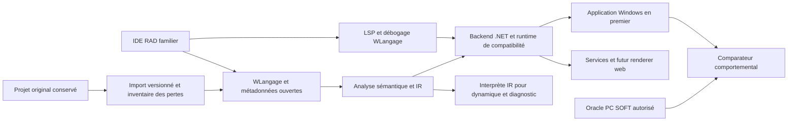
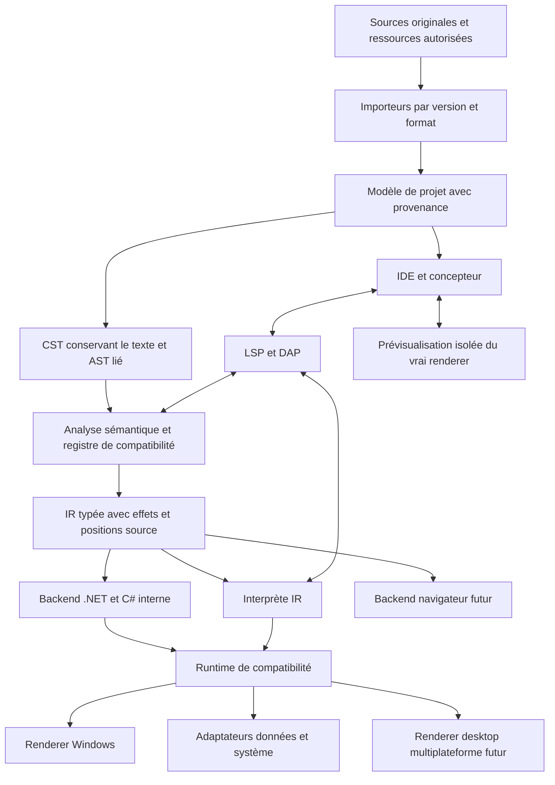

# Recherche : plateforme compatible WLangage et migration WINDEV

Date : 26 octobre 2026. Rapport assemblé à partir des chapitres de `docs/`. Modifier les chapitres puis relancer `python3 tools/assemble_report.py`.

Cette étude décrit un produit à développer. Elle ne certifie aucune compatibilité exécutée. Le périmètre, les limites et la méthode d'exhaustivité figurent dans les chapitres 00 et 06.

[Sommaire du dépôt](README.md) · [Matrice fonctionnelle](data/fonctionnalites.csv)


---

## Synthèse et décisions proposées

Date de recherche : **26 octobre 2026**. Nature du livrable : étude de conception, spécification et plan de validation. Aucun compilateur, importeur ou moteur compatible n'est présenté ici comme déjà réalisé.

### 1. Réponse à l'objectif

La voie qui répond le mieux à « réutiliser le même code source » est de créer une **implémentation indépendante compatible du WLangage**, accompagnée d'un importeur de projets et d'un environnement RAD familier. Le développeur continuerait à écrire et déboguer ses procédures et événements en WLangage ; la transformation vers un langage intermédiaire serait un détail de compilation. Traduire une fois vers C# ou JavaScript puis demander aux équipes de maintenir ce nouveau langage répond à un autre objectif.

Cette voie est techniquement plausible pour un **périmètre explicitement défini et vérifié**. La recherche ne démontre pas la faisabilité d'une compatibilité intégrale de toutes les versions, cibles, composants compilés, formats binaires et dépendances matérielles. Ce serait un produit de plateforme, avec un effort durable de compilation, bibliothèques, outils visuels et maintenance de compatibilité.

Le principal investissement ne sera probablement pas la reconnaissance des mots `SI`, `POUR` ou `PROCÉDURE`. Il sera dans les bibliothèques WLangage, le modèle d'événements, les comportements implicites des champs, la sémantique HFSQL, les états et l'import de métadonnées. C'est une conclusion d'architecture de cette étude, à confirmer par le pilote.

### 2. Les cinq compatibilités à contractualiser

| Niveau | Promesse distincte | Preuve requise |
| --- | --- | --- |
| Sources | Les traitements WLangage restent maintenus en WLangage, avec leur texte conservé | Empreintes des originaux, correspondance traitement/événement, journal de toute modification |
| Projet | Fenêtres, champs, états, analyse, requêtes et ressources sont repris | Inventaire avant/après et statut pour chaque propriété et chaque ressource |
| Exécution | Valeurs, effets de bord, erreurs et ordre d'événements sont équivalents | Tests différentiels contre l'application de référence, avec profil de compilation figé |
| Usage développeur | Le travail quotidien conserve les repères de l'AGL | Parcours chronométrés par des développeurs WINDEV, débogage dans le WLangage |
| Usage final | La nouvelle application permet les mêmes opérations | Recette métier, clavier, données, impressions, accessibilité et performances |

Une application qui compile n'a démontré que sa compilabilité. Une capture visuellement proche ne démontre ni la gestion du focus, ni les filtres HFSQL, ni les traitements de sortie de champ.

### 3. Ce que les sources changent dans le plan

Le format texte prévu pour Git est une porte d'entrée intéressante, mais il faut conserver les parties binaires et relever les caractéristiques non exposées. Le support technique de PC SOFT confirme la possibilité de sauver le code et les éléments en texte ; cela ne constitue pas une spécification publique complète des formats. [PC SOFT, partage des projets et authentification GitHub](https://blogs.pcsoft.fr/fr/obtenir-access-token-operations-pull-commit-push-projet-partage-git-heberge-chez-github/281474976710987/read.awp).

La version du produit ne suffit pas à définir le langage d'un projet. Des options de compilation influencent notamment l'évaluation des conditions et d'autres comportements. L'import doit donc produire un profil de compatibilité **version + build + options + cible + encodage**, conserver les réglages non résolus comme inconnus dans le bilan, puis bloquer la génération du périmètre concerné jusqu'à leur résolution. [PC SOFT, onglet Compilation du projet](https://doc.pcsoft.fr/?9500218=).

Les accès ODBC, OLE DB ou SQL ne sont pas une preuve d'équivalence de toutes les fonctions `H*`. La compatibilité des curseurs, filtres, verrous et erreurs exige son propre moteur d'adaptation et ses essais. La conservation temporaire de HFSQL est une stratégie de réduction du changement, soumise aux interfaces et droits réellement disponibles ; voir le [chapitre données](docs/04-donnees-integrations-et-cibles.md).

Les améliorations proposées doivent partir de la réalité du produit de référence. PC SOFT annonce déjà, dans sa version 2026, de l'assistance IA, du hot reload et des évolutions de sécurité et d'intégration. L'avantage à construire porte donc sur la transparence, l'interopérabilité, les preuves de compatibilité et l'ouverture des formats, plutôt que sur la seule présence de ces fonctions. [Annonce officielle 2026](https://forum.pcsoft.fr/fr-FR/pcsoft.fr.windev/278021-pcsoft-version-2026-windev-webdev-windev-mobile-est/read.awp).

### 4. Architecture recommandée, conditionnelle aux essais



Le premier produit devrait privilégier **WINDEV Windows desktop**, une version source et ses options connues, quelques familles de champs et des applications de gestion représentatives. Le backend proposé utilise .NET et un runtime qui préserve les valeurs et conventions WLangage ; un renderer Windows peut utiliser WinForms et des hôtes natifs. L'IDE et les autres renderers restent découplés. Le premier harnais peut interpréter l'IR ; le backend .NET ne devient une cible de production qu'après passage de la même suite de conformité. Ce choix n'est pas un résultat de benchmark : les prototypes et critères d'abandon sont décrits dans le [chapitre architecture](docs/05-architecture-cible.md).

WEBDEV, Android, iOS, Linux et macOS doivent avoir des lignes de couverture propres. Un appel bloquant d'interface desktop ne se transporte pas automatiquement dans le modèle navigateur ; un ActiveX Windows ne devient pas un composant iOS. Le même noyau métier pourra être réutilisé lorsque ses dépendances le permettent. Les adaptations nécessaires seront identifiées avant génération.

### 5. Expérience de développement proposée

Le point d'entrée est « Ouvrir un projet existant ». L'assistant préserve les fichiers originaux, explique les éléments reconnus et présente les blocages par écran, état et dépendance. Le développeur retrouve son arborescence, ses fenêtres, l'analyse, les événements des champs, un éditeur WLangage, l'action GO et le débogueur.

Les fichiers de projet de la nouvelle plateforme sont textuels, documentés et versionnés. Le code compilé généré n'est pas la source de vérité du développeur. Une modification dans le concepteur produit une différence lisible et un identifiant stable, sans réécrire tout le projet. Un panneau de compatibilité relie chaque écart à la source, à sa conséquence et à un test.

La familiarité ne doit pas devenir un obstacle à l'amélioration : mode de transition activé à l'import, raccourcis configurables, vocabulaire connu, puis fonctionnalités modernes accessibles progressivement. La priorité reste la capacité à travailler sans réapprentissage massif. Voir les [parcours UX](docs/03-experience-developpement-et-interface.md) et les [améliorations proposées](docs/08-ameliorations-produit.md).

### 6. Exhaustivité : une exigence mesurable

L'inventaire du dépôt est une **base large d'exigences fonctionnelles**. Ce n'est pas une certification que toutes les fonctions, surcharges, constantes, événements et variantes historiques sont identifiés. Aucun projet client ni SDK installé n'a été fourni pour fermer ce périmètre.

L'exhaustivité doit être atteinte sur un ensemble fini et publié : versions et builds retenus, cibles retenues, catalogue d'API daté, options de compilation, formats de projet et corpus pilote. Chaque élément reçoit l'un des statuts : conforme prouvé, partiel, pont externe, non pris en charge, non applicable avec justification, ou inconnu. **Inconnu ne compte jamais comme conforme et n'est jamais éliminé du dénominateur.**

Deux tableaux de bord sont nécessaires : couverture de la plateforme de référence, et couverture des fonctions effectivement utilisées par un projet. Une fréquence d'usage élevée ne permet pas de retirer les fonctions rares du premier tableau. Pour un pilote, on exige la fermeture de tous les éléments utilisés dans son périmètre, même si la plateforme globale reste incomplète. La procédure détaillée figure dans l'[inventaire de couverture](docs/06-inventaire-fonctionnel-et-couverture.md).

### 7. Ordre de décision

| Décision | Proposition | Condition avant engagement plus large |
| --- | --- | --- |
| Réutilisation des sources | Maintenir le WLangage comme source de vérité | Débogage et exécution de procédures non réécrites sur un pilote |
| Import | Texte hybride en premier, extraction complémentaire autorisée | Toutes les pertes détectées et classées ; aucun champ supprimé silencieusement |
| Cible initiale | Windows desktop | Parcours métier, impression et interop du pilote validés |
| Moteur de données initial | Conserver HFSQL si l'accès et les droits conviennent | Preuve comportementale et contrat de redistribution analysé |
| Élargissement SQL | Adaptateur PostgreSQL distinct | Tests des contrats `H*`, reprise des données et retour arrière répétés |
| Plateformes suivantes | Services/web puis autres cibles selon demande | Profil de compatibilité et budget séparés pour chaque renderer |
| Différenciation | Formats ouverts, reproductibilité et traçabilité | Export complet et reconstruction d'un projet sur poste vierge |
| Publication | Dépôt de recherche privé par défaut | Visibilité publique à décider séparément si souhaitée |

### 8. Premières semaines de travail produit

Avant de développer un concepteur visuel complet, prendre trois projets représentatifs sous droits appropriés : gestion CRUD et états, application avec interop/matériel, projet avec concurrence ou traitements complexes. Recueillir leurs builds PC SOFT et options exacts. Construire l'inventaire et l'oracle, mesurer l'import, puis exécuter une tranche verticale : ouverture d'écran, validation, accès base, transaction et impression.

On poursuit si la tranche conserve effectivement les traitements originaux, si les écarts sont explicables et si l'import des métadonnées ne dépend pas d'une reconstruction manuelle généralisée. Sinon, resserrer le profil ou choisir explicitement une réécriture assistée. Les estimations de l'étude sont des scénarios d'effort, sans engagement de couverture ou de coût avant cette preuve. Le [plan de réalisation](docs/07-plan-realisation-et-risques.md) donne les jalons.

### 9. Inconnues à lever

- Versions/builds et options réellement utilisés, dont projets antérieurs au format texte.
- Possibilité de relancer légalement et techniquement les applications de référence sur la durée.
- Taux de propriétés visuelles et d'états récupérables sans inférence.
- Composants distribués seulement compilés, droits sur les sources et actifs tiers.
- Dépendances exactes HFSQL, matériels, polices, Office, COM, DLL et bibliothèques.
- Cible prioritaire, taille du parc et budgets/contraintes de performances réels.
- Conditions PC SOFT applicables à chaque licence et build ; aucune gratuité ou redevance générale n'est déduite d'une ancienne brochure.

Ces inconnues n'empêchent pas de concevoir la plateforme. Elles empêchent de promettre aujourd'hui une migration intégrale, inchangée et certifiée d'un patrimoine qui n'a pas été examiné.


---

## Options et solutions existantes

Recherche arrêtée au 26 octobre 2026. Cette comparaison sépare les déclarations des auteurs et les conclusions de conception. Aucun des produits ou dépôts mentionnés n'a subi ici une campagne d'essais sur une application client. L'absence de preuve publique de compatibilité n'est pas une preuve d'impossibilité.

### 1. Choisir la bonne catégorie de solution

| Approche | Le développeur maintient le même WLangage | Reprise de l'IHM | Indépendance envers l'environnement PC SOFT | Usage approprié |
| --- | --- | --- | --- | --- |
| Continuer dans PC SOFT, extraire progressivement des services | Oui pour l'existant | Conservée dans le produit d'origine | Partielle | Réduire immédiatement le risque et isoler les dépendances |
| Nouveau compilateur et runtime compatibles | Objectif central | Importeur et renderer à construire | Forte si implémentation indépendante et dépendances maîtrisées | Construire le produit demandé |
| Transpileur de migration vers C# ou autre langage | Généralement non après bascule de maintenance | Variable et souvent chantier séparé | Possible | Sortie du langage d'origine acceptée |
| Réécriture assistée par IA | Non, sauf usage d'un compilateur compatible en aval | Recréée à partir des preuves | Possible | Refondre aussi l'architecture et les usages |
| Nouvel AGL avec un autre langage | Non sans couche additionnelle | Recréée ou import partiel démontré | Dépend du nouvel éditeur | Priorité à un RAD existant plutôt qu'au même code |
| Exécuter l'ancien runtime derrière un nouveau shell | Oui mais toujours exécuté par PC SOFT | Peut rester ancienne | Faible | Pont transitoire déclaré, selon licences et interfaces |
| Émuler l'exécutable compilé | Ne réutilise pas les sources au sens demandé | Ancienne application exécutée | Ne démontre pas l'indépendance | Compatibilité d'exploitation spécifique, hors architecture centrale |

**Recommandation :** retenir une implémentation compatible indépendante pour la plateforme, en gardant un pont transitoire explicite lorsqu'une capacité ne peut pas être reprise immédiatement. Pour un client qui accepte de changer de langage, proposer une autre offre de migration, avec ses propres critères. Mélanger ces promesses rendrait la couverture impossible à interpréter.

### 2. Ce qui existe publiquement et ce que cela démontre

#### 2.1 Le format texte et les outils PC SOFT

PC SOFT documente le partage via Git et la sauvegarde textuelle des éléments. Cela fournit une voie d'acquisition préférable à une hypothèse de décompilation universelle. Le guide détaillé d'import doit cependant considérer le binaire résiduel et les éléments non convertibles. [Blog officiel PC SOFT sur les projets Git](https://blogs.pcsoft.fr/fr/obtenir-access-token-operations-pull-commit-push-projet-partage-git-heberge-chez-github/281474976710987/read.awp).

Cette voie peut servir aussi à constituer un patrimoine documentaire et des tests sans attendre le nouveau moteur. Elle ne transforme pas l'environnement PC SOFT en compilateur ouvert et ne donne pas automatiquement le droit de redistribuer ses composants.

#### 2.2 `wl2net`

Le dépôt public de son auteur présente un transpileur WLangage vers C# et annonce des conversions de structures de contrôle et d'appels courants. Le README décrit explicitement des limites sur l'interface, HFSQL et l'analyse sémantique. Il est donc une piste pour étudier des transformations ou des contre-exemples, pas une preuve de compatibilité complète. [Dépôt de l'auteur et limites](https://github.com/lukimperinetti/wl2net).

Vérification complémentaire par l'API GitHub le 26 octobre 2026 : aucune licence reconnue détectée par GitHub (`license: null`), branche `main`, dépôt non archivé. Au commit `7fd8a11402e71ce38b713b06e556669c45f33942`, aucun fichier de licence ni déclaration dans le README n'a été identifié dans les éléments examinés. Une publication lisible ne suffit pas à autoriser une exploitation et redistribution générales du code. [GitHub, licences des dépôts](https://docs.github.com/en/repositories/managing-your-repositorys-settings-and-features/customizing-your-repository/licensing-a-repository). Les pourcentages de gain annoncés dans une présentation ne sont pas repris comme mesures de cette étude. Avant réemploi : licence explicite, audit du parseur, essais des conversions numériques et contrôle des appels non reconnus. En particulier, traduire directement `ET` en court-circuit peut changer le résultat d'un projet dont l'option de compilation est différente. Le comportement doit suivre le réglage importé, car le court-circuit existe aussi dans WLangage. [PC SOFT, opérateurs logiques](https://doc.pcsoft.fr/?1512003=).

#### 2.3 WXCode

L'éditeur décrit une chaîne d'import, graphe de dépendances, extraction de règles et conversion vers une nouvelle pile. Sa procédure publique mentionne les sources, le DDL et des compléments permettant de documenter les propriétés des contrôles. Cela éclaire l'intérêt d'un inventaire structuré avant conversion. Ce n'est pas, dans les pages examinées, une démonstration d'un runtime maintenant le WLangage inchangé. [Procédure de l'éditeur](https://wxcode.ai/windev-migration-guide/kb-import).

La présence d'un outil commercial d'import ou d'une démonstration ne suffit pas à conclure à une équivalence d'exécution. Une évaluation devra demander un échantillon anonymisé, les limitations par version/cible, le contrat sur les sources, le fonctionnement hors service et les résultats des tests d'origine. Aucune affirmation de réduction des coûts ou de couverture provenant du fournisseur n'est considérée ici comme vérifiée indépendamment.

#### 2.4 Xojo et autres AGL

Xojo a organisé un webinaire spécifiquement destiné aux utilisateurs de WINDEV. Cette initiative est une preuve d'une offre d'accompagnement et d'une expérience RAD présentée à ce public ; elle ne démontre pas l'exécution du WLangage original. [Annonce officielle Xojo](https://forum.xojo.com/t/new-webinar-intro-to-xojo-for-windev-users/88740).

Delphi/RAD Studio et d'autres AGL peuvent constituer une cible de réécriture. Les mécanismes de modernisation décrits par Embarcadero concernent notamment les sources Delphi/C++Builder ; on ne doit pas extrapoler cette conservation des sources au WLangage. [Centre de migration Embarcadero](https://upgrade-center.embarcadero.com/).

Pour chaque AGL envisagé, demander la démonstration d'un import WLangage sur le corpus et distinguer la familiarité visuelle de la compatibilité source. Une interface de concepteur similaire peut aider la formation sans préserver un seul traitement métier.

#### 2.5 Dépôts de mots-clés et documentation communautaire

Des dépôts publics recensent des mots-clés ou des pages de référence. Le fichier d'autocomplétion WLangage de la collection Notepad++ indique lui-même que ses métadonnées sont générées et demandent un travail expert. Cela peut aider à repérer des noms ; cela ne fournit ni grammaire normative, ni signatures garanties, ni disponibilité par cible. [Fichier source Notepad++](https://github.com/notepad-plus-plus/userDefinedLanguages/blob/master/autoCompletion/Wlangage.xml).

Des projets appelés `WLang` ou `WLanguage Compiler` peuvent concerner un langage totalement différent. Le nom ne permet pas de les compter comme implémentations compatibles PC SOFT. Toute veille devra vérifier l'origine, les exemples et la licence avant de retenir une solution.

### 3. Grille d'évaluation à appliquer à un fournisseur ou un prototype

La même procédure s'applique à la plateforme proposée dans ce dépôt.

| Test | Éléments à fournir | Refus ou restriction de la promesse si… |
| --- | --- | --- |
| Sources inchangées | Original, empreintes, différences, correspondance des événements | Du code généré remplace discrètement les traitements maintenus |
| Propriétés visuelles | Fenêtre dense, masques, ancrages, plans, tabulation, styles, valeurs | Des propriétés sont ignorées sans diagnostic |
| Options de compilation | Projet avec variantes de court-circuit, portées et conversions | La version du langage est la seule information capturée |
| Données | Parcours indexés, filtres, NULL, doublons, verrous et transactions | Le fournisseur montre seulement une requête SQL simple |
| État | Pagination stable, ruptures, polices, imprimante et export | La preuve est une capture d'écran d'aperçu |
| Interop | DLL/COM/Office/matériel réellement utilisé | La cible est annoncée sans architecture et pilotes compatibles |
| Débogage | Pas à pas dans le traitement d'origine, pile et variables WLangage | Le développeur doit comprendre le code généré pour corriger un incident |
| Sortie de la plateforme | Projet et dépendances exportés, build sur poste vierge | Un service distant secret reste nécessaire sans l'avoir annoncé |
| Maintenance | Mise à jour du compilateur et retour à une version antérieure | Un changement d'outil modifie silencieusement le comportement |
| Licence | Code réutilisé, composants redistribués, coûts et droits par cible | La publication du code est confondue avec une autorisation de réemploi |

### 4. Fabriquer, assembler ou acheter

**À fabriquer comme cœur du produit :** modèle de compatibilité, import versionné, analyse sémantique WLangage, IR, runtime des conventions spécifiques, moteur d'événements, adaptateur `H*`, correspondance source/débogueur et registre de preuves. Ce sont les éléments qui déterminent directement la promesse faite à l'utilisateur.

**À assembler si leur comportement et licence conviennent :** moteur de rendu natif, éditeur de texte, protocoles LSP/DAP, gestion Git, pilote SQL, bibliothèques réseau et chiffrement, outils de packaging et de tests. Chaque dépendance reste derrière une interface remplaçable et des contrats testés.

**À acheter éventuellement :** composants complexes tels que tableur, traitement de texte, reporting ou connecteurs métier, après preuve de leurs exigences. Leur présence au catalogue ne dispense pas du travail pour préserver les propriétés, événements et sorties attendus par le code existant.

Un plugin tiers ne doit pas faire disparaître une exigence du backlog. Il change sa stratégie de réalisation en « composant externe », ajoute les versions et licences au manifeste et conserve les critères d'acceptation.

### 5. Recherche restante avant une sélection irréversible

La veille de cette étude n'est pas un recensement contractuel de tous les fournisseurs du marché. Pour lancer une réalisation : ouvrir un dossier d'évaluation par solution, relever une version ou un commit précis, obtenir une licence, importer le même corpus et publier les résultats bruts reproductibles. Un outil peut être utile sans satisfaire l'ensemble de l'objectif ; sa portée doit rester visible.

La solution recommandée est donc une architecture et une méthode de preuve, pas une affirmation qu'aucune alternative ne pourra jamais exister. L'évaluation devra être réactualisée avant tout achat ou choix technique majeur.


---

## Reprendre les sources et exécuter le WLangage

Date de recherche : 26 octobre 2026. Ce chapitre décrit une architecture à développer, pas un compilateur déjà opérationnel. Aucun projet client, fichier natif, export Git ou exécutable de référence n'a été fourni. Les compatibilités et taux de reprise doivent donc être mesurés pendant les prototypes.

### 1. Le contrat de migration à viser

Le produit doit accepter le WLangage d'origine comme langage de développement permanent. Un développeur doit retrouver ses procédures, noms de champs, traitements et points d'arrêt, même si le moteur génère ensuite du C#, du JavaScript ou du code machine. Les fichiers générés sont des artefacts reconstruisibles. Ils ne deviennent pas les sources que l'équipe doit maintenir.

Il faut contractualiser séparément cinq propriétés :

| Propriété | Signification mesurable | Preuve attendue |
|---|---|---|
| Conservation textuelle | Les blocs WLangage importés gardent leurs octets ou une transformation d'encodage explicitement déclarée | Empreintes avant/après, diff consultable |
| Acceptation syntaxique | Toutes les constructions rencontrées sont reconnues dans le profil choisi | Rapport par fichier, traitement et construction |
| Compatibilité sémantique | Calculs, mutations, conversions et erreurs produisent les résultats attendus | Tests différentiels sur moteur de référence |
| Compatibilité de plateforme | Les services UI, données, système et intégrations existent pour la cible | Matrice API × signature × cible × version |
| Compatibilité observable | Le parcours utilisateur et ses effets métier restent équivalents | Scénarios, événements, données, documents et captures comparés |

La compilation sans erreur établit seulement la deuxième propriété. Une fonction remplacée par une coquille vide ne constitue jamais une compatibilité. Un résultat partiel doit rester explicite : « importé », « analysé », « exécutable avec adaptateur », « vérifié », « bloquant ».

PC SOFT distingue lui-même l'exécution du langage et les fonctionnalités du framework dans une explication historique du fonctionnement de son moteur. Cela confirme la nécessité de traiter ces deux chantiers séparément ; cette description de 2010 ne constitue pas une spécification du runtime actuel. [Source : PC SOFT, compilation, framework et JITc](https://blogs.pcsoft.fr/fr/compilation-wlangage-framework-jitc/7/read.awp).

### 2. Les sources disponibles et leurs limites

Les brochures officielles des versions 25 et 2024 indiquent que les projets peuvent être enregistrés pour Git avec du code texte et des éléments structurés dans un format hybride présenté comme du YAML. Elles mentionnent notamment projets, fenêtres, pages, états, classes et collections de procédures. Cette possibilité est un point d'entrée crédible pour un importeur ; elle ne démontre ni que tout le contenu est transparent, ni que le schéma est ouvert et stable. [Sources : brochure WINDEV 25](https://www.pcsoft-windev-webdev.com/brochureWD25.pdf), [brochure WINDEV 2024](https://www.pcsoft-windev-webdev.com/brochureWD2024.pdf).

| Élément à récupérer | Contenu nécessaire | Traitement de migration proposé |
|---|---|---|
| Projet et configurations | Éléments inclus, cibles, options de compilation, initialisation, langues | Import du manifeste, résolution des références, profil de compatibilité |
| Procédures globales et locales | Signatures, attributs, code, commentaires, ordre de déclaration | Analyse WLangage avec contexte de déclaration |
| Classes et structures | Membres, méthodes, propriétés, héritage, constantes | Graphe de types et règles d'affectation |
| Fenêtres et fenêtres internes | Arbre de champs, noms, dimensions, styles, événements | Modèle UI indépendant du moteur de rendu |
| Pages et modèles WEBDEV | Contrôles, zones, code serveur/navigateur, AJAX, ressources | Deux contextes d'exécution distincts et liaisons contrôlées |
| États et modèles d'états | Blocs, ruptures, ancrages, calculs, événements, polices | Modèle documentaire dédié ; aucune assimilation à une simple page HTML |
| Analyse de données | Tables, rubriques, clés, contraintes, liaisons, paramètres HFSQL | Import complet ou extraction contrôlée avec validation croisée |
| Requêtes | SQL, paramètres, métadonnées, relations avec les champs | AST SQL et description de résultat ; conserver le dialecte d'origine |
| Composants internes | Sources et métadonnées, dépendances et visibilité | Import récursif, espace de noms explicite |
| Composants externes binaires | Contrat public et droits d'utilisation | Source demandée au détenteur, remplacement ou pont isolé ; ne pas annoncer leur recompilation |
| Ressources | Images, icônes, traductions, modèles, sons, styles, fichiers embarqués | Copie déterministe avec empreinte, provenance et licence |
| Interopérations natives | DLL, COM, .NET, Java/Kotlin, Objective-C/Swift, scripts | Inventaire ABI et architecture, puis adaptateur spécifique |
| Tests et scénarios | Jeux de données, assertions et parcours utilisateur | Import lorsque le format le permet ; sinon reconstruction validée |
| Paramètres de génération | Manifestes, permissions, signature, installation, services | Traduction vers la chaîne de fabrication choisie |

Cette liste est un contrat d'inventaire. Elle ne prétend pas que chaque catégorie possède un export textuel intégral.

#### Sources anciennes ou natives

Commencer par une copie immuable du projet complet, de ses dépendances et de la version exacte de l'IDE. Ne jamais faire convertir l'unique exemplaire d'un projet : une montée de version peut rendre le retour dans l'ancienne version difficile ou impossible.

Le chemin privilégié est d'ouvrir une copie dans une installation autorisée de la version source, puis, lorsque nécessaire, dans une version permettant l'enregistrement texte. Produire un export contrôlé et reconstruire l'application avec l'outil d'origine pour vérifier que l'opération d'export n'a pas modifié son comportement. Les anciennes versions, les dépendances manquantes et les formats non exportables deviennent des cas de diagnostic séparés.

Un export de code seul ne suffit pas à reconstruire les fenêtres, l'analyse et les états. L'importeur doit refuser une migration déclarée complète si ces éléments restent absents. Il ne faut pas déduire un format de fichier uniquement de son extension : le contenu, la version et le mode de sauvegarde déterminent le parseur. La lecture de formats binaires propriétaires, si elle est envisagée, nécessite une étude technique et juridique distincte ; ce chapitre n'en suppose pas la faisabilité.

#### Parcours d'import recommandé

1. **Inventorier sans exécuter** : fichiers, tailles, empreintes, type détecté, encodage, liens et références. Contrôler les chemins sortant du projet et les archives anormalement volumineuses.
2. **Identifier le contexte** : produit, version/build, options effectives du projet et surcharges locales, cible, architecture 32/64 bits, langues, alphabet, fuseau et dépendances.
3. **Constituer un paquet d'évidence** : copie du projet, export texte, description de l'analyse, liste des ressources, dépendances, exécutable et jeux de référence si disponibles. Les secrets sont des références externes, jamais des valeurs publiées.
4. **Analyser les conteneurs** : lire chaque élément via un adaptateur de format versionné. Préserver les propriétés inconnues et les portions opaques ; ne pas les supprimer au prochain enregistrement.
5. **Extraire les blocs WLangage** : pour chacun, conserver fichier, objet, événement, position dans le conteneur, encodage et empreinte.
6. **Résoudre le graphe** : dépendances entre classes, procédures, champs, requêtes, tables, composants et ressources. Toute référence manquante reçoit un diagnostic localisé.
7. **Produire un bilan** : couverture par catégories, API utilisées, constructions dynamiques, incompatibilités de cible, interventions estimées et blocages.
8. **Créer un espace de travail séparé** : sources originales en lecture seule, représentation normalisée, paramètres de migration et artefacts générés dans des répertoires distincts.
9. **Compiler puis comparer** : la génération est interdite pour les configurations comportant un blocage non résolu. Un mode de démonstration peut afficher les écrans partiels, avec mention visible de son périmètre.

L'interface d'import doit proposer une explication actionnable par problème : « le composant X n'est disponible qu'en binaire ; fournir ses sources, utiliser le pont Windows ou sélectionner un remplacement ». Elle doit conserver la décision dans un fichier versionné, avec son auteur et les éléments concernés.

### 3. Un profil de compatibilité réellement reproductible

Deux projets de même version peuvent ne pas interpréter le même texte de la même façon. La documentation de l'onglet Compilation décrit des réglages portant notamment sur la portée des variables, la copie des tableaux, les types nullables, les sources de données et l'évaluation des booléens. Les réglages peuvent aussi être surchargés sur certains éléments. Les enregistrer est une condition de migration. [Source : description du projet, onglet Compilation](https://doc.pcsoft.fr/?9500218=).

Le manifeste suivant est **une proposition de format**, avec des valeurs d'exemple à résoudre à l'import ; ce n'est pas un fichier PC SOFT ni une configuration déjà testée :

```yaml
compatibility:
  product: WINDEV
  version: "a-renseigner"
  build: "a-renseigner"
  source_target: windows-x64
  generation_target: windows-x64
  language_vocabulary: [fr, en]
  boolean_evaluation: preserve-imported-setting
  local_scope: preserve-imported-setting
  array_assignment: preserve-imported-setting
  nullable_types: preserve-imported-setting
  datasource_naming: preserve-imported-setting
  string_encoding: preserve-imported-setting
  locale: fr-FR
  time_zone: Europe/Paris
  unresolved_settings_are_errors: true
```

Conserver la provenance de chaque réglage : « lu », « déduit d'un export identifié », « confirmé par le développeur » ou « encore inconnu ». Une valeur moderne par défaut ne remplace jamais silencieusement une valeur historique inconnue. Les écarts entre cible source et cible demandée deviennent des modifications de comportement à accepter dans le dossier de migration.

Il faut séparer le **mode compatibilité**, qui reproduit les résultats convenus, et les options de modernisation sélectionnables. L'IDE peut recommander une nouvelle pratique, mais son activation produit un diff, un plan de tests et une modification versionnée du profil.

### 4. Frontend WLangage : couverture à implémenter

Il faut une grammaire construite à partir de la documentation, des exemples autorisés et de corpus de projets. Une table de remplacement de mots-clés ou de noms de fonctions est insuffisante. Le parseur doit accepter les syntaxes historiques rencontrées, diagnostiquer les ambiguïtés et tolérer un fichier temporairement incomplet dans l'éditeur.

| Groupe | Couverture attendue du frontend |
|---|---|
| Lexique | Vocabulaires français et anglais, accents des mots-clés, identificateurs, constantes et commentaires |
| Mise en forme | Retours à la ligne significatifs, continuations, indentation, chaînes multilignes et délimiteurs |
| Expressions | Priorités, associativité, appels, accès membres/propriétés, opérateurs unaires et binaires |
| Affectations | Affectation de valeur, référence, opérations composées, incrémentations et affectations multiples si rencontrées |
| Déclarations | Typage explicite, inférence, constantes, types composés et déclarations externes |
| Contrôle | SI, SELON, boucles, POUR TOUT, sorties, retours et instructions conditionnelles |
| Procédures | Locales/globales/internes, paramètres optionnels, par référence/par valeur, résultat, surcharge et attributs |
| POO | Classes, structures, héritage, constructeurs, destructeurs, visibilité, méthodes et propriétés |
| Collections | Tableaux simples/multidimensionnels/associatifs, listes, piles, files, parcours et mutation |
| Dynamique | Variant, indirection, introspection, appels par nom et code construit à l'exécution |
| Erreurs | Gestion automatique configurée, blocs d'exception, propagation et informations d'erreur |
| Compilation | Conditions de compilation, configurations, directives et attributs dépendant de la cible |
| Données | Références à l'analyse, fichiers/rubriques, sources de données et paramètres de requêtes |
| UI | Noms de fenêtres/champs, propriétés, traitements implicites et variables de contexte |
| Concurrence | Threads, tâches, temporisations, callbacks et procédures asynchrones/réactives rencontrées |
| Langages embarqués | Blocs natifs et code SQL, XML/JSON/HTML ; parsers distincts selon le contexte |

Les équivalents français/anglais convergent vers le même identifiant sémantique interne, tout en conservant le lexème d'origine. Traduire automatiquement les identificateurs ou le texte d'un code construit dynamiquement altérerait les appels par nom. Pour la syntaxe classique et préfixée, la résolution doit partager la même définition de fonction lorsque les contrats sont effectivement équivalents ; elle doit aussi reconnaître les divergences de signatures et de disponibilité.

#### Arbre concret conservant le texte, AST et IR

Construire trois représentations complémentaires :

- Un **arbre concret conservant le texte** garde commentaires, espaces, encodage, lexèmes et zones inconnues. Sans modification, sa réémission doit rendre le même contenu.
- Un **AST sémantique** relie symboles, types, traitements, signatures, effets et profils. Les références aux éléments visuels y sont explicites.
- Une **représentation intermédiaire (IR)** décrit les opérations exécutables indépendamment du backend : conversion WLangage, référence vers une cellule, chargement de propriété UI, appel de fonction de compatibilité et branchement.

Le runtime reçoit des opérations WLangage précises, pas des comportements implicites du langage hôte. Une conversion, une égalité de chaînes ou un accès de tableau est un contrat à implémenter. Un backend peut ensuite optimiser une opération si une preuve et les tests établissent l'équivalence.

Ne pas imposer la normalisation du fichier d'origine dès son import. Une première version peut traiter les exports comme une source externe en lecture, avec fichiers de décisions adjacents. Une modification visuelle ultérieure peut écrire un format interne ouvert. Le réexport complet vers WINDEV est un objectif distinct : il exige une preuve de réouverture et de fonctionnement pour chaque type d'élément et chaque version.

### 5. Les règles sémantiques qui déterminent la fidélité

Les points ci-dessous sont des **exigences de conception et de caractérisation**. Lorsque le contrat exact n'est pas établi par la documentation ou le corpus, on crée un test de référence avant de choisir le comportement.

#### 5.1 Nombres, conversions et valeurs absentes

Définir des types WLangage pour les entiers avec taille et signe, les réels, les monétaires et les numériques décimaux. Documenter dépassement, troncature, arrondi, division, modulo et conversion en chaîne. L'exigence est l'absence de perte supplémentaire par rapport au type, aux arrondis et au profil de référence ; préserver aussi les limites et troncatures du programme d'origine. Choisir automatiquement le `double` du backend serait une erreur d'architecture.

Tester les conversions implicites à l'affectation, à l'appel et au retour. Une expression évaluée en variant peut suivre un autre chemin qu'une variable statiquement typée. Distinguer valeur par défaut, chaîne vide, date vide, objet non affecté, variable non initialisée et NULL. Tester leur comportement dans les comparaisons, les conditions, les paramètres optionnels et les champs liés à une base.

#### 5.2 Chaînes, encodages et comparaisons

La documentation distingue plusieurs formes de chaînes et des fonctions de conversion ANSI/OEM/Unicode. Elle indique aussi qu'un type de chaîne Unicode à taille fixée peut être remplacé par une chaîne ordinaire sur certaines cibles. La compatibilité doit donc porter sur une cible précise. [Sources : manipulation des chaînes](https://doc.pcsoft.fr/?3024020=), [Chaîne Unicode sur](https://doc.pcsoft.fr/?1000024447=).

Le runtime doit conserver les informations d'encodage nécessaires, distinguer texte et buffer et caractériser taille en octets/caractères, caractères composés, caractères hors du plan de base, zéros embarqués, espaces de remplissage et fins de ligne. Les tris et comparaisons dépendent aussi des options linguistiques. Une normalisation Unicode automatique peut modifier des clés ou empreintes ; elle doit être explicite.

#### 5.3 Dates, heures et durées

Séparer date civile, heure civile, date-heure, durée et instant UTC. Caractériser formats compacts, dates vides, validation, changement de mois, années bissextiles, précision et conversions. Une fonction comme PremierJourDuMois accepte des chaînes compactes et des types Date/DateHeure : ce contrat exige des surcharges de compatibilité. [Source : PremierJourDuMois](https://doc.pcsoft.fr/fr-FR/?1000019417=&product=WB).

Les tests doivent fixer l'horloge, la langue et le fuseau. Pour les applications distribuées, conserver les comportements historiques nécessaires puis proposer une modernisation explicite des fuseaux et de la sérialisation.

#### 5.4 Booléens et ordre d'évaluation

Les opérateurs logiques possèdent des variantes optimisées, et une option peut rendre ce mode actif pour les formes usuelles depuis la version 2024. La documentation précise également une priorité identique de ET et OU dans le langage, différente du contexte SQL. Reprendre la grammaire et la configuration exactes évite d'importer involontairement les règles du backend. [Source : opérateurs logiques](https://doc.pcsoft.fr/?1512003=).

```text
// Cas de caractérisation conceptuel, à exécuter dans le projet de référence.
SI ConditionA() ET ConditionB() ALORS
    Traiter()
FIN
```

Le test enregistre les appels et effets de `ConditionA` et `ConditionB`, y compris si la première condition est fausse. La valeur finale seule ne détecte pas une différence d'évaluation.

#### 5.5 Tableaux, collections et références

Les exemples officiels d'ajout et de suppression utilisent des indices commençant à 1 et décrivent des effets sur la taille et les erreurs d'indice. Ne pas propager les indices 0 du langage cible. [Sources : TableauAjouteTrié](https://doc.pcsoft.fr/fr-FR/?1000017013=), [Tableau.Supprime](https://doc.pcsoft.fr/fr-FR/?1000024314=).

Caractériser copies et références, tableaux fixes/dynamiques, dimensions, indices invalides, ordre de parcours, suppression de l'élément courant, doublons des tableaux associatifs et invalidation d'un élément passé par référence. Pour chaque collection, définir son interaction avec les threads, la sérialisation et les membres de classes.

#### 5.6 Paramètres, portée et durée de vie

Le tutoriel officiel décrit le passage par référence comme comportement usuel et le mot-clé LOCAL pour obtenir une copie. Il faut préserver cette distinction. Caractériser séparément variables affectables, éléments de tableaux, propriétés, constantes et expressions : création éventuelle d'un temporaire, conversions et possibilités de propagation des mutations. [Source : procédures, paramètres et références](https://aide.pcsoft.fr/?1410087236=&name=annexe_7_les_procedures).

Le moteur doit représenter une référence par une cellule ou un accès lecture/écriture, avec durée de vie contrôlée. Distinguer variables de projet, de collection, de fenêtre/page/état, locales, de classe et contexte de champ. Les captures de procédures internes et le moment de destruction des objets demandent des tests séparés. La documentation confirme que la visibilité dépend du lieu de déclaration. [Source : portée des variables](https://doc.pcsoft.fr/fr-FR/?1514088=).

#### 5.7 Classes, objets, propriétés et champs

Établir les règles d'héritage, résolution de surcharge, construction/destruction, affectation, identité, conversion, méthode virtuelle et visibilité. Les objets exposés par un composant externe peuvent demander un adaptateur plutôt qu'une instanciation directe.

Un champ n'est pas une variable ordinaire. La documentation distingue l'opérateur de référence `<-` et l'affectation `=`, cette dernière transférant une valeur. Le runtime doit préserver cette différence et les effets sur les événements. [Source : type Champ](https://doc.pcsoft.fr/fr-FR/?1000020967=).

Une propriété doit avoir un contrat : type, cibles, lecture/écriture, valeur par défaut, effet immédiat/différé, invalidation du rendu et événements induits. Une table générique de propriétés sans ces règles ne suffit pas à reproduire l'application.

#### 5.8 Événements et contexte implicite

Le compilateur associe un bloc de code à un type de traitement et un contexte : projet, fenêtre, champ, page ou état. Le runtime doit établir les variables de contexte, l'ordre d'initialisation, les événements imbriqués, les retours annulant une action et la durée de vie des fenêtres.

Créer un ordonnanceur d'événements journalisable. Une affectation programmée peut avoir un effet différent d'une saisie utilisateur ; un callback réseau peut revenir après la fermeture d'une fenêtre. Les scénarios doivent tester ces cas. Pour WEBDEV, séparer serveur et navigateur : aucun accès direct au disque serveur ni secret ne doit être déplacé dans le navigateur par simple traduction.

#### 5.9 HFSQL dans la sémantique du langage

Les symboles provenant de l'analyse constituent une partie du contexte de compilation. Une expression `Client.Nom` peut désigner une rubrique, avec un buffer courant et un état de lecture associés. Les fonctions H* modifient potentiellement curseur, filtre, erreur et transaction ; les convertir en requêtes SQL isolées détruirait ces relations.

Le compilateur doit typer les fichiers, rubriques, clés, requêtes et sources de données. Le runtime délègue ensuite à un fournisseur de données compatible. Les requêtes peuvent avoir des limitations propres à une cible, notamment lorsque leur SQL contient du WLangage. [Source : Source.ExécuteRequêteSQL](https://doc.pcsoft.fr/fr-fr/?1000024948=).

#### 5.10 Erreurs et exceptions

La documentation présente des mécanismes d'exception automatiques, généraux et spécifiques. Le comportement peut donc provenir du code et des paramètres de l'élément. [Source : gestion des erreurs de programmation](https://doc.pcsoft.fr/?3034004=).

Maintenir l'état d'erreur compatible au niveau correct : procédure, thread, connexion ou opération suivant le contrat. Préserver codes, message utile, emplacement source, reprise et effets transactionnels. Une exception du langage hôte doit être traduite à la frontière ; elle ne doit pas traverser arbitrairement le code WLangage. La nouvelle plateforme peut ajouter un identifiant de diagnostic stable, sans changer les valeurs sur lesquelles le programme existant branche.

#### 5.11 Indirection, introspection et compilation dynamique

Les appels par nom et la construction de code à l'exécution imposent de conserver une table de symboles runtime et des métadonnées. L'analyse statique ne peut pas prouver qu'aucun autre nom sera construit. Elle doit signaler les zones dynamiques et enrichir l'inventaire avec des traces de scénarios, en précisant que ces traces ne prouvent pas une couverture complète.

L'éditeur de code intégrable de PC SOFT possède des paramètres de fonctions autorisées/interdites, ce qui fournit un exemple concret de contrôle de la surface d'exécution dynamique. Notre proposition est d'utiliser le même frontend pour compilation normale et dynamique, avec budget de temps/mémoire et capacités configurables. [Source : manipulation du champ Éditeur de code](https://doc.pcsoft.fr/?1410087305=).

Ne pas annoncer la compilation dynamique sur une cible qui l'interdit ou ne la permet pas avec les mêmes propriétés. Sur les cibles AOT, prévoir une liste de modules précompilés lorsque le besoin s'y prête ou déclarer le blocage. Un interpréteur embarqué est une option technique à étudier avec les contraintes du système et de distribution.

#### 5.12 Threads, tâches et interopération

Spécifier les partages de variables, contextes de données, sections critiques, annulation, temporisations et retour sur le thread UI. Pour les opérations asynchrones, conserver ordre observable, propagation d'erreur et durée de vie des captures. Les threads ou processus du backend sont des moyens d'implémentation : ils ne définissent pas automatiquement le contrat WLangage.

L'interopération exige des contrats séparés pour tailles numériques, encodage, propriété de mémoire, callbacks, exceptions et architecture. Les docs d'intégration Java et .NET montrent des conversions et limites propres à ces passerelles ; elles ne permettent pas de promettre qu'un code natif sera portable sans adaptation. [Sources : saisir du code Java](https://doc.pcsoft.fr/fr-FR/?9000011=), [utiliser des assemblages .NET](https://doc.pcsoft.fr/fr-FR/?2012002=).

### 6. Exécution, diagnostics et expérience de débogage

La recommandation est un frontend commun et une couche de compatibilité explicitement versionnée. Un interpréteur d'AST ou une petite VM facilite d'abord les tests de sémantique et le débogage. Un backend compilé peut être développé ensuite pour les cibles et chemins validés. Le backend retenu par l'architecture générale devra passer exactement la même suite de conformité.

Chaque instruction générée garde un identifiant stable relié au fichier source, objet et traitement. La table de correspondance doit couvrir une génération un-vers-plusieurs et une macro/directive, avec positions en octets et conversion vers les unités du protocole d'éditeur. L'utilisateur pose un point d'arrêt dans « Clic de BTN_Valider », inspecte les variables WLangage et voit une pile WLangage, même si le moteur exécute du code généré.

Utiliser un serveur de langage commun via LSP et un adaptateur de débogage via DAP permet de mutualiser navigation, complétion, diagnostics et débogage entre l'IDE principal et d'autres éditeurs. Ces protocoles standardisent les échanges ; ils ne fournissent ni analyseur WLangage ni runtime. [Sources : Language Server Protocol](https://microsoft.github.io/language-server-protocol/), [Debug Adapter Protocol](https://microsoft.github.io/debug-adapter-protocol/).

Diagnostics proposés :

| Code de conception | Situation | Résolution attendue |
|---|---|---|
| IMP001 | Format/segment inconnu | Préserver le segment ; demander un export identifié |
| IMP002 | Ressource ou composant absent | Afficher les références et chemins recherchés |
| SEM001 | Réglage sémantique indéterminé | Résoudre via export, projet source ou confirmation documentée |
| API001 | Signature absente sur la cible | Proposer adaptateur, cible compatible ou remplacement |
| DYN001 | Nom construit dynamiquement | Afficher l'incertitude et les scénarios d'instrumentation |
| UI001 | Propriété visuelle sans équivalent | Afficher une différence localisée, jamais la supprimer |
| DB001 | Sémantique de curseur non assurée | Exiger un fournisseur ou un scénario de validation |
| GEN001 | Backend incapable d'une opération | Bloquer l'artefact concerné et proposer une autre stratégie |

### 7. Protocole de conformité et critères de sortie

Construire un harnais qui exécute le même petit programme dans une installation de référence autorisée et dans le nouveau moteur. Les programmes de caractérisation sont écrits pour l'étude ; on ne copie pas le code propriétaire du moteur. Conserver version, profil, résultats, erreurs et traces d'effets. Les cas non déterministes utilisent une horloge et des données fixées, ou des assertions d'ordre/intervalle explicitement convenues.

| Famille de tests | Cas minimaux nécessaires |
|---|---|
| Lexique | FR/EN, accents, commentaires, littéraux, fichier tronqué, erreurs localisées |
| Opérateurs | Priorité, associativité, courts-circuits, effets secondaires, null |
| Nombres | Limites, débordements, arrondis, divisions, conversions chaîne/nombre |
| Chaînes | ANSI/Unicode, taille, découpe, accents, zéros, caractères composés |
| Dates | Vide, invalide, bissextile, fins de mois, durée, changement d'heure |
| Paramètres | Référence/LOCAL, expression, constante, tableau, alias partagé |
| Collections | Indices, dimensions, doublons, copies, mutation pendant parcours |
| POO | Constructeurs, héritage, propriétés, identité, affectation, destruction |
| Portées | Projet/fenêtre/champ, masquage, capture, réentrée, fermeture |
| Dynamique | Nom construit, symbole absent, introspection, code valide/invalide |
| Erreurs | Retour faux, exception, gestion automatique, reprise, état d'erreur |
| Concurrence | Donnée partagée, thread UI, annulation, callback après destruction |
| Données | Buffer courant, filtre, recherche, transaction, clés, null, verrou |
| Événements | Initialisation, focus, saisie, validation, fermeture, événements imbriqués |
| Interopération | Conversion, encodage, callback, architecture, mémoire, exception |
| Génération | Profil/cible/version, build reproductible, artefacts et symboles |

Ajouter des tests génératifs pour les expressions et des tests de mutation pour vérifier que la suite détecte un changement de priorité, d'indice ou de règle de copie. Les programmes générés doivent rester dans un sous-ensemble défini dont on connaît le sens ; des programmes aléatoires invalides ne donnent pas une mesure de conformité utile.

Mesurer séparément : blocs de code importés, constructions syntaxiques rencontrées, signatures appelées, propriétés utilisées, scénarios passés et profils vérifiés. Ne pas publier un pourcentage global mêlant ces unités. Publier les dénominateurs : « 173 signatures vérifiées sur les 221 rencontrées dans trois applications », plutôt que « compatible à 78 % avec WINDEV ».

Trois portes de sortie sont recommandées :

1. **Import fidèle** : aucun élément perdu, inconnus conservés et signalés, provenance et empreintes disponibles, projet source inchangé.
2. **Noyau exécutable** : frontend, types, références, erreurs, événements et API du pilote passent les tests différentiels ; toutes les incompatibilités restantes sont visibles.
3. **Application migrée** : parcours métier, données, documents, périphériques et performances du périmètre accepté passent leur recette sur chaque cible. Une nouvelle version du runtime rejoue ces preuves.

### 8. Sources et réserves de recherche

Les liens de ce chapitre sont des sources primaires PC SOFT ou Microsoft. Plusieurs ouvertures directes du domaine de documentation ont renvoyé HTTP 403 pendant la recherche ; les passages utilisés ont alors été consultés via leur indexation web. Une URL disponible et un extrait indexé ne prouvent pas que la page décrit le build exact d'un futur projet client. Le pilote devra figer la documentation de la version effectivement migrée et consulter son aide locale autorisée.

Les sources documentaires établissent l'existence des comportements cités. Les structures de manifeste, algorithmes d'import, AST/IR, diagnostics, profils, stratégies runtime et critères de conformité sont des recommandations originales de cette étude. Aucune affirmation de compatibilité avec des fichiers binaires, de réexport natif intégral ou de couverture de tout le WLangage ne peut être déduite de ce document seul.


---

## Expérience de développement et fidélité des interfaces

Recherche arrêtée au 26 octobre 2026. Ce document décrit l'expérience **à construire**, les éléments officiels vérifiés servant de référence et les conditions pour déclarer une reprise satisfaisante. Les tableaux de périmètre constituent des exigences du futur produit ; ils ne signifient pas que toutes les fonctions existent déjà dans un prototype.

### 1. Principe directeur : préserver les gestes, expliciter les écarts

Une solution compatible doit permettre au développeur de retrouver son projet, son analyse de données, ses fenêtres, ses champs et leurs événements. Lui demander de comprendre d'abord une arborescence React, un ORM et trois outils de compilation déplacerait le coût de migration vers la formation. Le futur atelier doit donc présenter ces concepts familiers directement, tout en utilisant un stockage ouvert et une architecture moderne en dessous.

Il faut distinguer trois engagements :

- **Continuité du travail** : mêmes noms d'objets, recherche, passage conception/code, procédures, test d'une fenêtre et test du projet.
- **Continuité fonctionnelle** : mêmes calculs, données, contrôles, impressions, droits et séquences d'événements observables.
- **Continuité visuelle** : géométrie, police, densité, couleurs, menus et interactions suffisamment proches pour les tâches métier retenues.

Ces engagements se mesurent séparément. Une capture identique ne valide pas un ordre d'événements, et un calcul juste ne valide pas une saisie clavier. L'importeur doit préserver les originaux et produire un rapport des informations reconnues, opaques, perdues ou converties. Toute modernisation susceptible de changer le comportement doit faire l'objet d'une modification visible dans le dépôt du client.

**Référence vérifiée.** PC SOFT organise déjà son environnement autour d'éditeurs de code, fenêtres/pages, états et données. La description du projet regroupe notamment langues, styles/ambiance, GDS/Git, compilation et télémétrie. Le projet doit donc être repris comme un ensemble de métadonnées, pas seulement comme du texte WLangage. [Documentation générale](https://help.windev.com/fr-FR/), [Description du projet : compilation et autres onglets](https://doc.pcsoft.fr/?9500218=).

### 2. Deux espaces de travail, un seul projet

**Proposition.** Fournir au premier lancement un profil « Repères WINDEV » puis un profil « Atelier moderne ». Les deux manipulent le même modèle de projet. Le choix ne doit modifier ni le code ni la sémantique. Le premier place l'explorateur à gauche, les éditeurs au centre, le modifieur de propriétés à droite et les erreurs/traces en bas. Il emploie les mots fenêtre, champ, analyse, rubrique, requête, état, procédure, composant et configuration. Le second peut privilégier une palette de commandes, une vue fichiers et une disposition adaptée aux autres IDE.

Le ruban du profil de transition regroupe Projet, Création, Description, Alignement, Code, Tests et Génération. Les panneaux peuvent se détacher, se réancrer et être restaurés par un profil versionné localement. La densité d'affichage, les tailles de police, le contraste, le thème et la langue de l'IDE restent indépendants du thème de l'application. Le produit doit être utilisable entièrement au clavier ; chaque commande du ruban doit avoir un nom accessible et être disponible dans la palette.

L'écran d'accueil présente les projets récents, l'ouverture d'un projet importé, la création d'un projet et les opérations en cours. Un projet importé arrive directement sur ses objets et sur la liste des écarts ; le développeur n'est pas forcé de lire un assistant complet pour accéder à son code. Le résultat technique d'import reste accessible à tout moment depuis un onglet « Compatibilité ».

#### Correspondances à conserver

| Repère connu | Comportement attendu dans le futur atelier | Vérification utile |
|---|---|---|
| Explorateur de projet | Fenêtres, pages, états, analyse, requêtes, classes, procédures, ressources, tests, configurations | Retrouver un objet par son nom d'origine en quelques secondes |
| Description du projet | Métadonnées lisibles et formulaire organisé par thèmes familiers | Aller d'une option au fichier qui la porte |
| Description d'un champ | Dialogue par catégories et panneau de propriétés synchronisés | Modifier le libellé sans modifier une autre langue |
| Conception → code | Ouvrir directement l'événement de la sélection | Le curseur arrive sur le bon traitement |
| Test d'un élément | Exécuter l'objet avec son contexte et ses paramètres | Les dépendances sont préparées ou signalées |
| Test du projet | Démarrer la configuration choisie et sa première fenêtre | Même ordre de démarrage que le profil de référence |
| Modèles et styles | Héritage, variantes locales et propagation explicites | Une surcharge locale survit à la mise à jour du modèle |
| Analyse | Schéma visuel, rubriques, clés, liaisons et contraintes | Les noms métier restent stables dans le code |
| États et requêtes | Éditeurs intégrés reliés aux mêmes objets de données | Une modification de schéma localise ses impacts |
| GDS/Git | Historique, comparaison, branches et conflits depuis l'atelier | Une fusion ne perd pas un événement de champ |

**Références vérifiées.** La première fenêtre peut être définie depuis l'explorateur, la configuration ou le test ; les outils d'alignement regroupent position, taille et répartition. Ces parcours justifient des correspondances directes. [Première fenêtre du projet](https://doc.pcsoft.fr/?9000177=), [Options d'alignement](https://doc.pcsoft.fr/?2022004=).

#### Raccourcis et contexte

Les raccourcis suivants sont publiés par PC SOFT ; l'atelier peut proposer un profil de correspondance configurable. Il faut conserver leur **contexte**, car une même touche peut servir à des actions différentes selon l'éditeur. [Référence officielle WINDEV/WINDEV Mobile](https://www.pcsoft-windev-webdev.com/Raccourcis_WD_WM.pdf), [Référence officielle WEBDEV](https://www.pcsoft-windev-webdev.com/Raccourcis_WB.pdf).

| Geste | Action de transition proposée |
|---|---|
| F9 | Tester l'élément actif |
| Ctrl + F9 | Tester le projet |
| Alt + F9 | Tracer le projet |
| Ctrl + Maj + F9 | Paramétrer le mode test |
| Maj + F5 | Arrêter le test |
| F2 | Accéder au code de la sélection |
| Maj + F2 | Code de la fenêtre ou références, selon contexte |
| Ctrl + F2 | Revenir au traitement précédent |
| Alt + F2 | Revenir à l'objet visuel associé |
| Ctrl + B | Ajouter/enlever un point d'arrêt dans le code |
| F4 / Maj + F4 | Nouvelle procédure locale/globale dans le code |
| Ctrl + R | Réindenter le code dans l'éditeur de code |
| Ctrl + D | Dupliquer la sélection selon l'éditeur |
| F12 | Erreur suivante dans le code |

Le moteur de commandes doit résoudre les conflits, gérer claviers AZERTY/QWERTY et permettre un export du profil. Les raccourcis spécifiques macOS/Linux sont une décision à valider si ces hôtes IDE sont retenus ; ne pas remplacer silencieusement les touches familières.

### 3. Périmètre fonctionnel de l'atelier

Les éléments ci-dessous forment un cahier des charges de parité à décliner en tickets et tests. La disponibilité historique dépend de WINDEV, WEBDEV, WINDEV Mobile, de l'édition et de la cible. Le [catalogue officiel historique des fonctionnalités](https://fr.pcsoft-windev-webdev.com/liste-exhaustive-des-fonctionnalites-de-windev.pdf) fournit un point de départ, mais son intitulé correspond à la version 26 : il ne suffit pas pour certifier un périmètre 2026.

#### Projet, code, équipe et productivité

| Famille | Fonctions à prévoir et à qualifier |
|---|---|
| Cycle de vie du projet | Création, ouverture, copie, import, sauvegarde, archivage, réparation, version d'origine, mises à niveau réversibles, dépendances, dossiers virtuels et physiques |
| Configurations | Exécutables, bibliothèques, services, webservices, sites, applications mobiles, architectures CPU, variantes client, ressources et code conditionnels, profils de compilation |
| Navigation | Recherche de symbole, références croisées, usages, appels entrants/sortants, historique de navigation, favoris, marques, tâches, navigation entre objet/propriété/événement |
| Édition | Français/anglais du langage, commentaires, indentation, complétion, signatures, aide contextuelle, snippets, glossaire, blocs, multicurseur, pliage, différences, Unicode, encodages historiques |
| Refactorisation | Renommage sémantique projet/champ/rubrique, extraction de procédure, déplacement, conversion explicite de syntaxe, prévisualisation de tous les changements |
| Qualité | Erreurs syntaxiques et sémantiques, avertissements de cible, erreurs UI, audit statique, dépendances obsolètes, analyse des secrets, règles de projet, suppressions motivées |
| Documentation | Dossier technique, diagrammes, documentation des procédures, aide intégrée, guides utilisateur, liens des exigences vers tests et éléments |
| Travail en équipe | Git, historique par ligne, comparaison texte et visuelle, revue, branches, fusion structurelle, verrouillage optionnel des ressources non fusionnables, résolution des partages |
| Réutilisation | Classes, collections de procédures, composants internes, composants externes avec sources, contrats de composants sans sources, modèles de fenêtres/pages/champs/états |
| Ressources | Images/icônes, polices, SVG, traductions, modèles de document, médias, licences des ressources, références stables et résolution de chemins |
| Industrialisation | Compilation CLI, génération reproductible, dépendances verrouillées, cache, CI, rapports machine, signatures, installateurs, publication, mises à jour et retour arrière |
| Pilotage | Tâches, exigences, incidents et liens Git ; intégration aux outils déjà utilisés ; métriques explicites sans surveillance individuelle imposée |

Chaque fonction de refactorisation doit respecter les références indirectes. Quand un nom d'objet est construit par concaténation ou par données externes, le moteur indique l'incertitude et demande une revue du changement proposé. Une recherche textuelle ne doit pas être présentée comme un renommage sûr.

#### Éditeurs visuels et données

L'éditeur de fenêtres doit gérer sélection multiple, groupe, alignement, grille, guides, aimantation, règles, zoom, ordre de superposition, verrouillage, duplication et annulation/restauration. Les propriétés comprennent géométrie, ancrages, plans, visibilité, activation, focus, navigation, contenu, masque, liaison de données, styles, langues, bulles et événements. Les modèles doivent conserver l'identité des objets, les liens d'héritage et les surcharges ; un simple copier/coller du rendu ne suffit pas.

L'analyse et les requêtes nécessitent schéma visuel, tables/fichiers, rubriques, clés simples/composées, liaisons, contraintes, types, nullabilité, valeurs initiales, paramètres et génération SQL. Le développeur doit pouvoir suivre une liaison d'un champ jusqu'à la rubrique et revenir. Les données de démonstration sont isolées des connexions de production ; l'aperçu est désactivable et les valeurs sensibles masquées. Les changements de schéma présentent les effets sur requêtes, fenêtres, états et migrations de données.

Le concepteur d'états doit prévoir blocs, ruptures, regroupements, tris, calculs, sous-états, états imbriqués, étiquettes, codes-barres, images, graphes, marges, recto-verso, orientation, papier, pagination, polices, textes extensibles, aperçu, PDF et impressions physiques. Le moteur doit comparer aussi les numéros de page, les sauts, les totaux et les zones répétées. Un rendu HTML approximatif ne remplace pas une compatibilité d'impression certifiée.

#### Débogage, tests et exploitation

Prévoir points d'arrêt simples/conditionnels, compteurs de passages, activation/désactivation, arrêt sur exception, exécution pas à pas, entrée/sortie, pause, pile des appels, inspection et modification de variables, expressions surveillées, objets, collections, données images/HTML, threads, tâches asynchrones et contexte de données. Le débogueur travaille sur les lignes WLangage d'origine grâce aux correspondances de sources ; une pile exclusivement dans le langage généré ferait perdre le bénéfice de migration.

La référence PC SOFT propose déjà test du projet, attachement à un exécutable et lancement du débogueur pendant l'exécution. Il faut reprendre ces parcours et décider explicitement, cible par cible, ce qui reste disponible. [Tester et déboguer un projet](https://doc.pcsoft.fr/fr-fr/?2019017=).

La future suite doit couvrir tests unitaires de procédures/classes, tests de fenêtres, scénarios enregistrés, assertions métier, données de test, exécution CLI, rapports et reprise des scénarios existants quand leur format est compris. PC SOFT dispose déjà d'un outil de tests sur exécutable et de scénarios enregistrables ; un nouveau produit doit proposer une continuité ou déclarer les scénarios à réenregistrer. [Tests automatiques sur exécutable](https://doc.windev.com/en-US/?2019029=).

Pour l'exploitation : traces structurées, journal d'erreurs, dump de débogage, profilage CPU/mémoire, requêtes lentes, métriques, télémétrie optionnelle, anonymisation, diagnostic à distance et export du contexte autorisé. Les audits et le profiler sont des fonctions historiques ; leur seule présence ne différencie pas un concurrent. [Livre officiel historique des fonctionnalités, chapitres performances et audits](https://fr.pcsoft-windev-webdev.com/Fonctionnalites_WinDev.pdf).

### 4. Périmètre des interfaces produites

#### Familles de champs

Ce tableau indique les familles à inventorier pour chaque cible. Pour chacune, le contrat inclut **propriétés + événements + méthodes/fonctions + liaisons + FAA + rendu + clavier/accessibilité**. Une case « champ pris en charge » sans ces dimensions est insuffisante.

| Groupe | Familles à prévoir dans la matrice de compatibilité |
|---|---|
| Texte et saisie | Libellé, saisie simple/multiligne, mot de passe, numérique/monétaire, date/heure/durée, masque, texte riche, jetons, validation et saisie assistée |
| Actions et choix | Bouton, interrupteur, sélecteur, combo, liste, liste image, lien, menu, menu contextuel, ruban, barre d'outils, boutons segmentés |
| Données tabulaires | Table mémoire/fichier/requête, table hiérarchique, colonnes typées, ruptures, zone répétée, TCD, sélection et édition multiples, virtualisation |
| Conteneurs et navigation | Onglet, fenêtre/page interne, plans, dispositions, groupe, panneau, séparateur, volet, tiroir, fenêtre fille/sœur/modale, MDI et panneaux ancrables |
| Visualisation métier | Arbre, graphe, jauge, potentiomètre, tableau de bord, agenda, planning, diagramme de Gantt, Kanban, organigramme, diagramme |
| Documents | Lecteur PDF, traitement de texte, tableur, éditeur d'images, éditeur HTML, éditeur de code et visualiseur de documents |
| Médias et web | Image, dessin, vidéo, son, caméra, navigateur HTML, carte, contenu externe, WebView, notifications et dialogues système |
| Mobile et appareils | Gestes, orientation, zone de sécurité, clavier virtuel, caméra/scan, GPS, notifications, permissions, capteurs, authentification biométrique selon cible |
| Extensions récentes | Champs liés à l'IA et autres nouveautés : inventaire par version, dépendances externes et mode dégradé explicites |

**Faits vérifiés ciblés.** Le type `Champ` permet de référencer des champs existants ou créés dynamiquement, avec des limitations propres aux cibles. Le champ Arbre possède des options visuelles et des fonctions automatiques. Les propriétés d'un champ Disposition incluent notamment ancrage, géométrie et accessibilité. Ces cas montrent pourquoi il faut tester un objet dans sa cible réelle. [Type Champ](https://doc.pcsoft.fr/fr-FR/?1000020967=), [Champ Arbre](https://doc.pcsoft.fr/fr-FR/?1013037=), [Propriétés du champ Disposition](https://doc.pcsoft.fr/?1410087048=).

#### Fonctions automatiques attendues par les utilisateurs

Les FAA font partie du comportement métier perçu : les utilisateurs peuvent s'appuyer sur un filtre, une exportation ou une personnalisation sans que ce besoin soit visible dans le code de l'application. Le catalogue officiel comprend des commandes de filtrage/recherche, zoom, export, manipulation de planning, personnalisation et contrôle de disponibilité. Le futur moteur doit implémenter les commandes nécessaires ou signaler leur absence lors de l'audit. [Constantes officielles des FAA](https://doc.windev.com/en-US/?3013073=&lf=fr&name=AAF_constants).

**Exigences proposées :** conserver tri simple/multiple, filtres et mémorisation, recherche/loupe, choix/ordre/largeur des colonnes, calculs/totaux, copie, export autorisé, impression, zoom, sélection, cocher tout, menus contextuels, saisie/calendrier/calculatrice, annuler/refaire dans les éditeurs concernés et personnalisation des fenêtres. Chaque action doit déclencher les événements attendus et respecter les droits. Il faut inventorier également les commandes programmatiques activant, désactivant ou renommant ces fonctions. Les préférences utilisateur doivent être exportables et liées à des identifiants stables de champs.

Les exports et impressions doivent appliquer les autorisations côté données/service, pas uniquement masquer une option du menu. Quand une ancienne application autorisait une action dangereuse, le mode migration conserve le comportement seulement si la politique du client le permet ; la différence devient une décision documentée, pas une surprise après livraison.

#### Droits, langues, accessibilité et fidélité

La reprise du groupware doit couvrir utilisateurs, groupes, configuration de droits, premier écran, authentification, propagation des restrictions et personnalisation des fenêtres d'identification. Le groupware PC SOFT peut être classique ou utiliser un serveur d'authentification ; il ne faut pas réduire son import à un simple formulaire de login. [Options du groupware](https://doc.windev.com/en-US/?1000021153=&lf=fr&name=GPU_Options), [Personnalisation](https://doc.windev.com/en-US/?1000021170=).

**Proposition de recette :** matrice rôle × action × objet × périmètre de données ; contrôle des refus et des accès indirects ; migration des identités par processus explicite, sans présumer que les mots de passe existants sont portables. Les droits UI et les autorisations serveur doivent rester cohérents, même si un appel est fait sans interface.

Pour les langues, importer messages, libellés, bulles, masques et ressources ; conserver la langue de secours, formats nombres/dates, devises, tri/casse, pluriels et sens d'écriture. Pour l'accessibilité, prévoir navigation clavier, ordre de tabulation, focus visible, lecteur d'écran, nom/rôle/état accessibles, contraste et zoom texte. La tabulation et l'action Entrée font déjà partie du paramétrage des champs de saisie PC SOFT. [Champ de saisie](https://help.windev.com/en-US/?1013145=). La conformité au niveau WCAG 2.2 AA sur le web est une cible proposée qui exige une recette, pas une propriété acquise par choix d'un framework. [WCAG 2.2, W3C](https://www.w3.org/TR/WCAG22/).

Le web et le mobile ont des contraintes différentes du bureau : navigation HTTP, session, historique, permissions, reprise après suspension, latence et absence de réseau. Conserver le même code métier n'implique pas automatiquement les mêmes fenêtres. La conversion d'un écran dense peut demander une disposition dédiée ; l'atelier doit indiquer quels éléments sont partagés et quelles variantes sont spécifiques.

### 5. Quatre parcours prioritaires

#### A. Ouvrir un projet historique et retrouver sa fenêtre

Le développeur choisit une copie exportée du projet et indique version, cible et profil. L'atelier analyse les fichiers, conserve les originaux et affiche les objets reconnus. La première fenêtre s'ouvre sur son plan initial ; un panneau montre les écarts bloquants. F2 sur un bouton ouvre le code d'origine et non une traduction. F9 exécute la fenêtre avec des paramètres contrôlés. Le critère de recette est la réalisation d'une modification de libellé puis d'un test sans modifier manuellement les fichiers générés.

#### B. Corriger une régression métier après import

Depuis un scénario qui échoue, le développeur ouvre le résultat original et le résultat du nouveau moteur. Le rapport montre le premier événement divergent, les entrées et la valeur attendue. Il place un point d'arrêt dans le WLangage, inspecte la rubrique et le champ, puis corrige soit une règle de compatibilité du moteur, soit une adaptation explicitement acceptée du projet. La distinction est essentielle pour ne pas accumuler des corrections inutiles dans le code client.

#### C. Faire évoluer analyse, formulaire et impression ensemble

Le développeur ajoute une rubrique dans l'analyse, demande les impacts, met à jour le formulaire et l'état associé, puis génère une migration de données révisable. L'atelier propose de prolonger la liaison de données plutôt que d'insérer un SQL ad hoc invisible. La recette compare stockage, affichage, validation, export et impression avec des données témoins incluant vide, NULL et valeurs limites.

#### D. Moderniser progressivement sans perdre la référence

Le développeur duplique une disposition visuelle et active un nouveau thème sur un lot d'écrans ; le modèle métier et les procédures restent partagés. La comparaison montre la variante classique et la variante modernisée à plusieurs DPI/langues. Les nouvelles interactions sont testées avec des utilisateurs. Un déploiement pilote active la variante par population, puis permet le retour au thème classique sans restauration de la base de données.

### 6. Maquette textuelle du profil de transition

```text
Projet : Gestion commerciale             Profil : Référence WD / Windows
[Projet] [Création] [Description] [Alignement] [Code] [Tests] [Génération]
[Ouvrir] [Sauver] [GO Élément F9] [GO Projet Ctrl+F9] [Configuration ▾]
┌ Explorateur ─────────┬ FEN_Client : Conception | Code | Comparaison ┬ Propriétés ┐
│ Analyse             │ [Nom             ] [Code client         ] │ Général    │
│ Fenêtres            │ [Adresse                                 ] │ UI         │
│  FEN_Client         │ [Table contacts                          ] │ Liaison    │
│ Requêtes            │                                            │ Événements │
│ États               │ [Valider] [Annuler]                        │ Style      │
│ Classes / Procédures│ Plan 1 | Plan 2       Zoom 100 % DPI 125 %  │ Langues    │
├─────────────────────┴────────────────────────────────────────────┴────────────┤
│ Erreurs | Compatibilité | Tests | Traces | Données | Références                │
│ 1 blocage : fonction externe indisponible — localisation — options documentées│
└───────────────────────────────────────────────────────────────────────────────┘
```

Cette maquette représente une organisation proposée, sans reprendre les graphismes ni les ressources de PC SOFT. Un clic sur un écart doit ouvrir l'objet, sa localisation et les solutions possibles ; aucun écran ne doit afficher un taux global rassurant tout en cachant un blocage.

### 7. Validation et critères d'acceptation

La recette doit employer des projets représentatifs autorisés et plusieurs développeurs habitués à WINDEV, pas uniquement l'équipe qui construit l'atelier. Mesurer ouverture d'un projet, localisation d'un événement, ajout d'un champ lié, débogage d'une erreur, évolution d'un état et préparation d'une génération. Enregistrer réussite, durée, erreur, aide requise et satisfaction ; fixer les seuils après un pilote plutôt que publier une promesse arbitraire.

Pour les applications : scénarios métier comparés, capture à tailles/DPI fixés, arbre d'accessibilité, ordre d'événements, focus, clavier, données modifiées, états PDF et impression physique sur les périphériques concernés. Tester séparément langues, thème sombre, très longs textes, écran réduit, multiécran, réseau lent, permissions refusées et reprise d'une session.

Un rapport de parité doit identifier la version d'origine, l'OS, le moteur, les polices, la configuration, les jeux de données, le scénario et les tolérances. Les écarts acceptés restent listés. Les champs sans exemple représentatif, les composants sans sources et les paramètres opaques reçoivent un statut « non qualifié », jamais « compatible » par défaut.

### 8. Sources et limites

Les liens intégrés sont des sources primaires PC SOFT ou W3C, consultées via la recherche publique le 26 octobre 2026. Certaines pages de documentation indexées concernent 2024/2025 et le catalogue exhaustif historique concerne la version 26 ; leurs dates ne constituent pas une preuve du dernier état commercial disponible. L'annonce officielle 2026 confirme notamment IA conversationnelle, positionnement Grille, audit de sécurité et Hot Reload, sans permettre d'inférer leur disponibilité sur toutes les éditions et toutes les cibles. [Annonce officielle PC SOFT du 3 octobre 2025](https://forum.pcsoft.fr/fr-FR/pcsoft.fr.windev/278021-pcsoft-version-2026-windev-webdev-windev-mobile-est/read.awp).

Restent à qualifier sur des projets réels : l'intégralité des propriétés de chaque champ, les formats de personnalisation utilisateur, les comportements implicites des modèles, les différences d'événements par cible, l'import des scénarios, les versions de groupware, les limites des éditeurs documentaires et les contraintes d'impression. L'exhaustivité doit être produite et maintenue par inventaire versionné et tests ; ce document définit le périmètre UX de cette démarche.


---

## Données, intégrations, impressions et plateformes

Date de recherche : **26 octobre 2026**. Ce chapitre distingue les comportements documentés de PC SOFT, les décisions proposées pour le nouveau produit et les points à vérifier sur de véritables projets. Aucun accès à une installation WINDEV, à un serveur HFSQL, à un projet client ou à une imprimante n'a été fourni : les architectures et critères ci-dessous sont des spécifications, pas des compatibilités déjà démontrées.

### 1. Décision structurante : séparer trois migrations

**Recommandation : permettre de migrer le langage, l'interface et la base à des moments différents.** Changer simultanément les trois rend les écarts difficiles à attribuer. Le premier chemin doit pouvoir conserver HFSQL, reprendre les procédures WLangage et reconstruire seulement un périmètre d'interface contrôlé. Un second chemin permet de conserver l'application existante pour certaines fonctions pendant que les nouveaux modules appellent une API. La migration vers PostgreSQL constitue un chantier indépendant, activé après validation fonctionnelle.

Il faut distinguer les accès **depuis** WLangage vers une base tierce, les accès **depuis** un langage tiers vers HFSQL et la réimplémentation de l'API HFSQL. PC SOFT documente des connecteurs natifs utilisables par WLangage et, séparément, un pilote ODBC permettant à des logiciels externes de lire et écrire dans HFSQL. Cela n'établit ni une API C publique équivalente à toutes les fonctions `H*`, ni le droit de redistribuer n'importe quelle bibliothèque du framework. [Connecteurs dans HOuvreConnexion](https://help.windev.com/en-US/?3044107=), [pilote ODBC HFSQL](https://doc.pcsoft.fr/fr-FR/?3044179=).

| Parcours proposé | Ce qui change | Ce qui reste à qualifier | Usage conseillé |
|---|---|---|---|
| A. Nouveau runtime, HFSQL conservé | Compilateur et interface | Connexion externe, transactions, erreurs, curseurs, performances | Première migration d'un logiciel de gestion |
| B. Application hybride par API | Certains écrans et services | Contrats, identité, sessions, transaction métier | Gros patrimoine ou intégrations Windows |
| C. PostgreSQL sous API `H*` compatible | Moteur de données | Sémantique des parcours, clés, verrous et SQL | Après validation du noyau de compatibilité |
| D. Modernisation explicite | Architecture et parfois appels applicatifs | Travail de transformation du code assumé | Modules nouveaux ou exigences incompatibles |

La présence d'un connecteur PostgreSQL dans l'offre PC SOFT crée une autre possibilité d'expérimentation : tester d'abord le changement de base dans l'environnement d'origine, puis comparer le résultat au nouveau runtime. Cela aide à séparer les écarts provenant de PostgreSQL de ceux du compilateur ; l'accès natif, ses limites et ses conditions doivent néanmoins être qualifiés pour la version possédée. [HOuvreConnexion](https://help.windev.com/en-US/?3044107=).

### 2. Reprendre correctement une analyse et les fichiers HFSQL

#### 2.1. L'inventaire initial

Une reprise ne doit pas considérer les fichiers de données comme le modèle complet. Il faut rapprocher l'analyse de développement, la description réellement déployée et les décisions prises dynamiquement par l'application. Le modèle interne proposé conserve : noms logiques et physiques, alias, chemins, connexion, type et taille de chaque rubrique, précision et échelle numériques, encodage, valeurs par défaut, nullabilité, clés simples et composées, règles de tri, unicité, intégrité, index spécialisés et métadonnées de génération.

Les fichiers usuels comprennent `.fic` pour les données, `.ndx` pour les index et `.mmo` pour les mémos ; ils apparaissent explicitement dans les instructions officielles de déploiement Android. Il faut aussi inventorier les journaux, fichiers temporaires, transactions, sauvegardes et index spécialisés réellement présents, sans supposer que ces trois extensions suffisent à toute installation. Le fichier `.wdd` intervient notamment dans la configuration du pilote ODBC pour décrire le schéma. [Déploiement Android](https://doc.pcsoft.fr/en-us/?1410087576=&name=deploying_android_application), [configuration ODBC](https://doc.pcsoft.fr/fr-FR/?3044179=).

**Procédure proposée :**

1. Faire une copie cohérente et restaurable avec l'outil ou le mécanisme de sauvegarde approprié ; une copie de fichiers ouverts n'est pas un protocole universel de sauvegarde.
2. Relever les versions du serveur, des clients, du pilote et de la description déployée ; garder l'architecture 32/64 bits et le système.
3. Exporter le schéma par les moyens autorisés disponibles. L'éditeur d'analyse sait générer un script SQL avec des options d'index et d'intégrité ; utiliser cet export comme entrée contrôlable, puis rapprocher les métadonnées non représentées par SQL. [Génération de scripts SQL](https://doc.windev.com/en-US/?2011027=&name=Generer_Scripts_SQL).
4. Parcourir le code pour trouver les créations dynamiques, alias, changements de connexion, de nom et de répertoire ; calculer un graphe des accès.
5. Construire un manifeste versionné et une table de correspondance entre chaque rubrique source et sa représentation cible.
6. Vérifier sur échantillons puis sur la totalité des données ; ne jamais conclure à l'équivalence sur le seul succès d'un export CSV.

L'analyse reste visible dans le nouvel IDE sous des concepts familiers : fichiers/tables, rubriques, clés, liaisons et connexions. Le moteur de stockage peut être différent sans imposer au développeur de réécrire toute sa représentation mentale. Les écarts de capacités doivent être signalés à la génération du schéma.

#### 2.2. HFSQL Classic et Client/Serveur ne sont pas le même adaptateur

**Classic :** qualifier chemins locaux et réseau, partage de fichiers, droits du système, accès concurrents, interruptions réseau, antivirus, reconnexions, nettoyage et gestion de l'espace disque. Un exécutable qui manipulait directement des fichiers ne devient pas automatiquement un service centralisé.

**Client/Serveur :** qualifier authentification, noms de bases, connexions, droits de serveur/base/table, administration, tâches planifiées, traitements stockés et flux réseau. Le Centre de Contrôle expose notamment connexions, blocages et transactions ; ces fonctions d'exploitation font partie de la reprise. [Gestion des fichiers HFSQL C/S](https://doc.pcsoft.fr/?35400016=).

**Proposition de produit :** deux profils distincts dans le manifeste, chacun avec version et capacités prouvées. Les opérations d'administration passent par une interface séparée de l'accès métier ; le runtime normal n'obtient pas de droits de réparation ou de suppression de bases.

### 3. Pourquoi traduire `H*` en SQL demande un moteur de compatibilité

Les fonctions `H*` manipulent à la fois des données et un état d'exécution. Une fonction qui renvoie le bon enregistrement peut encore être incompatible si elle change le tampon courant, le parcours, une erreur ou un verrou différemment.

Deux exemples documentés illustrent ce risque. `HAjoute` distingue l'effet de l'ajout sur le parcours avec `hAffecteParcours` et `hEcritureDéfaut`. `HNbEnr` peut compter différentes catégories d'enregistrements, ignore le filtre courant et comporte des particularités selon le connecteur. Les ramener à un `INSERT` et à un `COUNT(*)` génériques perd des comportements observables. [HAjoute](https://doc.pcsoft.fr/?3044147=), [HNbEnr](https://doc.pcsoft.fr/fr-FR/?3044006=).

#### 3.1. Contrat d'état proposé

Chaque contexte de données doit porter au minimum :

```text
DataContext
  identity: projet, thread/tâche, connexion, transaction
  descriptors: analyse et déclarations dynamiques
  sourceStates[sourceId]:
    currentRecordBuffer, previousValues, changedItems
    browseKey, browseDirection, bookmark, searchCriterion
    filterDefinition, found, outOfBounds, deletedOrCrossedState
    lastError, duplicateError, integrityError, lockError
    heldLocks, pendingWrites, queryResources
```

Il s'agit d'un modèle conceptuel, pas d'une déclaration de l'implémentation interne PC SOFT. Sa portée exacte doit être mesurée : un contexte global, partagé entre tous les threads et toutes les sessions web, provoquerait des contaminations entre traitements.

L'interface d'adaptation proposée expose des opérations sémantiques : `seek`, `readFirst`, `readNext`, `readAtBookmark`, `insert`, `updateCurrent`, `deleteCurrent`, `lock`, `unlock`, `begin`, `commit`, `rollback`, `executeQuery`, `describeSource`. Elle doit accepter les options WLangage déjà normalisées par le compilateur et retourner un résultat structuré. Le rendu des erreurs WLangage reste dans le runtime ; les codes natifs sont conservés pour le diagnostic.

#### 3.2. Matrice de conformité de données

| Domaine | Points à reproduire ou à déclarer incompatibles | Preuve nécessaire |
|---|---|---|
| Positionnement | Première/dernière ligne, suivant/précédent, absence de résultat, reprise après ajout/modification | Traces de parcours avec identités de lignes |
| Recherche | Exacte/générique, bornes, doublons, clé composée, direction, arrêt du parcours | Corpus de clés limites et résultats dans le même ordre |
| Tampon courant | Valeurs conservées après recherche infructueuse, remise à zéro, copie d'enregistrement, alias | Valeurs avant/après chaque opération |
| Indicateurs | `HTrouve`, `HEnDehors`, erreurs et remise à zéro | Table de transitions des indicateurs |
| Filtres | Empilement éventuel, activation, compatibilité clé/filtre, effet sur recherches et comptages | Parcours filtrés et non filtrés identiques au référentiel |
| Identité | Identifiants automatiques, identifiants forcés, séquences après import, doublons | Insertion concurrente et reprise après rollback |
| Suppression | Actif/rayé/supprimé, possibilité de réutilisation, renumérotation physique | Scénarios utilisant ces états explicitement |
| Types | Numérique exact, réel, monnaie, date vide/invalide, heure, durée, chaîne et binaire | Valeurs extrêmes et comparaison sans conversions implicites |
| Nullabilité | `NULL`, chaîne vide, valeur par défaut et affectation partielle | Table vérité en lecture/écriture/recherche/SQL |
| Tri | Casse, accents, ponctuation, espaces, Unicode et ordre des doublons | Jeux multilingues et clés composées |
| Verrous | Lecture, écriture, lecture-écriture, attente, timeout, libération et déconnexion | Deux processus concurrents instrumentés |
| Transactions | Connexion concernée, isolation, erreurs intermédiaires, annulation, redémarrage | Pannes injectées avec contrôle après reprise |
| SQL | Paramètres, préparation, résultats modifiables, fonctions embarquées, requêtes sur requêtes | Plans fonctionnels et valeurs de résultat |
| Schéma | Création, contrôle de structure, mise à jour, liaisons, génération | Reconstruction en base vide et mise à niveau depuis N−1 |
| Ressources | Fermeture de requête, destruction de contexte, reconnexion, mémoire | Exécution longue avec mesures de ressources |

La documentation `HLitRecherche` indique que certaines options et gestions de blocage diffèrent entre HFSQL, ODBC, connecteurs et JDBC. Le nouveau produit doit conserver ces distinctions dans une table de capacités plutôt que les masquer. [HLitRecherche](https://doc.pcsoft.fr/fr-FR/?3044050=).

#### 3.3. Verrous et transactions : un blocage majeur possible

**Fait utile :** le modèle de verrous PostgreSQL ne transforme pas automatiquement un verrou d'écriture de ligne en interdiction de toute lecture ordinaire. Sa documentation distingue les verrous de table et de ligne, leurs conflits et les lectures MVCC. Un comportement historique bloquant les lectures peut donc demander une couche coopérative supplémentaire, ou conserver HFSQL. [Verrouillage explicite PostgreSQL](https://www.postgresql.org/docs/18/explicit-locking.html).

**Recommandation :** sélectionner un profil parmi `native-compatible`, `emulated-compatible` et `unsupported`. Un verrou coopératif n'est valide que si tous les clients passent par le même protocole ; un outil SQL externe peut contourner cette convention. Le rapport doit le signaler. Pour les conflits, définir l'ordre d'acquisition, les délais, la politique d'annulation et le nombre maximal de reprises. Ne jamais réessayer automatiquement un bloc métier ayant déjà envoyé un email ou appelé un paiement.

Chaque transaction doit avoir un propriétaire, une connexion et un identifiant de corrélation. L'IDE doit montrer les écritures incluses, les effets externes exclus et les risques de transaction longue pendant une interaction utilisateur. Les sauvegardes de transactions interrompues et la restitution des messages métier doivent être testées en arrêtant volontairement client, serveur et réseau dans un environnement jetable.

#### 3.4. Schéma, SQL, triggers et exploitation

`HModifieStructure` fournit une modification automatique de la structure HFSQL, avec certaines possibilités à chaud en C/S ; sa documentation précise que les liaisons ne sont pas mises à jour par cette fonction. La nouvelle solution doit donc modéliser séparément colonnes, index et liaisons. [HModifieStructure](https://doc.windev.com/en-US/?1000019439=).

**Proposition :** générer une migration de schéma lisible, annoncer son verrouillage prévu et sa réversibilité, puis l'exécuter avec sauvegarde et journal. Une suppression de colonne ne doit pas être automatiquement présentée comme réversible ; conserver temporairement les anciennes données ou créer une migration de compensation. Comparer le schéma attendu au schéma observé avant chaque déploiement.

Il faut inventorier les requêtes définies dans l'éditeur et celles construites dynamiquement. Les requêtes HFSQL peuvent inclure des fonctions WLangage : une réécriture SQL vers PostgreSQL doit soit évaluer une fonction déterministe dans une stratégie explicitement définie, soit la traduire avec preuve, soit refuser la construction. Aspirer toute la table dans le client pour appliquer une fonction est une dégradation à diagnostiquer. [ExécuteRequêteSQL](https://doc.pcsoft.fr/fr-fr/?1000024948=).

Pour chaque trigger et procédure stockée, relever : moteur d'exécution, événement, ordre, paramètres, droits effectifs, dépendances, erreurs et transaction. Les triggers applicatifs exécutés par le client ne doivent pas être confondus avec des triggers serveur. Les vues SQL constituent encore un autre objet : dans HFSQL, la documentation décrit notamment des droits liés au créateur de la vue. Une reprise doit empêcher qu'une vue change silencieusement de niveau de privilège. [Vues SQL HFSQL](https://doc.pcsoft.fr/fr-FR/?9000157=).

L'exploitation couvre réindexation, contrôle des mémos, statistiques, surveillance des connexions, tâches planifiées, sauvegarde complète/incrémentale selon le moteur, restauration, réplication, bascule et réparation. Le type `hPlanification` documente des planifications pour optimisation, sauvegarde et réplication ; leur existence doit être recherchée dans les projets et dans la configuration serveur, pas seulement dans le code. [hPlanification](https://doc.pcsoft.fr/fr-FR/?1000018853=).

### 4. Garder HFSQL : voies d'intégration réalistes

| Voie | Avantage | Limite et travail requis |
|---|---|---|
| ODBC officiel depuis le runtime | Interface externe documentée, lecture/écriture, intégration avec de nombreux langages | SQL et pilote à qualifier ; recréer l'état des fonctions `H*` ; architecture et distribution à vérifier |
| OLE DB officiel sous Windows | Autre interface externe documentée | Dépendance Windows et fournisseur ; ne constitue pas une API universelle multiplateforme |
| Pont métier compilé avec l'environnement d'origine | Peut conserver des traitements et comportements difficiles à réimplémenter | Dépendance PC SOFT maintenue ; contrat de service, packaging, licences et disponibilité |
| API applicative existante REST/SOAP | Sépare proprement les modules lorsque cette API existe déjà | Ne fournit que les opérations exposées ; latence, erreurs et transactions distribuées |
| Lecture des fichiers avec un moteur réécrit | Indépendance potentielle à long terme | Risque élevé de corruption, format non garanti, coût de qualification et examen juridique |

Le fournisseur OLE DB HFSQL est documenté en lecture et écriture depuis un logiciel externe. Cette possibilité ne prouve pas que chaque fonction WLangage peut être remplacée par une requête OLE DB équivalente. La page consultée est historique et renvoie vers une édition ultérieure : vérifier le package disponible avant de choisir cette voie. [Provider OLE DB HFSQL](https://doc.pcsoft.fr/?9000059=&name=provider_ole_pour_hfsql&verdisp=180).

**Choix proposé pour le premier prototype :** ODBC officiel pour un sous-ensemble précisément défini ; pont applicatif pour les transactions métier ou primitives sans équivalence qualifiée. Les appels ne doivent pas être cachés derrière une façade prétendant tout supporter. Une capacité manquante produit un diagnostic au build si elle est statiquement détectable, puis une erreur explicite à l'exécution si elle résulte d'un appel dynamique.

Pour le pont, préférer des opérations métier transactionnelles telles que `valider_commande` à une succession de milliers d'appels réseau `HLitSuivant`. Si une API bas niveau de compatibilité reste nécessaire, introduire des lots et des contextes bornés avec expiration, annulation, contrôle d'identité et fermeture explicite. Un contexte serveur ne doit pas porter une transaction ouverte indéfiniment. Versionner les messages et conserver des identifiants d'idempotence pour les opérations qui peuvent être rejouées.

Les composants redistribuables, versions de pilotes, plateformes Linux et modalités d'installation doivent être vérifiés sur les packages réellement disponibles. La documentation Windows renvoie à un pilote Linux ; cette recherche n'a pas établi une matrice binaire complète, par architecture et version, pour tous les environnements. Il reste nécessaire de tester le téléchargement, l'installation et les clauses de redistribution applicables. [Pilote ODBC HFSQL](https://doc.pcsoft.fr/fr-FR/?3044179=).

### 5. Migrer HFSQL vers PostgreSQL sans perte silencieuse

#### 5.1. Conversion et preuve

**Protocole proposé :**

La cible est l'absence de **perte supplémentaire par rapport au type et au profil source**, pas l'exactitude mathématique illimitée. Préserver aussi les arrondis, troncatures, débordements et conversions observables du programme d'origine. Un `numeric(p,s)` ou le `decimal` d'un backend ne peut être choisi qu'après qualification de sa capacité et de ses opérations ; la valeur stockée et le résultat d'un calcul sont deux contrats distincts.

1. Décrire les règles de correspondance : `numeric(p,s)` pour les valeurs exactes ; texte avec longueur validée si elle est significative ; `bytea` ou stockage externe contrôlé pour les mémos ; politique explicite pour les dates sans valeur et les dates invalides.
2. Créer le schéma et les contraintes cibles. Conserver une clé source durable ; ne pas utiliser un numéro physique d'enregistrement comme clé métier sans vérifier sa stabilité.
3. Charger une photographie cohérente. Pour chaque lot, journaliser identifiant, bornes, nombre attendu, nombre chargé, somme de contrôle et état. Rendre la reprise idempotente.
4. Comparer l'ensemble des données : nombre de lignes par table et état, clés distinctes, doublons, orphelins, valeurs `NULL`, extrêmes, sommes monétaires exactes, longueurs et empreintes binaires des mémos.
5. Comparer les résultats métier : encours client, stocks, taxes, arrondis par ligne et total, ancienneté des créances, factures et clôtures.
6. Rejouer les parcours WLangage et requêtes réelles sur les deux moteurs en observant ordre, erreurs et effets. Une différence de tri suffit à changer la sélection d'un premier résultat.
7. Approuver les écarts documentés, puis réaliser une répétition complète de la bascule avec les mêmes volumes et contraintes que la production.

Les collations PostgreSQL peuvent dépendre d'un fournisseur et de paramètres de langue ; il ne suffit pas de choisir « français » pour garantir les règles de comparaison HFSQL. Enregistrer les versions de collation et conserver un corpus d'accents, espaces, ligatures et normalisations Unicode. [Collations PostgreSQL](https://www.postgresql.org/docs/18/collation.html).

Une preuve chiffrée doit exprimer des résultats, par exemple « 2 400 000 lignes attendues, 2 400 000 chargées, 0 clé absente, 0 mémo d'empreinte différente ». Ces nombres sont un **exemple de format**, pas des mesures réalisées. Les données de validation peuvent être anonymisées, mais leurs distributions, contraintes et cas extrêmes doivent rester représentatifs.

#### 5.2. Synchronisation, autorité des écritures et retour arrière

La stratégie la plus simple à prouver est une fenêtre de gel : arrêter les écritures, terminer le transfert final, vérifier, puis changer l'autorité. Pour une disponibilité accrue, étudier un journal de changements fiable ou une outbox transactionnelle implantée dans le système source avec les garanties réellement disponibles. Ne pas annoncer une capture universelle du journal HFSQL sans interface et format validés.

**Interdiction de conception proposée :** deux écritures indépendantes `HFSQL` puis `PostgreSQL` ne constituent pas une transaction atomique. Une panne entre les deux crée une divergence. Choisir un seul système autoritaire à chaque instant, et un protocole de propagation idempotent avec ordre, détection de retard et file d'erreurs. Les événements externes doivent porter une clé de déduplication.

La réplication logique PostgreSQL est une fonctionnalité PostgreSQL et ne transforme pas HFSQL en publication PostgreSQL. De plus, sa documentation mentionne des restrictions telles que l'absence de réplication du schéma et des séquences. Le plan doit traiter ces objets séparément. [Réplication logique PostgreSQL](https://www.postgresql.org/docs/18/logical-replication.html), [restrictions](https://www.postgresql.org/docs/18/logical-replication-restrictions.html).

**Retour arrière proposé :** avant la première écriture métier autoritative sur la cible après bascule, et en l'absence d'effet externe à compenser, revenir vers la source peut consister à rétablir l'ancien routage après contrôle de son état et de son schéma. Le chargement initial de la cible n'est pas une écriture métier autoritative. Après des écritures métier sur PostgreSQL, il faut soit une réplication inverse déjà testée, soit exporter et réconcilier ces changements, soit restaurer et accepter une perte explicitement décidée. Une simple restauration d'HFSQL ferait perdre les opérations créées depuis la bascule. Fixer avant la mise en production les objectifs de perte maximale de données et de délai de reprise, puis les mesurer lors d'un exercice.

### 6. Plateformes : compatibilité déclarée par profil

Le tableau suivant présente une **politique de produit recommandée**, et non une promesse que PC SOFT ou le futur runtime possède toutes les capacités de chaque ligne. Chaque capacité doit être identifiée par `version-source × runtime × OS × architecture × type-d'exécution`.

| Cible | Fait documenté utile | Politique proposée et qualification |
|---|---|---|
| Windows bureau | L'écosystème expose des applications Windows et des intégrations Windows | Première cible de fidélité des applications de gestion ; DPI, clavier, dialogues, COM et impression |
| Linux bureau/service | Des cibles Linux apparaissent dans la documentation et certaines capacités évoluent par version | Profil séparé ; distributions, bibliothèques, affichage, polices, impression et démon |
| JVM/Java | WINDEV peut générer des fenêtres et fonctions WLangage en Java, avec restrictions | Ne pas choisir Java comme preuve automatique de fidélité complète |
| macOS | Le catalogue distingue notamment Java et Mac Catalyst selon les fonctions | Inventorier l'origine réelle ; ne pas assimiler Catalyst à toute application Windows |
| Web serveur | WEBDEV documente modes Session et AWP, et déploiement de sites/services | Runtime serveur propre, isolation des sessions, identité, stockage et montée en charge |
| Web navigateur | Code navigateur distinct du code serveur | Backend JavaScript ciblé ; messages asynchrones, sécurité DOM, limites du navigateur |
| PHP | Cible explicitement distinguée dans le catalogue WEBDEV | Maintien seulement si requis par un patrimoine réel et après audit de ses limites |
| Android | Génération et déploiement WINDEV Mobile documentés | Backend mobile qualifié, versions SDK, cycle de vie, permissions et packaging |
| iOS/iPadOS | Déploiement Apple avec certificats/profils et compilation Xcode documenté | Chaîne Mac/Xcode nécessaire à qualifier, signature, sandbox et publication |
| Widgets/montres/Catalyst | Entrées de cible visibles sur certaines fonctions | Lots spécifiques selon demande et corpus ; aucun support implicite |
| Batch/service/conteneur | Des traitements sans interface existent, notamment WDScript | Runtime headless et CLI ; pas de dépendance à une session graphique |

Les différences ne sont pas théoriques : la documentation Java mentionne des fonctionnalités non disponibles, dont les états, certaines formes d'indirection et la compilation dynamique. Les impressions directes WLangage disponibles ne remplacent pas l'éditeur et le moteur d'états. [Fonctionnalités et limites Java](https://doc.windev.com/en-US/?9000056=). La documentation distingue aussi des comportements de génération et d'exécution par cible ; l'ancien mécanisme de code conditionnel a été remplacé à partir de la version 25 par d'autres constructions. L'importeur doit donc respecter les variantes réelles du code source. [Code conditionnel par cible](https://doc.windev.com/en-US/?9000033=).

#### 6.1. Web : reprendre le cycle d'exécution

Un code serveur qui remplit une table avant rendu et un clic navigateur ne partagent pas nécessairement le même état ni la même transaction. Pour chaque événement importé, conserver sa localisation serveur/navigateur, ses paramètres, l'usage d'AJAX, les règles de validation et l'ordre d'initialisation. Définir les comportements du bouton retour, des URL, du rafraîchissement, des onglets multiples et de la session expirée.

Le mode AWP possède sa propre gestion du contexte. `DéclareContexteAWP` décrit une persistance des variables entre affichages avec des modes configurables. Une conversion systématique en session serveur changerait les propriétés de montée en charge, de confidentialité et de partage entre onglets. [DéclareContexteAWP](https://doc.pcsoft.fr/?3058028=).

Le déploiement WEBDEV documenté repose sur un serveur web, un serveur d'application et un compte de déploiement, avec des étapes de synchronisation des données. Un nouveau moteur peut proposer son propre hébergement, mais il doit fournir l'équivalent opérationnel : configuration des secrets, uploads, fichiers persistants, tâches, logs, sauvegarde, cluster et reprise. [Déploiement WEBDEV](https://doc.pcsoft.fr/?2028019=). WDDeploy offre déjà des packages et un mode de commande ; l'amélioration proposée doit porter sur des garanties concrètes supplémentaires plutôt que prétendre inventer le déploiement automatisé. [WDDeploy](https://doc.pcsoft.fr/?3533002=).

#### 6.2. Mobile : l'équivalence inclut le système et le hors ligne

Un plugin mobile doit fournir : capteurs, permission, état autorisé/refusé/révoqué, arrivée en arrière-plan, suspension, reprise et indisponibilité matérielle. Il doit permettre aux tests de simuler ces états. Sur Android, les permissions sensibles se demandent à l'exécution et peuvent être refusées ; un ancien code qui supposait l'accès permanent nécessite un traitement explicite. [Permissions Android](https://developer.android.com/training/permissions/requesting).

Pour le hors ligne, fixer le schéma local, chiffrement, quotas, synchronisation des suppressions, identité des opérations, résolution des conflits, reprise des pièces jointes et protection des identifiants. La présence de HFSQL ou SQLite sur le terminal ne résout pas les conflits métier. Prévoir des cas de double modification, changement d'heure, plusieurs jours sans réseau, réinstallation, restauration d'une sauvegarde et appareil perdu.

Les versions de SDK et règles de publication changent ; elles doivent être épinglées et contrôlées dans la chaîne de build. L'historique PC SOFT montre des adaptations du niveau API Android selon les versions de WINDEV Mobile. [Spécificités Android](https://doc.pcsoft.fr/en-US/?9000108=). Pour iOS, la génération doit prévoir les étapes de certificats, profils et Xcode, sans confondre simulateur et distribution. [Déploiement In-House PC SOFT](https://doc.windev.com/en-US/?1000019926=).

### 7. Inventaire des intégrations à intégrer au plan de compatibilité

Les lignes suivantes sont un **périmètre d'audit et de conception**. Elles ne déclarent pas chaque API existante disponible sur chaque cible. Pour chaque appel réellement rencontré : nom et surcharges, constantes, type retourné, erreurs, cible, version, dépendance, licence, mode synchrone/asynchrone et test de référence doivent être consignés.

| Famille | Couverture à rechercher | Stratégie et point de vigilance |
|---|---|---|
| Bases SQL | PostgreSQL, SQL Server/Azure SQL, Oracle, MySQL/MariaDB, DB2, Informix, AS/400, Progress, Sybase, SQLite | Adaptateurs distincts, dialecte et types ; pas de connecteur unique miraculeux |
| Bases et formats historiques | xBase, Access, Excel source de données, XML, fichiers délimités, sources ODBC/OLE DB/JDBC | Encodages, verrous, types inférés et identifiants |
| Données non relationnelles | Documents JSON/XML, MongoDB ou autres moteurs réellement utilisés | Inventorier les extensions ; pas de traduction implicite vers SQL |
| HTTP et API | HTTP/HTTPS, REST, verbes, en-têtes, cookies, streaming, multipart, upload/download, proxy | Timeout, annulation, certificats, redirection et taille maximale |
| SOAP | WSDL, types XML, tableaux, erreurs SOAP, authentification, pièces jointes | Générateur de clients et services, compatibilité sérialisation |
| GraphQL | Schéma, requêtes, variables, mutations, pagination et erreurs | Qualifier la version source et le contrat ; préserver réponses partielles |
| Temps réel | Sockets TCP/UDP, WebSocket, serveur et client, TLS | Encadrement des messages, reconnexion et concurrence |
| Réseau métier | MQTT, messageries ou middleware effectivement présents | QoS, ordre, réémission et déduplication |
| Fichiers et transfert | FTP/FTPS/SFTP, SSH/SCP, partages réseau, disque, archives ZIP | Permissions, chemins Windows/Linux, flux binaires et reprise |
| Email | SMTP, POP, IMAP, MIME, pièces jointes, OAuth, calendriers | Encodage, jetons, limites du fournisseur et déduplication |
| Identité | OAuth 2, OpenID Connect, annuaires/LDAP, SSO, certificats client | Règles de session et renouvellement ; séparer authentification et autorisation |
| Cloud et drives | Stockage objet, Dropbox, Google Drive, OneDrive, API d'entreprise utilisées | Adaptateurs versionnés et scopes minimaux, coûts et quotas visibles |
| Cryptographie | Hash, signature, chiffrement, certificats, coffre-fort, carte à puce | Choix explicite d'algorithme et format, compatibilité des octets et rotation |
| Windows natif | DLL, API Win32, COM/OLE, ActiveX, WPF/.NET, registre, services, planificateur | Plugin Windows isolé ; passage 32/64 bits et ABI |
| .NET et Java | Assemblies, composants externes, JVM, bibliothèques natives, callbacks | Cycle de vie, exceptions, types, threading et packaging |
| Langages embarqués | JavaScript, Python, Java/C selon les appels présents | Exécution isolée et dépendances déclarées ; ne pas assimiler code texte à support automatique |
| Office | Automatisation Word/Excel/Outlook, lecture/écriture de documents et tableurs | Distinguer formats ouverts et automatisation nécessitant Office installé |
| PDF/documents | Création, lecture, fusion, extraction, formulaires, pièces jointes, signatures, PDF/A | Polices, précision de rendu, validation et dépendances sous licence |
| Données métier documentaires | Factur-X/UBL, XML/EDI, codes fiscaux ou santé réellement utilisés | Valider schémas, signatures et versions normatives ; pas de conformité implicite |
| Impression | Pilotes système, PDF, étiquettes, tickets, PCL/ESC/POS, recto-verso, bacs | Périphériques réels et paramètres persistants |
| Capture | Scanner/TWAIN/WIA, caméra, OCR, lecture code-barres et QR | Qualité, permissions, SDK fabricants, matériels de test |
| Image/audio/vidéo | Chargement, dessin, EXIF, formats, codecs, capture, lecture et enregistrement | Licences de codecs, orientation, accélération et mémoire |
| Cartes/localisation | GPS, géocodage, itinéraires, cartes et tuiles, zones | Clés fournisseur, réseau, cache hors ligne et conditions d'utilisation |
| Mobile téléphonie | Appels, SMS, contacts, agenda, partage, liens profonds | Capacités fortement conditionnées par OS et permissions |
| Mobile notification | Notifications locales/push, APNs/FCM, badges, actions | Gestion des jetons, consentement et réinstallation |
| Bluetooth/NFC | Bluetooth classique, BLE/GATT, beacons, tags NFC | Matériel et OS précis ; services, MTU, reconnexion et arrière-plan |
| Industrie et périphériques | Ports série, USB/HID, balances, lecteurs, imprimantes, terminaux spécifiques | ABI, pilotes fabricant, chronologie et indisponibilité |
| IoT et capteurs | Accéléromètre, gyroscope, orientation, capteurs embarqués, appareils connectés | Fréquence, unité, batterie et simulation |
| Paiement et signature | Terminal, passerelle, tokenisation, signature électronique | Ne pas rejouer automatiquement ; journal métier et conformité du prestataire |
| IA | Appels de modèles, streaming, embeddings, outils, traitement local éventuel | Choix du fournisseur, confidentialité, coûts et tests reproductibles |
| Administration | Exécution de processus, shell, SSH, logs, supervision, tâches | Droits, isolation, annulation et audit |

L'existence de capacités BLE dans l'écosystème est documentée, avec différences par plateforme ; cela illustre le besoin d'une matrice par cible au lieu d'une simple case « Bluetooth ». [Gestion Bluetooth LE](https://doc.windev.com/en-US/?1000022226=).

### 8. États, impressions et personnalisation utilisateur

#### 8.1. Traiter le reporting comme un moteur distinct

**Proposition :** construire un modèle d'état indépendant du moteur d'interface, comprenant source de données, tri, ruptures, en-têtes/pieds, corps, blocs conditionnels, itérations, sous-états, calculs, champs, images et événements. L'état doit produire une représentation intermédiaire de pages avant export et impression. Les retours des procédures appelées pendant la génération doivent être observables dans les tests.

Le périmètre de fidélité inclut : marges, unités, mesure du texte, polices embarquées ou substituées, sauts de page, rupture en fin de page, répétition d'en-têtes, veuves/orphelines, numérotation, total en pied, impression en plusieurs passes, recto-verso, étiquettes, codes-barres et documents multilingues. Les blocs d'itération sont une construction documentée de l'éditeur d'états et doivent apparaître dans l'importeur. [Bloc Itération](https://doc.pcsoft.fr/?1011039=).

**Tests proposés :** comparer d'abord texte, montants, ordre, nombre de pages et positions des zones métier ; comparer ensuite les images avec seuils maîtrisés pour l'anticrénelage. Une comparaison d'image seule ne démontre ni le bon contenu caché, ni la validité d'une signature, ni la conformité PDF/A. Qualifier des impressions réelles sur plusieurs pilotes et formats, notamment ticket et étiquette. Les bacs, l'agrafage et le recto-verso ne sont pas reproduits par un simple export HTML.

L'aperçu doit conserver recherche, zoom, navigation, export, impression partielle et actions autorisées. Les états et requêtes créés par les utilisateurs finaux constituent des données applicatives : ils doivent être inventoriés, migrés et protégés avec leurs droits, pas remplacés silencieusement par les seuls états du projet.

#### 8.2. États & Requêtes, FAA et documents produits par les utilisateurs

PC SOFT permet d'intégrer le logiciel États & Requêtes à une installation et distingue des répertoires personnels et partagés. Cela établit que la personnalisation continue après le déploiement et qu'un inventaire uniquement Git peut être incomplet. [Modules complémentaires d'installation](https://doc.pcsoft.fr/?2028045=).

**Recommandation :** importer ces variantes dans un espace utilisateur versionné, avec aperçu des changements, validation et retour à une version précédente. Pour les FAA liées à l'impression ou aux tables, reprendre les actions utilisées : export de table, copie, recherche, tri, filtres, choix des colonnes et mémorisation. Tester leurs restrictions : une colonne masquée par commodité ne doit pas devenir une colonne accessible malgré une interdiction métier.

Séparer l'export fidèle d'un état et l'export structuré des données : le premier privilégie la mise en page ; le second des types et cellules exploitables. Conserver les droits sur les fichiers générés, la purge des temporaires, le téléchargement authentifié et les noms de fichiers sûrs. Les fichiers de production ne doivent pas aboutir dans un répertoire public pour simplifier l'aperçu web.

### 9. Conditions de sortie et inconnues à lever

| Lot | Condition de sortie proposée |
|---|---|
| HFSQL conservé | Installation reproductible du connecteur et licence validée ; transactions, parcours et erreurs du corpus conformes |
| PostgreSQL | 100 % des contrôles de données approuvés ; écarts sémantiques connus et acceptés ; bascule et retour arrière exercés |
| Web | Tests de sessions, onglets, AJAX, expirations, droits et isolation réussis ; restauration de déploiement démontrée |
| Mobile | Appareils et versions OS représentatifs ; permissions refusées/révoquées et hors ligne testés ; package signé installable |
| Reporting | Documents métier approuvés, totaux exacts, pagination acceptée et imprimantes critiques testées |
| Intégrations | Propriétaire, contrat, version, secret, dépendance et scénario de panne pour chaque intégration du projet |

Les inconnues bloquantes sont : disponibilité exacte des sources et analyses, version PC SOFT et options, fichiers réellement ouverts, fonctions dynamiques, formats d'états exportables, composants externes sans source, pilotes et droits de distribution, capacité de capture des modifications HFSQL, exigences de verrouillage, plateformes souhaitées et parc d'imprimantes. Il faut obtenir ces réponses par un audit d'un échantillon représentatif. Cette recherche établit les voies possibles et les protocoles de décision ; elle ne peut garantir une migration sans modification pour tous les patrimoines.

### Sources primaires consultées

Les liens proches du texte constituent les références précises. Plusieurs pages sont indexées sur des éditions antérieures ; leur présence ne prouve pas une disponibilité uniforme en 2026. Les faits utilisés sont limités aux éléments décrits, et toute recommandation d'architecture reste une proposition de cette étude.

1. [Pilote ODBC HFSQL Windows](https://doc.pcsoft.fr/fr-FR/?3044179=).
2. [Provider OLE DB HFSQL, page historique](https://doc.pcsoft.fr/?9000059=&name=provider_ole_pour_hfsql&verdisp=180).
3. [HOuvreConnexion et connecteurs](https://help.windev.com/en-US/?3044107=).
4. [Déploiement d'application Android, fichiers HFSQL](https://doc.pcsoft.fr/en-us/?1410087576=&name=deploying_android_application).
5. [Génération des scripts SQL depuis une analyse](https://doc.windev.com/en-US/?2011027=&name=Generer_Scripts_SQL).
6. [Gestion des fichiers HFSQL C/S](https://doc.pcsoft.fr/?35400016=).
7. [HAjoute](https://doc.pcsoft.fr/?3044147=).
8. [HNbEnr](https://doc.pcsoft.fr/fr-FR/?3044006=).
9. [HLitRecherche](https://doc.pcsoft.fr/fr-FR/?3044050=).
10. [HModifieStructure](https://doc.windev.com/en-US/?1000019439=).
11. [ExécuteRequêteSQL](https://doc.pcsoft.fr/fr-fr/?1000024948=).
12. [Vues SQL HFSQL](https://doc.pcsoft.fr/fr-FR/?9000157=).
13. [hPlanification](https://doc.pcsoft.fr/fr-FR/?1000018853=).
14. [Fonctionnalités et limites Java](https://doc.windev.com/en-US/?9000056=).
15. [Code conditionnel par cible](https://doc.windev.com/en-US/?9000033=).
16. [DéclareContexteAWP](https://doc.pcsoft.fr/?3058028=).
17. [Déploiement WEBDEV](https://doc.pcsoft.fr/?2028019=).
18. [WDDeploy et packages de déploiement](https://doc.pcsoft.fr/?3533002=).
19. [Spécificités Android](https://doc.pcsoft.fr/en-US/?9000108=).
20. [Déploiement In-House iOS](https://doc.windev.com/en-US/?1000019926=).
21. [Bluetooth LE](https://doc.windev.com/en-US/?1000022226=).
22. [Bloc d'itération d'un état](https://doc.pcsoft.fr/?1011039=).
23. [Modules complémentaires et États & Requêtes](https://doc.pcsoft.fr/?2028045=).
24. [Verrous PostgreSQL 18](https://www.postgresql.org/docs/18/explicit-locking.html).
25. [Collations PostgreSQL 18](https://www.postgresql.org/docs/18/collation.html).
26. [Réplication logique PostgreSQL 18](https://www.postgresql.org/docs/18/logical-replication.html).
27. [Restrictions de réplication logique](https://www.postgresql.org/docs/18/logical-replication-restrictions.html).
28. [Permissions à l'exécution Android](https://developer.android.com/training/permissions/requesting).


---

## Architecture cible : une chaîne WLangage indépendante et vérifiable

Date de recherche : **26 octobre 2026**. Statut : **proposition d’architecture**, sans compilateur, importeur ni compatibilité exécutée dans cette étude. Les choix ci-dessous doivent passer les essais indiqués avant engagement industriel. Les documents [Langage et import](docs/02-langage-et-import.md), [Données et cibles](docs/04-donnees-integrations-et-cibles.md) et [Expérience développeur](docs/03-experience-developpement-et-interface.md) détaillent leurs domaines respectifs.

### 1. Décision proposée

Construire un **compilateur WLangage indépendant**, un **runtime explicite de compatibilité** et un **modèle d’interface partagé entre concepteur et application**. Commencer par les applications de gestion Windows dont les sources sont accessibles. Garder les données HFSQL dans une première migration lorsque la voie d’accès et les droits le permettent. Reporter le changement de moteur de données à une décision distincte.

Le premier backend recommandé est **.NET**, avec génération interne de C# puis compilation en IL, et un renderer Windows Forms pour la première cible desktop. Le développeur continue d’écrire et de déboguer son WLangage. Le C# généré est un artefact de construction : aucune modification de ce C# n’est nécessaire ni acceptée comme source durable du projet. Un interprète de la même représentation intermédiaire sert aux évaluations du débogueur, aux constructions dynamiques prises en charge et à la comparaison des exécutions.

Cette recommandation privilégie la vitesse de réalisation d’une compatibilité Windows, la disponibilité de l’interopérabilité .NET et le diagnostic. Elle ne signifie pas que la sémantique WLangage serait celle de C#. La génération doit traduire chaque différence par une opération du runtime. Une simple substitution de noms de fonctions et d’opérateurs serait insuffisante.

Le deuxième renderer desktop peut utiliser **Avalonia**, après qualification. L’IDE peut lui-même utiliser Avalonia dès le départ, ou rester Windows Forms pendant le premier pilote si l’équipe n’a pas cette compétence. Le renderer navigateur doit être distinct, fondé sur le DOM et sur une séparation explicite client/serveur. La présence de cibles multiples dans un framework ne prouve aucune compatibilité avec WINDEV, WEBDEV ou WINDEV Mobile.

### 2. Contrat à préserver

Un projet doit déclarer son **profil de compatibilité** : version PC SOFT d’origine, configuration, dialecte, cible, architecture processeur, encodages, options de compilation et dépendances. Ce profil est figé par défaut. Une mise à jour du nouvel outil ne peut pas moderniser implicitement les conversions, l’ordre des événements ou les règles de tri.

L’engagement mesurable comporte cinq dimensions : acceptation des sources, résultat des calculs, effets externes, comportement d’interface et exploitation. Les taux doivent être publiés séparément. « 99 % des fonctions reconnues » ne prouve ni l’exactitude d’un arrondi financier ni la reprise d’une fenêtre utilisée quotidiennement.

Chaque fonctionnalité reçoit un état parmi : `inconnue`, `spécifiée`, `implémentée`, `testée isolément`, `conforme au profil`, `limitée`, `indisponible sur cette cible`. La compilation d’une fonctionnalité inconnue ayant un effet observable doit échouer avec un diagnostic localisé. Un stub qui renvoie silencieusement zéro ou une chaîne vide détruit la confiance dans la migration.

### 3. Vue d’ensemble



Le modèle de projet, le compilateur et la ligne de commande ne dépendent pas du processus de l’IDE. Les mêmes commandes doivent fonctionner sur un agent de construction sans écran. Le concepteur dialogue avec un processus de prévisualisation qui exécute le renderer réel, sans donner aux fenêtres importées les droits de l’IDE.

### 4. Compilation, transpilation et interprétation

| Approche | Avantage pour cette migration | Difficulté principale | Usage proposé |
| --- | --- | --- | --- |
| Réécriture du code en TypeScript, C# ou Java | Écosystème disponible | Le code d’origine cesse d’être la source maintenue ; aller-retour fragile | Export optionnel ultérieur, séparé du mode compatibilité |
| Transpilation textuelle directe | Première démonstration rapide | Portées, conversions, alias, événements, fonctions implicites et erreurs divergent | À exclure comme architecture du produit |
| Compilateur WLangage vers C# via IR | Backend mature ; interop .NET ; outils Windows | Runtime sémantique et débogage source indispensables | Premier backend recommandé |
| Compilateur WLangage vers LLVM | Contrôle des types, ABI et optimisations ; sorties natives | GC, exceptions, débogage, bibliothèques et outillage restent à construire | Réévaluer si un profil de charge le justifie |
| Interprète AST/IR | Introspection, dynamique, instrumentabilité | Débit et consommation à mesurer ; ne règle pas l’UI | Référence interne, dynamique et certains scénarios de test |
| Bytecode et machine virtuelle dédiés | Contrôle homogène des sémantiques | Coût d’une VM, d’un débogueur et d’un écosystème complet | Alternative si .NET impose des écarts bloquants |
| Génération JS/TypeScript | Distribution navigateur naturelle | Nombres, dates, threads, blocage et APIs natives différents | Backend spécialisé après stabilisation de l’IR |

Le mot « transpilation » n’est donc pas un problème en soi. La différence essentielle est l’existence d’une analyse sémantique complète et d’un contrat de runtime. Le compilateur peut produire du C# tout en conservant une sémantique WLangage, comme il peut produire du code natif erroné si cette sémantique est mal spécifiée.

LLVM possède un régime de licence Apache-2.0 avec exception LLVM ; l’inclusion de composants et de bibliothèques doit être examinée sur les versions réellement livrées. Cette licence est un avantage d’intégration, pas un argument suffisant pour développer un backend natif au premier jalon. [Politique officielle LLVM](https://www.llvm.org/docs/DeveloperPolicy.html).

### 5. Frontend et représentation des sources

#### 5.1 Deux représentations complémentaires

Le **CST** conserve tokens, commentaires, espaces, accents, fins de ligne, orthographe et positions. L’**AST** représente procédures, déclarations, expressions, classes, événements et références résolues. Chaque nœud AST pointe vers le CST et vers l’élément importé : fichier, objet, traitement, intervalle d’octets et version.

Les mots français et anglais correspondant à la même construction sont normalisés dans l’AST. Le CST garde leur écriture originale. Le formateur n’est pas appliqué lors d’un import. Une transformation ne réécrit que les fragments qu’elle modifie. Les noms de champs et les procédures générées implicitement doivent recevoir des symboles stables, distincts de leur libellé affiché.

Une grammaire ANTLR est un choix initial raisonnable pour le compilateur C# ; ANTLR produit des parseurs et des arbres à partir d’une grammaire. Le générateur ne fournit pas une grammaire WLangage validée : celle-ci devra être construite et vérifiée sur le corpus autorisé. [Présentation ANTLR](https://www.antlr.org/about.html), [licence ANTLR](https://www.antlr.org/api/maven-plugin/latest/license.html).

Tree-sitter est utile pour la coloration et l’analyse incrémentale tolérant du code incomplet. Une seconde grammaire crée toutefois un risque de divergence : ses sorties ne doivent pas devenir une deuxième définition du langage. Un corpus commun et des tests de reconnaissance doivent relier les deux grammaires ; commencer avec un seul parseur est préférable si les temps de réponse conviennent. [Présentation Tree-sitter](https://tree-sitter.github.io/tree-sitter/), [licence MIT](https://github.com/tree-sitter/tree-sitter/blob/master/LICENSE).

#### 5.2 Analyse sémantique

L’analyse construit une table des symboles par projet, configuration et contexte d’exécution. Elle distingue variables, propriétés de champs, rubriques de fichiers, paramètres, procédures, classes et constantes. Elle résout les surcharges en utilisant les règles du profil, sans déléguer cette décision au compilateur C#.

Elle annote explicitement : type attendu, conversion choisie, passage par référence, stockage partagé, disponibilité par cible, droits requis et effets possibles. Les expressions d’indirection et les noms calculés sont conservés comme opérations dynamiques. Leur analyse statique produit une liste prudente de dépendances, complétée par les traces de test ; elle ne peut prouver seule toutes les dépendances d’un nom construit à l’exécution.

#### 5.3 IR avec effets observables

L’IR doit rester suffisamment proche du langage pour expliquer un diagnostic, et suffisamment explicite pour générer plusieurs backends. Exemples d’opérations proposées : `LoadFieldValue`, `SetFieldProperty`, `ConvertNumber`, `ReadRecord`, `OpenModal`, `RaiseCompatibilityError`, `InvokeDynamic` et `PrintBand`. Ce sont des noms internes proposés, pas des fonctions existantes de PC SOFT.

Chaque opération porte : identifiant source, type, profil, domaine d’exécution et effets (`UI`, `DataRead`, `DataWrite`, `File`, `Network`, `Native`, `Suspend`, `Dynamic`). L’ordre d’évaluation est matérialisé. Une optimisation ne peut déplacer une opération à travers un effet incompatible. Une lecture de champ dépendant d’un événement ne devient pas une constante parce que son type C# semble stable.

### 6. Runtime de compatibilité

Le runtime constitue le cœur du produit. Il doit rester utilisable par le backend compilé et l’interprète, sans branche de sémantique indépendante.

| Domaine | Représentation proposée | Ce qu’il faut mesurer contre le profil d’origine |
| --- | --- | --- |
| Numérique | Types dédiés ou wrappers sélectionnés par type source | Précision, échelle, saturation/dépassement, division, arrondis, conversions |
| Monétaire/décimal | Mantisse et échelle explicites ; capacité fixée par profil | Ne pas supposer que `decimal` .NET suffit pour tous les types et versions |
| Chaînes | Chaîne avec information d’encodage quand nécessaire | Comparaison, indices, découpage, NUL, Unicode/ANSI, normalisation |
| Dates et durées | Types métiers indépendants des dates locales de l’hôte | Valeur vide, invalide, calculs, format, fuseau et précision |
| Tableaux et collections | Conteneurs avec règles d’indexation propres | Bornes, dimensions, copie, référence, tri, itération après mutation |
| Variant et Null | Union étiquetée ; état Null distinct des valeurs vides | Propagation, comparaisons, affectations et sérialisation |
| Objet et référence | Identité stable et cellules de stockage explicites | Alias, durée de vie, destruction, héritage, accès aux membres |
| Champ et fenêtre | Références vers modèle UI et instance de session | Résolution du nom, instance active, propriété par défaut, état |
| Données | Contexte de curseur et tampon d’enregistrement | Position courante, fin de parcours, erreurs, verrouillage, transactions |
| Erreur | Objet structuré et état attaché au contexte approprié | Code, message, pile, récupération et visibilité entre traitements |

Ne pas généraliser « tout est un `WlValue` » sans mesure. Les valeurs primitives statiquement prouvées peuvent utiliser des représentations efficaces, tandis que les frontières dynamiques emploient l’union étiquetée. Une optimisation doit garder la même observation dans le débogueur et les mêmes conversions.

Les fonctions système utilisent des interfaces injectables : horloge, hasard, système de fichiers, accès réseau, imprimante et fournisseur de données. Les tests peuvent les remplacer par des implémentations déterministes. En production, ces interfaces appellent les services réels. Leur contrat doit préserver les codes de retour et les erreurs attendus ; la neutralité du nom d’interface n’implique pas neutralité du comportement.

### 7. Exécution, événements et blocage

Un **contexte d’exécution** regroupe session, utilisateur, profil, variables globales pertinentes, connexions, transactions et état d’erreur. Les tâches ne partagent pas implicitement tout cet état. La qualification doit déterminer ce qui est global au processus, au thread, à une fenêtre ou à une requête selon la fonctionnalité d’origine.

Un répartiteur traite les événements UI dans leur domaine. Il distingue entrée utilisateur, initialisation, modification programmée, validation, fermeture et événements de liaison de données. Les comportements de réentrance, annulation et propagation sont des contrats testés. Convertir automatiquement chaque traitement en tâche .NET changerait l’ordre d’exécution et les accès aux champs ; cette transformation est interdite en mode compatibilité.

Le desktop peut utiliser une boucle modale lorsque le profil l’exige. Le navigateur ne peut reproduire une pile native bloquée en attendant librement un aller-retour réseau. Le backend web doit transformer les opérations suspendables en continuations, préserver les variables et références nécessaires, et qualifier les effets de réentrance. Certaines constructions ou dépendances natives resteront indisponibles. Le compilateur doit identifier ces cas avant génération.

Le lancement d’un thread, une minuterie et une procédure asynchrone doivent donc être trois opérations distinctes dans l’IR. Les tests doivent vérifier l’annulation, la fermeture de fenêtre pendant un traitement, la fin de transaction et la livraison tardive d’un événement. Les captures d’interface ne suffisent pas à détecter ces erreurs.

### 8. Modèle UI et fidélité du concepteur

Le modèle UI décrit arbre des champs, identifiants, coordonnées et unités, ancres, plans, styles, données, événements, navigation clavier, accessibilité et variantes. Les propriétés importées inconnues restent dans une section opaque avec provenance. Si une propriété peut changer le résultat, le rapport bloque la certification de l’élément jusqu’à son traitement ; la conserver en fichier sans l’exécuter ne constitue pas une compatibilité.

Le concepteur et le runtime consomment le même modèle. Une modification graphique est une commande versionnée (`MoveControl`, `SetProperty`, `BindEvent`) avec annulation. Le moteur de persistance transforme cette commande en patch minimal. Il ne sérialise pas tout un écran à chaque déplacement.

Le mode de fidélité conserve les coordonnées et le comportement importés. Un mode modernisation peut ensuite introduire responsive, thèmes ou nouveaux composants, après choix explicite. Les FAA et autres comportements automatiques doivent être des services du renderer : tri, filtre, export, redimensionnement, recherche, mémoire des choix et droits. Une grille de framework fournissant quelques opérations ne remplace pas ce contrat.

Le renderer Windows initial peut s’appuyer sur Windows Forms pour les champs standards, les dialogues et les hôtes spécifiques. Microsoft documente un ensemble de contrôles extensibles, y compris des contrôles personnalisés et ActiveX. Cela facilite un socle Windows, mais ne prouve pas l’équivalence d’une table, d’un état ou d’un champ métier WINDEV. [Contrôles Windows Forms](https://learn.microsoft.com/en-us/dotnet/desktop/winforms/controls/controls-to-use-on-windows-forms), [vue d’ensemble Windows Forms](https://learn.microsoft.com/en-us/dotnet/desktop/winforms/overview/).

Les contrôles complexes — table hiérarchique, zone répétée, planning, graphe, éditeur bureautique — passent chacun une sélection entre développement propre, composant tiers et maintien temporaire dans l’application d’origine. Le coût et la licence du composant font partie du choix. Une capture raster ne préserve ni saisie ni lecteurs d’écran.

### 9. Choix du toolkit

| Technologie | Intérêt | Limites pour le projet | Décision proposée |
| --- | --- | --- | --- |
| .NET + Windows Forms | Contrôles Windows, interop, impression, déploiement desktop | Windows seulement ; composants avancés et thèmes à réaliser | Premier renderer d’application ; banc d’essai natif |
| .NET + Avalonia | Cohérence avec runtime .NET ; IDE et desktop multiplateformes | Rendu différent ; qualification des contrôles, accessibilité et plateformes | IDE possible ; deuxième renderer après preuve |
| Qt Widgets/Quick + C++ | Desktop mature, outils graphiques, accès natif | Deuxième stack si backend .NET ; obligations variables selon modules | Alternative sérieuse si expertise C++ ou dépendances Qt existantes |
| Electron + HTML/TypeScript | Écosystème éditeur et UI web ; cohérence avec DOM | Empreinte et surface de mise à jour ; ponts natifs ; événements différents | Alternative pour la coque IDE, pas moteur sémantique universel |
| Flutter/Dart | UI mobile et desktop partagée, accès aux services natifs | Runtime supplémentaire ; interop et modèle UI à adapter | Candidat renderer mobile après comparaison, pas choix initial |
| DOM + TypeScript | Accessibilité et usages navigateur ; déploiement web | APIs locales et blocage limités ; séparation serveur obligatoire | Renderer web spécialisé |

Avalonia annonce plusieurs cibles et distingue des niveaux de support qui peuvent évoluer. Sa matrice doit être figée avec la version choisie ; la disponibilité générale d’une cible ne garantit pas que chaque contrôle et intégration possède le niveau requis. Son cœur est sous licence MIT ; les offres et composants additionnels s’examinent séparément. [Plateformes Avalonia](https://docs.avaloniaui.net/docs/supported-platforms), [licence du dépôt](https://github.com/AvaloniaUI/Avalonia/blob/main/licence.md).

Qt propose des licences commerciales et des voies LGPL/GPL selon les composants. Certains modules ne sont pas disponibles sous LGPL. Le choix ne peut donc pas se résumer à « Qt est gratuit » ; un inventaire exact des modules et de leur distribution est nécessaire. [Licences Qt](https://doc.qt.io/qt-6/licensing.html).

Flutter possède son propre moteur de rendu et des mécanismes d’intégration natifs, dont canaux de plateforme et FFI. Cela en fait un candidat crédible pour un renderer, mais ne fournit ni compilateur WLangage ni équivalence des widgets importés. [Architecture Flutter](https://docs.flutter.dev/resources/architectural-overview).

Si Electron est retenu pour la coque, isoler le contenu, désactiver l’accès Node des pages non fiables, exposer un pont étroit et appliquer une politique de contenu. Ces mesures suivent les recommandations officielles ; l’exécution d’une extension native exige encore une isolation supplémentaire. [Sécurité Electron](https://www.electronjs.org/docs/latest/tutorial/security).

### 10. Web et mobile : deux programmes de compatibilité distincts

Pour le web, séparer trois situations : reprendre un projet WEBDEV qui distingue déjà navigateur et serveur ; exposer un métier desktop en service ; transformer une interface desktop en interface navigateur. Les coûts diffèrent fortement. Une exécution WLangage côté serveur avec rendu DOM distant peut accélérer certains pilotes, mais ajoute latence, dépendance réseau et état de session. Elle doit être présentée comme un mode connecté avec limites, pas comme conversion universelle.

Le backend navigateur consomme l’IR autorisée côté client et ne reçoit aucun secret de connexion serveur. Les modèles partagés déclarent sérialisation, validation et droits. Le serveur revalide toute requête. Les propriétés calculées côté client restent des données non fiables. Les appels de fichiers, imprimantes et matériel nécessitent une capacité web disponible ou un agent local explicitement installé et authentifié.

Pour Android et iOS, le renderer doit ajouter cycle de vie, reprise après suspension, permissions, navigation et synchronisation hors connexion. Le code métier portable peut être réutilisé ; un composant COM ou une DLL Windows ne le devient pas. L’AOT et l’interprétation doivent être qualifiées selon la plateforme et les règles de distribution retenues. Le projet ne doit pas faire dépendre son MVP Windows de cette qualification.

### 11. Interopérabilité et adaptateurs

Les interfaces de plateforme proposées sont `IDataProvider`, `IUiHost`, `IPrintService`, `IFileService`, `INativeBridge` et `IIdentityProvider`. Leur interface réelle devra être spécifiée avec erreurs, transactions, annulation, ownership et durée de vie. Les adaptateurs ne peuvent aplatir tous les comportements dans un simple CRUD générique.

Un pont natif choisit explicitement architecture x86/x64/ARM64, convention d’appel, encodage, alignement des structures, allocation et libération. Un processus x64 ne charge pas directement une bibliothèque x86 : un auxiliaire x86 peut exposer des opérations définies via IPC, mais aucun pointeur brut ne traverse cette frontière. Les callbacks sont convertis en identifiants de session avec règles de thread et de fin de vie.

La prise en charge COM de .NET est spécifique à Windows ; elle ne rend pas l’automatisation Office ou ActiveX portable. Le profil Windows peut préserver ces dépendances tant que versions, architecture et autorisations conviennent. [Interop COM .NET](https://learn.microsoft.com/en-us/dotnet/standard/native-interop/cominterop).

L’accès HFSQL doit rester derrière un adaptateur dont les possibilités sont déclarées. Une passerelle exploitant un exécutable d’origine autorisé peut être une option transitoire à étudier ; elle impose licence, supervision, authentification, gestion des transactions et exploitation de deux runtimes. L’accès SQL ne doit pas être annoncé comme implémentation complète des API H*. Voir le chapitre données pour les conditions précises.

### 12. Débogueur et langage dans l’IDE

Le serveur de langage expose diagnostics, complétion, navigation, références, renommage prudent, aide aux paramètres et actions de correction. LSP standardise l’interface entre éditeur et service de langage. Il permet de réutiliser le moteur dans l’IDE dédié et dans d’autres éditeurs, sans empêcher un espace de travail familier. [Spécification LSP 3.17](https://microsoft.github.io/language-server-protocol/specifications/lsp/3.17/specification/).

Un adaptateur DAP présente points d’arrêt, pas à pas, pile, variables, exceptions et évaluation en WLangage. Les détails CLR sont une vue avancée. Les références de variables du débogueur doivent respecter leur durée de validité, notamment après reprise d’exécution. DAP définit des capacités négociées ; une fonction non implémentée n’est pas annoncée comme disponible. [Vue d’ensemble DAP](https://microsoft.github.io/debug-adapter-protocol/overview.html).

La chaîne de correspondance est : fichier d’origine → élément/traitement → AST → IR → méthode et position backend. Pour le C# interne, les directives `#line` peuvent contribuer au remappage, mais il faut aussi traduire noms, champs implicites, closures et machines d’état. Des documents virtuels matérialisés permettent d’ouvrir le traitement d’un champ comme source WLangage. [Directives C#](https://learn.microsoft.com/en-us/dotnet/csharp/language-reference/preprocessor-directives).

Pour une sortie JavaScript, produire une source map standard, en protégeant la distribution des sources métier. La carte ne remplace pas la traduction des valeurs ou des exceptions par le débogueur. [Format de source map, ECMA-426](https://tc39.es/ecma426/).

### 13. Format de projet et mises à jour

Le format proposé associe un manifeste JSON versionné, les sources WLangage, des descriptions UI structurées, une description de données, les ressources et un verrou de dépendances. Les identifiants restent stables lors d’un renommage. Les fichiers ont ordre de sérialisation déterministe et schémas publics. Les chemins sont relatifs au dépôt ; secrets et préférences individuelles sont externes.

Deux modes sont nécessaires. En **import conservateur**, les sources texte importées sont la source de vérité et les changements sont des patches contrôlés ; le modèle normalisé est une vue dérivée. En **projet converti**, une conversion explicite et versionnée adopte le format ouvert comme source de vérité. Les deux modes ne doivent jamais éditer indépendamment deux copies autoritaires du même traitement. La conservation d’une archive d’origine n’est pas une promesse de réexport vers tous les formats binaires PC SOFT.

Le manifeste déclare notamment : version de schéma, profil source, configuration, cibles, versions runtime/compilateur, dépendances, adaptateurs, politiques de capacités, liste des divergences acceptées et empreinte de l’import initial. Une migration de schéma produit un diff et conserve la possibilité de restaurer l’ancienne branche.

### 14. Compilation incrémentale et reproductibilité

Le graphe de dépendances doit distinguer signature, corps, ressource, modèle UI, analyse de données et options de profil. Modifier un texte de bouton ne recompile pas tout le moteur. Modifier une signature publique invalide les consommateurs. Une indirection non résolue nécessite une invalidation conservatrice ; un cache trop agressif peut produire un exécutable incohérent.

La clé de cache inclut contenu, profil, version du compilateur, runtime, adaptateurs, options et dépendances. Les chemins et horodatages doivent être normalisés. Deux constructions propres de la même révision visent des artefacts identiques hors signature et métadonnées explicitement non déterministes ; cette propriété sera vérifiée, pas déduite de l’utilisation d’un gestionnaire de paquets.

Chaque livraison produit exécutable ou paquet, symboles, rapport de compatibilité, inventaire des composants, licences, configuration et procédure de retour arrière. CycloneDX est une option standardisée pour représenter composants et dépendances ; SLSA permet de structurer la provenance de construction. Une nomenclature ne prouve pas à elle seule l’absence de vulnérabilités, et la présence d’une attestation ne permet pas d’annoncer un niveau SLSA non vérifié. [CycloneDX](https://cyclonedx.org/specification/overview/), [provenance SLSA](https://slsa.dev/spec/v1.2/provenance).

La livraison .NET initiale peut être autonome pour ne pas dépendre d’un runtime installé. Le Native AOT reste optionnel : Microsoft documente notamment des limites de génération dynamique, chargement dynamique et COM intégré. La chaîne ne doit pas supprimer une fonctionnalité dynamique du projet pour obtenir seulement un binaire plus petit. [Déploiement Native AOT](https://learn.microsoft.com/en-us/dotnet/core/deploying/native-aot/).

### 15. Extensions, isolation et observabilité

Une extension déclare identifiant, version de protocole, fonctionnalités, cibles, dépendances, licence et capacités demandées. Le protocole prévoit négociation, annulation, délai maximum, diagnostics et reprise après arrêt. L’interface n’expose pas les objets internes du compilateur sans version : elle échange des DTO documentés et des identifiants opaques.

Les extensions d’édition s’exécutent dans un processus séparé. Les adaptateurs natifs et plugins autorisés pour l’application s’exécutent selon le profil choisi. Le code .NET chargé dans un même processus n’est pas une frontière de sécurité. L’ouverture d’un projet ne doit lancer ni scripts d’installation ni code d’initialisation importé. Le mode prévisualisation a des capacités limitées et des données fictives par défaut.

Le code dynamique doit passer le même parseur, le même profil et les mêmes contrôles de capacité que le code statique. Une limite de temps et de mémoire doit pouvoir interrompre l’hôte isolé. WebAssembly peut fournir une isolation utile pour certains modules, mais les accès passent par les API de l’hôte : une API de fichiers ou de réseau trop permissive annulerait l’intérêt du cloisonnement. [Modèle de sécurité WebAssembly](https://webassembly.org/docs/security/).

Tracer les événements UI, appels de données, transactions et franchissements de pont avec identifiants de corrélation. Mesurer démarrage, mémoire, latence d’événement et durée de requête. OpenTelemetry fournit une base interopérable pour traces, métriques et journaux ; l’usage proposé est local par défaut, export configurable, avec masquage des paramètres sensibles. Aucune collecte du code ou des données métier n’est nécessaire au fonctionnement normal. [Signaux OpenTelemetry](https://opentelemetry.io/docs/concepts/signals/).

### 16. Organisation du futur dépôt d’implémentation

Cette arborescence est une **proposition pour le développement ultérieur**, pas un état des fichiers présents dans ce dépôt de recherche.

```text
src/
  project-model/          # provenance, formats, schémas et patches
  importers/              # modules par version/format
  language/               # lexique, grammaire, AST, liaison et analyse
  ir/                     # opérations typées et effets
  compiler-dotnet/        # émission C# interne, compilation et symboles
  interpreter/            # exécution de l'IR et instrumentation
  runtime-core/           # types, conversions, collections et erreurs
  runtime-platform/       # fichiers, réseau, processus et identité
  data-providers/         # HFSQL/passerelle, SQL et autres moteurs
  ui-model/               # description des champs et événements
  ui-winforms/            # premier renderer Windows
  reports/                # bandes, pagination et impression
  language-server/        # LSP
  debug-adapter/          # DAP et traduction des valeurs
  designer/               # commandes et prévisualisation
  ide/                    # coque et parcours familiers
  cli/                    # import, audit, build, test et package
contracts/                # schémas publics et protocoles
conformance/              # cas autorisés, attendus et profils
integration/              # projets pilotes anonymisés sous droits adéquats
benchmarks/               # charges documentées et budgets
docs/adr/                 # décisions, alternatives et preuves
```

Les corpus clients restent privés et séparés de la distribution du produit. Les exemples publics sont originaux ou redistribués sous droits compatibles. La documentation explique les contrats de modules ; elle ne vend pas un nombre de packages comme preuve de maturité.

### 17. Décisions d’architecture à valider

| ADR | Décision proposée | Alternative considérée | Condition de validation et de réexamen |
| --- | --- | --- | --- |
| A01 | WLangage demeure la source maintenue | Migration définitive vers C#/TS | Import et modification d’un projet pilote sans modification du code métier pour le sous-ensemble certifié |
| A02 | IR explicite, indépendante de la cible | Générateur direct WLangage → C# | Tests montrant ordre d’évaluation, références, conversions et événements identiques |
| A03 | Backend .NET en premier | C++/LLVM, JVM, VM dédiée | Interop, diagnostic et charge pilote satisfaisants ; réexamen si un écart runtime est impossible à corriger proprement |
| A04 | Interprète partageant runtime et IR | Deux moteurs sans code sémantique commun | Même suite de conformité exécutée en compilé et interprété ; aucun résultat métier divergent accepté |
| A05 | Windows Forms premier renderer, multiplateforme ensuite | Avalonia ou Qt unique dès le départ | Matrice de champs, impression, modalité et interop validée sur les pilotes Windows |
| A06 | Modèle UI partagé et vraie prévisualisation isolée | Renderer de designer distinct | Propriétés, navigation et captures concordantes entre conception et exécution |
| A07 | Format de projet ouvert avec provenance | Réécriture directe des binaires PC SOFT | Cycle import–édition–build déterministe ; aucune propriété inconnue supprimée silencieusement |
| A08 | LSP/DAP et diagnostics en WLangage | IDE et débogueur propriétaires couplés | Points d’arrêt, pile et valeurs justes dans les traitements de champs et procédures |
| A09 | Adaptateurs de capacités par cible | API universelle qui émule tout | Erreur à la compilation pour une dépendance indisponible ; limitation compréhensible avant déploiement |
| A10 | Runtime dynamique isolé et AOT optionnel | AOT obligatoire ou plugins illimités | Cas dynamiques qualifiés ; tests d’isolation et de révocation ; décision distincte par plateforme mobile |

### 18. Expériences qui doivent précéder le financement complet

1. **Frontend** : importer un petit projet autorisé comprenant procédure, classe, fenêtre, état, requête et ressource ; produire le graphe de provenance et un rapport de pertes. Vérifier une modification locale sans réécriture globale.
2. **Sémantique** : exécuter les mêmes cas sur la version PC SOFT de référence et sur les deux moteurs proposés. Couvrir chaînes, décimaux, dates, références, erreurs, indirection et collections ; inclure les cas limites et les effets observables.
3. **UI** : reprendre un parcours de saisie avec table liée, modalité, validation, FAA, raccourcis, impression et fermeture pendant traitement. Comparer événements et données, puis apparence, DPI, clavier et accessibilité.
4. **Interop** : tester une dépendance réelle de chaque classe bloquante du parc : DLL, COM/ActiveX, imprimante ou matériel. Démontrer architecture et durée de vie correctes, y compris échec et arrêt brutal de l’auxiliaire.
5. **Données** : qualifier les opérations réellement utilisées contre HFSQL conservé. Ne lancer un remplacement SQL qu’après définition des contrats de transactions, curseurs et verrouillages, avec stratégie de retour.
6. **Outillage** : poser un point d’arrêt dans le code d’un champ, modifier une variable, suivre une exception et retrouver la source exacte. Aucun passage obligé par le C# généré.
7. **Industrialisation** : reconstruire le pilote sur un agent propre, installer sur une machine cible vierge, vérifier signature, symboles et retour arrière ; répéter avec les mêmes entrées pour évaluer la reproductibilité.

Les seuils de temps, mémoire et productivité sont à fixer après mesure du parc. Une cible initiale raisonnable à négocier est l’absence de régression métier critique et l’absence de modification manuelle du code dans le sous-ensemble annoncé ; les budgets de performance doivent ensuite être chiffrés sur des jeux de données représentatifs. Un prototype qui montre seulement un bouton et un calcul ne valide ni un compilateur compatible ni la migration d’une application de gestion.

### Sources primaires consultées

Les liens ci-dessus étayent les caractéristiques des technologies, pas la faisabilité déjà démontrée du produit proposé. Consultation au 26 octobre 2026. Les versions et licences effectivement sélectionnées devront être verrouillées au démarrage de l’implémentation.

- [ANTLR : présentation](https://www.antlr.org/about.html) et [licence](https://www.antlr.org/api/maven-plugin/latest/license.html).
- [Tree-sitter : documentation](https://tree-sitter.github.io/tree-sitter/) et [licence](https://github.com/tree-sitter/tree-sitter/blob/master/LICENSE).
- [LLVM : politique et licence](https://www.llvm.org/docs/DeveloperPolicy.html).
- [Microsoft : Windows Forms](https://learn.microsoft.com/en-us/dotnet/desktop/winforms/overview/), [contrôles](https://learn.microsoft.com/en-us/dotnet/desktop/winforms/controls/controls-to-use-on-windows-forms), [interop COM](https://learn.microsoft.com/en-us/dotnet/standard/native-interop/cominterop), [Native AOT](https://learn.microsoft.com/en-us/dotnet/core/deploying/native-aot/) et [directives C#](https://learn.microsoft.com/en-us/dotnet/csharp/language-reference/preprocessor-directives).
- [Avalonia : plateformes](https://docs.avaloniaui.net/docs/supported-platforms) et [licence du cœur](https://github.com/AvaloniaUI/Avalonia/blob/main/licence.md).
- [Qt : licences](https://doc.qt.io/qt-6/licensing.html).
- [Flutter : architecture](https://docs.flutter.dev/resources/architectural-overview).
- [Electron : sécurité](https://www.electronjs.org/docs/latest/tutorial/security).
- [LSP : spécification](https://microsoft.github.io/language-server-protocol/specifications/lsp/3.17/specification/) et [DAP : vue d’ensemble](https://microsoft.github.io/debug-adapter-protocol/overview.html).
- [ECMA-426 : source maps](https://tc39.es/ecma426/).
- [WebAssembly : sécurité](https://webassembly.org/docs/security/).
- [OpenTelemetry : signaux](https://opentelemetry.io/docs/concepts/signals/).
- [CycloneDX : spécification](https://cyclonedx.org/specification/overview/).
- [SLSA : provenance](https://slsa.dev/spec/v1.2/provenance).


---

## Inventaire fonctionnel et démonstration de couverture

Date de recherche : 26 octobre 2026. Nature du livrable : cahier des exigences de la future solution, avec références documentaires et méthode de certification. Aucun compilateur, importeur ou adaptateur de compatibilité n'est implémenté dans ce dossier.

### 1. Ce que contient l'inventaire

Le fichier [fonctionnalites.csv](data/fonctionnalites.csv) décrit **517 exigences**, réparties en **17 domaines**. Chaque ligne possède un identifiant stable, un périmètre, une priorité, une stratégie et un critère d'acceptation. Il couvre la chaîne complète : reprendre un projet, comprendre son code, générer l'application, conserver les comportements utiles, la qualifier, l'installer et l'exploiter. Quinze exigences P0 disposent désormais de références ciblées avec limites explicites ; leur précision documentaire ne prouve aucune conformité d’exécution. Le registre [sources-inventaire.json](data/sources-inventaire.json) distingue les références thématiques des observations ponctuelles et précise le mode d'accès réellement obtenu.

Cette matrice est une base fonctionnelle étendue, destinée à devenir le backlog de référence. **Elle ne constitue pas une liste certifiée de toutes les fonctions WLangage, surcharges, constantes, propriétés et cibles de toutes les versions PC SOFT.** Les signatures API ne se déduisent pas d'une liste de familles. L'exhaustivité demandée devient une obligation de fermeture du périmètre et de traçabilité, décrite ci-dessous, avant toute promesse de compatibilité complète.

Cette distinction change le produit à construire : le futur IDE doit pouvoir expliquer, pour chaque objet d'un projet, s'il est importé, compilé, émulé, exécuté par un pont ou bloquant. Un pourcentage global sans dénominateur explicite masquerait les incompatibilités les plus coûteuses.

#### Répartition

| Domaine | Exigences | Exemple de frontière à qualifier |
|---|---:|---|
| Import et projet | 31 | Version, format hybride, sections opaques, .MCU, constantes et événements |
| Langage | 40 | Options de compilation, conversions, portées, POO, indirection |
| Bibliothèque standard | 38 | Encodage, fichiers, sérialisation, cryptographie, scripts, dates |
| IDE | 30 | Complétion, navigation, débogage du source original, extensions |
| Designer | 23 | Ancrages, héritage, styles, traduction, accessibilité |
| Champs | 73 | Champs simples, tables, TCD, documents, hôtes natifs, chat IA |
| Événements et FAA | 20 | Ordre de traitement, focus, modalité, menus et préférences |
| Données | 72 | Analyse, API H, moteurs SQL, administration SaaS, TCD |
| États et documents | 22 | Blocs, pagination, imprimantes, exports et signatures |
| Intégrations | 40 | Protocoles, .NET, DLL, COM, matériel, services cloud, legacy |
| Web | 23 | Séparation client/serveur, sessions, AWP, AJAX, droits, déploiement |
| Mobile | 23 | Cycle de vie, permissions, hors ligne, matériel, stores |
| Construction et déploiement | 18 | Build reproductible, installation, mise à jour, signature |
| Qualité | 23 | Oracle, erreurs, concurrence, performances, périphériques réels |
| Sécurité et gouvernance | 16 | Groupware, secrets, isolation, données sensibles, licences |
| Collaboration | 10 | Git/GDS, fusion visuelle, exigences, documentation, CI |
| Exploitation et support | 15 | Watchdog, reprise, support, modes hors ligne et réversibilité |
| **Total** | **517** | **Aucun de ces points n'est marqué compatible par anticipation** |

Les ajouts de revue couvrent notamment UML, MCD Merise, full-text, HBase/HDFS, aide contextuelle, anciennes API SQL, vues matérialisées et intégrité inaltérable. Les hôtes ActiveX, OLE, XAML, Java et Flash sont distingués ; les cibles sont restreintes ou signalées comme nécessitant un remplacement. COM/TAPI/TWAIN ne deviennent pas disponibles sur Linux ou mobile par une simple recompilation. Réplication universelle et serveur spare ont deux contrats séparés.

Les domaines se recoupent volontairement aux frontières : « champ TCD » concerne l'objet visuel ; ses caches et recalculs concernent le moteur de données ; son export concerne la restitution. Il ne faut pas additionner ces lignes pour annoncer un nombre de fonctions PC SOFT reproduites.

#### Lecture des colonnes du CSV

| Colonne | Sens et règle de lecture |
|---|---|
| `id` | Identifiant d'exigence `F-0001` à `F-0517` ; ne pas renuméroter après publication |
| `domaine`, `sous_domaine` | Classement de navigation, sans déduire les dépendances techniques |
| `fonctionnalite` | Capacité à traiter ; certaines familles exigent ensuite plusieurs contrats API |
| `produits_reference` | Famille produit dans laquelle rechercher les usages ; ne signifie pas que chaque fonction existe dans chaque édition citée |
| `cibles_proposees` | Ambition de la future solution ; ce champ ne décrit pas les disponibilités officielles PC SOFT |
| `priorite` | Ordre proposé du programme, à recalibrer par les applications pilotes |
| `strategie` | Voie de réalisation envisagée, sans garantie de faisabilité acquise |
| `statut_preuve` | Exigence proposée ; référence thématique ou ciblée sur un contrat partiel |
| `critere_acceptation` | Résultat observable à vérifier, puis à transformer en scénarios versionnés |
| `source_url` | Point de départ documentaire ; son contenu ne prouve pas toutes les combinaisons de cette ligne |
| `statut_implementation` | Toutes les lignes : `non implémenté` |
| `portee_source` | Disponibilité exacte par cible et version à qualifier |

Les références thématiques sont marquées ainsi pour empêcher qu'une URL générale soit prise pour une validation ligne par ligne. Les noms d'API historiques dans les exigences sont des sujets d'investigation et de qualification, pas une déclaration universelle de disponibilité ou de droit de redistribution.

#### Priorités proposées

- **P0 : 267 exigences** liées au diagnostic fiable, au noyau de compatibilité, aux premières applications Windows, aux données, aux états et à la démonstration de non-régression. P0 signifie « nécessaire avant de déclarer réussi le périmètre qui l'utilise », pas « à livrer entièrement dans le premier prototype ».
- **P1 : 230 exigences** de parité produit, intégrations et extension aux cibles Web/mobile, dont l'ordre dépendra de la fréquence réelle dans les pilotes.
- **P2 : 20 exigences** de spécialisations ou de legacy à isoler derrière un contrat précis. P2 ne signifie jamais ignorable lorsqu'une application en dépend.

Une application industrielle utilisant DDE, un automate ou une imprimante particulière peut rendre sa dépendance P2 prioritaire pour son pilote. L'ordre global du backlog n'autorise pas une perte fonctionnelle silencieuse.

### 2. Pourquoi l'exhaustivité API exige un autre registre

L'index officiel des fonctions WLangage ouvre cinq branches : champs/pages/fenêtres, communication, fonctions Web, fonctions Mobile et fonctions standard. Les catégories sont paginées. Les rubriques de syntaxe, les propriétés et HFSQL possèdent aussi leurs points d'entrée. Lire cette seule première page ne donne donc pas un dénominateur complet. [Index officiel des fonctions WLangage](https://doc.pcsoft.fr/fr-FR/search2.awp?cat=fonctions-wlangage%2C489&origin=browse), [accueil de la documentation](https://doc.pcsoft.fr/fr-FR/).

Un appel peut également avoir une syntaxe classique et une syntaxe préfixée ; l'existence des deux formes n'implique pas deux comportements métier différents. Les regrouper demande une correspondance explicite, tout en conservant chaque signature dans le registre. [Présentation du WLangage](https://doc.pcsoft.fr/fr-FR/?1410087578=).

Les icônes et remarques de disponibilité doivent être lues au niveau de chaque fonction et de ses paramètres. Par exemple, la documentation de `HNumEnr` expose une dépendance au moteur HFSQL ; la documentation de `ExécuteRequêteSQL` décrit des différences selon connexion et cible. Un accès SQL réussi n'établit pas l'équivalence des fonctions H. [HNumEnr](https://doc.pcsoft.fr/?3044063=), [ExécuteRequêteSQL](https://doc.pcsoft.fr/fr-fr/?1000024948=).

Le périmètre de certification est un tuple, et non un simple numéro d'année :

```text
profil = produit + version complète/build + édition/mode + cible/architecture
       + langue/vocabulaire + options de compilation + connecteur/moteur
       + OS/locale + dépendances natives utilisées
```

L'édition et le mode SaaS doivent être enregistrés. Les mises à jour officielles distinguent des fonctionnalités accessibles selon ce mode et décrivent aussi des changements de vocabulaire et de types. La version affichée en tête d'une page Web peut différer du profil effectivement choisi par le projet. [Mises à jour WINDEV 2025](https://doc.pcsoft.fr/fr-GEN/?9000050=&verdisp=300).

Il faut aussi conserver les options du projet : une option de court-circuit ET/OU ou de copie des tableaux peut changer le résultat sans modifier une seule ligne de code. L'importeur doit exporter cette configuration avec la source. [Description du projet, compilation](https://doc.pcsoft.fr/?9500218=).

### 3. Procédure de fermeture du catalogue

#### 3.1 Fixer la baseline

Choisir des versions et builds précis, documenter les licences et l'accès à leur documentation, sélectionner les cibles réellement promises. La première baseline recommandée est étroite : une famille de projets Windows et quelques applications métier représentatives. Les éditions 2025 et les annonces 2026 alimentent la recherche ; aucune disponibilité 2026, encore moins une version ultérieure, ne doit être inférée sans sa fiche et son build.

Enregistrer ce qui reste hors périmètre, avec justification, dépendances et condition d'entrée. Un objet hors périmètre présent dans un projet produit un blocage ou une décision de migration explicite ; il n'est pas ignoré par le générateur.

#### 3.2 Récolter les métadonnées autorisées

Parcourir les index officiels et leurs paginations, puis leurs entrées pertinentes : syntaxe, fonctions, variantes préfixées, types, propriétés, constantes, événements, erreurs, connecteurs, objets projet et formats d'échange. Respecter les conditions d'accès, limiter la charge, conserver la provenance et les échecs. La documentation reste la propriété de son éditeur ; le registre contient principalement des identifiants, noms, liens et qualifications originales.

Pour chaque collecte, consigner : URL initiale, URL normalisée, langue, version sélectionnée, date/heure, mécanisme d'accès, statut HTTP, hash du contenu d'observation conservé dans l'environnement autorisé, nombre d'entrées et pagination attendue/observée. Une erreur 403 ou une pagination manquante devient un manque de preuve. L'index de cette étude a été accessible en HTTP public, tandis que certaines ouvertures du moteur Web ont échoué ; aucun contournement d'accès privé n'est nécessaire à ce livrable.

Les dépôts tiers de documentation ou de pseudo-transpilateurs peuvent révéler des pistes. Leur compteur n'est ni un oracle sémantique ni une autorisation de recopier leur corpus. Leur version et leur licence doivent être qualifiées séparément.

#### 3.3 Normaliser sans fusion abusive

Utiliser un identifiant canonique interne indépendant du nom traduit, conserver l'identifiant documentaire officiel lorsqu'il existe. Enregistrer les alias FR historique, FR générique et anglais ; ne pas fusionner les surcharges sur la seule base du nom. Les constantes identiques en apparence peuvent avoir des disponibilités différentes selon le type d'objet.

Le niveau de détail proposé pour un futur registre `api-contracts` est le suivant :

```text
symbol_id, official_doc_id, kind, canonical_name, aliases[]
receiver_type, overload_id, parameters[], defaults, return_type
side_effects, implicit_context, errors[], constants_used[]
product, source_build, edition_mode, compiler_options, target, connector
availability, documentation_observation, implementation_status
test_ids[], evidence_runs[], known_divergences[], owner
```

`kind` distingue au minimum instruction, fonction, surcharge, type, propriété, constante, événement et code d'erreur. `availability` distingue documenté disponible, documenté absent, ambigu et non investigué. `implementation_status` distingue non commencé, partiel, réalisé non qualifié et qualifié pour un profil précis.

#### 3.4 Découvrir les usages effectifs

Analyser chaque application pilote : appels directs et préfixés, propriétés, événements, liaisons de données, requêtes, états, ressources et composants. Résoudre les références statiques ; journaliser les noms calculés, l'indirection, la compilation dynamique, les procédures injectées et les .MCU comme surfaces à observer.

Prévoir une revue humaine pour les appels dynamiques non résolus. Une instrumentation de l'application originale peut enrichir les usages observés si elle est autorisée, mais une trace sans appel observé ne prouve pas qu'un chemin est inutile. Les plugins, DLL, ActiveX et composants externes sans sources restent des dépendances séparées du catalogue WLangage.

#### 3.5 Croiser documentation, import et exécution

Établir trois ensembles indépendants : éléments documentés du profil, éléments présents dans les sources et éléments effectivement exécutés durant les scénarios. Produire les différences : symbole non reconnu, objet opaque, API documentée absente du runtime, comportement exercé sans preuve, objet déclaré mais non exercé.

La fermeture du catalogue documentaire exige une vérification de toutes les pages de pagination et des branches du profil. La fermeture d'un pilote exige que chacun de ses usages dispose d'une stratégie et d'un état de preuve. Ce sont deux obligations différentes ; une migration peut être complètement qualifiée sur un périmètre limité sans avoir réimplémenté toute la plateforme.

### 4. Ce qu'une preuve doit contenir

Une exigence du CSV devient un ou plusieurs scénarios avec entrées, préconditions, profil exact, données isolées et résultat attendu. La preuve lie l'identifiant d'exigence à la signature utilisée, au test, à l'exécution et aux artefacts observés.

Pour chaque surcharge réellement utilisée, prévoir les cas nominal, limites et erreur ; ajouter NULL, paramètres omis, conversions, locale et interaction de contexte lorsque pertinents. Les erreurs demandent code, catégorie et état des données ; comparer seulement une chaîne de message traduite serait fragile. La documentation distingue erreurs d'exécution et erreurs de programmation : les tests doivent donc couvrir leurs circuits respectifs. [Gestion des erreurs en exécution](https://doc.pcsoft.fr/fr-FR/?3034016=).

L'oracle de référence est une exécution de l'application ou d'un cas minimal sous la version PC SOFT autorisée, sur une copie du corpus. Elle doit être enregistrée avec son build, son OS et ses dépendances. L'exécution cible utilise exactement les mêmes entrées. Horloge, hasard, réseau et ordre des threads doivent être contrôlés ou assortis d'un contrat de tolérance explicite. Les effets externes sont simulés ou confinés : on ne rejoue pas deux paiements réels pour comparer deux moteurs.

| Surface | Observation nécessaire | Exemple de divergence bloquante |
|---|---|---|
| Langage | Valeur, type, effets de bord, erreur | Second opérande ET exécuté dans le mauvais profil |
| Événements | Séquence, paramètres, focus, modalité | Validation contournée lors d'une fermeture |
| HFSQL | Buffer, curseur, état global, verrou, transaction | H implicite opère sur le mauvais fichier |
| SQL | Multiensemble de lignes, types, ordre contractuel | NULL transformé en chaîne vide |
| UI | État sémantique, accessibilité, capture sous conditions fixes | Ligne masquée exportée malgré une restriction |
| États | Texte, pages, positions, polices, réglage imprimante | Facture repartie sur une page de plus |
| Mobile | Cycle de vie, permissions, reprise hors ligne | Écriture locale perdue après arrêt du processus |
| Déploiement | Paquet, installation, signature, mise à jour, rollback | Version installée incapable de lire le schéma migré |

Les tests automatiques PC SOFT existants doivent être inventoriés et repris quand leurs API sont supportées. L'éditeur documente des scénarios en WLangage pour fenêtres, procédures et classes ; cela constitue un actif de migration, sans supposer que ces scénarios couvrent tous les traitements métier. [Tests unitaires](https://doc.pcsoft.fr/?1410086932=).

### 5. Calculs de couverture sans fausse précision

Toutes les mesures ci-dessous sont **à calculer dans la future solution**. Pour ce dépôt de recherche : aucune compatibilité exécutée n'est mesurée, et les 517 exigences sont non implémentées.

Définir `D_p` comme l'ensemble des contrats API applicables au profil `p` ; `U_a,p` comme les contrats utilisés par l'application `a` ; `Q_p` comme ceux qualifiés par un test dont l'oracle et la provenance sont disponibles. Un contrat inclut sa surcharge et son profil.

```text
Couverture catalogue(p) = |Q_p ∩ D_p| / |D_p|
Couverture usages(a,p)  = |Q_p ∩ U_a,p| / |U_a,p|
Couverture import(a)   = objets compris sans perte / objets inventoriés
Couverture scénarios  = scénarios métier acceptés / scénarios métier requis
```

Un dénominateur incomplet rend la mesure non calculable ; afficher « inconnu » et le manque à résoudre. Un symbole opaque ou un appel dynamique non résolu interdit d'annoncer la couverture complète des usages. Les exclusions restent visibles et ne sont pas retirées après coup pour améliorer un score.

Une mesure pondérée par fréquence d'appel peut guider la priorité, mais ne remplace pas la couverture brute : une seule fonction peu fréquente peut valider une clôture comptable ou signer une facture. Publier aussi les blocages, divergences connues, chemins dynamiques et scénarios non exercés.

La ligne d'exigence elle-même n'est pas une unité suffisante de certification. Une ligne « REST » peut engendrer des dizaines de contrats ; une ligne « champ Table » ne devient pas validée parce qu'une table vide s'affiche. La granularité de preuve doit suivre le comportement réel.

### 6. Conditions d'acceptation d'une migration

Un pilote est prêt à basculer lorsque tous ses éléments inventoriés ont une stratégie explicite, tous les usages statiques et dynamiques pertinents sont résolus, les scénarios métier obligatoires passent, les différences de données et documents sont expliquées, et l'installation ainsi que le retour arrière ont été exercés. Aucun composant natif manquant, champ supprimé, événement ignoré ou conversion avec perte ne peut être masqué par une génération réussie.

La liste du CSV n'accorde pas le droit d'omettre une capacité découverte après l'audit. Ajouter l'exigence avec un nouvel identifiant, son propriétaire, son origine et ses dépendances ; conserver l'historique. Pour chaque release, publier le profil certifié, le périmètre des pilotes, les limites et les preuves correspondantes.

Les surfaces à surveiller particulièrement sont les .MCU et autres codes post-déploiement, dictionnaires .DIC abonnés, états personnalisables, chaînes traduites réintégrées, composants sans source, options du projet, intégrations DDE/RPC/X10/UPnP, TCD et caches, administration SaaS, robots de surveillance, et règles implicites des fonctions H. Elles doivent être cherchées activement dans l'audit, même lorsqu'elles ne sont pas visibles dans les principaux écrans du projet.

Cette procédure permet une affirmation vérifiable : « cette application, dans ces profils et ces scénarios, garde son code et ses comportements qualifiés ». La promesse « tout projet de toute version fonctionne sans changement » resterait dépourvue de preuve tant que le catalogue documentaire, les composants externes et les comportements dynamiques ne sont pas fermés.


---

## Plan de réalisation, validation et maîtrise des risques

Date de l'étude : **26 octobre 2026**. Ce chapitre est une **proposition de conduite du programme**, pas le compte rendu d'une implémentation existante. Aucun projet client, installation WINDEV, périphérique ou serveur HFSQL n'a été testé pour cette étude. Les seuils ci-dessous sont des critères de départ à contractualiser avec les pilotes.

Les seuils illustratifs sont rapprochés par stade dans le [registre de décision](data/seuils-decision.csv). Ils restent non validés jusqu’à leur choix avant un essai sur un profil précis ; voir les [améliorations immédiates](docs/12-ameliorations-immediates.md).

### 1. Résultat à financer et première décision

Le premier produit doit être un environnement capable d'importer un périmètre documenté, d'exécuter le WLangage d'origine et de signaler chaque incompatibilité. La première décision d'investissement porte sur cette capacité mesurée, pas sur une promesse de remplacement universel de WINDEV, WEBDEV et WINDEV Mobile.

La trajectoire proposée suit l'architecture du chapitre [05](docs/05-architecture-cible.md) : représentation intermédiaire WLangage, moteur de compatibilité et premier backend .NET, applications Windows avec WinForms, puis moteurs d'interface web et mobile distincts. Avalonia pour l'IDE reste conditionné par un prototype du concepteur, du débogage et des intégrations Windows. Une technologie choisie pour l'IDE n'impose pas celle des applications générées.

Conserver HFSQL dans les premiers pilotes et changer le langage d'exécution d'abord réduit le nombre de variables. Une migration PostgreSQL constitue un chantier séparé, avec sa propre preuve d'équivalence. Le maintien d'un composant PC SOFT dépend des droits applicables décrits au chapitre [09](docs/09-propriete-intellectuelle-et-licences.md).

### 2. Corpus pilote à constituer

Sélectionner cinq applications réelles détenues ou confiées légalement, et compléter par des microprogrammes originaux. Les nombres suivants décrivent **les jeux à rechercher**, sans prétendre qu'ils sont déjà disponibles.

| Pilote | Profil recherché | Difficultés qu'il doit révéler | Mesures de sortie |
| --- | --- | --- | --- |
| A — gestion Windows | 30–100 fenêtres, 20–80 tables, code procédural FR, HFSQL Classic | Tables fichier, FAA, fenêtres modales, états, installation réseau | Parcours commande-facture-stock, mêmes montants et événements |
| B — application ancienne | Version ancienne convertie légalement en texte, ANSI, composants internes | Options de compilation historiques, fichiers externes, copies de tableaux, valeurs implicites | Conservation exacte des sources, conversions et comportements datés |
| C — application concurrente | HFSQL C/S, droits, transactions et traitements longs | Verrous, reprise après incident, timeouts, procédures stockées | Invariants transactionnels et droits inchangés sous charge |
| D — WEBDEV | Pages navigateur/serveur, AJAX, sessions, REST, authentification | Frontière client/serveur, réentrance, expiration, erreurs réseau | Parcours E2E, isolation des sessions, absence de fuite de secrets |
| E — WINDEV Mobile | Android puis iOS, collecte hors ligne, code-barres, photos | Permissions, tâches de fond, synchronisation et conflits | Reprise après déconnexion, périphériques réels et publication test |

Un pilote simple qui évite toutes les difficultés ne prouve pas la migration du parc. Stratifier les projets selon version, édition, options de compilation, cible, base, volume, langue, interop native et fonctions dynamiques. Faire apparaître les zones non représentées. Obtenir pour chaque application un propriétaire métier, un référent WINDEV et un référent données.

Livrables d'entrée : copie immuable et empreintes des sources, inventaire des binaires dépendants, analyse, ressources, états, requêtes, dictionnaires, traductions, styles, composants, paramètres projet, installateurs et droits d'utilisation. Les bases sont synthétiques ou anonymisées; leur méthode de génération doit reproduire les cas de bord. Un environnement d'observation licencié reste distinct du code du nouveau produit.

### 3. Jalons et portes de sortie

Le calendrier ci-dessous est **une hypothèse budgétaire séquentielle de 36 mois**. Il suppose une équipe expérimentée, un corpus disponible dès M0 et l'absence de blocage juridique sur le chemin choisi. Les étapes sont séquentielles pour rendre les efforts lisibles; une parallélisation change les effectifs de pointe et ne supprime pas le travail.

| Phase | Fenêtre indicative | Équipe moyenne | Effort indicatif | Livrables et condition de passage |
| --- | --- | --- | --- | --- |
| P0 — qualification | M0–M2 | 5–7 ETP | 10–14 personnes-mois | Corpus, contrats, inventaire, export réel; 100 % des fichiers classés ou explicitement inconnus; aucune perte silencieuse |
| P1 — preuve sémantique | M2–M5 | 7–10 ETP | 21–30 personnes-mois | Parseur sans perte, profils, premiers types et fonctions, exécution différentielle; tous les cas retenus passent ou bloquent explicitement |
| P2 — tranche Windows | M5–M11 | 10–14 ETP | 60–84 personnes-mois | Import fenêtre/données/état, IDE familiarisé, débogage WLangage, build CI; parcours complet A sur données de test |
| P3 — Windows pilote | M11–M18 | 12–18 ETP | 84–126 personnes-mois | Extension API/champs, C/S, concurrence, packaging et rollback; trois pilotes Windows acceptés, zéro défaut critique ouvert |
| P4 — service et web | M18–M26 | 16–22 ETP | 128–176 personnes-mois | Services, séparation navigateur/serveur et première famille de pages; pilote D avec session/sécurité/performance validées |
| P5 — mobile et extension | M26–M36 | 20–30 ETP | 200–300 personnes-mois | Android/iOS sur périmètre annoncé, hors ligne, interop; pilote E et certification des profils publiés |
| P6 — couverture durable | Après M36 | À dimensionner sur le parc | Non chiffrable sans inventaire | Longue traîne API, états complexes, matériels, autres OS et nouvelles versions PC SOFT |

Total de l'hypothèse P0–P5 : **503–730 personnes-mois**. Ce total finance les périmètres des pilotes et l'industrialisation progressive; il ne constitue pas un devis pour l'intégralité de l'écosystème. Une équipe réduite peut produire un démonstrateur, mais elle doit réduire la couverture ou allonger le calendrier. Réestimer après P0 et P2 avec débit observé de fonctionnalités certifiées, taux de divergences et coût de maintenance.

Chaque passage de phase exige une démonstration reproductible à partir d'un checkout propre, un rapport des écarts encore présents et une décision du responsable produit. Un défaut bloquant provoque une réduction du périmètre annoncé ou une prolongation explicite. Il ne disparaît pas par reclassement en avertissement.

#### Premier lot de 90 jours

1. J1–J15 : obtenir les sources, leurs paramètres, les droits et les scénarios; exporter un projet représentatif par la voie documentée.
2. J16–J30 : scanner les éléments, produire le manifeste et la carte des dépendances; conserver tous les fragments inconnus; choisir 50 microcas sémantiques à fort risque.
3. J31–J60 : lexer/parseur, arbre conservant le texte, profils de compilation, types numériques/chaînes, diagnostics; première exécution comparative automatisée.
4. J61–J75 : importer une fenêtre, une table, un événement et une requête, puis générer un état minimal; tester les événements et l'arrondi.
5. J76–J90 : démonstration reproductible et mesure du coût d'ajout d'une API/champ; décision poursuivre, concentrer la cible ou abandonner un chemin technique.

Ce lot ne se confond pas avec P1 terminé : il doit produire la preuve la plus informative avant le financement des modules suivants.

### 4. Équipe et modèle de coût

Prévoir les compétences suivantes, avec cumul possible dans le noyau initial : direction technique des langages, ingénieurs compilateur/runtime, spécialiste WINDEV senior, développeurs concepteur/IDE, spécialiste UI Windows et impression, ingénieurs données/HFSQL, backend/web, mobile, QA automatisation, UX/accessibilité, sécurité/DevSecOps et documentation/support. Un expert fonctionnel client doit participer aux recettes; il n'est pas remplacé par un test de compilation.

Une allocation en régime établi peut consacrer 25 % au langage/runtime, 20 % à l'IDE/designer, 15 % aux données/intégrations, 15 % aux cibles, 15 % à QA/conformité et 10 % à sécurité, exploitation et documentation. Réviser cette répartition selon les goulets observés. Les personnes qui connaissent à la fois WLangage et les compilateurs constituent une capacité rare à sécuriser tôt.

Formule de cadrage :

```text
Budget = Σ(personnes-mois par rôle × coût mensuel complet du rôle)
       + licences/outils + machines et périphériques + infrastructure CI
       + conseil juridique + audits spécialisés + assistance pilotes
       + provision de risque explicitement affectée.
```

Avec une **hypothèse illustrative** de 9 000 à 16 000 € par personne-mois complet, 503–730 personnes-mois représentent 4,53 à 11,68 M€ de travail, avant postes additionnels et provision. Ces valeurs ne sont ni des tarifs PC SOFT ni des prix de marché vérifiés ni une offre commerciale. Remplacer chaque hypothèse par les coûts réels de l'organisation. Une provision de 20–35 % est un point de départ de planification, pas une preuve statistique. Ne pas additionner une seconde fois les mêmes QA, charges employeur ou équipements déjà intégrés au coût complet.

Le coût récurrent inclut maintien des profils historiques, certification des nouvelles versions d'OS, mises à jour de dépendances, support, sécurité, tests de périphériques et enrichissement du catalogue. La couverture complète n'est pas un état acquis définitivement.

### 5. Système de preuves de compatibilité

#### 5.1 Quatre dénominateurs à publier

Un score unique masque les lacunes. Publier séparément :

| Mesure | Dénominateur | Preuve nécessaire |
| --- | --- | --- |
| Import sans perte | Éléments effectivement présents dans le corpus | Inventaire avant/après, empreintes, comptage code et ressources, inconnus conservés |
| Source inchangée | Unités WLangage originales sélectionnées | Empreintes des octets ou diff explicite; conversions d'encodage rapportées séparément |
| Compatibilité API utilisée | Signatures, propriétés, événements et modes rencontrés | Tests par profil/version/cible et cas d'erreur; appel dynamique signalé |
| Compatibilité fonctionnelle | Scénarios et invariants métier acceptés | Recette différentielle données/UI/PDF et traces signées |

Le catalogue global du produit donne un cinquième indicateur : entrées certifiées / entrées inventoriées **dans une édition et un périmètre datés**. Un très bon score sur trois pilotes ne devient pas une couverture mondiale de WLangage.

#### 5.2 Oracle différentiel

Exécuter le même microprogramme original dans l'environnement PC SOFT autorisé et dans le moteur cible. Comparer valeurs typées, précision, erreurs, état global et effets observables. Enregistrer version exacte, options projet, architecture, langue système, fuseau, police, moteur données et graine de test. Les programmes ne doivent pas envoyer deux fois des emails, paiements ou commandes matériels : rediriger les effets vers des doubles contrôlés ou utiliser une capture/relecture.

Cas prioritaires : valeurs limites et nulles, décimaux, débordements, chaînes ANSI/Unicode, caractères combinés, indices, dates invalides, portée, référence/copie, ET/OU, procédures, exceptions, propriétés, ordre des événements, réentrance, curseurs, doublons et verrous. Un test d'erreur est aussi important qu'un résultat nominal. Employer tests génératifs et réduction automatique des cas défaillants; un millier de variantes d'une addition ne remplace pas un test du changement de portée.

#### 5.3 Recette des interfaces et documents

Capturer navigation clavier, focus, tabulation, validation, clic/double-clic, raccourcis, glisser-déposer, menus contextuels, FAA, états de tri/filtre et persistance des préférences. Vérifier la même suite d'événements métier, pas seulement une capture visuelle similaire. Tester DPI 100/150/200 %, écrans multiples et lecteur d'écran sur le périmètre annoncé.

Pour les états : comparer le contenu extrait, montants et pagination; comparer ensuite géométrie, polices, sauts et superpositions. Une tolérance initiale de 0,2 mm sur les éléments imprimés peut être choisie puis ajustée au cas métier; les chiffres, identifiants, signatures et codes-barres n'admettent pas une altération cachée dans une tolérance visuelle. Tester de vraies imprimantes, étiquettes et lecteurs lorsque le pilote en dépend. Le hash d'un PDF ne suffit pas, car les métadonnées ou identifiants internes peuvent varier.

#### 5.4 Données, concurrence et résilience

Comparer comptages par table, clés et relations, totaux monétaires exacts, valeurs nulles/vides, types, blobs, dates et encodages. Produire des empreintes de lignes après une canonicalisation documentée, avec traitement explicite des champs non déterministes. Contrôler également ordre des parcours et équivalences de recherche selon les collations.

Injecter crash avant/après commit, coupure réseau, expiration de session, disque plein, restauration, conflit offline et reprise de tâche. Vérifier qu'une opération acquittée n'est pas perdue, qu'une opération rejouée n'est pas facturée deux fois et que les verrous sont libérés. Définir RPO/RTO par pilote, puis les mesurer lors d'un exercice; une sauvegarde jamais restaurée n'est pas une preuve de reprise.

#### 5.5 Performance et sécurité

Établir une référence sur le même matériel et jeu de données. Comparer démarrage, compilation froide/chaude, import, consommation mémoire, tables volumineuses, impression et latences p50/p95/p99. Un seuil de départ tel que p95 inférieur à 1,2 fois la référence peut être un objectif pilote; il doit être négocié par scénario. Les fonctions plus lentes mais acceptables restent documentées.

Tester séparation des privilèges, contrôle d'accès serveur, injection, sérialisation, secrets, dépendances, accès disque/réseau des extensions et confinement des compilations dynamiques. Structurer les pratiques de développement sécurisé à partir du [NIST SSDF, SP 800-218](https://csrc.nist.gov/pubs/sp/800/218/final), sans confondre conformité à un processus et absence de vulnérabilité.

### 6. Déploiement progressif et retour arrière

Pour chaque pilote : sauvegarde restaurable, version applicative et runtime verrouillées, empreintes des artefacts, plan de changement du schéma, utilisateurs pilotes, surveillance et procédures d'escalade. Livrer d'abord en environnement de recette, puis à un groupe limité avec un responsable métier joignable.

Le retour arrière du **binaire** est simple seulement si les données restent lisibles par l'ancienne version. Préférer des changements de schéma additifs, puis retirer les anciennes structures dans une livraison ultérieure. Tout changement destructif exige export de reprise et réconciliation éprouvés.

Pendant la comparaison, une seule pile écrit les données métier faisant autorité. La seconde lit un snapshot ou reçoit un flux de comparaison sans effets externes. Une double écriture improvisée créerait des divergences difficiles à réparer. Si une réplication est nécessaire, définir ordre, idempotence, point de reprise et propriétaire de chaque entité.

Déclencheurs de repli proposés : perte/intégrité de données, erreur de montant, accès indu, incident critique, hausse de latence dépassant le seuil convenu ou taux d'échec d'un parcours essentiel. Le repli comprend arrêt des écritures, sauvegarde de l'état atteint, réconciliation et contrôle métier avant réouverture. Ne pas restaurer aveuglément une ancienne base en effaçant les opérations valides déjà réalisées.

### 7. Registre de risques initial

Probabilités et impacts sont des **appréciations initiales qualitatives**, à recalibrer après les pilotes. « Élevé » n'est pas un pourcentage observé.

| Risque | Probabilité / impact | Signal précoce | Réduction et réponse | Responsable |
| --- | --- | --- | --- | --- |
| Formats natifs insuffisamment lisibles | Élevée / critique | Métadonnées absentes après export | Priorité texte officiel, conserver les inconnus, échantillonner les versions; ne pas inventer les données | Import |
| Options de compilation historiques perdues | Élevée / critique | Même source, résultat divergent | Profils explicites, tests ET/OU/portée/copie; bloquer profil inconnu | Langage |
| Sémantique dynamique non détectée | Élevée / élevée | Appels résolus uniquement en production | Traces autorisées, analyse conservatrice, runtime contrôlé, diagnostic actionnable | Runtime |
| ODBC confondu avec les fonctions H* | Élevée / critique | Différences de recherche ou verrouillage | Adaptateur sémantique certifié, pont légal ciblé, migration données séparée | Données |
| Ordre des événements différent | Élevée / critique | Double validation, fenêtres bloquées | Traces événements, tests réentrance et modalité | UI |
| Pagination ou précision financière altérée | Élevée / critique | État visuellement proche mais totaux faux | Comparaison structurée + géométrie + recette imprimée | Reporting |
| Composant externe sans source | Élevée / élevée | Uniquement DLL ou composant compilé | Réutilisation autorisée via contrat documenté ou remplacement annoncé; pas de promesse de recompilation | Interop |
| Dépendance COM/ActiveX Windows | Élevée / élevée | Blocage web/mobile/Linux | Isoler adaptateur Windows, diagnostic cible, alternative explicite | Plateforme |
| Droits d'exploitation insuffisants | Moyenne / critique | EULA/contrat manquant ou restriction pertinente | Dossier de provenance, revue ciblée, architecture sans redistribution litigieuse | Juridique |
| Budget de longue traîne sous-estimé | Élevée / critique | Coût par API/champ croissant | Mesurer débit, trier par usage, budget maintenance, réviser périmètre annoncé | Produit |
| Corps de tests trop simple | Élevée / élevée | Pilote passe, nouveau client échoue | Stratification du corpus, programme de pilotes, critères par profil | QA |
| Sources modifiées silencieusement | Moyenne / critique | Diff sans explication | Copie immuable, import sans perte, patchs séparés et revue | Import |
| Dual write incohérent | Moyenne / critique | Soldes et événements divergents | Autorité d'écriture unique, idempotence, réconciliation | Données |
| Perte au retour arrière | Moyenne / critique | Schéma incompatible ancien binaire | Migrations additives, répétition de repli, journal opérations | Exploitation |
| Régression sécurité de compatibilité | Moyenne / critique | Ancienne permission devient accès global | Profil sécurité séparé, pas d'affaiblissement implicite, tests négatifs | Sécurité |
| Extension ou package compromis | Moyenne / élevée | Artefact non signé ou origine inconnue | Versions verrouillées, SBOM, vérification d'origine et politique d'extensions | DevSecOps |
| Performance non acceptable | Moyenne / élevée | p95 dégradé sur gros jeux | Mesures précoces, profiler, backend adapté; annoncer les limites | Runtime |
| Stores et permissions mobiles changent | Élevée / élevée | Rejet de publication ou permission retirée | Veille éditeurs, tests appareil, releases de maintenance | Mobile |
| Développeurs désorientés | Moyenne / élevée | Temps de tâche ou erreurs augmentent | Tests avec développeurs WINDEV, terminologie et raccourcis configurables | UX |
| Compétence clé concentrée | Moyenne / élevée | Un seul mainteneur pour un sous-système | Binômage, spécifications exécutables, revue croisée et formation | Direction technique |
| Catalogue périmé | Élevée / élevée | Nouvelle API non classée | Inventaire daté, delta par version, statut inconnu visible | Compatibilité |
| Test oracle non reproductible | Moyenne / élevée | Version historique ou licence inaccessible | Images et installations conservées légalement, manifeste complet, export des résultats | QA / juridique |

Un registre vivant ajoute pour chaque risque une date de revue, un propriétaire nommé, une action, une échéance et une preuve de réduction. Une probabilité basse ne dispense pas de traiter une perte de données potentielle.

### 8. Documentation, support et maintenance

Livrer un guide « je viens de WINDEV », un dictionnaire concepts/raccourcis, les limites par version/cible, un tutoriel d'import réel, un guide débogage et un diagnostic consultable depuis l'IDE. Chaque message d'incompatibilité indique l'élément source, la signature concernée, la cible, le comportement manquant, la voie de contournement et le test de certification attendu.

Publier notes de version, schéma du projet ouvert, politique de compatibilité, durée de support, procédure de rapport de bug et procédure de minimisation des reproductions. Les projets clients envoyés au support nécessitent consentement et filtrage des secrets; proposer un diagnostic local et des reproductions synthétiques.

La déclaration d'une version stable doit nommer les profils certifiés, les cibles, l'ensemble de tests et les exclusions. Conserver une branche corrective pour les pilotes en production. Une nouvelle optimisation du compilateur doit rejouer les tests historiques qu'elle peut affecter. Une nouvelle version majeure PC SOFT n'est compatible qu'après son propre inventaire et ses preuves.

### Sources et nature des informations

- [Architecture proposée](docs/05-architecture-cible.md) et [compatibilité langage](docs/02-langage-et-import.md) : recommandations internes de cette étude.
- [NIST, Secure Software Development Framework SP 800-218](https://csrc.nist.gov/pubs/sp/800/218/final) : référence primaire de processus de développement sécurisé.
- [Directive 2009/24/CE](https://eur-lex.europa.eu/legal-content/FR/TXT/?uri=CELEX:32009L0024) : cadre du travail d'interopérabilité; détaillé au chapitre 09.

Les charges, calendriers, scénarios, répartitions et seuils sont des propositions originales de planification. Ils devront être remplacés par des mesures du corpus et les engagements des pilotes.


---

## Améliorations proposées et différenciation vérifiable

Recherche arrêtée au 26 octobre 2026. Ce chapitre est une proposition de produit, pas une évaluation par essai comparatif de WINDEV. Chaque idée doit être validée avec des projets et des équipes représentatifs. Une fonction existante chez PC SOFT peut être améliorée par un contrat plus ouvert, une mesure précise ou une meilleure continuité de migration ; il serait trompeur de la présenter comme absente.

### 1. Positionnement recommandé

La promesse centrale doit être : **« Vos sources WLangage restent votre point de travail ; chaque compatibilité annoncée est démontrée et chaque écart est localisé. »** Le produit doit d'abord réduire les modifications nécessaires et la durée de retour à une application fiable. Une liste de nouvelles technologies ne constitue pas à elle seule un avantage pour les développeurs qui maintiennent une application de gestion depuis quinze ans.

Ne pas revendiquer « nous apportons Git, les tests, l'IA, l'audit ou le rechargement à chaud » comme si ces concepts étaient absents. La documentation PC SOFT traite déjà Git, tests automatisés, audits, profilage et télémétrie ; l'annonce 2026 cite IA conversationnelle, audit de sécurité et Hot Reload. Les variantes historiques/SaaS et les cibles doivent être distinguées. [Tests sur exécutable](https://doc.windev.com/en-US/?2019029=), [Mises à jour WINDEV 2025](https://doc.pcsoft.fr/fr-GEN/?9000050=&verdisp=300), [Annonce officielle 2026](https://forum.pcsoft.fr/fr-FR/pcsoft.fr.windev/278021-pcsoft-version-2026-windev-webdev-windev-mobile-est/read.awp).

**Décision proposée :** privilégier trois avantages fondateurs : une migration mesurable, des projets entièrement exploitables avec les outils standards et une liberté durable de compilation/exploitation. Les autres innovations se greffent sur ces bases. Le tableau ci-dessous décrit les preuves nécessaires, sans affirmer que PC SOFT ne pourrait pas fournir certaines capacités comparables.

### 2. Quinze améliorations concrètes

#### A01 — Rapport de compatibilité expliqué jusqu'à la ligne

À l'import, construire le graphe des objets, API, propriétés, événements, dépendances et accès aux données. Chaque élément reçoit un statut : reconnu, implémenté mais non qualifié sur cette cible, testé sur corpus, écart connu, dépendance externe, conversion manuelle requise. Un lien ouvre la source et la preuve associée.

Le rapport distingue code repris sans modification, écrans fidèles, données converties et scénarios métier validés. Un blocage unique doit rester visible même si 99 % des références sont reconnues. L'estimation de migration affiche ses hypothèses et son intervalle, avec l'impact des composants sans sources et des usages dynamiques non résolus.

**Preuve d'acceptation :** sur un jeu de projets de référence, aucun appel connu comme non implémenté ne passe en statut compatible ; chaque diagnostic peut être relié à un test ou à une raison d'incertitude. **Dépendance :** inventaire d'API et analyse sémantique. **Risque :** faux sentiment de sécurité si le dénominateur compte seulement des lignes de code.

#### A02 — Comparaison automatique avec l'application d'origine

Un enregistreur capture entrées, événements observables, appels contrôlés, résultats et effets de données. Le même scénario est rejoué dans un environnement isolé sur la version d'origine et le nouveau moteur. La comparaison présente le premier écart pertinent : calcul, focus, ordre d'événements, requête, donnée modifiée ou pagination.

Les horloges, aléas, fichiers et services tiers doivent être injectables ou enregistrés. Les opérations de paiement, d'envoi et de production restent simulées dans la recette. Les captures d'écran complètent les assertions métier ; elles ne les remplacent pas.

**Preuve :** un scénario injectant une différence volontaire de total ou d'ordre d'événements échoue avec une localisation utile. **Dépendance :** environnement original autorisé et instrumentable. **Limite :** les composants non déterministes exigent une normalisation déclarée ; toute tolérance doit être visible.

#### A03 — Projet texte complet, stable et réversible

Publier un schéma de projet pour le code, les fenêtres, les états, les données, les événements, les ressources et les configurations. Utiliser des identifiants stables, un ordre de sérialisation déterministe et des fichiers limités à des responsabilités cohérentes. Les parties non reconnues d'un import sont conservées dans un compartiment opaque avec provenance et empreinte.

La différence recherchée n'est pas « avoir Git », puisque l'écosystème le permet déjà : c'est garantir qu'une édition indépendante du projet ne dépend pas d'un blob impossible à interpréter pour les éléments pris en charge. Le format ouvert doit être versionné, accompagné d'exemples et d'un validateur utilisable sans IDE.

**Preuve :** ouvrir/sauver sans modification produit un diff nul ; un changement de libellé ne réécrit pas toute la fenêtre ; une migration de format peut revenir à sa représentation précédente lorsqu'elle est déclarée réversible. **Risque :** promettre la réversibilité vers un format propriétaire opaque serait injustifié. Le retour garanti porte d'abord sur le format propre du produit et sur les originaux conservés.

#### A04 — Fusion sémantique et visuelle des interfaces

Lors de changements concurrents, comparer propriétés et événements par identifiant, indépendamment de leur position dans un fichier. Présenter « libellé modifié par A », « validation modifiée par B », « champ supprimé et encore référencé » et afficher l'aperçu de la fusion. Résoudre explicitement les collisions de noms, les déplacements et les suppressions.

**Preuve :** deux développeurs modifient des champs distincts sans conflit artificiel ; une suppression opposée à une modification déclenche un conflit réel ; les tests de compilation et de scénario s'exécutent après résolution. **Dépendance :** schéma stable et AST conservant commentaires/formatage. **Risque :** une fusion automatique ne peut pas déduire toutes les intentions métier.

#### A05 — Compilateur autonome et compilation reproductible

Fournir CLI, version épinglée du compilateur/runtime, verrouillage des dépendances, manifeste d'entrées et génération automatisable sans interaction graphique. Le client peut reconstruire la version livrée à partir du dépôt, avec les droits de redistribution des dépendances explicités. La politique de licence proposée garantit la continuité d'exécution et une procédure durable de reconstruction des versions acquises ; ses conditions exactes doivent être contractualisées.

**Preuve :** deux environnements de construction propres produisent des artefacts identiques quand les outils et formats le permettent ; les variations de signature/horodatage sont isolées et expliquées. **Bénéfice :** audit, reprise d'activité et indépendance de l'IDE. **Risque :** la signature et les chaînes propriétaires mobiles imposent leurs propres contraintes.

#### A06 — WLangage utilisable dans plusieurs éditeurs

Exposer complétion, références, diagnostics et refactorisations via LSP ; proposer le débogage par DAP quand le moteur le permet. Le protocole LSP vise précisément à séparer services de langage et éditeurs : il fournit une base d'intégration plutôt qu'une obligation de réécrire un IDE pour chaque hôte. [Spécification officielle LSP](https://microsoft.github.io/language-server-protocol/).

**Proposition :** atelier visuel complet pour la transition, extension d'éditeur pour le travail principalement en code et outils CLI pour la CI. La parité des services doit être testée ; le concepteur de fenêtres peut rester une fonction spécifique de l'atelier. **Preuve :** une même erreur renvoie le même code et la même localisation dans l'IDE, la CLI et l'extension. **Limite :** une interface protocolaire ne rend pas les éditeurs visuels portables automatiquement.

#### A07 — Modernisation progressive avec variantes comparables

Conserver un rendu de référence puis permettre thèmes, densités, conteneurs flexibles, dispositions web/mobile et composants accessibles par écran. Prévisualiser la variante à côté de l'original avec noms et procédures partagés. Produire une liste de différences fonctionnelles attendues, pas seulement un changement de couleur.

**Preuve :** une équipe modernise une fenêtre pilote, annule la variante et retrouve le comportement de référence ; les procédures métier ne divergent pas entre versions. **Risque :** les règles de focus, validation et événement peuvent changer avec la disposition. Le thème moderne doit donc rester une évolution révisable jusqu'à sa recette.

#### A08 — Accessibilité contrôlée dans l'éditeur

Ajouter diagnostics de nom accessible manquant, contraste, ordre de tabulation incohérent, cible trop petite et information transmise uniquement par la couleur. Relier chaque diagnostic à l'objet et proposer un correctif. Les critères WCAG sont formulés de manière testable et indépendante des technologies ; ils peuvent guider les exigences web. [WCAG 2.2, W3C](https://www.w3.org/TR/WCAG22/).

**Proposition :** bibliothèque de composants accessible, tests clavier et lecteurs d'écran, recettes avec utilisateurs et rapport exportable. **Preuve :** les problèmes connus du corpus sont repérés et les parcours prioritaires restent réalisables sans souris. **Limite :** aucun scanner automatique ne suffit à certifier toutes les obligations d'accessibilité ; les règles natives et web doivent être distinguées.

#### A09 — Observabilité ouverte, corrélée au WLangage

Chaque action UI peut être reliée à une procédure, un appel service et une requête au moyen d'un identifiant de corrélation. Fournir traces, métriques et journaux exportables vers le système du client. OpenTelemetry fournit des composants et conventions pour collecter/exporter plusieurs signaux ; il ne constitue pas à lui seul un stockage ou une interface complète d'observabilité. [Présentation officielle OpenTelemetry](https://opentelemetry.io/docs/what-is-opentelemetry/).

**Proposition :** affichage des procédures WLangage dans les traces, échantillonnage, masquage des paramètres, collecte locale possible et activation explicite. **Preuve :** remonter d'une lenteur utilisateur à une requête et à sa ligne d'origine sur un scénario contrôlé. **Risque :** fuite de données dans les traces ; les valeurs sensibles doivent être exclues avant export.

#### A10 — Transactions, migrations de données et droits explicables

Afficher ce que fait un accès implicite : contexte HFSQL utilisé, transaction active, paramètres, origine de la liaison et contraintes. Générer une migration de schéma relisible, avec analyse de perte, sauvegarde et retour arrière lorsque c'est techniquement possible. Pour les droits, présenter les règles applicables et la raison d'un refus.

**Preuve :** un développeur peut expliquer pourquoi une écriture a lieu et pourquoi un utilisateur n'accède pas à un écran ; une migration destructrice ne s'applique pas sans étape explicite. **Différenciation recherchée :** visibilité et contrôle de la sémantique, pas remplacement systématique de HFSQL par un autre moteur. **Risque :** un changement de moteur modifie tri, verrouillage ou NULL ; la preuve exige des tests différentiels.

#### A11 — Assistant IA gouverné et facultatif

Proposer recherche dans le projet, explication d'un traitement, génération de tests et préparation de correctifs. Choisir un fournisseur autorisé, un modèle local ou aucun assistant. L'IA ne participe pas de manière obligatoire à la compilation ni à l'exécution de l'application.

L'assistant fournit les fichiers qu'il a consultés, produit un diff révisable et exécute les tests appropriés. Il ne doit pas annoncer une compatibilité parce qu'une traduction générée semble plausible. Les prompts externes excluent secrets et données de production selon une politique configurable ; coût et volume sont visibles.

**Preuve :** l'IDE et les builds fonctionnent sans réseau IA ; les changements générés sont attribuables et annulables ; un cas non pris en charge reste signalé même si l'assistant sait proposer une adaptation. **Risque :** divulgation de propriété intellectuelle et corrections silencieusement sémantiques.

#### A12 — Composants et extensions avec contrats stables

Définir API d'extension, versionnement sémantique, compatibilité du moteur, licences, signatures, dépendances, permissions et tests de contrat. Séparer extensions d'éditeur, composants d'application, connecteurs et moteurs de rendu. Une galerie peut être auto-hébergée et filtrée par politique d'organisation.

**Preuve :** une extension désactivée ne corrompt pas un projet ; un connecteur annonce précisément ses capacités ; une mise à jour incompatible est bloquée avant déploiement. **Risque :** confondre composants WLangage avec sources et composants binaires propriétaires. Ces derniers nécessitent une stratégie spécifique, et parfois leur remplacement.

#### A13 — Contrats de compatibilité et support à long terme

Publier les versions du langage, options sémantiques, bibliothèques et cibles couvertes. Chaque correction peut être activée sous un profil de compatibilité ; toute rupture a un cas de test, une note de migration et une période d'adaptation. Des versions LTS du compilateur et du runtime sont proposées avec une durée de maintenance annoncée.

**Preuve :** le corpus d'une version stable reste valide sur sa branche de maintenance ; une mise à jour ne modifie pas silencieusement l'évaluation d'une expression. **Risque :** conserver indéfiniment des défauts crée une dette ; distinguer le comportement de référence des correctifs de sécurité obligatoires, avec procédure d'impact.

#### A14 — Migration par modules et retour arrière opérationnel

Permettre de déplacer un lot métier ou un service avant de réécrire tout l'atelier. Définir des frontières explicites de données et de transactions entre ancien et nouveau modules. Prévoir coexistence, observation des écarts, activation par population et retour vers le module d'origine.

**Preuve :** un pilote peut être retiré sans désynchroniser les données. **Dépendance :** contrats d'API et stratégie d'écriture uniques. **Risque :** la double écriture n'est pas une stratégie suffisante : elle introduit des divergences difficiles à réparer ; chaque cas exige journalisation, idempotence et réconciliation définies.

#### A15 — Documentation et assistance reliées aux preuves

Chaque API prise en charge doit avoir signature, contraintes de cible, comportement d'erreur, différences connues, exemples originaux et tests de contrat. L'aide contextuelle doit afficher le profil courant et prévenir lorsqu'un exemple vise une autre version. Un incident peut exporter un petit cas reproductible avec secrets retirés.

**Preuve :** un diagnostic mène à une page décrivant exactement le statut rencontré ; l'exemple s'exécute en CI ; une fonction non qualifiée ne possède pas une page promettant la parité totale. **Bénéfice :** la documentation participe à la réduction du risque de migration, au lieu d'être séparée du moteur.

### 3. Priorisation proposée

| Vague | Améliorations | Pourquoi cet ordre |
|---|---|---|
| Fondations | A01, A03, A05, A13, A15 | Sans format, diagnostic et contrat de version, aucune promesse n'est vérifiable |
| Pilote métier | A02, A07, A10, A14 | Prouver reprise fonctionnelle et capacité à livrer/retirer un premier lot |
| Travail en équipe | A04, A06, A09, A12 | Réduire les coûts récurrents de maintenance et d'intégration |
| Qualité continue | A08 dès les composants initiaux, puis élargissement ; A11 optionnel | Éviter la dette d'accessibilité ; maintenir l'IA comme service indépendant |

Le classement ne constitue pas un chiffrage. Un pilote très orienté impressions peut placer le moteur d'états avant la fusion visuelle ; une application mobile hors ligne peut placer la synchronisation avant les extensions. La priorité se décide par blocages réels, fréquence et coût de correction, pas par nombre de fonctions dans une brochure.

### 4. Mesures permettant de juger le produit

Suivre le pourcentage d'objets importés sans perte connue, les appels résolus, la part de source préservée, les scénarios métier validés, les écarts visuels et d'impression, les blocs non qualifiés et la quantité de modifications manuelles. Les compteurs doivent toujours afficher leur dénominateur et ne pas mélanger reconnaissance syntaxique et comportement vérifié.

Pour la productivité, mesurer les tâches décrites dans le document UX : retrouver un événement, ajouter une rubrique, déboguer une erreur et générer une version. Pour l'exploitation, mesurer temps de build propre/incrémental, taille, démarrage, mémoire, latence, fiabilité, installation et retour arrière sur la configuration de référence. Pour l'ouverture, faire valider qu'une équipe indépendante peut reconstruire et maintenir une application sans accès à l'IDE commercial.

Éviter d'annoncer des gains comme « migration automatique à 100 % », « cinq fois plus rapide » ou « compatible avec tout WINDEV » avant une étude sur corpus. Publier les résultats par type d'application, version source et cible ; conserver les échecs dans le jeu de tests. Le véritable progrès recherché est une décision de migration mieux informée et une diminution démontrée du travail manuel.

### 5. Limites de la comparaison et sources

Les références PC SOFT prouvent l'existence de fonctions et de parcours, pas leur qualité relative à une solution qui n'a pas encore été construite. Aucun banc d'essai de performance, d'ergonomie ou de compatibilité avec une application client n'a été réalisé dans cette recherche. L'état de chaque édition, build et licence reste à contrôler au démarrage d'un projet concret. Les propositions ci-dessus doivent donc être testées, et ne constituent pas des reproches factuels à l'éditeur.

Sources primaires complémentaires : [Documentation PC SOFT](https://help.windev.com/fr-FR/), [Référentiel LSP](https://microsoft.github.io/language-server-protocol/), [WCAG 2.2](https://www.w3.org/TR/WCAG22/), [OpenTelemetry](https://opentelemetry.io/docs/what-is-opentelemetry/). Les faits PC SOFT spécifiques sont cités près de leur utilisation ; toutes les idées A01 à A15 sont des recommandations de conception.


---

## Propriété intellectuelle, interopérabilité et licences

Date de recherche : **26 octobre 2026**. Objet : définir une méthode de développement indépendante et les vérifications qui conditionnent les chemins techniques. Ce chapitre explique les textes et propose une organisation; il ne tranche pas les droits attachés à un contrat client non fourni.

### 1. Trois droits à distinguer dès le départ

Le projet doit séparer : **les sources métier de l'utilisateur**, **l'implémentation de PC SOFT** et **les dépendances redistribuées**. Posséder les sources d'une application ne donne pas automatiquement le droit de copier le compilateur, les DLL, la documentation, les images, les modèles ou les composants d'un tiers. À l'inverse, l'existence de droits sur le compilateur ne suffit pas à interdire toute implémentation indépendante d'un langage.

L'inventaire juridique accompagne donc l'inventaire technique : auteur/titulaire, contrat ou licence, version, provenance, acte envisagé, destinataires, pays et preuve conservée. L'import d'un projet autorisé, l'observation d'un comportement, la copie d'une DLL dans un produit et la mise en ligne d'un exemple sont quatre actes différents. Ils ne reçoivent pas une autorisation unique par analogie.

### 2. Cadre européen et français pertinent

La [directive 2009/24/CE, article 1](https://eur-lex.europa.eu/legal-content/FR/TXT/?uri=CELEX:32009L0024) protège l'expression des programmes, tout en distinguant idées et principes, notamment ceux des interfaces. Ses articles 5 et 6 encadrent respectivement certains actes d'utilisation/observation et les actes indispensables à l'interopérabilité. Les conditions ne permettent pas de copier librement un produit concurrent.

En France, [l'article L122-6-1 du CPI](https://www.legifrance.gouv.fr/codes/article_lc/LEGIARTI000044365559) distingue l'observation ou le test réalisés lors d'opérations que l'on a le droit d'effectuer, et la reproduction/traduction de code indispensable à l'interopérabilité. Pour cette dernière voie, il faut notamment un utilisateur habilité, une information qui n'était pas déjà facilement accessible et une intervention limitée au nécessaire. L'utilisation et la communication des informations obtenues sont elles-mêmes encadrées. Le texte prévoit aussi la nullité de certaines stipulations contraires aux exceptions qu'il vise. Une restriction contractuelle ne se lit donc pas sans le droit applicable.

Dans [SAS Institute / World Programming, C-406/10, arrêt du 2 mai 2012](https://eur-lex.europa.eu/legal-content/FR/TXT/?uri=CELEX:62010CJ0406), la CJUE distingue les fonctionnalités, le langage et certains formats de données de l'expression protégée du programme. Elle examine aussi l'observation par un licencié et le risque de reproduction d'éléments originaux du manuel. **Conséquence proposée pour ce projet** : fonder une implémentation indépendante sur des spécifications fonctionnelles et des tests originaux, en évitant la copie de code ou de documentation. L'arrêt ne constitue pas un feu vert général pour chaque méthode, interface graphique, licence ou territoire.

Il faut faire examiner par un juriste spécialisé les opérations sensibles effectivement envisagées, avec les contrats et faits précis. Les questions sont ciblées : qui est habilité à exécuter l'oracle, quel format manque, quelle information est publique, quel composant sera distribué et dans quels pays? Une étude de documentation publique et une implémentation originale peuvent avancer pendant la constitution de ce dossier; elles ne nécessitent pas une suspension générale du travail.

### 3. Ce qui a été vérifié chez PC SOFT et ce qui reste inconnu

Les [CGV publiées par PC SOFT](https://pcsoft.fr/pcsoft/conditions-generales-de-vente.htm), lien présent sur le site officiel, servaient lors de la consultation un PDF intitulé version 1.6 du 25 mars 2026. Elles renvoient au contrat de licence et au bon de commande. Les articles 4.9 et 6.6 décrivent un maintien d'une version figée sous conditions liées à la clé, à son activation/actualisation et au périmètre contractuel. Il serait donc inexact d'affirmer ici que toute fin d'abonnement enlève systématiquement tout droit d'usage. Leur applicabilité à une commande historique particulière n'est pas établie par la seule publication actuelle.

Une [licence spécifique du pilote OLE DB HFSQL](https://doc.pcsoft.fr/?1410087273) a aussi été consultée. Elle envisage des applications non WINDEV et une redistribution de fichiers désignés et de leur framework, avec conditions. Cela fournit une piste d'accès documentée; cela ne valide pas automatiquement un IDE concurrent ni tous les usages des autres pilotes.

Les documents contractuels de l'utilisateur, les licences exactes des moteurs/SDK choisis, les commandes, avenants, éditions et éventuels contrats particuliers ne sont pas disponibles dans cette étude. Les termes commerciaux actuels ou anciens ne doivent donc pas être déduits d'un forum ou d'une brochure. Pour chaque pilote, conserver la version du contrat applicable et son empreinte. Aucune affirmation globale « librement redistribuable » ou « sans redevance » ne doit être inscrite dans le produit avant cette vérification.

### 4. Matrice des chemins techniques et des contrôles associés

| Acte envisagé | Chemin de départ recommandé | Preuve à obtenir / point de vigilance |
| --- | --- | --- |
| Importer les sources métier | Copie ou export effectué par leur titulaire ou un mandataire habilité | Droits sur le projet, code salarié/prestataire et composants embarqués; confidentialité |
| Convertir un ancien projet | Utiliser la version de l'éditeur disponible légalement et la voie officielle | Licence utilisateur, versions autorisées, impact irréversible d'une conversion; conserver l'original |
| Lire le format texte hybride | Analyser les fichiers fournis, documenter sa propre représentation | Ne pas confondre lisibilité texte et spécification complète; provenance des exemples |
| Explorer un format natif opaque | D'abord rechercher documentation, export, SDK ou information accessible | Nécessité et proportionnalité d'une analyse supplémentaire; examen juridique ciblé avant décompilation |
| Reproduire la sémantique WLangage | Spécification originale et tests de comportement sur environnement autorisé | Conditions d'exécution de l'oracle; absence de copie du moteur, des tables ou des exemples propriétaires |
| Conserver HFSQL | Pilote/API officiellement documenté ou service applicatif légalement opéré | Contrat du serveur, pilote, framework et application; usage/redistribution distincts |
| Distribuer un pont WINDEV | Service séparé développé et distribué sous droits vérifiés | Périmètre de la licence, dépendance résiduelle, tarification éventuelle, maintenance |
| Remplacer HFSQL | Export logique autorisé puis adaptateur indépendant | Droits d'accès aux données; absence de contournement du chiffrement ou des permissions |
| Réutiliser une DLL/composant tiers | Chargement via interface publiée, dans environnement autorisé | Licence de déploiement, architecture, redistribution, maintenance et composants transitifs |
| Reproduire un workflow IDE | Conserver concepts utiles et terminologie métier | Création graphique propre, marques, signes distinctifs et absence d'apparence trompeuse |
| Fournir une aide de compatibilité | Documentation originale, citations brèves et liens | Pas de miroir non autorisé du manuel; droit sur illustrations, exemples et traductions |
| Publier un corpus de tests | Microprogrammes originaux et données synthétiques | Pas de code client confidentiel, secrets, datasets ou exemples propriétaires sans droits |

Un pilote disposant de sa propre licence ne confère pas cette licence à tous les futurs utilisateurs du produit. Le fonctionnement via service distant n'efface pas davantage les conditions du logiciel exécuté par ce service.

### 5. Organisation d'un développement indépendant

La méthode proposée de séparation des travaux, souvent appelée *clean room*, est un moyen de traçabilité; ce n'est pas une immunité juridique automatique.

1. **Registre des informations** : URL ou document, date, auteur, licence, statut public/confidentiel, version et personne ayant collecté l'information. Référencer les pages; ne pas les republier intégralement.
2. **Spécifications fonctionnelles originales** : valeurs d'entrée, sorties observables, états, événements, erreurs et variantes. Éviter la reprise du texte du manuel; les identifiants nécessaires à l'interopérabilité sont distingués de la rédaction explicative.
3. **Tests originaux** : écrire de petits programmes qui isolent un comportement. L'oracle exécute ces programmes dans le cadre des droits établis. Exporter valeurs et traces nécessaires, pas les binaires internes de PC SOFT.
4. **Implémentation traçable** : rattacher chaque changement au contrat fonctionnel et aux tests. Consigner les auteurs et origines des contributions. Écarter les soumissions contenant du code ou des assets dont la provenance n'est pas démontrée.
5. **Séparation renforcée si nécessaire** : pour une analyse sensible de format, faire produire une spécification minimale par une équipe d'analyse autorisée, puis une implémentation indépendante par une autre équipe selon un protocole validé.
6. **Revue avant diffusion** : contrôler code, dépendances, documents, marques et corpus de tests; joindre les notices et obligations des composants réellement livrés.

Les spécifications peuvent décrire qu'une fonction retourne une valeur précise et déclenche tel événement. Elles ne doivent pas contenir une traduction déguisée du code du moteur. Les journaux de recherche servent à démontrer cette distinction et à corriger une contamination si elle apparaît.

### 6. Expérience familière, identité propre

Le besoin de ne pas perdre les développeurs se traduit par des concepts reconnaissables : projet, analyse, fenêtre, champ, événement, état, procédure, débogueur, aperçu et génération. Le nouveau produit peut proposer une configuration de raccourcis et un lexique de correspondance. Il doit adopter son propre nom, ses icônes, visuels, modèles et textes.

Ne pas copier les logos, captures de ruban, gabarits ou bibliothèques d'images PC SOFT comme assets distribués. Les références à WINDEV/WLangage/HFSQL doivent rester descriptives et ne pas suggérer un produit officiel, un partenariat ou une certification. Une formulation telle que « environnement indépendant destiné à exécuter des sources WLangage selon les profils de compatibilité publiés » est plus précise qu'un nom de produit reprenant la marque. Faire vérifier les règles de marque et les communications prévues dans les territoires de diffusion.

Le droit sur l'apparence d'une interface ne se résume pas au droit du logiciel. L'arrêt SAS ne règle pas toutes les questions de marques, dessins, concurrence déloyale ou parasitisme. L'équipe UX doit donc travailler à partir des tâches et comportements recherchés, puis produire une interface originale, testée avec les développeurs concernés.

### 7. Dépendances, licences du nouveau produit et distribution

Le dépôt de recherche ne choisit pas à lui seul le modèle économique ou la licence du futur compilateur. Séparer les décisions pour le frontend langage, le runtime distribué avec les applications, l'IDE, les SDK d'extensions, le catalogue et la documentation. Une bibliothèque copyleft forte, une licence permissive et un composant commercial ont des implications différentes selon lien, modification et distribution.

Exiger une nomenclature de composants, version verrouillée, auteur, licence, empreinte, notice et modalité de distribution. Le format [SPDX](https://spdx.dev/use/specifications/) fournit une référence primaire pour structurer ces informations. Une SBOM décrit les composants; elle n'accorde aucun droit supplémentaire et ne remplace pas leur lecture juridique.

Pour .NET/WinForms et les autres bibliothèques pressenties, vérifier les fichiers LICENSE et THIRD-PARTY-NOTICES de **la version réellement embarquée**, les dépendances natives et les packs de distribution. Pour Avalonia, distinguer le cœur et les éventuels services/outils commerciaux. Pour Qt, si cette option revient dans les arbitrages, distinguer les modules, licences libres et offre commerciale; ne pas supposer qu'un choix de toolkit règle tout le produit.

Les polices, moteurs PDF, codecs, cartographie, connecteurs Office, cryptographie, pilotes matériels et composants mobiles méritent chacun une ligne. Les droits sur un code-barres ou un standard documentaire ne garantissent pas que la bibliothèque retenue soit redistribuable selon le modèle voulu. Les stores, certificats, SDK Apple/Android et contrats de signature appartiennent également au dossier de livraison.

### 8. Données clients et corpus de certification

La compatibilité nécessite souvent des données représentatives, mais le code source peut déjà contenir des identifiants, clés ou informations personnelles. Fournir un scanner local de secrets et un inventaire des fichiers avant tout transfert au support. Préférer des reproductions minimales et des données synthétiques; l'anonymisation doit être vérifiée, pas présumée par retrait des noms.

Si des données personnelles sont traitées, déterminer finalité, rôles, base légale, durée, hébergement, accès, sous-traitants et transferts. Le [RGPD, notamment articles 5, 25, 28 et 32](https://eur-lex.europa.eu/legal-content/FR/TXT/?uri=CELEX:32016R0679), donne le cadre primaire pertinent. Les logs différentiels et captures d'écran sont inclus dans ce périmètre. Une architecture exécutant les tests localement chez le client peut limiter les transferts; elle n'élimine pas les obligations de sécurité.

Ne pas utiliser les projets clients pour entraîner un assistant ou enrichir publiquement les tests sans droits et engagements adaptés. Les suggestions par IA doivent avoir une origine et une politique de données explicites; elles ne constituent pas une méthode de blanchiment d'un code propriétaire.

### 9. Dossier à clôturer avant chaque diffusion

Le responsable de livraison doit pouvoir relier chaque artefact à son droit d'usage et de distribution : sources originales, tests, modèles, bibliothèques, DLL et documentation. Les inconnus doivent devenir une restriction explicite du paquet ou être résolus avant qu'il contienne le composant concerné.

Questions concrètes à faire traiter : la voie d'export est-elle autorisée pour la version du pilote? L'observation est-elle réalisée par une personne habilitée? Le pilote HFSQL peut-il accompagner ce type de produit? Les fichiers redistribués sont-ils exactement ceux couverts par la licence applicable? Le corpus contient-il des données ou du code tiers? Le nouveau nom et les visuels prêtent-ils à confusion? Les obligations de chaque dépendance sont-elles remplies?

Le choix architectural de minimiser les composants propriétaires réembarqués réduit les dépendances contractuelles. Il n'autorise pas à ignorer celles qui subsistent. La décision juridique doit se fonder sur les actes et contrats réels, pas sur une conclusion générale « compatible donc permis » ou « propriétaire donc impossible ».

### Sources primaires consultées

| Source | Usage dans ce chapitre | État de consultation |
| --- | --- | --- |
| [Directive 2009/24/CE](https://eur-lex.europa.eu/legal-content/FR/TXT/?uri=CELEX:32009L0024) | Expression, observation, interopérabilité | Texte/extraits officiels indexés; ouverture web parfois soumise à contrôle JavaScript |
| [CPI, article L122-6-1](https://www.legifrance.gouv.fr/codes/article_lc/LEGIARTI000044365559) | Conditions françaises | Version officielle indexée, en vigueur depuis le 26 novembre 2021 dans la page consultée |
| [CJUE, C-406/10, ECLI:EU:C:2012:259](https://eur-lex.europa.eu/legal-content/FR/TXT/?uri=CELEX:62010CJ0406) | Fonctionnalités/langage/formats et manuel | Arrêt et résumé officiels; pas seulement conclusions de l'avocat général |
| [PC SOFT, CGV](https://pcsoft.fr/pcsoft/conditions-generales-de-vente.htm) | Contrats, version figée, périmètre | PDF récupéré et lu par extraction texte; v1.6 du 25 mars 2026 |
| [PC SOFT, licence pilote OLE DB HFSQL](https://doc.pcsoft.fr/?1410087273) | Accès d'applications non WINDEV et redistribution encadrée | Page officielle récupérée par HTTP et lue; outil web d'ouverture retournait 403 |
| [SPDX, spécifications](https://spdx.dev/use/specifications/) | Nomenclature de dépendances proposée | Référence officielle à consulter pour l'implémentation; pas une certification juridique |
| [Règlement (UE) 2016/679](https://eur-lex.europa.eu/legal-content/FR/TXT/?uri=CELEX:32016R0679) | Corpus, données et sous-traitance | Référence primaire du cadre; obligations à décliner selon le traitement réel |

Aucun manuel, PDF contractuel complet, code PC SOFT ou binaire propriétaire n'est redistribué dans ce dépôt. Les résumés sont originaux; les sources externes restent accessibles auprès de leur éditeur.


---

## Protocole d'audit, pilote et recette

Ce protocole opérationnalise la conception ; **il n'a pas été exécuté sur des projets WINDEV dans cette étude**. Les fichiers du dossier `examples/` sont des modèles de travail à compléter, sans relation normative avec les formats PC SOFT.

### 1. Définir un périmètre fermé

Avant toute mesure, signer techniquement le périmètre : produit, version, build, configuration, options, cibles d'origine et de génération, dépendances et fonctionnalités métier. Un « projet WINDEV » sans ces informations n'est pas un cas de compatibilité reproductible.

Le dossier d'un pilote contient trois ensembles distincts : projet original conservé, exports complémentaires avec provenance, résultats d'exécution. Les données réelles sensibles et secrets restent dans l'environnement autorisé de l'équipe ; les dépôts de preuves contiennent des jeux synthétiques ou anonymisés et des références de secrets.

Le pilote doit concentrer des difficultés représentatives, pas simplement le plus petit écran. Proposition de sélection : un écran de saisie maître/détail avec validation et transaction ; une recherche et un parcours indexé avec filtre ; un état paginé avec rupture ; une opération asynchrone ; une intégration native effectivement utilisée. Si le patrimoine n'utilise pas l'une de ces familles, consigner sa non-applicabilité et choisir un autre risque réel.

### 2. Paquet à recueillir

| Ensemble | Contenu demandé | Contrôle avant utilisation |
| --- | --- | --- |
| Sources | Copie complète, éléments inclus/exclus, branches et composants internes | Empreintes et inventaire indépendants ; copie originale immuable |
| Environnement | IDE/build, mode de licence, runtime installé, OS/architecture | Reconstruction ou exécution de référence reproductible sous droits appropriés |
| Options | Compilation, encodages, langues, fuseaux et configurations | Captures ou exports des réglages effectifs et surcharges locales |
| Interface | Fenêtres/pages, modèles, champs, propriétés, plans, styles, événements | Nombre d'objets et références croisés avec l'IDE et l'application |
| Données | Analyse, SQL, contraintes, clés, triggers, procédures, connexions | Schéma recensé ; comptes de test séparés ; secrets référencés |
| États | Sources, polices, modèles, imprimantes, exports de référence | Droits de reproduction des ressources et paramètres d'impression relevés |
| Interop | DLL, COM, ActiveX, assemblages, pilotes, périphériques | Version, architecture, contrat, disponibilité du matériel et licence |
| Déploiement | Installateur, service, mise à jour, signature, paramètres | Installation et désinstallation documentées sur poste propre |
| Exploitation | Volumes, incidents représentatifs, latences et pics | Mesures datées avec matériel et méthode, sans extrapolation |
| Recette | Scénarios, jeux d'entrée, sorties, erreurs attendues | Responsable métier et classification de criticité |

Un composant compilé sans source reste une dépendance externe, même si l'import du reste réussit. Un fichier de propriété opaque reste inventorié, avec sa taille et son empreinte, jusqu'à résolution.

### 3. Registre d'éléments et de pertes

Chaque objet importé possède un identifiant stable et une provenance : chemin, conteneur, élément, événement, intervalle source, empreinte, version d'extraction. Les dépendances forment un graphe typé : appelle, lit/écrit, affiche, contient, hérite, imprime et référence une ressource.

Pour chaque propriété : `reconnue`, `préservée opaque`, `convertie avec règle`, `reconstituée par preuve`, `manquante` ou `non applicable justifiée`. Ces statuts ne sont pas des niveaux de compatibilité d'exécution. Un objet peut être parfaitement importé et mal exécuté ; il peut aussi être opaque mais utilisé via un pont explicitement déclaré.

Le rapport d'import doit pouvoir répondre : combien de traitements sont présents dans l'original et la cible ; lesquels ne sont pas attribués à un événement ; quelles propriétés ne sont pas interprétées ; quelles sources sont absentes ; quels chemins de compilation et usages dynamiques restent indéterminés. La génération finale est bloquée lorsqu'une absence peut affecter une fonctionnalité exigée.

### 4. Une tranche verticale de référence

Exemple synthétique : « enregistrer une commande et produire son document ». Il sert à montrer la méthode, sans supposer la structure du patrimoine du client.

1. Ouvrir la fenêtre, vérifier ses valeurs initiales et le focus.
2. Saisir un client et une ligne ; vérifier masques, entrée/sortie et recalcul.
3. Provoquer une erreur métier puis corriger sans perdre les données.
4. Sauver, faire échouer un contrôle concurrent puis rejouer une transaction valide.
5. Fermer et rouvrir ; vérifier les clés, montants, relations et valeurs NULL.
6. Produire le document, contrôler son contenu, sa pagination et les exports.
7. Simuler un incident réseau ou une fermeture pendant une étape pertinente.

Les mêmes entrées sont appliquées à deux environnements isolés possédant un état initial équivalent. Les opérations externes sont capturées ou simulées : le scénario de comparaison ne doit pas envoyer deux paiements, deux courriels ou deux commandes réelles. L'application de référence produit les observations attendues, puis la nouvelle implémentation les reproduit.

### 5. Oracle et capture des observations

L'oracle est la version effectivement retenue de l'application d'origine, avec son profil. Il n'est pas une interprétation d'un modèle de langage. La documentation décrit les contrats, les tests les mesurent, et le responsable métier arbitre les comportements volontairement modifiés.

Toutes les observations ne sont pas instrumentables de la même façon. Distinguer capture boîte noire par l'interface et la base, journalisation ajoutée dans une copie de recette lorsque permise, et tests unitaires de procédures isolées. Une instrumentation qui change la concurrence ou les temps peut elle-même perturber le comportement ; conserver son niveau d'intrusion dans la preuve.

| Observation | Comparaison proposée | Précaution |
| --- | --- | --- |
| Valeurs et calculs | Type, valeur, échelle, précision et erreurs | Aucun arrondi global ajouté pour masquer les écarts |
| Interface | Focus, sélection, navigation, ordre d'événements accessibles | Déclarer ce qui est observé indirectement |
| Données | Valeurs canoniques, clés, relations et effets de transaction | Comparer NULL/vide et types, pas uniquement des chaînes affichées |
| Documents | Texte, positions, nombre de pages, ruptures et rendu | Ne pas comparer seulement les octets PDF avec horodatages variables |
| Fichiers et réseau | Chemins, encodages, contenu, requêtes/réponses et reprises | Retirer secrets et identifiants personnels des journaux |
| Erreurs | Catégorie, moment, état final et récupération | La formulation peut être différente si le contrat l'autorise explicitement |
| Concurrence | Invariants, interblocages, accès perdus et terminaison | Plusieurs ordonnancements ; pas un ordre exact artificiel entre threads |
| Temps et mémoire | Médiane, p95, pic, nombre d'itérations | Machines, chauffe, volumes et variabilité documentés |

Le temps, l'aléatoire, les GUID, les chemins temporaires et les réponses réseau peuvent nécessiter une normalisation. Chaque normalisation possède une justification et un test qui prouve qu'elle ne neutralise pas une différence métier. Un total monétaire incorrect ne devient jamais acceptable parce que l'interface est proche.

### 6. Batteries de tests à construire

**Langage :** limites numériques et dépassements, conversions implicites, précision monétaire, dates invalides ou vides, changement d'heure, ANSI/Unicode, indices et bornes, copie/référence, portées, paramètres facultatifs et par référence, POO, exceptions, indirections et compilation dynamique. Ajouter une combinaison de réglages différente lorsque l'option change le sens d'un cas.

**Interface :** initialisation, entrée/sortie, saisie invalide, tabulation, raccourcis, Enter/Escape, fenêtres modales, réentrance, multi-fenêtres, redimensionnement, DPI, thèmes, traductions, lecteurs d'écran et FAA réellement utilisés. Les tests pilotent les commandes accessibles autant que possible et réservent la reconnaissance visuelle aux besoins qui la justifient.

**Données :** recherche exacte/générique, doublons, filtres, parcours courant après insertion, suppression logique, verrou occupé, transaction annulée, erreur de connexion, tri/accents/casse, clés composées, mémos, import/export et changement de schéma. Les tests de concurrence utilisent au moins deux sessions isolées quand le comportement l'exige.

**États et intégrations :** début/fin de blocs, ruptures, polices manquantes, nombres localisés, pages limites, imprimantes, PDF, fichiers Office, courrier, API, matériels et fonctionnement hors ligne. Les périphériques réels sont qualifiés en complément des doubles de test.

**Exploitation :** installation sans IDE, compte non administrateur, mise à jour interrompue, retour de version, sauvegarde/restauration, secrets, certificats expirés, perte réseau, manque d'espace et crash. L'absence d'un service distant attendu doit produire un diagnostic exploitable.

### 7. Mesurer sans fabriquer un « 100 % »

Définir avant calcul des ensembles de référence versionnés. Chaque mesure inclut le dénominateur et l'identifiant du corpus.

- **Intégrité d'inventaire** : éléments source identifiés avec provenance / éléments dénombrés par la procédure de référence. Les éléments non lisibles restent inclus.
- **Conservation textuelle** : blocs dont les octets sont identiques / blocs extraits. Publier séparément les conversions d'encodage déclarées ; ne pas confondre transformation technique et réécriture métier.
- **Absence de réécriture manuelle** : traitements utilisés sans modification manuelle / traitements dans le périmètre retenu. Le nombre de lignes modifiées complète cette mesure.
- **Couverture de qualification** : cas possédant résultat comparé et preuve valide / cas exigés. Un test ignoré ou non exécuté n'est pas une réussite.
- **Conformité observée** : cas conformes / tous les cas exigés, en publiant échecs, non exécutés et dérogations. Les comportements non applicables sont justifiés dans le périmètre avant calcul.
- **Complétude API** : symboles/signatures/cibles avec statut documenté / catalogue de référence. C'est une mesure de documentation de couverture ; seule une preuve d'exécution justifie le statut conforme.

Publier également les effectifs bruts et les blocages critiques. Une moyenne pondérée peut aider à planifier ; elle ne remplace pas la liste des exigences non satisfaites. La couverture d'un corpus n'est jamais extrapolée à toutes les applications possibles.

### 8. Critères proposés pour le premier pilote

Les seuils suivants sont des critères de décision à convenir, pas des résultats atteints : aucun élément obligatoire perdu silencieusement ; tous les traitements de la tranche attribués à leur événement ; aucun écart métier critique ouvert ; tous les appels utilisés classés et toute dépendance externe déclarée ; conservation sans réécriture manuelle des traitements revendiqués compatibles ; aucune modification directe du code généré ; reconstruction sur un poste vierge ; procédure de retour arrière répétée.

Pour les performances, définir le budget par parcours à partir de la référence et de l'usage. Un seuil universel « pas plus de 10 % de ralentissement » serait arbitraire sans volumes ni matériel. Certains parcours exigent une latence absolue ; d'autres nécessitent un débit ou une limite de mémoire. Déclarer les deux si nécessaire.

Les défauts anciens détectés sont consignés. La correction volontaire d'un bug métier doit apparaître comme un changement approuvé de spécification ; elle ne doit pas être comptée comme une reproduction identique.

### 9. Bascule et retour arrière

Garder un seul propriétaire d'écriture par domaine pendant la transition. Une copie de comparaison peut être alimentée pour l'observation ; elle ne devient pas un second écrivain métier. Toute synchronisation possède un ordre, une idempotence et un point de reprise explicites.

Une bascule de données fige ou séquence les écritures, prend un point de restauration vérifié, applique les derniers changements, compare les effectifs et contrôles métier, puis change le routage. Les écritures effectuées après bascule doivent avoir une stratégie de retour : journal rejouable, reconversion prouvée ou point d'arrêt assumé. Restaurer simplement l'ancienne sauvegarde ferait perdre ces écritures.

Le dossier de passage en production contient : version de la plateforme, profil, manifeste, résultats, écarts acceptés, dépendances/licences, procédure d'installation, sauvegarde vérifiée, responsabilités et procédure d'incident. Le retour arrière de l'application et le retour arrière des données sont deux opérations distinctes à tester.

### 10. Dossier de preuve à livrer

Une livraison qualifiée comporte `manifest.json`, inventaire des sources, liste des pertes, références API utilisées, décisions d'adaptation, cas et sorties de référence, résultats comparés, contrôles de données, empreintes des artefacts, documentation d'exploitation et écarts résiduels. Les chemins suivent une convention stable ; les preuves indiquent qui, quoi, quand et sur quelle configuration.

Le registre fonctionne pour un pilote, une version de runtime et chaque nouvelle cible. Une mise à jour de compilateur qui change les résultats remet les preuves concernées en statut à requalifier. Les modèles fournis dans `examples/` montrent les champs minimums ; ils ne réalisent ni import, ni analyse WLangage, ni test différentiel.


---

## Cahier des charges des prototypes de décision

Date : **26 octobre 2026**. Ces six prototypes sont **à réaliser**. Aucun résultat, fichier de test, mesure ou compatibilité ci-dessous n'est présenté comme déjà obtenu. Ils servent à décider si l'[architecture proposée](docs/05-architecture-cible.md) mérite un investissement plus large.

Les seuils illustratifs sont rapprochés par stade dans le [registre de décision](data/seuils-decision.csv). Ils restent non validés jusqu’à leur choix avant un essai sur un profil précis ; voir les [améliorations immédiates](docs/12-ameliorations-immediates.md).

### Cadre commun

Les durées sont des **hypothèses de charge en jours-personnes**, pour des ingénieurs expérimentés disposant des outils et des entrées, hors obtention des droits et remise en état du patrimoine. Elles ne constituent ni devis ni calendrier. On fige pour chaque essai : version/build PC SOFT, configuration, options, encodage, cible, architecture, système, polices et données. Les nombres de cas sont des minima de caractérisation du prototype, jamais des preuves d'exhaustivité.

Prévoir trois projets autorisés : gestion avec états, interop/matériel, concurrence ou logique complexe. Une installation PC SOFT autorisée et capable de reconstruire ces projets fournit l'oracle ; son absence rend l'essai **non concluant**. Les jeux contiennent des données fictives ou anonymisées. Chaque dossier restitue entrées et empreintes, scripts, versions, résultats bruts, comparaison, limites, décision et procédure de répétition. Le code métier n'est pas réécrit pour obtenir un résultat favorable. Un échec reste dans le dénominateur.

Les seuils ci-dessous sont des **propositions à arrêter avant l'exécution**, puis à conserver dans le dossier. Une divergence critique de montant, transaction, ordre métier, document ou sécurité interdit le passage au pilote concerné, même si le taux moyen est élevé.

| Prototype | Question décisive | Charge indicative |
| --- | --- | --- |
| P1 | La chaîne conserve-t-elle la sémantique sur un sous-ensemble précis ? | 20–35 jours-personnes |
| P2 | Peut-on récupérer les éléments sans reconstruction généralisée ? | 10–20 jours-personnes |
| P3 | Le modèle d'événements permet-il un vrai parcours Windows ? | 12–20 jours-personnes |
| P4 | L'adaptateur préserve-t-il les contrats H* utilisés ? | 15–25 jours-personnes |
| P5 | Les états restent-ils utilisables et exacts ? | 12–20 jours-personnes |
| P6 | Le développeur débogue-t-il effectivement son WLangage ? | 8–15 jours-personnes |

P1 et P2 peuvent commencer en parallèle. P3–P5 consomment leurs contrats stabilisés. P6 s'appuie sur le backend de P1 et un écran de P3. Ces charges incluent des composants réutilisés entre prototypes et ne doivent pas être additionnées sans dédoublonnage.

### P1 — Compilateur et runtime sémantique

**Entrées.** Profil figé, exemples originaux autorisés, documentation des constructions choisies et au moins 200 cas : nombres/arrondis, conversions, chaînes, dates vides/limites, paramètres par référence, tableaux, ordre d'évaluation et erreurs. Définir une grammaire volontairement limitée mais complète pour ces cas.

**Travail.** Réaliser lexer/parseur, AST, IR avec positions et effets, et primitives de runtime. Commencer par un interprète minimal afin d'obtenir des observations explicables ; produire ensuite un backend C# interne/.NET pour **le même sous-ensemble**. Les deux moteurs partagent les opérations sémantiques. L'ordre des conditions et les mutations d'arguments sont journalisés, pas seulement la valeur finale.

**Artefacts.** Grammaire, table des types/conversions, cas autoportants, exécutables de référence, traces, résultats des deux moteurs, liste des constructions refusées et benchmark documenté.

**Mesures et décision.** Exiger 100 % des cas déclarés dans le sous-ensemble conformes dans les deux moteurs, y compris erreurs et effets observables ; aucune approximation numérique non prévue. Chaque syntaxe hors périmètre doit être refusée avec position utile. Mesurer temps et mémoire sur cinq charges fixes ; un ralentissement compilé supérieur à 5× sur une charge représentative déclenche une analyse avant décision, sans imposer cette limite à l'interprète diagnostique.

**Si échec.** Corriger le modèle de valeurs ou l'IR avant d'ajouter des API. Si .NET empêche un contrat indispensable, essayer un backend alternatif sur ces mêmes cas. Si la sémantique ne peut être caractérisée, réduire publiquement le profil ou abandonner la promesse de compatibilité correspondante.

### P2 — Import texte hybride et voie des projets binaires

**Entrées.** Copies immuables des trois projets, dont un export texte identifié et, si le parc en contient, un projet natif ancien avec sa version autorisée. Inclure fenêtre interne, état, analyse, requête, classe, composant et ressources. Obtenir un inventaire de référence à partir de l'outil d'origine.

**Travail.** Détecter format/encodage sans se fier seulement à l'extension ; extraire traitements, propriétés et références avec provenance. Préserver les segments opaques. Pour le binaire, tester d'abord l'ouverture et l'export sur copie via les outils autorisés ; aucun décodeur binaire universel n'est présupposé. Reconstruire la référence après conversion pour détecter une altération due à celle-ci.

**Artefacts.** Inventaire avant/après, empreintes, manifeste normalisé, correspondances objet/traitement, archive des inconnues, journal de conversion et diff d'une modification locale.

**Mesures et décision.** Retrouver 100 % des blocs de code et ressources inventoriés du périmètre, avec identité octet pour octet ou transcodage réversible déclaré. Toutes les propriétés indispensables au pilote sont récupérées ou bloquent explicitement l'élément. Aucun inconnu n'est supprimé. Un changement de libellé ne doit modifier que les éléments attendus. **Go binaire** uniquement si une voie reproductible restitue les métadonnées requises ; un export du code seul ne suffit pas.

**Si échec.** Demander un export plus complet au détenteur, limiter les versions prises en charge ou déclarer l'élément non importable. Si le parc prioritaire exige une reconstruction manuelle systématique, arrêter l'orientation « migration maximale » et chiffrer explicitement une autre approche.

### P3 — Boucle d'événements, fenêtres et modalité

**Entrées.** Écran Windows avec table liée, fenêtre modale, validation, raccourcis, événements de saisie/sortie, minuterie et callback. Capturer douze parcours déterministes et quatre scénarios de concurrence/fermeture sur la référence.

**Travail.** Exécuter le code importé via P1 dans un renderer Windows minimal. Construire répartiteur et contexte, puis tester focus, annulation, réentrance, modification programmée, fermeture pendant traitement et résultat modal. La prévisualisation du concepteur utilise ce même renderer dans un processus isolé.

**Artefacts.** Modèle UI, carte des événements, traces comparées, captures à DPI fixés, scénario clavier et liste de propriétés encore indisponibles.

**Mesures et décision.** Identité des événements déterministes et de leurs effets métier ; pour la concurrence, respect des relations d'ordre convenues sans exiger des horodatages identiques. Zéro validation omise, double écriture ou événement délivré à la mauvaise instance. Tous les parcours clavier terminent avec le même résultat. Les écarts visuels sont localisés et acceptés individuellement ; ils ne compensent pas un défaut fonctionnel. Mesurer latence p95 et mémoire sur matériel identique.

**Si échec.** Modifier ordonnanceur et contexte ; comparer WinForms et Avalonia sur le composant bloquant. Conserver Windows comme profil séparé. Une modalité desktop incompatible avec le navigateur ne doit pas conduire à modifier silencieusement le code du pilote.

### P4 — Contrats H* et conservation des données

**Entrées.** Analyse et base fictive représentative, contraintes, clés composées, doublons, NULL, mémo/binaire et deux clients concurrents. Inventorier précisément les signatures H* utilisées ; disposer d'une interface HFSQL et de droits d'utilisation vérifiés.

**Travail.** Réaliser au moins trente scénarios : recherche exacte/approchée, parcours/fin, filtre, tampon courant, modification, erreur, transaction/rollback, verrou concurrent et interruption de connexion. Comparer un adaptateur conservant HFSQL à la référence. Un essai PostgreSQL éventuel est une variante distincte, avec son propre rapport.

**Artefacts.** Contrat du fournisseur, traces de curseur et d'erreur, dump logique canonique, contrôles de volumes/empreintes, script de concurrence et procédure de restauration.

**Mesures et décision.** Zéro divergence sur état final, retour, curseur, transaction et invariant métier dans les scénarios annoncés. Les blocages concurrents respectent le contrat convenu, sans exiger une durée identique. Mesurer latence p50/p95, débit et comportement lors d'un arrêt brutal. Aucun passage en production si l'interface ne couvre pas un contrat H* indispensable. La seule réussite de requêtes SQL ne vaut pas réussite du prototype.

**Si échec.** Pont autorisé plus proche du moteur d'origine, réduction du profil ou maintien du module existant. Pour un remplacement SQL, construire une émulation démontrée ou accepter un changement explicite ; aucune double écriture non transactionnelle n'est retenue comme solution par défaut.

### P5 — États, pagination et PDF

**Entrées.** Trois états autorisés : facture avec montants et totaux, état avec ruptures/sous-totaux, document comportant images, codes-barres et événements. Fournir polices sous droits adéquats, formats papier, marges, imprimante et PDF de référence. Utiliser cinq jeux par état, dont vide, une ligne et saut de page limite.

**Travail.** Importer bandes, liaisons et traitements ; construire un layout documentaire avec pagination et génération PDF. Tester aperçu et une impression réelle, sans remplacer les traitements d'état par une réécriture métier.

**Artefacts.** Modèle d'état, PDF générés, extraction de texte/valeurs, rapport de pagination, comparaison des zones et protocole d'impression.

**Mesures et décision.** Zéro montant, libellé obligatoire, ligne ou code-barres absent ; totaux et ordre identiques. Même nombre de pages sur les cas de fidélité retenus. Fixer une tolérance proposée de 0,5 mm pour les zones critiques, à confirmer selon l'usage, avec contrôle visuel des écarts restants. Vérifier lecture des codes-barres et absence de texte tronqué. Un simple pourcentage de pixels semblables n'est pas un critère suffisant.

**Si échec.** Évaluer un moteur documentaire différent sur les mêmes états, maintenir temporairement l'impression d'origine ou restreindre publiquement les types d'états supportés. La facture du pilote demeure bloquante.

### P6 — Débogage dans le code d'origine

**Entrées.** Backend compilé P1, écran P3, procédure interne, appel imbriqué, variable par référence et erreur déclenchable. Définir quinze manipulations attendues par un développeur WINDEV.

**Travail.** Relier positions conteneur/traitement/IR/backend ; implémenter DAP minimal, documents virtuels WLangage, variables et évaluation contrôlée. Tester points d'arrêt, pas à pas, pile, exception, modification de valeur et changement d'un fichier après compilation.

**Artefacts.** Tables de correspondance, adaptateur, enregistrement des parcours, tests de positions et rapport des capacités annoncées.

**Mesures et décision.** Les quinze manipulations s'effectuent sans ouvrir le C# généré ; chaque arrêt pointe vers le bon traitement et chaque valeur respecte le type WLangage. Un point non réalisable est indiqué non vérifié, jamais affiché comme actif à tort. Une version source discordante est détectée. Toute erreur de pile ou d'alias critique interdit la certification du débogueur.

**Si échec.** Renforcer le mapping ou fournir temporairement un mode interprété explicitement limité. Si le pilote n'est débogable qu'en langage hôte, la promesse d'expérience familière n'est pas validée.


---

## Améliorations immédiates et premier lot

Ce chapitre répond à la question « que peut-on améliorer tout de suite ? ». Il distingue les corrections du dossier déjà faites et les travaux de préparation ou de développement restant à exécuter.

### 1. Deux corrections livrées immédiatement

**Précision des références.** Quinze exigences P0 de la matrice renvoyaient à des références trop générales alors que des pages ciblées avaient été examinées. Leurs URL et leur portée sont désormais précisées : F-0002, F-0004, F-0011, F-0030, F-0032, F-0034, F-0036, F-0038, F-0039, F-0043, F-0046, F-0047, F-0050, F-0051 et F-0060. Les limites restent explicites : une page sur la suppression d'un tableau ne définit pas tous les comportements d'un tableau. Aucun statut d'implémentation ou de compatibilité n'a été augmenté.

**Ordre de travail.** Les 267 exigences P0 ne constituent pas un premier sprint. Le fichier [premier-lot.csv](data/premier-lot.csv) définit dix tâches de préparation, avec dépendances, identifiants d'exigences, rôles et critères de sortie. Leur exécution reste à faire. Le plan permet d'avancer sur les contrats et l'outillage avant d'engager le développement complet du produit.

### 2. Ce qu'il faut améliorer ensuite, par ordre d'utilité

#### A. Fermer un profil pilote

Choisir une cible proposée, puis obtenir les versions/builds et options d'un projet réel. Windows x64 et .NET/WinForms sont des choix initiaux de conception, pas un profil source déjà validé. Les versions du runtime, les options et les dépendances ne doivent jamais être choisies par déduction d'une date commerciale.

**Sortie attendue :** un profil renseigné et une liste des inconnus bloquants, avec leur responsable. Sans ces éléments, le meilleur résultat possible est « prêt à collecter les preuves », pas « compatible ».

#### B. Séparer validité documentaire et préparation d'un essai

Le contrôle actuel du dépôt valide la syntaxe JSON, les liens et la matrice. Il ne garantit pas qu'un profil est prêt à compiler : les exemples comportent volontairement des champs `null` et aucune preuve. Cette distinction est correcte, mais un futur outil de préparation doit pouvoir refuser un profil incomplet.

Définir un schéma pour profil, cas et preuve, puis un contrôle des règles entre fichiers : références existantes, options résolues, oracle disponible, sources correspondant aux empreintes, cas liés aux exigences et absence de blocage ouvert. Les étapes « audit prêt », « génération prête » et « qualification documentée » ont des conditions distinctes. Un schéma conforme ne démontre jamais le comportement du moteur.

#### C. Relier catalogue et preuves

Le prochain registre doit fermer la chaîne : **F-ID → contrat/signature et profil → prototype P1–P6 → cas → exécution → décision**. Un document peut décrire un excellent protocole sans qu'un cas précis le mette en œuvre ; cette liaison doit être contrôlée.

Commencer par les règles qui peuvent modifier silencieusement le métier : court-circuit et effets de bord, paramètres par référence, copie des tableaux, précision monétaire, NULL/vide, événements et curseurs HFSQL. Le détail des signatures reste à relever avant d'annoncer un catalogue API fermé.

#### D. Tester les outils de preuve avant de leur faire confiance

Préparer des observations synthétiques volontairement différentes : un centime d'écart, une valeur NULL remplacée par vide, deux événements inversés, une mutation perdue après passage par référence et une normalisation qui masque un montant. Le comparateur doit les détecter, et expliquer le premier écart utile.

Ces fixtures peuvent être conçues sans projet client. Elles testeront le comparateur lorsqu'il sera réalisé ; elles ne seront jamais présentées comme des résultats de WINDEV. L'oracle original reste nécessaire pour qualifier le futur runtime.

#### E. Centraliser les seuils

Les chapitres 07 et 11 donnent des seuils illustratifs différents selon le stade : prototype, pilote et comparaison de performance. Ils sont des propositions, pas des résultats ni des obligations universelles. Le registre [seuils-decision.csv](data/seuils-decision.csv) les rapproche avec leur contexte et leur statut **non validé**.

Avant un essai, choisir une seule valeur applicable à sa mesure, au profil et au stade. Une alerte de lenteur d'un prototype ne devient pas une tolérance de production. Une tolérance géométrique ne permet jamais de modifier un total, un code-barres ou une information obligatoire. Les arbitrages devront être datés avant les résultats, pour éviter un déplacement des seuils après un échec.

### 3. Ce qui peut démarrer sans sources

Le premier lot porte sur le modèle de profil, les schémas, la traçabilité, les seuils, les fixtures synthétiques et le format des preuves. Les jours J1–J10 du CSV sont un **ordre indicatif de préparation**, pas un engagement de délai ni un programme de construction du compilateur en dix jours. Ils supposent les compétences et la disponibilité nécessaires.

Les essais d'import, l'exécution du WLangage, la compatibilité H*, la fidélité des fenêtres et des états requièrent ensuite un corpus et un environnement de référence autorisé. Le [cahier des prototypes](docs/11-cahier-des-charges-des-spikes.md) reste la référence pour ces développements. Ne pas écrire des résultats attendus imaginés pour remplir des colonnes de preuve.

### 4. Décision recommandée

Engager d'abord ce lot de préparation limité, puis le prototype d'import et le prototype sémantique sur un même profil réel. Poursuivre si les pertes sont toutes identifiées, les traitements originaux restent maintenus en WLangage et les divergences critiques sont résolubles. Réduire le profil ou changer d'approche si la reprise exige une reconstruction manuelle généralisée.

Les meilleurs gains immédiats sont donc la précision, l'ordre d'exécution et la qualité des preuves. Ajouter des familles à la liste restera nécessaire lorsqu'elles seront découvertes ; cela ne remplace pas la démonstration d'une première tranche complète.
