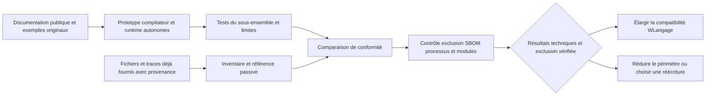

# Synthèse et décisions proposées

Date de recherche : **26 octobre 2026**. Nature du livrable : étude de conception, spécification et plan de validation. Aucun compilateur, importeur ou moteur compatible n'est présenté ici comme déjà réalisé.

## 1. Réponse à l'objectif

La question immédiate est la **faisabilité technique d'une reprise du code WLangage d'origine**, avec un compilateur et un runtime développés indépendamment. C'est l'objectif prioritaire de l'étude et du prototype proposé. Le modèle commercial ou une décision de publication ne sont pas des préalables à cette preuve de concept autonome.

**Contrainte ferme du projet : aucune utilisation de DLL, outil ou autre composant PC SOFT dans la chaîne de développement, d'import, de construction, de test, de données ou d'exécution.** Sont exclus IDE, convertisseur/exporteur, compilateur, framework, SDK, pilote, serveur HFSQL, pont et exécutable d'origine servant d'oracle, même exécutés chez un client pour notre workflow. Les sources, exports, spécifications publiques, jeux et traces **déjà disponibles** peuvent être fournis comme entrées passives avec leur provenance. Aucun export supplémentaire ne sera demandé par l'intermédiaire d'un outil PC SOFT.

Les deux dimensions deviennent des exigences simultanées : **conserver le code comme source maintenue** et **supprimer toute dépendance logicielle PC SOFT de notre chaîne**. Une implémentation indépendante doit réunir les deux sur le périmètre annoncé. L'incompatibilité d'un élément devient un blocage explicite ; elle n'autorise pas l'ajout d'un pont propriétaire.

| Trajectoire | Résultat recherché | Conséquence et condition |
| --- | --- | --- |
| A — compatibilité du code, priorité de l'étude | Continuer à écrire et déboguer les traitements d'origine en WLangage | Compilateur/runtime originaux et outils tiers non PC SOFT ; indépendance dès le prototype, import et tests compris |
| B — conversion ou réécriture explicite | Reprendre les fonctionnalités si la conservation du code échoue pour un élément | Même exclusion PC SOFT ; changement de langage maintenu annoncé, sans le compter comme code inchangé |

Dans A, le C# éventuellement généré serait un artefact interne. Dans B, le langage cible deviendrait la source maintenue : l'engagement porterait sur les fonctionnalités et les données, avec les changements tracés. Les stratégies historiques de conservation de HFSQL ou de pont vers WINDEV sont **exclues du projet**, même à titre transitoire.

Une implémentation indépendante du langage est une **hypothèse technique à éprouver sur un périmètre fini**. Le prototype emploie code original, spécifications et exemples synthétiques sans logiciels ni composants PC SOFT. L'applicabilité à ce travail autonome des clauses encadrant l'utilisation de WINDEV ou de son framework n'est pas démontrée dans le dossier. Aucun avis juridique individualisé n'a été obtenu ; aucun avis préalable n'est posé ici comme condition au codage autonome. Les questions de commercialisation ou diffusion restent distinctes de la preuve de faisabilité.

Le principal investissement ne sera probablement pas la reconnaissance des mots `SI`, `POUR` ou `PROCÉDURE`. Il sera dans les bibliothèques WLangage, le modèle d'événements, les comportements implicites des champs, la sémantique HFSQL, les états et l'import de métadonnées. C'est une conclusion d'architecture de cette étude, à confirmer par le pilote.

## 2. Les cinq compatibilités à contractualiser pour la trajectoire A

| Niveau | Promesse distincte | Preuve requise |
| --- | --- | --- |
| Sources | Les traitements WLangage restent maintenus en WLangage, avec leur texte conservé | Empreintes des originaux, correspondance traitement/événement, journal de toute modification |
| Projet | Fenêtres, champs, états, analyse, requêtes et ressources sont repris | Inventaire avant/après et statut pour chaque propriété et chaque ressource |
| Exécution | Résultats conformes au contrat public et aux observations déjà fournies du profil | Cas attendus sourcés, fixtures/traces passives avec provenance ; aucun moteur PC SOFT exécuté, aucune parité totale déduite |
| Usage développeur | Le travail quotidien conserve les repères de l'AGL | Parcours chronométrés par des développeurs WINDEV, débogage dans le WLangage |
| Usage final | La nouvelle application permet les mêmes opérations | Recette métier, clavier, données, impressions, accessibilité et performances |

Une application qui compile n'a démontré que sa compilabilité. Une capture visuellement proche ne démontre ni la gestion du focus, ni les filtres HFSQL, ni les traitements de sortie de champ.

## 3. Ce que les sources changent dans le plan

Le format texte prévu pour Git est une porte d'entrée **lorsqu'un export existe déjà et est fourni**. Le support technique PC SOFT documente cette possibilité ; cela ne constitue pas un schéma public complet. Notre chaîne ne lance pas WINDEV pour produire ou convertir cet export. Elle lit les fichiers reçus avec ses propres importeurs, conserve les portions opaques et bloque l'élément si les informations indispensables ne sont pas récupérables sans outil PC SOFT. [PC SOFT, enregistrement des projets en texte](https://blogs.pcsoft.fr/fr/obtenir-access-token-operations-pull-commit-push-projet-partage-git-heberge-chez-github/281474976710987/read.awp).

La version du produit ne suffit pas à définir le langage d'un projet. Des options de compilation influencent notamment l'évaluation des conditions et d'autres comportements. L'import doit donc produire un profil de compatibilité **version + build + options + cible + encodage**, conserver les réglages non résolus comme inconnus dans le bilan, puis bloquer la génération du périmètre concerné jusqu'à leur résolution. [PC SOFT, onglet Compilation du projet](https://doc.pcsoft.fr/?9500218=).

Le moteur de données cible proposé est **PostgreSQL avec un pilote non PC SOFT**. Les fonctions `H*` nécessitent une couche sémantique originale pour curseurs, filtres, verrous et erreurs : un accès SQL seul ne prouve pas leur équivalence. Les entrées sont des schémas et exports de données déjà fournis, ou des jeux synthétiques. Aucun pilote, serveur HFSQL ou accès distant indirect à ce moteur n'est prévu. Un fichier de données opaque sans lecteur indépendant éprouvé reste bloquant ; voir le [chapitre données](04-donnees-integrations-et-cibles.md).

Le [contrat WINDEV publié, article 4](https://doc.pcsoft.fr/fr-FR/?4510001=&name=License_WINDEV), et la [licence du framework, article 3](https://doc.windev.com/fr-FR/?1000019581=&name=licence_framework_windev), concernent l'utilisation des produits couverts. Notre architecture exclut cette utilisation ; elle conserve la provenance des sources et informations reçues. Le dossier ne conclut ni à la nullité générale des clauses ni à l'interdiction du code autonome. Voir le [chapitre juridique](09-propriete-intellectuelle-et-licences.md) pour l'analyse séparée des droits et de la diffusion future.

Les améliorations proposées doivent partir de la réalité du produit de référence. PC SOFT annonce déjà, dans sa version 2026, de l'assistance IA, du hot reload et des évolutions de sécurité et d'intégration. L'avantage à construire porte donc sur la transparence, l'interopérabilité, les preuves de compatibilité et l'ouverture des formats, plutôt que sur la seule présence de ces fonctions. [Annonce officielle 2026](https://forum.pcsoft.fr/fr-FR/pcsoft.fr.windev/278021-pcsoft-version-2026-windev-webdev-windev-mobile-est/read.awp).

## 4. Stratégie de preuve technique et architecture proposée

**Étage 1 — prototype autonome et inventaire.** Développer frontend, types du runtime et cas synthétiques à partir des informations publiques. Inventorier les fichiers/exports déjà fournis et leur provenance, sans en commander la génération par PC SOFT. Ces tests prouvent le fonctionnement du prototype et les règles documentées couvertes, pas l'équivalence générale à WINDEV.

**Étage 2 — confronter aux preuves disponibles et élargir.** Importer les fichiers reçus et comparer aux fixtures, traces et documents de référence déjà fournis ; relever leur couverture et leurs inconnues. Ne pas exécuter l'application PC SOFT d'origine, même chez un tiers pour produire de nouvelles preuves. Une information manquante reste à spécifier ou bloque l'élément ; elle n'est pas inventée. Poursuite A, réduction du périmètre ou B reposent sur les résultats, sans annoncer une parité totale faute d'oracle exécuté.

Pour éprouver A, le premier périmètre proposé est **Windows desktop**, un profil source précis, quelques familles de champs et des applications de gestion représentatives. .NET et WinForms sont les premiers candidats techniques à tester, sans utilisation du framework PC SOFT dans le prototype. Le runtime proposé serait développé indépendamment. Le premier harnais peut interpréter l'IR ; le backend compilé passe ensuite la même suite. Le [chapitre architecture](05-architecture-cible.md) détaille cette hypothèse, sans prétendre sa conformité déjà démontrée.

Pour B, la pile cible se choisit après inventaire des usages, contraintes d'hébergement, licences, compétences et degré de sortie recherché. Les adaptations des API `H*`, les migrations de données et les remplacements de champs font alors partie du produit. Une réécriture ne peut être comptée comme conservation inchangée du code.

WEBDEV, Android, iOS, Linux et macOS doivent avoir des lignes de couverture propres. Un appel bloquant d'interface desktop ne se transporte pas automatiquement dans le modèle navigateur ; un ActiveX Windows ne devient pas un composant iOS. Le même noyau métier pourra être réutilisé lorsque ses dépendances le permettent. Les adaptations nécessaires seront identifiées avant génération.

## 5. Expérience de développement proposée

Les parcours ci-dessous décrivent la branche d'atelier compatible A. En B, conserver vocabulaire métier, données, navigation et repères utiles reste souhaitable, mais le nouvel outil et son langage peuvent demander une formation ; cette différence doit être annoncée.

Le point d'entrée est « Ouvrir un projet existant ». L'assistant préserve les fichiers originaux, explique les éléments reconnus et présente les blocages par écran, état et dépendance. Le développeur retrouve son arborescence, ses fenêtres, l'analyse, les événements des champs, un éditeur WLangage, l'action GO et le débogueur.

Les fichiers de projet de la nouvelle plateforme sont textuels, documentés et versionnés. Le code compilé généré n'est pas la source de vérité du développeur. Une modification dans le concepteur produit une différence lisible et un identifiant stable, sans réécrire tout le projet. Un panneau de compatibilité relie chaque écart à la source, à sa conséquence et à un test.

La familiarité ne doit pas devenir un obstacle à l'amélioration : mode de transition activé à l'import, raccourcis configurables, vocabulaire connu, puis fonctionnalités modernes accessibles progressivement. La priorité reste la capacité à travailler sans réapprentissage massif. Voir les [parcours UX](03-experience-developpement-et-interface.md) et les [améliorations proposées](08-ameliorations-produit.md).

## 6. Exhaustivité : une exigence mesurable

L'inventaire du dépôt est une **base large d'exigences fonctionnelles**. Ce n'est pas une certification que toutes les fonctions, surcharges, constantes, événements et variantes historiques sont identifiés. Aucun projet client ni SDK installé n'a été fourni pour fermer ce périmètre.

L'exhaustivité se mesure sur un ensemble fini et publié : versions/builds, cibles, catalogue daté, options, formats et corpus. Chaque élément reçoit un statut : conforme au contrat testé, partiel, bloquant, non pris en charge, non applicable justifié, ou inconnu. **Inconnu ne compte jamais comme conforme et n'est jamais éliminé du dénominateur.** Un pont PC SOFT ne peut pas résoudre un blocage dans le périmètre choisi. La preuve contre documentation/fixtures est distincte d'une parité générale avec un moteur d'origine non exécuté.

Deux tableaux de bord sont nécessaires : couverture de la plateforme de référence, et couverture des fonctions effectivement utilisées par un projet. Une fréquence d'usage élevée ne permet pas de retirer les fonctions rares du premier tableau. Pour un pilote, on exige la fermeture de tous les éléments utilisés dans son périmètre, même si la plateforme globale reste incomplète. La procédure détaillée figure dans l'[inventaire de couverture](06-inventaire-fonctionnel-et-couverture.md).

## 7. Ordre de décision

| Décision | Proposition | Condition avant engagement plus large |
| --- | --- | --- |
| Faisabilité immédiate | Prototyper la reprise WLangage avec compilateur et runtime originaux | Cas synthétiques, limites connues et résultats reproductibles ; aucun avis juridique préalable imposé au code autonome |
| Réutilisation des sources | Maintenir le WLangage dans A ; accepter un langage cible dans B si nécessaire | Débogage et exécution inchangée dans A ; recette métier et changements tracés dans B |
| Import | Fichiers et exports déjà disponibles, lus par du code indépendant | Aucune conversion/export par outil PC SOFT ; toute portion opaque et information absente détectée |
| Cible et backend | Windows desktop/.NET/WinForms comme hypothèse de A | Mesures sur le sous-ensemble, conformité sémantique et parcours UI ; réexaminer les candidats si échec |
| Moteur de données | PostgreSQL et adaptateur sémantique `H*` originaux | Aucun serveur/pilote HFSQL ; données importables depuis des exports fournis ou synthétiques |
| Élargissement SQL | Adaptateur PostgreSQL distinct | Tests des contrats `H*`, reprise des données et retour arrière répétés |
| Plateformes suivantes | Services/web puis autres cibles selon demande | Profil de compatibilité et budget séparés pour chaque renderer |
| Exclusion PC SOFT | Appliquer la contrainte à import/build/CI/test/exécution et dépendances transitives | SBOM, processus, modules et connexions contrôlés ; échec si un composant ou service PC SOFT est requis |
| Différenciation | Formats ouverts, reproductibilité et traçabilité | Reconstruction sur poste vierge sans composant ni outil PC SOFT |
| Références de comparaison | Spécifications publiques et preuves passives déjà fournies | Provenance et couverture déclarées ; aucun oracle PC SOFT exécuté ni résultat manquant fabriqué |
| Commercialisation ou diffusion ultérieure | Définir modèle d'exploitation, composants et destinataires | Consultation ciblée sur le produit réel, contrats et droits concernés avant cette étape |
| Publication | Visibilité actuelle publique ; choix de licence de publication différé par le propriétaire | Aucun choix d'ouverture n'est un préalable à la faisabilité ; aucune modification de visibilité proposée ici |

## 8. Premières semaines de travail produit

Commencer par parseur réduit, modèle de valeurs, interprète et cas synthétiques originaux ; ajouter le backend .NET sur le même sous-ensemble. Rechercher en parallèle des dossiers déjà disponibles de projets représentatifs : gestion CRUD et états, interop non PC SOFT, concurrence. Accepter les fichiers, options, jeux et traces déjà fournis avec provenance. Construire le registre de leurs lacunes sans lancer d'IDE, serveur ou application PC SOFT. L'exclusion se contrôle dès la première CI.

On élargit A si la tranche conserve les traitements originaux, les écarts sont explicables, les preuves suffisantes pour le contrat annoncé et l'exclusion vérifiée. Sinon, corriger, resserrer le profil ou retenir B explicitement. Toute dépendance PC SOFT découverte est retirée ou bloque le module ; elle ne devient pas une exception autorisée. Le [plan de réalisation](07-plan-realisation-et-risques.md) distingue ces décisions et les limites de preuve.

## 9. Inconnues à lever

- Versions/builds et options réellement utilisés, dont projets antérieurs au format texte.
- Disponibilité et couverture de fixtures/traces de référence déjà fournies ; aucune exécution PC SOFT prévue pour les compléter.
- Taux de propriétés visuelles et d'états récupérables sans inférence.
- Composants distribués seulement compilés, droits sur les sources et actifs tiers.
- Dépendances exactes HFSQL, matériels, polices, Office, COM, DLL et bibliothèques.
- Cible prioritaire, taille du parc et budgets/contraintes de performances réels.
- Objectif commercial ou interne, dépendances acceptées en transition et exigence d'indépendance à l'état final.
- Portée des clauses relatives aux outils de même nature pour les actes et contrats du projet ; aucune analyse juridique individualisée obtenue.
- Possibilité de lire indépendamment les portions binaires des fichiers reçus ; aucune conversion par outil PC SOFT admise.

Ces inconnues fixent les limites de ce qui peut être démontré aujourd'hui. Le prochain résultat attendu est une preuve de concept autonome de reprise WLangage ; la conformité au patrimoine réel et les questions d'exploitation commerciale viennent avec les actes et résultats correspondants.
