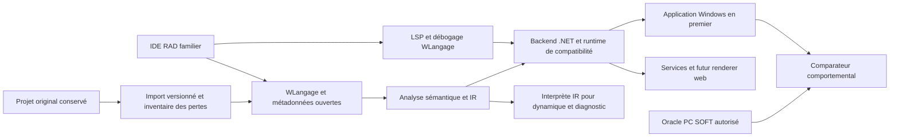

# Synthèse et décisions proposées

Date de recherche : **26 octobre 2026**. Nature du livrable : étude de conception, spécification et plan de validation. Aucun compilateur, importeur ou moteur compatible n'est présenté ici comme déjà réalisé.

## 1. Réponse à l'objectif

La voie qui répond le mieux à « réutiliser le même code source » est de créer une **implémentation indépendante compatible du WLangage**, accompagnée d'un importeur de projets et d'un environnement RAD familier. Le développeur continuerait à écrire et déboguer ses procédures et événements en WLangage ; la transformation vers un langage intermédiaire serait un détail de compilation. Traduire une fois vers C# ou JavaScript puis demander aux équipes de maintenir ce nouveau langage répond à un autre objectif.

Cette voie est techniquement plausible pour un **périmètre explicitement défini et vérifié**. La recherche ne démontre pas la faisabilité d'une compatibilité intégrale de toutes les versions, cibles, composants compilés, formats binaires et dépendances matérielles. Ce serait un produit de plateforme, avec un effort durable de compilation, bibliothèques, outils visuels et maintenance de compatibilité.

Le principal investissement ne sera probablement pas la reconnaissance des mots `SI`, `POUR` ou `PROCÉDURE`. Il sera dans les bibliothèques WLangage, le modèle d'événements, les comportements implicites des champs, la sémantique HFSQL, les états et l'import de métadonnées. C'est une conclusion d'architecture de cette étude, à confirmer par le pilote.

## 2. Les cinq compatibilités à contractualiser

| Niveau | Promesse distincte | Preuve requise |
| --- | --- | --- |
| Sources | Les traitements WLangage restent maintenus en WLangage, avec leur texte conservé | Empreintes des originaux, correspondance traitement/événement, journal de toute modification |
| Projet | Fenêtres, champs, états, analyse, requêtes et ressources sont repris | Inventaire avant/après et statut pour chaque propriété et chaque ressource |
| Exécution | Valeurs, effets de bord, erreurs et ordre d'événements sont équivalents | Tests différentiels contre l'application de référence, avec profil de compilation figé |
| Usage développeur | Le travail quotidien conserve les repères de l'AGL | Parcours chronométrés par des développeurs WINDEV, débogage dans le WLangage |
| Usage final | La nouvelle application permet les mêmes opérations | Recette métier, clavier, données, impressions, accessibilité et performances |

Une application qui compile n'a démontré que sa compilabilité. Une capture visuellement proche ne démontre ni la gestion du focus, ni les filtres HFSQL, ni les traitements de sortie de champ.

## 3. Ce que les sources changent dans le plan

Le format texte prévu pour Git est une porte d'entrée intéressante, mais il faut conserver les parties binaires et relever les caractéristiques non exposées. Le support technique de PC SOFT confirme la possibilité de sauver le code et les éléments en texte ; cela ne constitue pas une spécification publique complète des formats. [PC SOFT, partage des projets et authentification GitHub](https://blogs.pcsoft.fr/fr/obtenir-access-token-operations-pull-commit-push-projet-partage-git-heberge-chez-github/281474976710987/read.awp).

La version du produit ne suffit pas à définir le langage d'un projet. Des options de compilation influencent notamment l'évaluation des conditions et d'autres comportements. L'import doit donc produire un profil de compatibilité **version + build + options + cible + encodage**, conserver les réglages non résolus comme inconnus dans le bilan, puis bloquer la génération du périmètre concerné jusqu'à leur résolution. [PC SOFT, onglet Compilation du projet](https://doc.pcsoft.fr/?9500218=).

Les accès ODBC, OLE DB ou SQL ne sont pas une preuve d'équivalence de toutes les fonctions `H*`. La compatibilité des curseurs, filtres, verrous et erreurs exige son propre moteur d'adaptation et ses essais. La conservation temporaire de HFSQL est une stratégie de réduction du changement, soumise aux interfaces et droits réellement disponibles ; voir le [chapitre données](04-donnees-integrations-et-cibles.md).

Les améliorations proposées doivent partir de la réalité du produit de référence. PC SOFT annonce déjà, dans sa version 2026, de l'assistance IA, du hot reload et des évolutions de sécurité et d'intégration. L'avantage à construire porte donc sur la transparence, l'interopérabilité, les preuves de compatibilité et l'ouverture des formats, plutôt que sur la seule présence de ces fonctions. [Annonce officielle 2026](https://forum.pcsoft.fr/fr-FR/pcsoft.fr.windev/278021-pcsoft-version-2026-windev-webdev-windev-mobile-est/read.awp).

## 4. Architecture recommandée, conditionnelle aux essais

Le premier produit devrait privilégier **WINDEV Windows desktop**, une version source et ses options connues, quelques familles de champs et des applications de gestion représentatives. Le backend proposé utilise .NET et un runtime qui préserve les valeurs et conventions WLangage ; un renderer Windows peut utiliser WinForms et des hôtes natifs. L'IDE et les autres renderers restent découplés. Le premier harnais peut interpréter l'IR ; le backend .NET ne devient une cible de production qu'après passage de la même suite de conformité. Ce choix n'est pas un résultat de benchmark : les prototypes et critères d'abandon sont décrits dans le [chapitre architecture](05-architecture-cible.md).

WEBDEV, Android, iOS, Linux et macOS doivent avoir des lignes de couverture propres. Un appel bloquant d'interface desktop ne se transporte pas automatiquement dans le modèle navigateur ; un ActiveX Windows ne devient pas un composant iOS. Le même noyau métier pourra être réutilisé lorsque ses dépendances le permettent. Les adaptations nécessaires seront identifiées avant génération.

## 5. Expérience de développement proposée

Le point d'entrée est « Ouvrir un projet existant ». L'assistant préserve les fichiers originaux, explique les éléments reconnus et présente les blocages par écran, état et dépendance. Le développeur retrouve son arborescence, ses fenêtres, l'analyse, les événements des champs, un éditeur WLangage, l'action GO et le débogueur.

Les fichiers de projet de la nouvelle plateforme sont textuels, documentés et versionnés. Le code compilé généré n'est pas la source de vérité du développeur. Une modification dans le concepteur produit une différence lisible et un identifiant stable, sans réécrire tout le projet. Un panneau de compatibilité relie chaque écart à la source, à sa conséquence et à un test.

La familiarité ne doit pas devenir un obstacle à l'amélioration : mode de transition activé à l'import, raccourcis configurables, vocabulaire connu, puis fonctionnalités modernes accessibles progressivement. La priorité reste la capacité à travailler sans réapprentissage massif. Voir les [parcours UX](03-experience-developpement-et-interface.md) et les [améliorations proposées](08-ameliorations-produit.md).

## 6. Exhaustivité : une exigence mesurable

L'inventaire du dépôt est une **base large d'exigences fonctionnelles**. Ce n'est pas une certification que toutes les fonctions, surcharges, constantes, événements et variantes historiques sont identifiés. Aucun projet client ni SDK installé n'a été fourni pour fermer ce périmètre.

L'exhaustivité doit être atteinte sur un ensemble fini et publié : versions et builds retenus, cibles retenues, catalogue d'API daté, options de compilation, formats de projet et corpus pilote. Chaque élément reçoit l'un des statuts : conforme prouvé, partiel, pont externe, non pris en charge, non applicable avec justification, ou inconnu. **Inconnu ne compte jamais comme conforme et n'est jamais éliminé du dénominateur.**

Deux tableaux de bord sont nécessaires : couverture de la plateforme de référence, et couverture des fonctions effectivement utilisées par un projet. Une fréquence d'usage élevée ne permet pas de retirer les fonctions rares du premier tableau. Pour un pilote, on exige la fermeture de tous les éléments utilisés dans son périmètre, même si la plateforme globale reste incomplète. La procédure détaillée figure dans l'[inventaire de couverture](06-inventaire-fonctionnel-et-couverture.md).

## 7. Ordre de décision

| Décision | Proposition | Condition avant engagement plus large |
| --- | --- | --- |
| Réutilisation des sources | Maintenir le WLangage comme source de vérité | Débogage et exécution de procédures non réécrites sur un pilote |
| Import | Texte hybride en premier, extraction complémentaire autorisée | Toutes les pertes détectées et classées ; aucun champ supprimé silencieusement |
| Cible initiale | Windows desktop | Parcours métier, impression et interop du pilote validés |
| Moteur de données initial | Conserver HFSQL si l'accès et les droits conviennent | Preuve comportementale et contrat de redistribution analysé |
| Élargissement SQL | Adaptateur PostgreSQL distinct | Tests des contrats `H*`, reprise des données et retour arrière répétés |
| Plateformes suivantes | Services/web puis autres cibles selon demande | Profil de compatibilité et budget séparés pour chaque renderer |
| Différenciation | Formats ouverts, reproductibilité et traçabilité | Export complet et reconstruction d'un projet sur poste vierge |
| Publication | Dépôt de recherche privé par défaut | Visibilité publique à décider séparément si souhaitée |

## 8. Premières semaines de travail produit

Avant de développer un concepteur visuel complet, prendre trois projets représentatifs sous droits appropriés : gestion CRUD et états, application avec interop/matériel, projet avec concurrence ou traitements complexes. Recueillir leurs builds PC SOFT et options exacts. Construire l'inventaire et l'oracle, mesurer l'import, puis exécuter une tranche verticale : ouverture d'écran, validation, accès base, transaction et impression.

On poursuit si la tranche conserve effectivement les traitements originaux, si les écarts sont explicables et si l'import des métadonnées ne dépend pas d'une reconstruction manuelle généralisée. Sinon, resserrer le profil ou choisir explicitement une réécriture assistée. Les estimations de l'étude sont des scénarios d'effort, sans engagement de couverture ou de coût avant cette preuve. Le [plan de réalisation](07-plan-realisation-et-risques.md) donne les jalons.

## 9. Inconnues à lever

- Versions/builds et options réellement utilisés, dont projets antérieurs au format texte.
- Possibilité de relancer légalement et techniquement les applications de référence sur la durée.
- Taux de propriétés visuelles et d'états récupérables sans inférence.
- Composants distribués seulement compilés, droits sur les sources et actifs tiers.
- Dépendances exactes HFSQL, matériels, polices, Office, COM, DLL et bibliothèques.
- Cible prioritaire, taille du parc et budgets/contraintes de performances réels.
- Conditions PC SOFT applicables à chaque licence et build ; aucune gratuité ou redevance générale n'est déduite d'une ancienne brochure.

Ces inconnues n'empêchent pas de concevoir la plateforme. Elles empêchent de promettre aujourd'hui une migration intégrale, inchangée et certifiée d'un patrimoine qui n'a pas été examiné.
