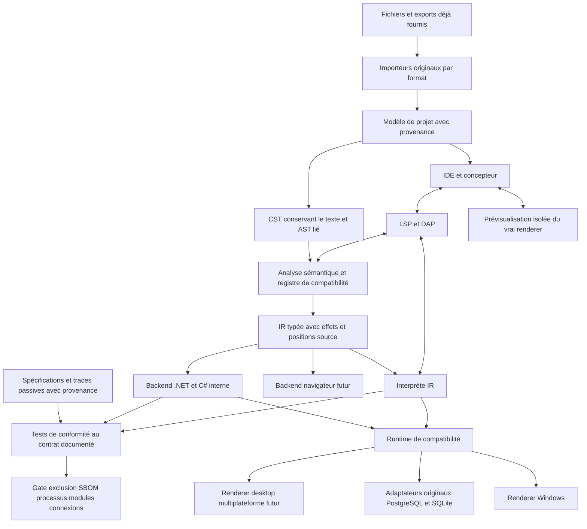

# Architecture autonome : reprise du WLangage sans composant PC SOFT

Date de recherche : **26 octobre 2026**. Statut : **hypothèses d’architecture à prototyper**, sans compilateur, importeur ni compatibilité exécutée dans cette étude. La priorité est la preuve technique de reprise WLangage par du code original autonome. Aucun avis juridique préalable au développement sans WINDEV ni framework PC SOFT n'est posé comme condition par ce chapitre. Les documents [Langage et import](02-langage-et-import.md), [Données et cibles](04-donnees-integrations-et-cibles.md), [Expérience développeur](03-experience-developpement-et-interface.md) et [Contrats et licences](09-propriete-intellectuelle-et-licences.md) détaillent leurs domaines respectifs.

## 1. Hypothèse technique à éprouver en premier

La priorité est **A — compatibilité du code** : conserver le WLangage comme source maintenue par une implémentation indépendante. **L'exclusion de tout outil ou composant PC SOFT est ferme dès l'import, le développement, la construction et les tests, puis en production.** Le code de la plateforme est original ; les outils tiers et leurs dépendances sont non PC SOFT. Cela exclut DLL, framework, SDK, IDE, exporteur/convertisseur, pilote, serveur HFSQL et pont, ainsi que l'exécution d'un original PC SOFT comme oracle, même chez un tiers pour notre workflow. B, conversion/réécriture explicite si A échoue, respecte la même exclusion.

Choisir les premières expériences d'après les contraintes techniques : conservation du WLangage, desktop Windows, types et événements à reproduire, interop effectivement utilisée et ressources de l'équipe. .NET et WinForms peuvent être essayés après admission exacte des outils nécessaires sur ce sous-ensemble original. Le modèle commercial, les pays et la distribution future éclaireront une phase ultérieure ; ils ne conditionnent pas le démarrage du prototype.

Le [contrat WINDEV publié, article 4](https://doc.pcsoft.fr/fr-FR/?4510001=&name=License_WINDEV), et la [licence du framework, article 3](https://doc.windev.com/fr-FR/?1000019581=&name=licence_framework_windev), visent l'utilisation des produits couverts. Cette utilisation est exclue de notre architecture. Leur applicabilité au code autonome original n'est pas démontrée ; elles ne constituent pas ici un veto au prototype. Les sources, exports, traces et fixtures déjà fournis restent des entrées passives avec provenance ; aucune nouvelle observation par exécution PC SOFT n'est demandée. La diffusion future relève d'une analyse distincte, sans avis préalable imposé au codage autonome.

### 1.1 Ce que signifie « indépendant »

| Dimension | Objectif à vérifier | Ce qui ne suffit pas à le prouver |
| --- | --- | --- |
| Langage | Analyseur, compilateur et sémantique implémentés indépendamment | Conserver la syntaxe WLangage ne supprime pas le coût de suivi de ses versions ni les questions sur les actes de développement |
| Import et construction | Aucun IDE, générateur, exporteur, convertisseur, SDK ou compilateur PC SOFT, local ou délégué | Générer du C# après avoir demandé un export WINDEV pour notre workflow |
| Exécution et tests | Runtime original, aucun framework PC SOFT ni oracle de ce fournisseur | Appeler une DLL PC SOFT via adaptateur, sous-processus ou pont réseau chez un tiers |
| Données | PostgreSQL + SQLite d’abord, pilotes non PC SOFT ; schémas/exports déjà fournis ou jeux synthétiques | Accéder à HFSQL par SQL, ODBC, API ou service distant |
| Exploitation et maintenance | Installation, support, mises à jour et restauration réalisables avec les composants retenus | Une exécution réussie sur une machine qui possède encore toutes les dépendances d'origine |

Dans ce chapitre, **runtime de compatibilité** désigne une implémentation originale à développer. Tout module PC SOFT, même isolé ou transitoire, est exclu. Un composant externe contenant transitivement un tel module est également exclu ; un nom renommé ou un accès réseau ne change pas cette décision.

### 1.2 Deux étages de preuve

**Étage 1 : code autonome, inventaire et cas originaux.** Construire frontend, types et premiers moteurs sur des exemples synthétiques et les règles publiques. Lire uniquement les fichiers/exports déjà fournis avec des importeurs originaux. Une portion opaque non résolue est conservée et bloque la fonctionnalité qui en dépend. Aucun IDE n'est appelé pour exporter ou convertir le projet.

**Étage 2 : conformité aux preuves disponibles.** Comparer traitements, imports, événements, données et documents aux spécifications publiques et fixtures/traces déjà fournies, avec provenance. L'absence d'observation laisse un contrat non vérifié, sans exécution de l'application d'origine pour combler le manque. Les deux moteurs originaux peuvent être comparés entre eux, mais leur accord peut partager le même défaut : il ne prouve pas une parité totale avec PC SOFT. Le [plan de réalisation](07-plan-realisation-et-risques.md) publie ces limites.

### 1.3 Branche A : architecture du prototype

**Les sections 2 à 18 détaillent A sous l'exclusion ferme ; la conformité reste à démontrer.** Le prototype étudie un compilateur WLangage indépendant, un runtime explicite et un modèle UI partagé entre concepteur et application. Commencer par constructions originales puis projets de gestion dont les fichiers sont déjà disponibles. La couche données est désormais multi-moteurs : PostgreSQL et SQLite initiaux, SQL Server ensuite ; la couche de contrats `H*` est originale et ne charge aucun composant HFSQL. Les scénarios historiques de conservation de HFSQL ou de pont PC SOFT sont exclus.

La base d’implémentation demandée est **C#**, avec génération interne de C# puis compilation en IL par une toolchain **.NET LTS** admise, et Windows Forms comme renderer candidat pour la première cible desktop. Le [plan de réalisation](16-plan-detaille-de-realisation.md) et l’[architecture multi-BDD](18-architecture-csharp-multi-bdd-et-reemploi.md) détaillent les modules et gates. Le développeur continuerait d’écrire et de déboguer son WLangage. Le C# généré serait un artefact de construction, sans devenir la source durable du projet. Un interprète de la même représentation intermédiaire servirait aux évaluations du débogueur, aux constructions dynamiques prises en charge et à la comparaison des exécutions.

Cette hypothèse privilégie la réalisation d’une compatibilité Windows, l’interopérabilité .NET et le diagnostic ; aucune vitesse de réalisation n'a été mesurée. Elle ne signifie pas que la sémantique WLangage serait celle de C#. La génération doit traduire chaque différence par une opération du runtime. Une simple substitution de noms de fonctions et d’opérateurs serait insuffisante.

Le deuxième renderer desktop peut utiliser **Avalonia**, après qualification. L’IDE peut lui-même utiliser Avalonia dès le départ, ou rester Windows Forms pendant le premier pilote si l’équipe n’a pas cette compétence. Le renderer navigateur doit être distinct, fondé sur le DOM et sur une séparation explicite client/serveur. La présence de cibles multiples dans un framework ne prouve aucune compatibilité avec WINDEV, WEBDEV ou WINDEV Mobile.

## 2. Contrat à préserver

Un projet doit déclarer son **profil de compatibilité** : version PC SOFT d’origine, configuration, dialecte, cible, architecture processeur, encodages, options de compilation et dépendances. Ce profil est figé par défaut. Une mise à jour du nouvel outil ne peut pas moderniser implicitement les conversions, l’ordre des événements ou les règles de tri.

L’engagement mesurable comporte cinq dimensions : acceptation des sources, résultat des calculs, effets externes, comportement d’interface et exploitation. Les taux doivent être publiés séparément. « 99 % des fonctions reconnues » ne prouve ni l’exactitude d’un arrondi financier ni la reprise d’une fenêtre utilisée quotidiennement.

Chaque fonctionnalité reçoit un état parmi : `inconnue`, `spécifiée`, `implémentée`, `testée isolément`, `conforme au profil`, `limitée`, `indisponible sur cette cible`. La compilation d’une fonctionnalité inconnue ayant un effet observable doit échouer avec un diagnostic localisé. Un stub qui renvoie silencieusement zéro ou une chaîne vide détruit la confiance dans la migration.

## 3. Vue d’ensemble



Le modèle de projet, le compilateur et la ligne de commande ne dépendent pas du processus de notre IDE. Les mêmes commandes fonctionnent sur un agent sans écran et sans installation PC SOFT. Le concepteur dialogue avec une prévisualisation de notre renderer, sans exécuter un élément importé sous un runtime propriétaire.

## 4. Compilation, transpilation et interprétation

| Approche | Avantage pour cette migration | Difficulté principale | Usage proposé |
| --- | --- | --- | --- |
| Réécriture du code en TypeScript, C# ou Java | Écosystème disponible ; voie de sortie B si les dépendances sont remplacées | Le code d’origine cesse d’être la source maintenue ; aller-retour fragile | Trajectoire B à choisir explicitement, sans la compter comme code inchangé |
| Transpilation textuelle directe | Première démonstration rapide | Portées, conversions, alias, événements, fonctions implicites et erreurs divergent | À exclure comme architecture du produit |
| Compilateur WLangage vers C# via IR | Backend mature ; interop .NET ; outils Windows | Runtime sémantique et débogage source indispensables | Premier backend candidat de la branche A |
| Compilateur WLangage vers LLVM | Contrôle des types, ABI et optimisations ; sorties natives | GC, exceptions, débogage, bibliothèques et outillage restent à construire | Réévaluer si un profil de charge le justifie |
| Interprète AST/IR | Introspection, dynamique, instrumentabilité | Débit et consommation à mesurer ; ne règle pas l’UI | Référence interne, dynamique et certains scénarios de test |
| Bytecode et machine virtuelle dédiés | Contrôle homogène des sémantiques | Coût d’une VM, d’un débogueur et d’un écosystème complet | Alternative si .NET impose des écarts bloquants |
| Génération JS/TypeScript | Distribution navigateur naturelle | Nombres, dates, threads, blocage et APIs natives différents | Backend spécialisé après stabilisation de l’IR |

Le mot « transpilation » n’est donc pas un problème en soi. La différence essentielle est l’existence d’une analyse sémantique complète et d’un contrat de runtime. Le compilateur peut produire du C# tout en conservant une sémantique WLangage, comme il peut produire du code natif erroné si cette sémantique est mal spécifiée.

LLVM possède un régime de licence Apache-2.0 avec exception LLVM ; l’inclusion de composants et de bibliothèques doit être examinée sur les versions réellement livrées. Cette licence est un avantage d’intégration, pas un argument suffisant pour développer un backend natif au premier jalon. [Politique officielle LLVM](https://www.llvm.org/docs/DeveloperPolicy.html).

## 5. Frontend et représentation des sources

### 5.1 Deux représentations complémentaires

Le **CST** conserve tokens, commentaires, espaces, accents, fins de ligne, orthographe et positions. L’**AST** représente procédures, déclarations, expressions, classes, événements et références résolues. Chaque nœud AST pointe vers le CST et vers l’élément importé : fichier, objet, traitement, intervalle d’octets et version.

Les mots français et anglais correspondant à la même construction sont normalisés dans l’AST. Le CST garde leur écriture originale. Le formateur n’est pas appliqué lors d’un import. Une transformation ne réécrit que les fragments qu’elle modifie. Les noms de champs et les procédures générées implicitement doivent recevoir des symboles stables, distincts de leur libellé affiché.

Une grammaire ANTLR est un choix initial raisonnable pour le compilateur C# ; ANTLR produit des parseurs et des arbres à partir d’une grammaire. Le générateur ne fournit pas une grammaire WLangage validée : celle-ci devra être construite et vérifiée sur le corpus autorisé. [Présentation ANTLR](https://www.antlr.org/about.html), [licence ANTLR](https://www.antlr.org/api/maven-plugin/latest/license.html).

Tree-sitter est utile pour la coloration et l’analyse incrémentale tolérant du code incomplet. Une seconde grammaire crée toutefois un risque de divergence : ses sorties ne doivent pas devenir une deuxième définition du langage. Un corpus commun et des tests de reconnaissance doivent relier les deux grammaires ; commencer avec un seul parseur est préférable si les temps de réponse conviennent. [Présentation Tree-sitter](https://tree-sitter.github.io/tree-sitter/), [licence MIT](https://github.com/tree-sitter/tree-sitter/blob/master/LICENSE).

### 5.2 Analyse sémantique

L’analyse construit une table des symboles par projet, configuration et contexte d’exécution. Elle distingue variables, propriétés de champs, rubriques de fichiers, paramètres, procédures, classes et constantes. Elle résout les surcharges en utilisant les règles du profil, sans déléguer cette décision au compilateur C#.

Elle annote explicitement : type attendu, conversion choisie, passage par référence, stockage partagé, disponibilité par cible, droits requis et effets possibles. Les expressions d’indirection et les noms calculés sont conservés comme opérations dynamiques. Leur analyse statique produit une liste prudente de dépendances, complétée par les traces de test ; elle ne peut prouver seule toutes les dépendances d’un nom construit à l’exécution.

### 5.3 IR avec effets observables

L’IR doit rester suffisamment proche du langage pour expliquer un diagnostic, et suffisamment explicite pour générer plusieurs backends. Exemples d’opérations proposées : `LoadFieldValue`, `SetFieldProperty`, `ConvertNumber`, `ReadRecord`, `OpenModal`, `RaiseCompatibilityError`, `InvokeDynamic` et `PrintBand`. Ce sont des noms internes proposés, pas des fonctions existantes de PC SOFT.

Chaque opération porte : identifiant source, type, profil, domaine d’exécution et effets (`UI`, `DataRead`, `DataWrite`, `File`, `Network`, `Native`, `Suspend`, `Dynamic`). L’ordre d’évaluation est matérialisé. Une optimisation ne peut déplacer une opération à travers un effet incompatible. Une lecture de champ dépendant d’un événement ne devient pas une constante parce que son type C# semble stable.

## 6. Runtime de compatibilité

Le runtime constitue le cœur du produit. Il doit rester utilisable par le backend compilé et l’interprète, sans branche de sémantique indépendante.

| Domaine | Représentation proposée | Contrat public et traces disponibles à vérifier pour le profil |
| --- | --- | --- |
| Numérique | Types dédiés ou wrappers sélectionnés par type source | Précision, échelle, saturation/dépassement, division, arrondis, conversions |
| Monétaire/décimal | Mantisse et échelle explicites ; capacité fixée par profil | Ne pas supposer que `decimal` .NET suffit pour tous les types et versions |
| Chaînes | Chaîne avec information d’encodage quand nécessaire | Comparaison, indices, découpage, NUL, Unicode/ANSI, normalisation |
| Dates et durées | Types métiers indépendants des dates locales de l’hôte | Valeur vide, invalide, calculs, format, fuseau et précision |
| Tableaux et collections | Conteneurs avec règles d’indexation propres | Bornes, dimensions, copie, référence, tri, itération après mutation |
| Variant et Null | Union étiquetée ; état Null distinct des valeurs vides | Propagation, comparaisons, affectations et sérialisation |
| Objet et référence | Identité stable et cellules de stockage explicites | Alias, durée de vie, destruction, héritage, accès aux membres |
| Champ et fenêtre | Références vers modèle UI et instance de session | Résolution du nom, instance active, propriété par défaut, état |
| Données | Contexte de curseur et tampon d’enregistrement | Position courante, fin de parcours, erreurs, verrouillage, transactions |
| Erreur | Objet structuré et état attaché au contexte approprié | Code, message, pile, récupération et visibilité entre traitements |

Ne pas généraliser « tout est un `WlValue` » sans mesure. Les valeurs primitives statiquement prouvées peuvent utiliser des représentations efficaces, tandis que les frontières dynamiques emploient l’union étiquetée. Une optimisation doit garder la même observation dans le débogueur et les mêmes conversions.

Les fonctions système utilisent des interfaces injectables : horloge, hasard, système de fichiers, accès réseau, imprimante et fournisseur de données. Les tests peuvent les remplacer par des implémentations déterministes. En production, ces interfaces appellent les services réels. Leur contrat doit préserver les codes de retour et les erreurs attendus ; la neutralité du nom d’interface n’implique pas neutralité du comportement.

## 7. Exécution, événements et blocage

Un **contexte d’exécution** regroupe session, utilisateur, profil, variables globales pertinentes, connexions, transactions et état d’erreur. Les tâches ne partagent pas implicitement tout cet état. La qualification doit déterminer ce qui est global au processus, au thread, à une fenêtre ou à une requête selon la fonctionnalité d’origine.

Un répartiteur traite les événements UI dans leur domaine. Il distingue entrée utilisateur, initialisation, modification programmée, validation, fermeture et événements de liaison de données. Les comportements de réentrance, annulation et propagation sont des contrats testés. Convertir automatiquement chaque traitement en tâche .NET changerait l’ordre d’exécution et les accès aux champs ; cette transformation est interdite en mode compatibilité.

Le desktop peut utiliser une boucle modale lorsque le profil l’exige. Le navigateur ne peut reproduire une pile native bloquée en attendant librement un aller-retour réseau. Le backend web doit transformer les opérations suspendables en continuations, préserver les variables et références nécessaires, et qualifier les effets de réentrance. Certaines constructions ou dépendances natives resteront indisponibles. Le compilateur doit identifier ces cas avant génération.

Le lancement d’un thread, une minuterie et une procédure asynchrone doivent donc être trois opérations distinctes dans l’IR. Les tests doivent vérifier l’annulation, la fermeture de fenêtre pendant un traitement, la fin de transaction et la livraison tardive d’un événement. Les captures d’interface ne suffisent pas à détecter ces erreurs.

## 8. Modèle UI et fidélité du concepteur

Le modèle UI décrit arbre des champs, identifiants, coordonnées et unités, ancres, plans, styles, données, événements, navigation clavier, accessibilité et variantes. Les propriétés importées inconnues restent dans une section opaque avec provenance. Si une propriété peut changer le résultat, le rapport bloque la certification de l’élément jusqu’à son traitement ; la conserver en fichier sans l’exécuter ne constitue pas une compatibilité.

Le concepteur et le runtime consomment le même modèle. Une modification graphique est une commande versionnée (`MoveControl`, `SetProperty`, `BindEvent`) avec annulation. Le moteur de persistance transforme cette commande en patch minimal. Il ne sérialise pas tout un écran à chaque déplacement.

Le mode de fidélité conserve les coordonnées et le comportement importés. Un mode modernisation peut ensuite introduire responsive, thèmes ou nouveaux composants, après choix explicite. Les FAA et autres comportements automatiques doivent être des services du renderer : tri, filtre, export, redimensionnement, recherche, mémoire des choix et droits. Une grille de framework fournissant quelques opérations ne remplace pas ce contrat.

Le renderer Windows initial peut s’appuyer sur Windows Forms pour les champs standards, les dialogues et les hôtes spécifiques. Microsoft documente un ensemble de contrôles extensibles, y compris des contrôles personnalisés et ActiveX. Cela facilite un socle Windows, mais ne prouve pas l’équivalence d’une table, d’un état ou d’un champ métier WINDEV. [Contrôles Windows Forms](https://learn.microsoft.com/en-us/dotnet/desktop/winforms/controls/controls-to-use-on-windows-forms), [vue d’ensemble Windows Forms](https://learn.microsoft.com/en-us/dotnet/desktop/winforms/overview/).

Les contrôles complexes — table hiérarchique, zone répétée, planning, graphe, éditeur bureautique — passent chacun une sélection entre développement propre, composant tiers et maintien temporaire dans l’application d’origine. Le coût et la licence du composant font partie du choix. Une capture raster ne préserve ni saisie ni lecteurs d’écran.

## 9. Choix du toolkit

| Technologie | Intérêt | Limites pour le projet | Décision proposée |
| --- | --- | --- | --- |
| .NET + Windows Forms | Contrôles Windows, interop, impression, déploiement desktop | Windows seulement ; composants avancés et thèmes à réaliser | Premier renderer d’application ; banc d’essai natif |
| .NET + Avalonia | Cohérence avec runtime .NET ; IDE et desktop multiplateformes | Rendu différent ; qualification des contrôles, accessibilité et plateformes | IDE possible ; deuxième renderer après preuve |
| Qt Widgets/Quick + C++ | Desktop mature, outils graphiques, accès natif | Deuxième stack si backend .NET ; obligations variables selon modules | Alternative sérieuse si expertise C++ ou dépendances Qt existantes |
| Electron + HTML/TypeScript | Écosystème éditeur et UI web ; cohérence avec DOM | Empreinte et surface de mise à jour ; ponts natifs ; événements différents | Alternative pour la coque IDE, pas moteur sémantique universel |
| Flutter/Dart | UI mobile et desktop partagée, accès aux services natifs | Runtime supplémentaire ; interop et modèle UI à adapter | Candidat renderer mobile après comparaison, pas choix initial |
| DOM + TypeScript | Accessibilité et usages navigateur ; déploiement web | APIs locales et blocage limités ; séparation serveur obligatoire | Renderer web spécialisé |

Avalonia annonce plusieurs cibles et distingue des niveaux de support qui peuvent évoluer. Sa matrice doit être figée avec la version choisie ; la disponibilité générale d’une cible ne garantit pas que chaque contrôle et intégration possède le niveau requis. Son cœur est sous licence MIT ; les offres et composants additionnels s’examinent séparément. [Plateformes Avalonia](https://docs.avaloniaui.net/docs/supported-platforms), [licence du dépôt](https://github.com/AvaloniaUI/Avalonia/blob/main/licence.md).

Qt propose des licences commerciales et des voies LGPL/GPL selon les composants. Certains modules ne sont pas disponibles sous LGPL. Le choix ne peut donc pas se résumer à « Qt est gratuit » ; un inventaire exact des modules et de leur distribution est nécessaire. [Licences Qt](https://doc.qt.io/qt-6/licensing.html).

Flutter possède son propre moteur de rendu et des mécanismes d’intégration natifs, dont canaux de plateforme et FFI. Cela en fait un candidat crédible pour un renderer, mais ne fournit ni compilateur WLangage ni équivalence des widgets importés. [Architecture Flutter](https://docs.flutter.dev/resources/architectural-overview).

Si Electron est retenu pour la coque, isoler le contenu, désactiver l’accès Node des pages non fiables, exposer un pont étroit et appliquer une politique de contenu. Ces mesures suivent les recommandations officielles ; l’exécution d’une extension native exige encore une isolation supplémentaire. [Sécurité Electron](https://www.electronjs.org/docs/latest/tutorial/security).

## 10. Web et mobile : deux programmes de compatibilité distincts

Pour le web, séparer trois situations : reprendre un projet WEBDEV qui distingue déjà navigateur et serveur ; exposer un métier desktop en service ; transformer une interface desktop en interface navigateur. Les coûts diffèrent fortement. Une exécution WLangage côté serveur avec rendu DOM distant peut accélérer certains pilotes, mais ajoute latence, dépendance réseau et état de session. Elle doit être présentée comme un mode connecté avec limites, pas comme conversion universelle.

Le backend navigateur consomme l’IR autorisée côté client et ne reçoit aucun secret de connexion serveur. Les modèles partagés déclarent sérialisation, validation et droits. Le serveur revalide toute requête. Les propriétés calculées côté client restent des données non fiables. Les appels de fichiers, imprimantes et matériel nécessitent une capacité web disponible ou un agent local explicitement installé et authentifié.

Pour Android et iOS, le renderer doit ajouter cycle de vie, reprise après suspension, permissions, navigation et synchronisation hors connexion. Le code métier portable peut être réutilisé ; un composant COM ou une DLL Windows ne le devient pas. L’AOT et l’interprétation doivent être qualifiées selon la plateforme et les règles de distribution retenues. Le projet ne doit pas faire dépendre son MVP Windows de cette qualification.

## 11. Interopérabilité et adaptateurs

Les interfaces de plateforme proposées sont `IDataProvider`, `IUiHost`, `IPrintService`, `IFileService`, `INativeBridge` et `IIdentityProvider`. Leur interface réelle devra être spécifiée avec erreurs, transactions, annulation, ownership et durée de vie. Les adaptateurs ne peuvent aplatir tous les comportements dans un simple CRUD générique.

`INativeBridge` désigne uniquement l'intégration de composants **non PC SOFT** inventoriés, par exemple une bibliothèque matérielle tierce. Ce n'est pas une ouverture vers un runtime, une DLL, un serveur ou un oracle PC SOFT. Une dépendance transitive interdite bloque l'intégration.

Un pont natif choisit explicitement architecture x86/x64/ARM64, convention d’appel, encodage, alignement des structures, allocation et libération. Un processus x64 ne charge pas directement une bibliothèque x86 : un auxiliaire x86 peut exposer des opérations définies via IPC, mais aucun pointeur brut ne traverse cette frontière. Les callbacks sont convertis en identifiants de session avec règles de thread et de fin de vie.

La prise en charge COM de .NET est spécifique à Windows ; elle ne rend pas l’automatisation Office ou ActiveX portable. Le profil Windows peut préserver ces dépendances tant que versions, architecture et autorisations conviennent. [Interop COM .NET](https://learn.microsoft.com/en-us/dotnet/standard/native-interop/cominterop).

Les premiers fournisseurs de données ciblent PostgreSQL et SQLite avec pilotes indépendants de PC SOFT ; les contrats ne référencent aucun fournisseur concret. SQL Server puis les moteurs optionnels repassent chacun les mêmes tests et leur admission propre. La couche originale `H*` doit spécifier tampon courant, recherche, parcours, filtres, erreurs, verrous et transactions à partir des contrats publics et preuves reçues. Elle ne se réduit pas à renommer des fonctions SQL. Schémas et données proviennent de formats déjà fournis et lisibles indépendamment ; un fichier natif opaque sans lecteur original éprouvé bloque sa reprise. **HFSQL, ses pilotes et tout pont vers l'exécutable d'origine sont exclus**, même en transition. Voir le [chapitre données](04-donnees-integrations-et-cibles.md).

## 12. Débogueur et langage dans l’IDE

Le serveur de langage expose diagnostics, complétion, navigation, références, renommage prudent, aide aux paramètres et actions de correction. LSP standardise l’interface entre éditeur et service de langage. Il permet de réutiliser le moteur dans l’IDE dédié et dans d’autres éditeurs, sans empêcher un espace de travail familier. [Spécification LSP 3.17](https://microsoft.github.io/language-server-protocol/specifications/lsp/3.17/specification/).

Un adaptateur DAP présente points d’arrêt, pas à pas, pile, variables, exceptions et évaluation en WLangage. Les détails CLR sont une vue avancée. Les références de variables du débogueur doivent respecter leur durée de validité, notamment après reprise d’exécution. DAP définit des capacités négociées ; une fonction non implémentée n’est pas annoncée comme disponible. [Vue d’ensemble DAP](https://microsoft.github.io/debug-adapter-protocol/overview.html).

La chaîne de correspondance est : fichier d’origine → élément/traitement → AST → IR → méthode et position backend. Pour le C# interne, les directives `#line` peuvent contribuer au remappage, mais il faut aussi traduire noms, champs implicites, closures et machines d’état. Des documents virtuels matérialisés permettent d’ouvrir le traitement d’un champ comme source WLangage. [Directives C#](https://learn.microsoft.com/en-us/dotnet/csharp/language-reference/preprocessor-directives).

Pour une sortie JavaScript, produire une source map standard, en protégeant la distribution des sources métier. La carte ne remplace pas la traduction des valeurs ou des exceptions par le débogueur. [Format de source map, ECMA-426](https://tc39.es/ecma426/).

## 13. Format de projet et mises à jour

Le format proposé associe un manifeste JSON versionné, les sources WLangage, des descriptions UI structurées, une description de données, les ressources et un verrou de dépendances. Les identifiants restent stables lors d’un renommage. Les fichiers ont ordre de sérialisation déterministe et schémas publics. Les chemins sont relatifs au dépôt ; secrets et préférences individuelles sont externes.

Deux modes sont nécessaires. En **import conservateur**, les sources texte importées sont la source de vérité et les changements sont des patches contrôlés ; le modèle normalisé est une vue dérivée. En **projet converti**, une conversion explicite et versionnée adopte le format ouvert comme source de vérité. Les deux modes ne doivent jamais éditer indépendamment deux copies autoritaires du même traitement. La conservation d’une archive d’origine n’est pas une promesse de réexport vers tous les formats binaires PC SOFT.

Le manifeste déclare notamment : version de schéma, profil source, configuration, cibles, versions runtime/compilateur, dépendances, adaptateurs, politiques de capacités, liste des divergences acceptées et empreinte de l’import initial. Une migration de schéma produit un diff et conserve la possibilité de restaurer l’ancienne branche.

## 14. Compilation incrémentale et reproductibilité

Le graphe de dépendances doit distinguer signature, corps, ressource, modèle UI, analyse de données et options de profil. Modifier un texte de bouton ne recompile pas tout le moteur. Modifier une signature publique invalide les consommateurs. Une indirection non résolue nécessite une invalidation conservatrice ; un cache trop agressif peut produire un exécutable incohérent.

La clé de cache inclut contenu, profil, version du compilateur, runtime, adaptateurs, options et dépendances. Les chemins et horodatages doivent être normalisés. Deux constructions propres de la même révision visent des artefacts identiques hors signature et métadonnées explicitement non déterministes ; cette propriété sera vérifiée, pas déduite de l’utilisation d’un gestionnaire de paquets.

Chaque livraison produit exécutable ou paquet, symboles, rapport de compatibilité, inventaire des composants, licences, configuration et procédure de retour arrière. CycloneDX est une option standardisée pour représenter composants et dépendances ; SLSA permet de structurer la provenance de construction. Une nomenclature ne prouve pas à elle seule l’absence de vulnérabilités, et la présence d’une attestation ne permet pas d’annoncer un niveau SLSA non vérifié. [CycloneDX](https://cyclonedx.org/specification/overview/), [provenance SLSA](https://slsa.dev/spec/v1.2/provenance).

### 14.1 Gate technique d'exclusion PC SOFT

Ce contrôle est une **exigence à implémenter**, pas une capacité déjà livrée par ce dossier. Chaque chemin d'import/build/test/package/exécution doit fonctionner sur une machine propre sans produit PC SOFT. Produire : inventaire transitif/SBOM et provenance avec empreintes ; liste des outils et processus enfants ; modules natifs et assemblages chargés ; services et connexions nécessaires ; contenu exact du paquet. Utiliser une liste positive de dépendances non PC SOFT et identifier origine/éditeur/empreinte, plutôt que seulement chercher des noms de fichiers `wd*.dll`.

La CI doit refuser toute DLL, assembly, SDK, outil, pilote, serveur, service ou pont PC SOFT détecté ou requis, même fourni par un plugin tiers. Tester aussi la prévisualisation, l'import, le débogage et les chemins d'erreur. Aucun appel délégué au poste client ne contourne la règle. Un composant inconnu est à instruire avant livraison ; il n'est pas implicitement autorisé. Les fichiers métier reçus demeurent des données passives et ne sont jamais lancés comme programme de référence.

La livraison .NET initiale peut être autonome pour ne pas dépendre d’un runtime installé. Le Native AOT reste optionnel : Microsoft documente notamment des limites de génération dynamique, chargement dynamique et COM intégré. La chaîne ne doit pas supprimer une fonctionnalité dynamique du projet pour obtenir seulement un binaire plus petit. [Déploiement Native AOT](https://learn.microsoft.com/en-us/dotnet/core/deploying/native-aot/).

## 15. Extensions, isolation et observabilité

Une extension déclare identifiant, version de protocole, fonctionnalités, cibles, dépendances, licence et capacités demandées. Le protocole prévoit négociation, annulation, délai maximum, diagnostics et reprise après arrêt. L’interface n’expose pas les objets internes du compilateur sans version : elle échange des DTO documentés et des identifiants opaques.

Les extensions d’édition s’exécutent dans un processus séparé. Les adaptateurs natifs et plugins autorisés pour l’application s’exécutent selon le profil choisi. Le code .NET chargé dans un même processus n’est pas une frontière de sécurité. L’ouverture d’un projet ne doit lancer ni scripts d’installation ni code d’initialisation importé. Le mode prévisualisation a des capacités limitées et des données fictives par défaut.

Le code dynamique doit passer le même parseur, le même profil et les mêmes contrôles de capacité que le code statique. Une limite de temps et de mémoire doit pouvoir interrompre l’hôte isolé. WebAssembly peut fournir une isolation utile pour certains modules, mais les accès passent par les API de l’hôte : une API de fichiers ou de réseau trop permissive annulerait l’intérêt du cloisonnement. [Modèle de sécurité WebAssembly](https://webassembly.org/docs/security/).

Tracer les événements UI, appels de données, transactions et franchissements de pont avec identifiants de corrélation. Mesurer démarrage, mémoire, latence d’événement et durée de requête. OpenTelemetry fournit une base interopérable pour traces, métriques et journaux ; l’usage proposé est local par défaut, export configurable, avec masquage des paramètres sensibles. Aucune collecte du code ou des données métier n’est nécessaire au fonctionnement normal. [Signaux OpenTelemetry](https://opentelemetry.io/docs/concepts/signals/).

## 16. Organisation du futur dépôt d’implémentation

Cette arborescence est une **proposition pour développer et éprouver la branche A**, pas un état des fichiers présents dans ce dépôt de recherche. Une réécriture B emploierait une architecture adaptée à la stack choisie, sans exiger un atelier WLangage complet.

```text
src/
  project-model/          # provenance, formats, schémas et patches
  importers/              # modules par version/format
  language/               # lexique, grammaire, AST, liaison et analyse
  ir/                     # opérations typées et effets
  compiler-dotnet/        # émission C# interne, compilation et symboles
  interpreter/            # exécution de l'IR et instrumentation
  runtime-core/           # types, conversions, collections et erreurs
  runtime-platform/       # fichiers, réseau, processus et identité
  data-providers/         # contrats H* originaux, PostgreSQL, SQLite puis extensions
  ui-model/               # description des champs et événements
  ui-winforms/            # premier renderer Windows
  reports/                # bandes, pagination et impression
  language-server/        # LSP
  debug-adapter/          # DAP et traduction des valeurs
  designer/               # commandes et prévisualisation
  ide/                    # coque et parcours familiers
  cli/                    # import, audit, build, test et package
contracts/                # schémas publics et protocoles
conformance/              # cas autorisés, attendus et profils
integration/              # projets pilotes anonymisés sous droits adéquats
benchmarks/               # charges documentées et budgets
docs/adr/                 # décisions, alternatives et preuves
```

Les corpus clients restent privés et séparés de la distribution du produit. Les exemples publics sont originaux ou redistribués sous droits compatibles. La documentation explique les contrats de modules ; elle ne vend pas un nombre de packages comme preuve de maturité.

## 17. Décisions d’architecture à valider

| ADR | Décision proposée | Alternative considérée | Condition de validation et de réexamen |
| --- | --- | --- | --- |
| A00 | Exclusion de tout logiciel PC SOFT dans toute la chaîne | Outils/framework/HFSQL/pont/oracle PC SOFT : exclus | Provenance, SBOM, outils/processus/modules/services inspectés et tests sur machine propre ; aucune délégation chez un tiers |
| A01 | WLangage demeure la source maintenue dans A | Conversion ou réécriture B avec code cible maintenu | Import/modification d’un pilote sans réécriture pour le sous-ensemble certifié ; sinon ne pas revendiquer le même code |
| A02 | IR explicite, indépendante de la cible | Générateur direct WLangage → C# | Tests montrant ordre d’évaluation, références, conversions et événements identiques |
| A03 | Backend .NET en premier | C++/LLVM, JVM, VM dédiée | Interop, diagnostic et charge pilote satisfaisants ; réexamen si un écart runtime est impossible à corriger proprement |
| A04 | Interprète partageant runtime et IR | Deux moteurs sans code sémantique commun | Même suite de conformité exécutée en compilé et interprété ; aucun résultat métier divergent accepté |
| A05 | Windows Forms premier renderer, multiplateforme ensuite | Avalonia ou Qt unique dès le départ | Matrice de champs, impression, modalité et interop validée sur les pilotes Windows |
| A06 | Modèle UI partagé et vraie prévisualisation isolée | Renderer de designer distinct | Propriétés, navigation et captures concordantes entre conception et exécution |
| A07 | Import indépendant des fichiers/exports déjà fournis puis format ouvert | Appel d'IDE/exporteur/convertisseur PC SOFT : exclu | Cycle import–édition–build déterministe ; portions opaques conservées et bloquantes si indispensables |
| A08 | LSP/DAP et diagnostics en WLangage | IDE et débogueur propriétaires couplés | Points d’arrêt, pile et valeurs justes dans les traitements de champs et procédures |
| A09 | Adaptateurs de capacités par cible | API universelle qui émule tout | Erreur à la compilation pour une dépendance indisponible ; limitation compréhensible avant déploiement |
| A10 | Runtime dynamique isolé et AOT optionnel | AOT obligatoire ou plugins illimités | Cas dynamiques qualifiés ; tests d’isolation et de révocation ; décision distincte par plateforme mobile |

## 18. Expériences techniques à engager pour la faisabilité

Les essais emploient exclusivement code original et outils non PC SOFT. Les attendus viennent de règles publiques ou de fixtures/traces déjà fournies avec provenance. Les contrats sans preuve restent non vérifiés ; aucun oracle PC SOFT n'est exécuté pour les compléter. Aucun avis juridique préalable n'est imposé au prototype autonome. Les vérifications de diffusion future restent distinctes.

1. **Frontend** : importer des fichiers déjà fournis comprenant procédure, classe, fenêtre, état, requête et ressource ; produire provenance et rapport de pertes sans exporteur PC SOFT. Vérifier une modification locale sans réécriture globale.
2. **Sémantique** : exécuter les cas dans l'interprète et le backend .NET originaux, comparer aux contrats publics et fixtures passives disponibles. Couvrir chaînes, décimaux, dates, références, erreurs, indirection et collections ; distinguer cohérence des deux moteurs et preuve externe disponible.
3. **UI** : reprendre un parcours de saisie avec table liée, modalité, validation, FAA, raccourcis, impression et fermeture pendant traitement. Comparer événements et données, puis apparence, DPI, clavier et accessibilité.
4. **Interop** : tester les dépendances tierces non PC SOFT permises par le contrat d'exclusion : bibliothèque matérielle, COM/ActiveX tiers, imprimante. Vérifier également leur fermeture transitive ; bloquer un composant qui embarque du PC SOFT.
5. **Données** : tester PostgreSQL, SQLite et l’adaptateur `H*` original sur schéma/export déjà fourni ou jeu synthétique. Définir transactions, curseurs, verrous et reprise ; aucun serveur HFSQL, pilote ou pont dans les tests.
6. **Outillage** : poser un point d’arrêt dans le code d’un champ, modifier une variable, suivre une exception et retrouver la source exacte. Aucun passage obligé par le C# généré.
7. **Industrialisation** : reconstruire sur agent propre, installer sur machine vierge, vérifier exclusion A00, signature, symboles et retour arrière ; répéter avec les mêmes entrées. L'absence de PC SOFT est requise dans l'agent, les processus, services nécessaires et paquets, pas seulement dans le fichier principal.

Les seuils de temps, mémoire et productivité sont à fixer après mesure du parc. Une cible initiale raisonnable à négocier est l’absence de régression métier critique et l’absence de modification manuelle du code dans le sous-ensemble annoncé ; les budgets de performance doivent ensuite être chiffrés sur des jeux de données représentatifs. Un prototype qui montre seulement un bouton et un calcul ne valide ni un compilateur compatible ni la migration d’une application de gestion.

## Sources primaires consultées

Les liens ci-dessus étayent les caractéristiques des technologies, pas la faisabilité déjà démontrée du produit proposé. Consultation au 26 octobre 2026. Les versions et licences effectivement sélectionnées devront être verrouillées au démarrage de l’implémentation.

- [ANTLR : présentation](https://www.antlr.org/about.html) et [licence](https://www.antlr.org/api/maven-plugin/latest/license.html).
- [Tree-sitter : documentation](https://tree-sitter.github.io/tree-sitter/) et [licence](https://github.com/tree-sitter/tree-sitter/blob/master/LICENSE).
- [LLVM : politique et licence](https://www.llvm.org/docs/DeveloperPolicy.html).
- [Microsoft : Windows Forms](https://learn.microsoft.com/en-us/dotnet/desktop/winforms/overview/), [contrôles](https://learn.microsoft.com/en-us/dotnet/desktop/winforms/controls/controls-to-use-on-windows-forms), [interop COM](https://learn.microsoft.com/en-us/dotnet/standard/native-interop/cominterop), [Native AOT](https://learn.microsoft.com/en-us/dotnet/core/deploying/native-aot/) et [directives C#](https://learn.microsoft.com/en-us/dotnet/csharp/language-reference/preprocessor-directives).
- [Avalonia : plateformes](https://docs.avaloniaui.net/docs/supported-platforms) et [licence du cœur](https://github.com/AvaloniaUI/Avalonia/blob/main/licence.md).
- [Qt : licences](https://doc.qt.io/qt-6/licensing.html).
- [Flutter : architecture](https://docs.flutter.dev/resources/architectural-overview).
- [Electron : sécurité](https://www.electronjs.org/docs/latest/tutorial/security).
- [LSP : spécification](https://microsoft.github.io/language-server-protocol/specifications/lsp/3.17/specification/) et [DAP : vue d’ensemble](https://microsoft.github.io/debug-adapter-protocol/overview.html).
- [ECMA-426 : source maps](https://tc39.es/ecma426/).
- [WebAssembly : sécurité](https://webassembly.org/docs/security/).
- [OpenTelemetry : signaux](https://opentelemetry.io/docs/concepts/signals/).
- [CycloneDX : spécification](https://cyclonedx.org/specification/overview/).
- [SLSA : provenance](https://slsa.dev/spec/v1.2/provenance).
- [PC SOFT : contrat WINDEV, notamment articles 4 et 5](https://doc.pcsoft.fr/fr-FR/?4510001=&name=License_WINDEV), et [licence du framework, notamment article 3](https://doc.windev.com/fr-FR/?1000019581=&name=licence_framework_windev) : restrictions contractuelles à examiner pour le projet réel, sans conclusion d'autorisation dans ce chapitre.
