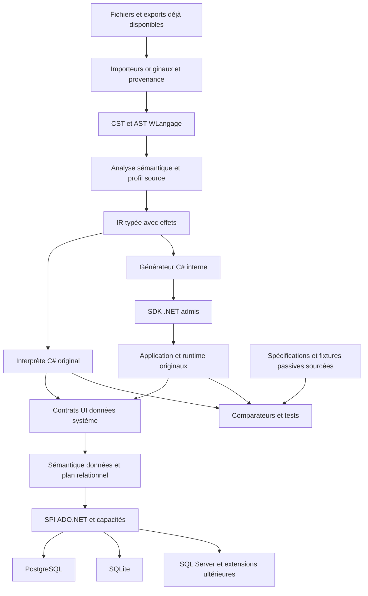

# Architecture C#, multi-BDD et procédure de réemploi

Date : **26 octobre 2026**. Ce chapitre définit une architecture originale à réaliser. Aucun compilateur, pilote, moteur de données, paquet réutilisé ou profil de compatibilité n'est admis, implémenté ou certifié par sa rédaction. Il complète les [principes d'architecture](05-architecture-cible.md), le [chapitre données](04-donnees-integrations-et-cibles.md) et le [périmètre indépendant](15-perimetre-independant-et-preuve-de-faisabilite.md).

## 1. Décisions de conception

La **base d'implémentation choisie est C#** : importeurs, frontend WLangage, analyse sémantique, IR, runtime, générateur, services de données et outillage. Le langage maintenu par l'utilisateur reste WLangage. Le C# produit pour une application constitue un artefact interne, jamais un fichier que le développeur doit corriger pour réussir la migration.

La cible est une version **.NET LTS encore supportée**, à sélectionner et épingler après admission de sa version exacte, du SDK, des workloads, du runtime et des composants distribués. Ce choix ne se réduit pas à un numéro de langage C#. La durée de support restante doit couvrir le pilote et sa maintenance ; une mise à jour de sécurité déclenche les contrôles concernés et la requalification des profils affectés. La [politique officielle .NET](https://dotnet.microsoft.com/en-us/platform/support/policy/dotnet-core) distingue support et niveau de correctifs requis. La famille .NET 10 LTS est le candidat initial du plan ; aucun patch exact ni droit d’usage n’est fixé par ce chapitre.

**Le multi-moteur est une exigence de conception.** Le premier gate utilise réellement **PostgreSQL et SQLite**, puis SQL Server devient la troisième cible. MariaDB, MySQL et Oracle restent des extensions facultatives, chacune avec son pilote, ses versions, ses capacités et son admission propres. Aucun de ces produits n'est autorisé à l'usage par sa seule présence dans ce document.

La contrainte actuelle demeure : **aucun outil, framework, DLL, SDK, pilote, serveur, service ou pont PC SOFT**, dans l'import, la construction, les tests ou l'application. Aucun oracle PC SOFT, même délégué à un client. Les entrées sont des fichiers, exports et preuves passives déjà disponibles, lus par du code indépendant. Un format opaque indispensable bloque l'élément concerné. La procédure d'[admission documentée](../data/admission-outils.json) s'applique aussi aux outils et dépendances non PC SOFT ; candidat ne signifie pas admis.

## 2. Séparer trois problèmes de données

| Notion | Ce qu'il faut réaliser | Ce qu'elle ne démontre pas |
| --- | --- | --- |
| Plusieurs connexions ou bases | Une application ouvre plusieurs bases logiques, avec sessions et transactions distinctes | La prise en charge de moteurs SQL différents |
| Plusieurs moteurs | Le même sous-ensemble WLangage fonctionne sur PostgreSQL et SQLite, puis sur d'autres fournisseurs | L'équivalence de toutes leurs transactions, types, collations et fonctions |
| Multi-tenant | Les données et droits de chaque client/contexte sont isolés | La portabilité SQL ou l'atomicité d'une opération couvrant plusieurs tenants |

Le runtime doit représenter une **base logique** par identifiant, un moteur par identifiant/version, et une session par contexte d'exécution. Le tenant éventuel est un autre attribut contrôlé. Ne pas confondre nom de table, nom de base, schéma SQL et tenant dans une même chaîne.

Le premier pilote peut rester mono-tenant tout en passant le gate multi-moteur. La qualification multi-tenant viendra avec ses propres tests d'isolation ; elle ne doit pas être annoncée parce qu'un dictionnaire contient plusieurs chaînes de connexion.

## 3. Modules et sens des dépendances

Organiser une solution C# modulaire, avec des processus séparés aux frontières utiles : CLI, serveur de langage, débogueur et prévisualisation. Les bibliothèques de syntaxe ou de valeurs restent sans accès réseau, disque métier ni référence à un moteur de données concret. Aucun ERP, ORM ou framework web n'est imposé au noyau.

Les namespaces ci-dessous sont des **propositions originales**, à adapter au nom final du projet.

| Modules proposés | Responsabilité | Dépendances permises |
| --- | --- | --- |
| `Compatibility.ProjectModel`, `Compatibility.Import` | Provenance, profils, éléments et import non destructif des fichiers reçus | Contrats de formats et diagnostics ; aucun exécutable d'origine |
| `Compatibility.Language.Syntax`, `.Semantics` | Tokens/CST/AST, symboles, types, résolution FR/EN, diagnostics | Modèle de projet, contrats du langage ; aucun fournisseur SQL concret |
| `Compatibility.IR` | Opérations typées, références, ordre d'évaluation et effets | Types de contrat et positions source |
| `Compatibility.Runtime.Values`, `.Execution`, `.Library` | Valeurs WLangage, contextes, erreurs, ordonnancement et fonctions originales | IR/contrats ; accès externes via interfaces |
| `Compatibility.CodeGen.CSharp` | Génération interne et correspondances source | IR stabilisée et contrats du runtime |
| `Compatibility.Data.Contracts`, `.Semantics`, `.Relational` | Modèle logique, contrats H*/SQL, curseurs, plans relationnels | Valeurs et contrats ; pas de pilote concret dans la sémantique |
| `Compatibility.Data.Providers.PostgreSql`, `.Sqlite` | Connexions, dialecte, liaisons de types, erreurs et migrations propres au moteur | Contrats de données, ADO.NET et pilote admis |
| `Compatibility.UI.Model`, `.Windows` | Champs, propriétés, événements et premier renderer | Contrats UI/runtime ; aucun accès SQL direct des contrôles |
| `Compatibility.Tools.LanguageServer`, `.DebugAdapter`, `.Cli` | LSP, DAP, import/audit/build/test/package | Services publics du compilateur et du runtime |
| `Compatibility.IDE` | Atelier familier, concepteur et navigation | Contrats d'outillage ; prévisualisation de notre renderer isolée |

Les fournisseurs futurs ont chacun leur module. Aucun `using` d'un fournisseur PostgreSQL, SQLite ou SQL Server ne doit apparaître dans `Runtime.Values`, l'analyseur ou les contrats H*. Un test d'architecture vérifie cette règle et un cas négatif démontre qu'il détecte réellement sa violation.

Les changements transverses passent par des contrats versionnés. Une tâche d'agent doit pouvoir modifier un module et ses tests sans comprendre tous les moteurs. Les catégories d'un ERP ne sont pas recopiées systématiquement : un parseur n'a pas besoin d'une couche HTTP ou d'une entité métier pour chaque nœud.

## 4. De la source WLangage à l'application C#

La résolution d'un nom, le choix d'une conversion et le passage par référence sont décidés par le frontend WLangage. Ils ne sont pas abandonnés au compilateur C#. L'IR matérialise aussi les effets UI, données, fichiers et suspension. Le backend n'optimise un chemin qu'après vérification de son contrat.

Le runtime contient des valeurs propres aux règles de compatibilité : précision numérique, valeur vide, NULL, encodage, indices, cellules de référence, erreur et contexte. Utiliser directement `double`, `DateTime` ou une liste C# n'est acceptable que lorsque l'équivalence est établie pour le profil concerné.

L'interprète et le code généré consomment les mêmes contrats. Leur accord prouve une cohérence interne et facilite le diagnostic ; un défaut du runtime peut être partagé. Les attendus externes restent des règles publiques ou fixtures/traces déjà fournies, avec provenance et portée explicites. Aucun accord interne ne devient une preuve de parité générale avec WINDEV.

## 5. Trois couches de données, aucune obligation de modèle EF

### 5.1 Sémantique de compatibilité

Cette couche implémente les opérations observables : tampon courant, recherche exacte/générique, parcours ordonné, filtre, erreur, ajout/modification/suppression et contexte de transaction. Les fonctions H* et les anciennes familles SQL gardent des contrats distincts lorsqu'elles n'ont pas le même comportement.

Le modèle est issu de l'analyse ou des métadonnées déjà reçues : tables, rubriques, clés, relations et requêtes. Il n'impose pas de réécrire chaque fichier en classe métier C# ou en entité Entity Framework. Un ORM optionnel ne doit pas devenir un prérequis de migration ni décider des conversions ou de la durée de vie des curseurs.

### 5.2 Plan relationnel et dialecte

La sémantique produit un plan structuré, pas une chaîne SQL fabriquée partout. Le plan exprime projection, prédicats, paramètres typés, ordre total, limite, clé de reprise et effets d'écriture. Le générateur de dialecte choisit la syntaxe compatible avec le moteur/version.

Les valeurs sont paramétrées. Les identifiants proviennent d'un modèle validé et d'un mécanisme de citation propre au moteur ; ils ne sont pas des paramètres SQL ordinaires. Les requêtes sources sont conservées avec provenance. Une requête utilisant un dialecte spécifique peut rester liée à un moteur ou être refusée sur un autre ; « multi-BDD » ne promet pas la portabilité de tout SQL arbitraire.

### 5.3 Fournisseur ADO.NET

ADO.NET fournit notamment les abstractions `DbConnection`, `DbCommand`, `DbTransaction`, `DbParameter` et `DbDataReader`. Elles sont un socle de transport et d'exécution ; elles ne standardisent ni SQL, ni verrouillage, ni toutes les conversions. [Documentation Microsoft sur les objets des fournisseurs](https://learn.microsoft.com/en-us/dotnet/framework/data/adonet/data-providers).

La **SPI**, interface d'extension entre le moteur et ses fournisseurs, comporte les contrats originaux suivants :

| Contrat proposé | Entrées et sorties | Invariant |
| --- | --- | --- |
| `DatabaseProviderDescriptor` | Identifiant, version de contrat, moteurs/versions cibles et identifiant d'admission | Une implémentation ne s'enregistre pas anonymement |
| `DatabaseCapabilities` | Capacités qualifiées et limites par profil | Une capacité inconnue n'est pas annoncée disponible |
| `DatabaseSessionFactory` | Référence de base logique et contexte ; session ouverte | Résolution contrôlée des secrets ; isolation du contexte ; pas de singleton de connexion métier |
| `RelationalCommandCompiler` | Plan typé ; commande et paramètres | Pas d'interpolation des valeurs ; identifiants validés |
| `StorageTypeMapping` | Type source, précision, valeur ; type/valeur du pilote | Aucun arrondi, NULL ou encodage modifié silencieusement |
| `DatabaseErrorTranslator` | Erreur structurée fournisseur ; catégorie canonique et détail préservé | Pas d'analyse fragile du texte localisé comme seul mécanisme |
| `SchemaMigrationAdapter` | Plan de schéma versionné ; commandes et préconditions | Aucune modification appliquée pendant la simple lecture d'un projet |

Ces noms décrivent des responsabilités, pas un SDK déjà livré. La signature finale sera stabilisée par de petites tâches de contrats, puis utilisée par des implémentations indépendantes. L'appelant ne reçoit pas un objet fournisseur dans une valeur WLangage.

## 6. Matrice de capacités et limites assumées

Chaque capacité porte : moteur/version, pilote/version, statut `non testé`, `natif qualifié`, `émulé qualifié avec limites` ou `indisponible`, cas exécutés, preuves et limites. Les tableaux suivants fixent les **points de qualification**, pas des résultats acquis.

| Capacité | PostgreSQL : voie à qualifier | SQLite : voie à qualifier | Décision de compatibilité |
| --- | --- | --- | --- |
| Lecture et écriture paramétrées | Pilote dédié admis | Pilote dédié et bibliothèque native admis | Même contrat de paramètres, erreurs et valeurs |
| Décimaux exacts | Liaison vers stockage numérique approprié | Représentation exacte à définir selon précision/plage | Refus si le profil ne tient pas dans la représentation choisie ; jamais de repli monétaire silencieux en réel |
| NULL, vide, zéro | Types et contraintes du modèle | Affinités et contraintes à contrôler | Cas séparés à la lecture, écriture et comparaison |
| Identifiants générés | Stratégie propre au moteur | Stratégie propre au moteur | Résultat retourné explicitement à la session |
| Verrou d'enregistrement | Contrat et durée à préciser | Pas d'équivalence présumée au verrou d'une ligne serveur | Émulation uniquement si effets et limites sont acceptables ; sinon profil bloqué |
| Concurrence d'écriture | Transactions concurrentes à qualifier | Écriture concurrente limitée | Tester attentes, délais, annulation et erreurs |
| Savepoints et isolation | Niveaux et transitions qualifiés | Transactions/savepoints et modes propres | Aucun nom de niveau commun ne vaut preuve d'effet identique |
| Annulation et asynchronisme | Comportement du pilote et du serveur mesuré | Comportement spécifique du pilote | L'API async ne garantit pas une E/S asynchrone |
| Espaces de noms et DDL | Schémas et migrations du moteur | Organisation physique différente | Mapping explicite ; pas de dépendance universelle à `schema.table` |
| Tri, casse, accents et clés composées | Collations et version consignées | Collations disponibles et règles consignées | Les mêmes clés doivent donner l'ordre contractuel, ou un écart explicite |

SQLite documente une seule transaction d'écriture simultanée, même si plusieurs lectures peuvent coexister ; cela impose un scénario de contention propre. [Transactions SQLite](https://www.sqlite.org/lang_transaction.html). Microsoft documente aussi l'exécution synchrone des méthodes ADO.NET async de `Microsoft.Data.Sqlite` : une façade uniforme ne doit pas masquer cette limite. [Limites async du pilote](https://learn.microsoft.com/en-us/dotnet/standard/data/sqlite/async).

Pour les erreurs, conserver le code moteur et traduire vers les catégories de notre contrat. PostgreSQL recommande d'utiliser les codes SQLSTATE plutôt que les textes localisés. Le code historique WLangage n'est reproduit que lorsque sa correspondance est documentée pour le profil ; sinon il reste non qualifié. [Codes d'erreur PostgreSQL](https://www.postgresql.org/docs/current/errcodes-appendix.html).

## 7. Transactions, schéma et plusieurs bases

Une transaction de compatibilité appartient à une session et à une connexion, avec moteur et isolation connus. Toutes les opérations qui en font partie doivent employer cette même transaction. Ouvrir une connexion indépendante par opération détruirait l'atomicité.

Ne pas imposer au patrimoine source les frontières d'un ERP moderne : une transaction couvrant plusieurs tables du projet ne devient pas automatiquement plusieurs transactions par module. De même, une relation ou jointure valide dans le modèle source n'est pas supprimée pour satisfaire une convention de rangement des nouveaux packages.

Le premier périmètre multi-moteur garantit les transactions **dans une seule base/moteur à la fois**. Une transaction atomique traversant deux moteurs est un besoin distinct, non pris en charge implicitement. Si le source l'exige, produire un blocage précis ou une évolution de spécification explicite. Une saga ou une outbox peut servir un nouveau processus, mais ne remplace pas silencieusement un engagement ACID existant.

Séparer le schéma de fonctionnement de notre plateforme du modèle de données des applications importées. Les migrations de la plateforme, celles d'une application et celles de chaque moteur ont des catalogues identifiés et des préconditions propres. Une migration possède un identifiant stable, un checksum, une version attendue, une cible et une stratégie de reprise. Tester crash et reprise partielle ; ne pas présumer que toute commande DDL est annulable de la même façon.

La restauration et le retour arrière concernent notre chaîne autonome et ses données. Aucun retour ou contrôle n'appelle un moteur, installateur ou service PC SOFT.

## 8. Trois gates successives du multi-moteur réel

Une interface implémentée par deux classes ne suffit pas. La preuve avance en trois étapes, sur **PostgreSQL réel et SQLite réel** :

| Gate | Périmètre positif annoncé | Ce qu’elle ne valide pas encore |
| --- | --- | --- |
| `G-B08` | Providers C# V0 : schéma scalaire borné, paramètres, valeurs exactes, erreurs et cycle transactionnel | Fonctions H*, sources WLangage de gestion et migration complète |
| `G-B09` | Sous-ensemble H* original et même source WLangage de gestion sur les deux moteurs | Toute surcharge H*, tous verrous historiques ou tous formats source |
| `G-B10` | Chargement logique, marqueurs de reprise, réconciliation et restauration du V0 | Lecture de fichiers HFSQL opaques, réplication ou sauvegarde à chaud non qualifiées |

Aucune branche conditionnelle ajoutée au code métier importé ne doit masquer une différence de fournisseur. Les cas ci-dessous sont répartis entre ces gates ; ils ne sont pas tous prérequis au premier provider de B08.

Le lot de qualification couvre au minimum :

1. Création du schéma, paramètres, insertion, lecture, modification et suppression.
2. Valeurs NULL/vides/zéro, Unicode et valeurs monétaires limites de V0. Dates, buffers ou autres types demandent des tickets et preuves propres avant support.
3. Clés simples V0, doublons, ordre déterministe, recherche et fin de parcours. Les clés composées demandent des sous-tickets et preuves supplémentaires avant annonce de support.
4. Tampon courant et filtre après mutation ; annulation d'un parcours.
5. Commit, rollback, erreur de contrainte, connexion interrompue et arrêt pendant transaction.
6. Deux sessions concurrentes, conflit d'écriture et état final ; tester SQLite sur fichier temporaire, pas seulement une base mémoire attachée à une unique connexion.
7. Codes d'erreur canoniques et détails conservés ; délai, annulation et libération des ressources.
8. Migration du schéma, échec intermédiaire et reprise ; données vérifiées après redémarrage.

Publier cas requis, exécutés, échoués, inconnus et non applicables justifiés. Exiger tous les cas nécessaires au contrat annoncé, zéro divergence métier critique, zéro capacité affirmée sans preuve et zéro logiciel PC SOFT détecté. Les outils, pilotes, binaires natifs et images de test doivent avoir leur admission par usage. Un test ignoré ou un moteur non lancé ne passe pas le gate.

Les preuves comprennent versions/empreintes, profil, source WLangage, schéma, jeux, commandes exécutées, résultats, logs expurgés et origine des attendus. Ce gate démontre un sous-ensemble multi-moteur de notre implémentation ; il ne certifie pas la totalité des comportements historiques de WINDEV.

## 9. Extension aux autres moteurs

| Ordre proposé | Travail supplémentaire | Gate avant annonce de support |
| --- | --- | --- |
| PostgreSQL + SQLite | SPI, deux dialectes, types, transactions et suite commune | Gate initial complet sur les deux moteurs |
| SQL Server | Fournisseur, dialecte, identifiants, erreurs, isolation, migrations et pilote admis | Même suite, scénarios spécifiques et régression des deux premiers moteurs |
| MariaDB / MySQL | Qualification séparée des moteurs et versions, types, collations et SQL | Ne pas déduire le support de l'un du succès de l'autre |
| Oracle | Fournisseur et conditions exactes, types, chaînes, identifiants, transactions et migrations | Suite commune plus différences propres au profil, sans fonctionnalités simulées annoncées natives |

Les identifiants de fournisseurs peuvent être prévus tôt ; leurs capacités restent indisponibles tant que les implémentations et preuves manquent. L'extension n'exige pas une réécriture du compilateur, mais peut révéler qu'une opération IR ou un contrat de données est trop spécifique. Modifier alors le contrat avec tests de régression, plutôt qu'ajouter des tests de nom de moteur dans toutes les fonctions WLangage.

## 10. Organisation compatible avec des tâches d'agents IA

Chaque tâche doit livrer un résultat local : un contrat, une opération IR, un convertisseur de type, une règle de dialecte ou un scénario de données. Son dossier contient entrées, fichiers autorisés, dépendances de tâches, comportement attendu, cas d'erreur, commande de vérification et artefact de preuve.

Pour les travaux parallèles, séparer propriétaire du contrat et propriétaire de chaque fournisseur. Une modification de SPI invalide les tâches consommatrices jusqu'à mise à jour explicite. Les agents ne changent pas simultanément signatures partagées, schémas et deux fournisseurs sans une tâche d'intégration identifiable.

À la fin de chaque bloc : construire la solution pertinente, exécuter tests ciblés et négatifs, contrôler frontières/admission/exclusion, puis rejouer la tranche verticale concernée. Une mutation volontaire doit montrer que le gate détecte une conversion erronée, une dépendance interdite ou un moteur manquant. L'absence de verdict, une suite vide ou un contrôle non exécuté reste un échec de preuve.

La granularité du plan doit permettre reprise par un autre agent : contrat stabilisé, diff borné, tests reproductibles et incertitudes explicites. La multiplication des fichiers ou classes ne suffit pas à rendre une tâche petite.

## 11. Inspiration Liakern et options de réemploi

L'utilisateur a nommé **Liakern** comme inspiration. Ce chapitre propose une architecture originale générique ; il ne publie aucun code, chemin, commit ou contenu interne d'un dépôt privé. Les constats privés éventuels restent hors du dépôt public. L'accès à un dépôt, y compris avec des droits d'administration, n'établit aucun droit de réemploi, de divulgation ou de relicenciement.

Trois voies peuvent être évaluées, sans admission acquise :

- **Conception originale** : reprendre les besoins et principes généraux pertinents, rédiger des contrats propres à la plateforme et écrire leur implémentation et leurs tests.
- **Consommation d'un composant existant** : délimiter le paquet, sa version et ses actes d'usage ; vérifier droits, dépendances transitives, obligations et compatibilité avec la cible avant toute incorporation.
- **Extraction ou adaptation ciblée** : identifier précisément les fichiers et titulaires, les contributions et autorisations, les parties tierces et la possibilité de distribution dans le support prévu ; documenter modifications et preuves. Aucun code privé ne passe dans un dépôt public sans droits de divulgation établis.

### Candidats à examiner avant de décider une récupération

Ce tableau décrit les **besoins et critères de sélection de notre plateforme**. Il ne certifie ni la présence, ni l’exécution, ni les droits d’un composant particulier du dépôt consulté. Les constats fichier par fichier restent dans la revue privée.

| Famille candidate | Usage possible ici | Adaptation ou refus à vérifier | Bloc |
| --- | --- | --- | --- |
| Contrats de modules et tests d’architecture | Empêcher le compilateur ou le runtime de dépendre d’un provider concret | Règles adaptées à un compilateur ; pas d’architecture ERP imposée au frontend | B01 |
| Configuration et références de secrets | Séparer projet versionné, réglages locaux et identifiants sensibles | Aucun secret ni convention privée importé ; rôle runtime distinct du host web | B01 / B17 |
| Fabriques de connexions et gestion de pools | Fournir une session nommée et libérer correctement ses ressources | Retirer tout couplage fournisseur du contrat ; deux moteurs réels ; limites/éviction de pools | B07 / B08 |
| Contexte tenant et transaction | Isoler état, données et identité par exécution | Multi-tenant distinct du multi-moteur ; aucune réduction de l’atomicité des sources | B07 / B17 |
| Catalogues et suivi de migrations | Identifier cible, version, préconditions et reprise | DDL différent selon moteur ; marqueur atomique ; restore prouvé avant repli | B10 |
| Contrats d’orchestration et journaux | Suivre tentatives, preuves, intégration et reprise | État absent non assimilé à terminé ; preuve du SHA final ; implémentation originale ou composant admis | B01 |

Pour chacun, le premier ticket de réemploi reste petit : examiner un artefact exact et ses dépendances, conclure « adapté », « à modifier », « à réécrire » ou « refusé », avec droits établis pour l’acte suivant. Ce diagnostic ne déclenche pas une extraction globale. Une réimplémentation originale répondant au même besoin permet de continuer lorsqu’aucune récupération n’est admise.

Pour chaque candidat : fiche d'admission artefact/version/empreinte + usage/contexte, textes de droit applicables, obligations et satisfaction, réglementation pertinente ou non-applicabilité motivée, décision datée et déclencheurs de réexamen. Doute, permission absente ou obligation non remplie bloque l'acte concerné. Une déclaration générale de conformité dans un autre projet n'est pas transférable au nôtre.

Un prototype entièrement original peut avancer sans avis juridique général automatique. L'admission des outils et matériaux tiers reste précise et documentée. La contrainte d'exclusion PC SOFT demeure prioritaire ; ni une inspiration ni une possibilité théorique de licence ne la lève.
