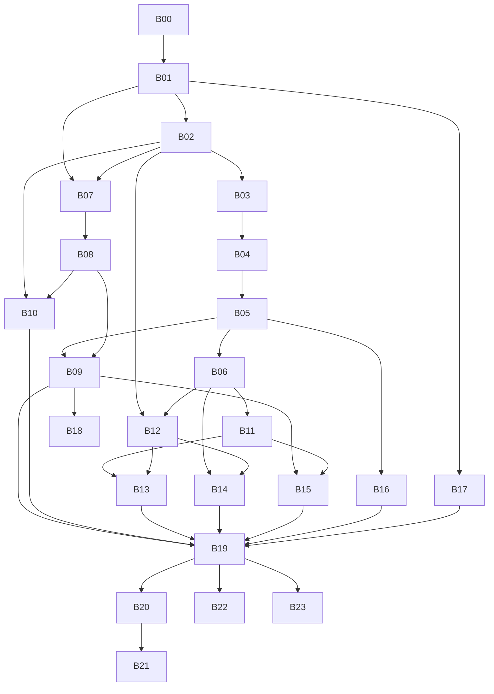

# Plan de réalisation pour agents IA

**Plan proposé, non exécuté.** Base C#, applications maintenues en WLangage, PostgreSQL + SQLite d’abord. Aucun outil ni composant PC SOFT.

**24 blocs, 255 tâches explicites, 24 gates et 519 exigences parents rattachées.** Les exigences parents ne sont pas des tickets exécutables : les extensions demandent une décomposition complémentaire. Les tickets ci-dessous bornent le socle et organisent cet élargissement.

Sources : [plan JSON](../data/plan-realisation.json), [backlog CSV](../data/taches-agents.csv), [rattachement des exigences](../data/exigences-blocs.csv). [Agenda des parents à décomposer](../data/extensions-a-decomposer.csv). [Guide de réalisation](../docs/16-plan-detaille-de-realisation.md), [orchestration](../docs/17-orchestration-agents-et-gates.md), [architecture C# / multi-BDD](../docs/18-architecture-csharp-multi-bdd-et-reemploi.md).

Une tâche vise 2–6 heures de travail d’agent comme budget à réviser. Dès que le périmètre n’est plus borné, la tâche est suspendue puis redécoupée ; le temps écoulé ne valide rien. Revue et intégration sont distinctes.

| Bloc | Livrable | Tâches | Gate | Prérequis de blocs | Exigences parents |
| --- | --- | ---: | --- | --- | ---: |
| [B00](blocs/B00.md) | Admission des outils, des entrées et du réemploi | 9 | G-B00 | aucun | 4 |
| [B01](blocs/B01.md) | Socle C# et orchestration vérifiable | 11 | G-B01 | B00 | 7 |
| [B02](blocs/B02.md) | Corpus synthétique et import sans perte | 10 | G-B02 | B01 | 24 |
| [B03](blocs/B03.md) | Lexer, CST et parseur incrémental | 11 | G-B03 | B02 | 3 |
| [B04](blocs/B04.md) | Types, valeurs et profils sémantiques | 10 | G-B04 | B03 | 29 |
| [B05](blocs/B05.md) | Procédures, alias et runtime de base | 11 | G-B05 | B04 | 11 |
| [B06](blocs/B06.md) | Backend C# et première preuve console | 10 | G-B06 | B05 | 3 |
| [B07](blocs/B07.md) | Contrats multi-BDD et schéma logique | 10 | G-B07 | B01, B02 | 17 |
| [B08](blocs/B08.md) | PostgreSQL et SQLite réellement exécutés | 11 | G-B08 | B07 | 2 |
| [B09](blocs/B09.md) | Couche sémantique H* originale | 12 | G-B09 | B05, B08 | 21 |
| [B10](blocs/B10.md) | Migration logique et reprise des données | 10 | G-B10 | B02, B08 | 8 |
| [B11](blocs/B11.md) | Runtime UI Windows et événements | 11 | G-B11 | B06 | 57 |
| [B12](blocs/B12.md) | Atelier RAD et parcours développeur | 11 | G-B12 | B02, B06 | 13 |
| [B13](blocs/B13.md) | Designer et premières métadonnées visuelles | 11 | G-B13 | B11, B12 | 25 |
| [B14](blocs/B14.md) | Services de langage et débogage WLangage | 10 | G-B14 | B06, B12 | 17 |
| [B15](blocs/B15.md) | États et documents sans moteur propriétaire | 10 | G-B15 | B09, B11 | 24 |
| [B16](blocs/B16.md) | Bibliothèque standard et intégrations prioritaires | 10 | G-B16 | B05 | 62 |
| [B17](blocs/B17.md) | Sécurité et exploitation minimales | 10 | G-B17 | B01 | 46 |
| [B18](blocs/B18.md) | Troisième moteur et extensions SQL conditionnelles | 10 | G-B18 | B09 | 12 |
| [B19](blocs/B19.md) | Pilote Windows et livraison reproductible | 11 | G-B19 | B09, B10, B13, B14, B15, B16, B17 | 15 |
| [B20](blocs/B20.md) | Services et web par tranches verticales | 10 | G-B20 | B19 | 24 |
| [B21](blocs/B21.md) | Mobile et fonctionnement hors ligne | 11 | G-B21 | B20 | 24 |
| [B22](blocs/B22.md) | Longue traîne API, champs et formats | 11 | G-B22 | B19 | 56 |
| [B23](blocs/B23.md) | Maintenance, collaboration et évolution | 14 | G-B23 | B19 | 15 |

## Lecture des dépendances

Une flèche indique une gate requise, pas seulement la présence d’un document. La représentation exacte est le JSON ; chaque fiche rappelle ses prérequis.

Fichier généré par `python3 tools/build_execution_plan.py`. Modifier le JSON et la cartographie, puis régénérer.
